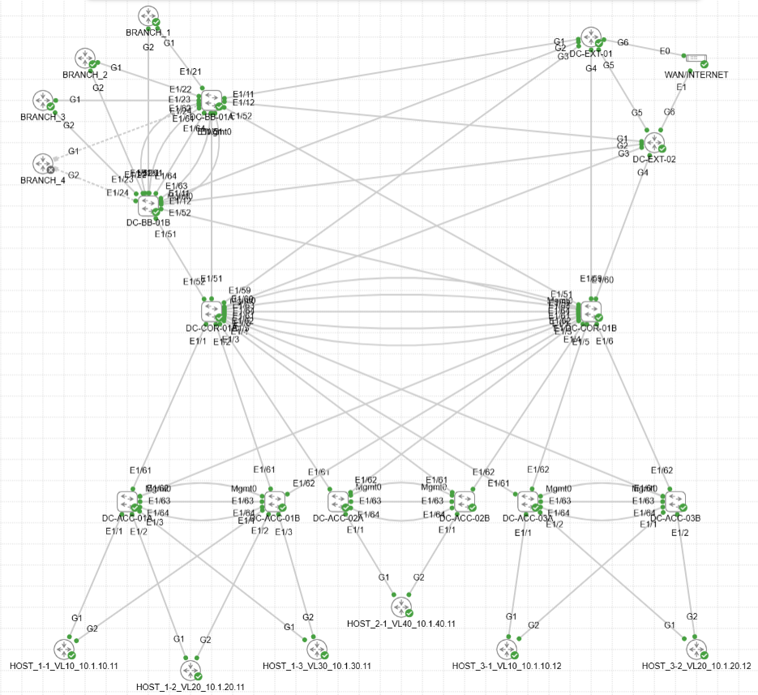
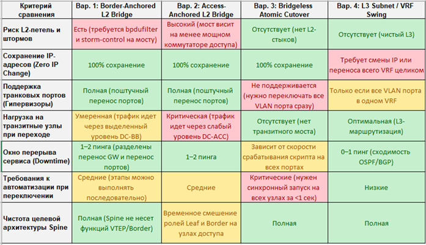
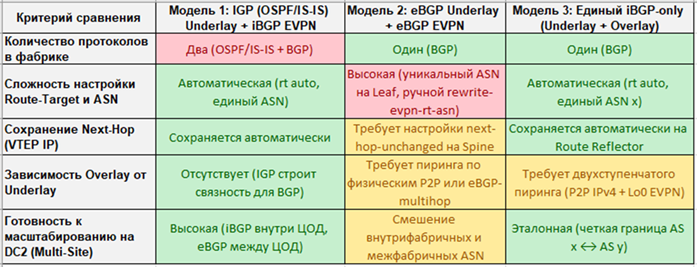

# Проектная работа
## Тема:
## Бесшовная миграция инфраструктуры действующего ЦОД с технологии vPС на технологию VXLAN
## Цели работы:
Разработка и экспериментальная верификация методики бесшовной миграции сетевой инфраструктуры действующего центра обработки данных с классической архитектуры vPC/HSRP на фабрику VXLAN EVPN на существующем оборудовании с сохранением строгой изоляции VRF и маршрутизацией всего межсегментного трафика исключительно через межсетевые экраны периметра без прерывания работы пользовательских сервисов.

### Для достижения поставленной цели в работе решаются следующие задачи:
* Провести сравнительный анализ существующих подходов и вариаций миграции действующих сетей ЦОД на архитектуру VXLAN EVPN по техническим, эксплуатационным и экономическим критериям.
* Спроектировать целевую архитектуру фабрики Spine–Leaf, обеспечивающую оптимальную маршрутизацию внутри каждого VRF и направление всего Inter-VRF трафика через пограничные узлы (Border Leaf) на межсетевые экраны (DC-EXT).
* Разработать пошаговый алгоритм бесшовной миграции инфраструктуры с использованием временного межсетевого моста и регламента быстрого аварийного отката (Rollback).
* Развернуть имитационную модель в среде Cisco Modeling Labs (CML) и провести экспериментальную проверку сходимости протоколов, потерь пакетов, отказоустойчивости и корректности прохождения трафика через зоны безопасности межсетевых экранов.

 ## Оглавление:
1. [Текущая архитектура сети на Day 0](#1-текущая-архитектура-сети-на-day-0)
2. [Сборка лабораторного стенда Day0. Принятые ограничения и допущения](#2-сборка-лабораторного-стенда-day0-принятые-ограничения-и-допущения)
3. [Аналитический обзор и выбор методологии бесшовной миграции инфраструктуры ЦОД на архитектуру VXLAN EVPN](#3-аналитический-обзор-и-выбор-методологии-бесшовной-миграции-инфраструктуры-цод-на-архитектуру-vxlan-evpn)
4. [Проектирование целевой архитектуры фабрики VXLAN EVPN](#4-проектирование-целевой-архитектуры-фабрики-vxlan-evpn)
5. [Методика бесшовной миграции, автоматизация и управление рисками](#5-методика-бесшовной-миграции-автоматизация-и-управление-рисками)
6. [Экспериментальная верификация и моделирование бесшовной миграции](#6-экспериментальная-верификация-и-моделирование-бесшовной-миграции)
7. [Заключение](#7-заключение)
8. [Приложение 1. Изначальные конфигурации сетевого оборудования в лабораторном стенде](#8-приложение-1-изначальные-конфигурации-сетевого-оборудования-в-лабораторном-стенде)
9. [Приложение 2. Поэтапные конфигурации CLI сетевого оборудования](#9-приложение-2-поэтапные-конфигурации-cli-сетевого-оборудования)
10. [Приложение 3. Вывод команд диагностики в процессе выполнения работы](#10-приложение-3-вывод-команд-диагностики-в-процессе-выполнения-работы)
11. [Презентация](#11-презентация)

## 1. Текущая архитектура сети на Day 0

    Текущая архитектура сети представляет собой классическую иерархическую корпоративную Legacy-архитектуру с разделением на уровни маршрутизации (L3) и коммутации (L2), а также полным резервированием всех критически важных узлов.
#### Основные уровни и элементы схемы:
**Внешний периметр и выход в Интернет (DC-EXT-01, DC-EXT-02)** – Ферма межсетевых экранов, состоящая из HA-пар, обеспечивающих подключение сети к внешнему сегменту сети и сети Интернет (EXT/INTERNET).

**Домен маршрутизации (OSPF DOMAIN based on VRF's)** - Уровень L3, на котором работает протокол динамической маршрутизации OSPF. Использование технологии VRF (Virtual Routing and Forwarding) позволяет логически изолировать трафик разных логических сегментов ЦОДа с терминированием на МСЭ, а также организовать корпоративный сегмент как для подключения удаленных площадок так и серверов корпоративного сегмента внутри единой физической инфраструктуры.

**Магистральный уровень (DC-BB-01A/B)** - Пара коммутаторов (Backbone/Distribution), агрегирующих трафик от филиалов и пограничных маршрутизаторов перед передачей его в ядро ЦОД (в рамках VRF CORP) либо в сторону Интернет-каналов через МСЭ.

**Филиальная сеть (BRANCH_1, BRANCH_n)** - Маршрутизаторы удаленных офисов и филиалов, которые подключаются к магистральным узлам ЦОД.

**Ядро сети (DC-COR-01A/B)** - Высокопроизводительные отказоустойчивые коммутаторы ядра (объединенные в кластер по технологии Cisco vPС) служат центральной точкой связности между уровнем маршрутизации (L3) и серверным сегментом (L2).

**Уровень доступа (DC-ACC-0xA/B)** - Парные коммутаторы доступа (типа Top-of-Rack, объединенные в кластер по технологии Cisco vPС), к которым напрямую подключаются Cервера (SERVERS). Каждый сервер имеет двойное подключение (к коммутаторам A и B) для защиты от сбоев с агрегацией по протоколу LACP.

## 2. Сборка лабораторного стенда Day0. Принятые ограничения и допущения
В качестве системы эмуляции лабораторного стенда была использована среда Cisco Modeling Labs (CML) версии 2.9.  

Ниже представлена собранная архитектура сети на Day0. 


В качестве устройств с ролями COR, BB, ACC был использован виртуальный образ Cisco NX-OS 9300v под управлением NX-OS версии 10.5.3.F

В качестве устройств с ролями BRANCH и EXT был использован виртуальный образ Cisco Catalyst 8000v под управлением IOS-XE версии 17.16.01a. В качестве конечных хостов (HOST) первоначально использовался образ Catalyst 8000v, который на этапе восстановления двуплечевой агрегации (Этап 3) был заменён на L2-коммутаторы Cisco IOSvL2 для исключения программного дефекта драйвера Broadcom SDK в виртуальном NX-OS 10.5(3).

Все изначальные конфигурации приложены к проекту Приложении №1.

Принятые допущения и ограничения (не влияющие на результат):
* Вместо серверов в качестве конечных хостов (HOST) использовались виртуальные маршрутизаторы с протоколом агрегации LACP до вышестоящих узлов.
* Вместо межсетевых экранов (EXT) с разделением по зонам безопасности (Security Zones) использовались виртуальные маршрутизаторы с протоколом агрегации LACP до узлов COR и BB. 
* Маршрут по умолчанию отсутствует в сети, т.к. рассмотрение его распространения не является одной из задач работы.

## 3. Аналитический обзор и выбор методологии бесшовной миграции инфраструктуры ЦОД на архитектуру VXLAN EVPN

### Классификация и сравнительный анализ подходов к миграции действующего ЦОД

Переход от классической трехуровневой или двухуровневой сетевой архитектуры, построенной на базе протоколов агрегации каналов (vPC / MLAG) и резервирования шлюзов по умолчанию (HSRP / VRRP), к фабрике VXLAN EVPN является одной из наиболее сложных задач сетевой инженерии. Основная трудность заключается в необходимости обеспечения непрерывности бизнес-процессов (Zero-Downtime Migration) при одновременной смене парадигмы коммутации и маршрутизации: переходе от централизованной L3-маршрутизации на уровне ядра к распределенному шлюзу (Distributed Anycast Gateway) на уровне доступа.

В современной индустрии сетевых технологий выделяют пять фундаментальных подходов к проведению подобной миграции:

#### Поочередная миграция по плечам на существующем оборудовании (In-Place A/B Split Migration).
Метод основывается на использовании штатной избыточности отказоустойчивых подключений серверов (Dual-Homed LACP) и сетевых узлов без закупки дополнительного оборудования. Сетевая инфраструктура логически разделяется на два независимых контура (плечо А и плечо Б). Весь продуктивный трафик принудительно направляется через плечо А, в то время как плечо Б выводится из эксплуатации, перенастраивается в топологию Spine–Leaf (VXLAN EVPN) и связывается со старым ядром временным L2-мостом с фильтрацией протокола Spanning Tree (bpdufilter). После переключения шлюзов по умолчанию (с HSRP на Anycast Gateway) и миграции клиентских портов на плечо Б аналогичным образом перестраивается плечо А.

#### Параллельное построение новой фабрики (Greenfield Side-by-Side / Swing Migration).
Подход предполагает развертывание изолированной фабрики VXLAN EVPN с нуля на новом парке оборудования рядом с действующей сетью. Между старым ядром и пограничными узлами новой фабрики (Border Leaf) организуется межфабричный шлюз (DCI / Migration Border). Перенос нагрузки осуществляется путем физической перекоммутации кабелей серверов либо с помощью живой миграции виртуальных машин (vMotion) с сохранением IP-адресации через растянутые L2-сегменты.

#### Инкрементальная гибридная миграция (Hybrid Pod-by-Pod Migration).
Компромиссный метод, при котором новое оборудование закупается только для уровня ядра (Spine) и одной буферной стойки (Pod). Существующие коммутаторы доступа выводятся из классической сети по одной паре, перенастраиваются в роль Leaf и включаются в новую фабрику. На протяжении всего переходного периода старое ядро и новые Spine-коммутаторы взаимодействуют через межфабричный L2/L3-шлюз.

#### Поэтапная модернизация с заменой только уровня ядра (Core-to-Spine / Lift-and-Shift).
При данном подходе в фабрику VXLAN EVPN переводится исключительно уровень ядра и агрегации, тогда как коммутаторы доступа временно сохраняют конфигурацию классического L2 vPC и подключаются к новым Leaf-узлам в качестве обычных транковых портов. Перенос шлюзов маршрутизации на уровень доступа откладывается на второй этап модернизации.

#### Программно-определяемый оверлей поверх существующей сети (Host-based Overlay / SDN).
Отказ от аппаратной реализации VXLAN EVPN на физических коммутаторах в пользу программного туннелирования на уровне гипервизоров серверов (например, VMware NSX или Open vSwitch). Физическая сеть упрощается до базового IP-транспорта (Underlay), а вся логика виртуальных сетей (VRF), инкапсуляции и распределенной маршрутизации выполняется силами центральных процессоров (CPU) серверов.
Для объективного выбора оптимальной стратегии проведен многокритериальный сравнительный анализ указанных подходов по двенадцати техническим, эксплуатационным и экономическим параметрам (Таблица ниже). Для наглядности оценки в таблице применена цветовая индикация: Зеленый — благоприятный показатель (низкие риски/затраты), Оранжевый — умеренный (требует компромиссов), Красный — критический (высокие риски/затраты).

### Обоснование выбора подхода
Анализ матрицы демонстрирует наличие жесткого антагонизма между капитальными затратами (CAPEX) и операционными рисками (OPEX):

Подход Greenfield Side-by-Side обладает наилучшими показателями безопасности и минимальным радиусом поражения, однако он неприменим в условиях действующего корпоративного ЦОД из-за необходимости 100% дублирования парка оборудования, дефицита свободных стойко-мест (юнитов), резервов электропитания и высокой трудоемкости физической перекоммутации кабельной системы.

Подход Host-based Overlay (SDN) не решает задачу подключения не-виртуализированных физических серверов (Bare Metal) и систем хранения данных (СХД) без приобретения дорогостоящих аппаратных шлюзов (Hardware VTEP Gateway), а также влечет за собой высокие расходы на лицензирование ПО и нагрузку на вычислительные ресурсы серверов.
Подход Core-to-Spine (Lift & Shift) является половинчатым решением: сохранение уровня доступа в режиме классического L2 vPC не устраняет проблему неоптимальной маршрутизации и требует проведения повторного цикла модернизации в будущем.

Подход Hybrid Pod-by-Pod требует закупки новых коммутаторов ядра (Spine) и буферной стойки, а также обрекает сеть на длительную работу в гибридном режиме с двойным администрированием и повышенными задержками при обмене трафиком между мигрировавшими и старыми сегментами.

Таким образом, при наличии современного аппаратного парка коммутаторов уровня ядра и доступа (в частности, линейки Cisco Nexus 9000), поддерживающего аппаратную инкапсуляцию VXLAN, экономически и технически наиболее целесообразным является метод In-Place A/B Split Migration. Он позволяет получить полноценную фабрику VXLAN EVPN за минимальное время без закупки нового оборудования и без вмешательства в настройки серверного стека.


### Детальный анализ вариаций реализации метода In-Place A/B Split Migration
В инженерной практике метод In-Place A/B Split Migration имеет четыре основные модификации, различающиеся архитектурой межсетевого стыка (Interconnect) в переходный период и способом синхронизации шлюзов по умолчанию:

#### Поэтапная миграция с L2-мостом на пограничном уровне (Border-Anchored L2 Bridge).
Функции взаимодействия с внешними сетями (L3 Out) и роль временного L2-моста между старым контуром (DC-COR) и новой фабрикой концентрируются на выделенных пограничных коммутаторах (DC-BB / Border Leaf). Внешние стыки заранее переводятся на DC-BB, после чего между старым ядром плеча А и Border Leaf плеча Б поднимается временный L2-транк с включенной фильтрацией BPDU (spanning-tree bpdufilter enable). Это позволяет разделить во времени два критических события: переключение L3-шлюзов (с HSRP на Distributed Anycast Gateway) и последующее плавное переключение физических портов серверов с плеча А на плечо Б.

#### Миграция с L2-мостом непосредственно на уровне доступа (Access-Anchored L2 Bridge).
Применяется в двухуровневых топологиях (Core–Access), где отсутствует выделенный уровень Backbone. Поскольку коммутаторы Spine в архитектуре VXLAN EVPN не могут выступать конечными точками туннелей (VTEP), временный L2-мост организуется между старым коммутатором ядра и одним из первых переведенных коммутаторов доступа (Leaf), который временно берет на себя функции пограничного маршрутизатора.

#### Безмостовая миграция с атомарным переворотом сегментов (Bridgeless Atomic Cutover).
Вариация, полностью исключающая организацию каких-либо L2-связей между старой и новой сетями. В технологическое окно средства автоматизации синхронно (за доли секунды) отключают HSRP-шлюзы и все порты доступа конкретного VLAN на плече А, одновременно активируя Anycast Gateway и порты доступа на плече Б.

#### Гибридная L3-миграция с переключением подсетей или VRF (L3 Subnet / VRF Swing).
Старый и новый контуры связываются исключительно на сетевом уровне (L3) по протоколам динамической маршрутизации (OSPF / BGP). Миграция осуществляется путем переноса изолированных доменов маршрутизации (VRF) целиком либо за счет выделения серверам новых IP-подсетей при переключении на плечо Б.

Сравнительная оценка данных вариаций по семи ключевым критериям приведена в Таблице ниже.


На основании проведенного анализа для практической реализации в рамках данной работы выбрана Вариация 1 метода In-Place A/B Split Migration (Border-Anchored L2 Bridge) по следующим причинам:
* **Неизменность адресного пространства:** Наличие временного L2-моста между ядром и пограничными узлами гарантирует сохранение связности внутри растянутых L2-сегментов без необходимости изменения IP-адресов конечных хостов (в отличие от Вариации 4).
* **Поддержка серверной виртуализации:** В отличие от безмостового переворота (Вариация 3), выбранный алгоритм позволяет мигрировать транковые порты серверов поэтапно, исключая риск длительного простоя при массовом переключении сотен интерфейсов.
* **Защита уровня доступа от перегрузок:** Использование выделенных пограничных коммутаторов (будущих Border Leaf) для организации временного L2-моста и терминации внешних каналов избавляет коммутаторы доступа от транзитного межфабричного трафика (в отличие от Вариации 2).
* **Нейтрализация эксплуатационных рисков:** Присущие методу риски возникновения петель коммутации на временном мосту и деградации резервирования компенсируются строгой регламентацией этапов (Этапы 0–4), принудительной фильтрацией BPDU (spanning-tree bpdufilter enable), предварительной валидацией конфигураций и сохранением настроек резервного плеча в состоянии shutdown для обеспечения быстрого отката (Rollback).

## 4. Проектирование целевой архитектуры фабрики VXLAN EVPN

### Топология Spine–Leaf и распределение ролей оборудования
Целевая архитектура модернизируемого центра обработки данных (ЦОД) строится на базе неблокируемой двухуровневой фабрики Clos (Spine–Leaf). Переход выполняется путем программно-логического перепрофилирования действующего парка коммутаторов Cisco Nexus без изменения физической кабельной инфраструктуры (СКС) магистрального уровня.

Распределение функциональных ролей между узлами фабрики организовано следующим образом:
* **Уровень ядра маршрутизации (Spine Layer — DC-COR-01A, DC-COR-01B).** Бывшие коммутаторы классического ядра переводятся в режим высокоскоростного L3-транзита и выполняют роль BGP Route Reflector для плоскости управления EVPN. Прямые межъядерные соединения (Po61 и vPC Peer-Link) полностью выводятся из эксплуатации, так как в топологии Clos коммутаторы Spine должны быть изолированы друг от друга. Также со Spine снимаются все внешние каналы связи и клиентские шлюзы.
* **Уровень доступа (Leaf Layer — DC-ACC-01A/B, DC-ACC-02A/B, DC-ACC-03A/B).** Коммутаторы доступа становятся граничными узлами туннелирования (VTEP — VXLAN Tunnel Endpoint). Каждый Leaf-коммутатор терминирует L2-сегменты серверов, инкапсулирует кадры Ethernet в пакеты VXLAN и выполняет функцию распределенного шлюза (Distributed Anycast Gateway).
* **Пограничный уровень (Border Leaf Layer — DC-BB-01A, DC-BB-01B).** Коммутаторы уровня Backbone консолидируют все стыки с межсетевыми экранами периметра (DC-EXT-01/02) и региональными филиалами (BRANCH_1–4) по всем четырем изолированным VRF.

Все магистральные линки между уровнями Spine и Leaf переводятся в режим чистого L3 (Point-to-Point /31) с увеличенным размером максимального передаваемого блока (MTU 9216 байт), что исключает фрагментацию пакетов при добавлении 50-байтного заголовка VXLAN.

### Выбор протоколов маршрутизации Underlay и Overlay
Для функционирования фабрики VXLAN EVPN необходимо спроектировать две логически независимые плоскости:

* **Underlay-сеть:** обеспечивает IP-связность между Loopback-интерфейсами всех коммутаторов фабрики и балансировку трафика по равнозначным маршрутам (ECMP).
* **Overlay-сеть:** отвечает за распространение информации о MAC-адресах, IP-адресах конечных хостов и префиксах VRF с использованием семейства адресов MP-BGP L2VPN EVPN (RFC 7432).
 
В современных сетях применяются три основные модели построения Control Plane фабрики, сравнение которых приведено в таблице ниже.



### Обоснование выбора модели iBGP-only

Для целевой архитектуры выбрана Модель 3 (единый iBGP для Underlay и Overlay в рамках автономной системы):
* **Отказ от IGP-протоколов внутри фабрики:** Использование единого протокола BGP для передачи как транспортных /32 Loopback-адресов (семейство ipv4 unicast), так и клиентских маршрутов EVPN (семейство l2vpn evpn) унифицирует эксплуатацию и диагностику сети.
* **Упрощение политик EVPN:** В отличие от схемы eBGP, где каждой паре Leaf назначается собственный номер автономной системы и требуется принудительная перезапись атрибутов Route-Target на каждом узле, единая AS 65001 позволяет использовать автоматическую генерацию идентификаторов (rd auto, route-target auto). Коммутаторы Spine выступают в роли Route Reflector и передают маршруты между Leaf с сохранением исходного адреса VTEP в качестве Next-Hop.
* **Архитектурная готовность к EVPN Multi-Site:** Закрепление единой автономной системы (например AS 65001) за первым дата-центром (DC1) создает четкую административную границу для будущего подключения второго дата-центра (например AS 65002) по стандартному протоколу eBGP между пограничными узлами Border Gateway.

### Выбор механизма отказоустойчивости доступа (Multihoming) и обработки BUM-трафика

#### Сравнение vPC VXLAN и EVPN Multihoming (ESI)

Для подключения серверов по схеме Dual-Homing (агрегация каналов LACP к двум коммутаторам доступа одновременно) в стандарте EVPN предусмотрены два механизма: классический vPC VXLAN (Anycast VTEP) и стандартизированный EVPN Multihoming (Ethernet Segment Identifier — ESI, RFC 7432).


Для проекта выбран механизм vPC VXLAN (Anycast VTEP). Поскольку в действующей сети уже развернуты домены vPC и физически собраны межкоммутаторные линки Po63 (Eth1/63–64), сохранение vPC VXLAN позволяет выполнить миграцию без разрыва клиентских групп LACP и перенастройки сетевых адаптеров серверов. Для корректной маршрутизации трафика одиночно подключенных устройств (Orphan Ports) и внешних стыков на всех vPC-парах активируется анонс первичного IP-адреса VTEP (advertise pip в BGP EVPN) и виртуального MAC-адреса маршрутизатора (advertise virtual-rmac в интерфейсе nve1).

#### Выбор способа репликации BUM-трафика
Для доставки широковещательного, неизвестного одноадресного и многоадресного трафика (BUM — Broadcast, Unknown Unicast, Multicast) внутри VXLAN-сегментов выбран механизм Ingress Replication (Head-End Replication) на базе BGP EVPN (маршруты Type-3 IMET).

В отличие от Multicast Underlay (требующего развертывания протокола PIM Sparse Mode и выделения точек рандеву Anycast-RP на Spine), Ingress Replication полностью избавляет транспортную сеть от необходимости поддерживать состояние многоадресных деревьев. При умеренном количестве VTEP-узлов в фабрике головная репликация силами аппаратных ASIC коммутаторов Cisco Nexus обеспечивает минимальную задержку и максимальную простоту эксплуатации.

### Проектирование распределенного шлюза (Distributed Anycast Gateway) и сегментации
В целевой архитектуре устраняется узкое горлышко централизованной маршрутизации на ядре. На каждом коммутаторе Leaf и Border Leaf настраиваются идентичные виртуальные интерфейсы (SVI) для всех клиентских подсетей с единым IP-адресом шлюза (.1) и единым виртуальным MAC-адресом (0000.2222.3333) в режиме fabric forwarding mode anycast-gateway.

Критическим архитектурным требованием информационной безопасности является строгая изоляция четырех контуров (vrf_DC-FE, vrf_DC-BE, vrf_DC-DB, vrf_DC-CORP) с прохождением всего межсегментного трафика исключительно через межсетевые экраны периметра DC-EXT-01/02, на которых реализованы соответствующие зоны безопасности.

Для соблюдения этого правила в фабрике VXLAN EVPN закладываются следующие механизмы:
* **Оптимальная маршрутизация внутри контура (Intra-VRF Symmetric IRB):** Трафик между разными подсетями одного VRF (например, между VLAN 20 и VLAN 30 внутри vrf_DC-BE) маршрутизируется локально на входном Leaf через Distributed Anycast Gateway (MAC 0000.2222.3333) с использованием транзитного L3 VNI 50193 без выхода за пределы фабрики.
* **Полный запрет Route Leaking на Leaf и Border Leaf:** Каждый из четырех VRF имеет свой уникальный транзитный L3 VNI и уникальные автоматические атрибуты Route-Target (route-target both auto evpn). Импорт маршрутов между разными VRF на коммутаторах DC-ACC и DC-BB строго отсутствует.
* **Маршрутизация Inter-VRF через межсетевые экраны (DC-EXT):** Внутри каждого VRF пограничные узлы DC-BB-01A/B получают от межсетевых экранов DC-EXT-01/02 (по протоколу OSPF внутри соответствующего VRF-сабинтерфейса .192–.195) маршрут по умолчанию 0.0.0.0/0 (или суммарные маршруты других зон безопасности) и анонсируют его внутрь фабрики EVPN как маршрут Type-5 (IP Prefix). Таким образом, при обращении сервера из зоны vrf_DC-FE (10.1.10.11) к базе данных в зоне vrf_DC-DB (10.1.40.11):
  * Пакет попадает на локальный Anycast Gateway входного Leaf в контуре vrf_DC-FE.
  * Не найдя префикса 10.1.40.0/24 в таблице маршрутизации vrf_DC-FE, Leaf направляет пакет по маршруту по умолчанию в туннель L3 VNI на Border Leaf (DC-BB).
  * Border Leaf декапсулирует пакет и передает его на межсетевые экраны DC-EXT.
  * Межсетевой экран DC-EXT выполняет инспекцию сессии согласно политикам безопасности между зонами FE и DB, после чего возвращает разрешенный пакет (в рамках vrf_DC-DB) на Border Leaf, который доставляет его по туннелю L3 VNI до целевого Leaf.

Для сохранения строгой изоляции контуров безопасности в фабрике реализуется модель Multi-Tenancy на базе четырех VRF:
* **vrf_DC-FE** (контур фронтенд-сервисов);
* **vrf_DC-BE** (контур бэкенд-приложений и обработки данных);
* **vrf_DC-DB** (изолированный контур систем управления базами данных);
* **vrf_DC-CORP** (корпоративный контур и взаимодействие с филиалами).

Ниже представлена матрица сегментации VRF, VLAN и VNI целевой фабрики.

|Домен маршрутизации (VRF)|Транзитный L3 VNI|Транзитный VLAN (IRB)|Клиентский VLAN|Назначение сегмента|Клиентский L2 VNI|Anycast Gateway IP (MAC 0000.2222.3333)|
|:-:|:-:|:-:|:-:|:-:|:-:|:-:|
|vrf_DC-FE|50192|VLAN 1192|VLAN 10|Сегмент Front-End (DC-FE)|10010|10.1.10.1/24|
|vrf_DC-BE|50193|VLAN 1193|VLAN 20|Сегмент Back-End (DC-BE)|10020|10.1.20.1/24|
|vrf_DC-BE|50193|VLAN 1193|VLAN 30|Сегмент данных (DC-DATA)|10030|10.1.30.1/24|
|vrf_DC-DB|50194|VLAN 1194|VLAN 40|Сегмент баз данных (DC-DB)|10040|10.1.40.1/24|
|vrf_DC-CORP|50195|VLAN 1195|VLAN 50|Корпоративный сегмент (DC-CORP)|10050|10.1.50.1/24|

### Спроектированный план IP-адресации (DC1 — 10.1.0.0/16)

Для стандартизации управления и обеспечения масштабируемости (резервирование блока 10.2.0.0/16 под второй ЦОД DC2) разработан структурированный адресный план из пространства 10.1.0.0/16:

**Информация об адресации на Day 0:**

* 192.168.0.0/16 - EXTERNAL SEGMENTs:<br>
	192.168.1.0/24 - BRANCH_1<br>
	192.168.2.0/24 - BRANCH_2<br>
	192.168.3.0/24 - BRANCH_3<br>
	192.168.4.0/24 - BRANCH_4<br>
	192.168.192.0/24 - BRANCHes_TRANSPORT to BB (vrf_DC-CORP for BB)<br>
	192.168.255.0/24 - BRANCHes_Lo0 (Lo 255 vrf_DC-CORP for BB)<br>

* SITES:<br>
DC1 - 10.1.0.0/16<br>
DC2 - 10.2.0.0/16 (reserved)<br>

* PROD VLANS:
	Vl 10 - 10.1.10.0/24 - DC-FE vrf_DC-FE<br>
	Vl 20 - 10.1.20.0/24 - DC-BE vrf_DC-BE<br>
	Vl 30 - 10.1.30.0/24 - DC-DATA vrf_DC-BE<br>
	Vl 40 - 10.1.40.0/24 - DC-DB vrf_DC-DB<br>
	Vl 50 - 10.1.50.0/24 - DC-CORP vrf_DC-CORP<br>

* TRANSPORT for vrf_DC-FE - 10.1.192.0/24:
	802.1Q 192 - 10.1.192.0/31 - DC-COR-01A_to_DC-EXT-01<br>
	802.1Q 192 - 10.1.192.2/31 - DC-COR-01A_to_DC-EXT-02<br>
	802.1Q 192 - 10.1.192.4/31 - DC-COR-01B_to_DC-EXT-01<br>
	802.1Q 192 - 10.1.192.6/31 - DC-COR-01B_to_DC-EXT-02<br>
	802.1Q 192 - 10.1.192.254/31 - DC-COR-01A_to_DC-COR-01B<br>
	
* TRANSPORT for vrf_DC-BE - 10.1.193.0/24:
	802.1Q 193 - 10.1.193.0/31 - DC-COR-01A_to_DC-EXT-01<br>
	802.1Q 193 - 10.1.193.2/31 - DC-COR-01A_to_DC-EXT-02<br>
	802.1Q 193 - 10.1.193.4/31 - DC-COR-01B_to_DC-EXT-01<br>
	802.1Q 193 - 10.1.193.6/31 - DC-COR-01B_to_DC-EXT-02<br>
	802.1Q 193 - 10.1.193.254/31 - DC-COR-01A_to_DC-COR-01B<br>
  
* TRANSPORT for vrf_DC-DB - 10.1.194.0/24:
	802.1Q 194 - 10.1.194.0/31 - DC-COR-01A_to_DC-EXT-01<br>
	802.1Q 194 - 10.1.194.2/31 - DC-COR-01A_to_DC-EXT-02<br>
	802.1Q 194 - 10.1.194.4/31 - DC-COR-01B_to_DC-EXT-01<br>
	802.1Q 194 - 10.1.194.6/31 - DC-COR-01B_to_DC-EXT-02<br>
	802.1Q 194 - 10.1.194.254/31 - DC-COR-1A_to_DC-COR-01B<br>
	
* TRANSPORT for vrf_DC-CORP - 10.1.195.0/24:
	802.1Q 195 - 10.1.195.0/31 - DC-COR-01A_to_DC-EXT-01<br>
	802.1Q 195 - 10.1.195.2/31 - DC-COR-01A_to_DC-EXT-02<br>
	802.1Q 195 - 10.1.195.4/31 - DC-COR-01B_to_DC-EXT-01<br>
	802.1Q 195 - 10.1.195.6/31 - DC-COR-01B_to_DC-EXT-02<br>
	802.1Q 195 - 10.1.195.10/31 - DC-BB-01A_to_DC-EXT-01<br>
	802.1Q 195 - 10.1.195.12/31 - DC-BB-01A_to_DC-EXT-02<br>
	802.1Q 195 - 10.1.195.14/31 - DC-BB-01B_to_DC-EXT-01<br>
	802.1Q 195 - 10.1.195.16/31 - DC-BB-01B_to_DC-EXT-02<br>
 802.1Q 195 - 10.1.195.240/31 - DC-COR-01A_to_DC-BB-01A<br>
	802.1Q 195 - 10.1.195.242/31 - DC-COR-01A_to_DC-BB-01B<br>
	802.1Q 195 - 10.1.195.244/31 - DC-COR-01B_to_DC-BB-01A<br>
	802.1Q 195 - 10.1.195.246/31 - DC-COR-01B_to_DC-BB-01B<br>
	802.1Q 195 - 10.1.195.252/31 - DC-EXT-01_to_DC-EXT-02<br>
	802.1Q 195 - 10.1.195.254/31 - DC-COR-01A_to_DC-COR-01B<br>

* 10.x.255.0/24 - RID:<br>
	DC-COR-01A:<br>
		vrf_DC-FE Lo 192 - 10.1.255.212<br>
		vrf_DC-BE Lo 193 - 10.1.255.213<br>
		vrf_DC-DB Lo 194 - 10.1.255.214<br>
		vrf_DC-CORP Lo 195 - 10.1.255.215<br>
	DC-COR-01B:<br>
		vrf_DC-FE Lo 192 - 10.1.255.222<br>
		vrf_DC-BE Lo 193 - 10.1.255.223<br>
		vrf_DC-DB Lo 194 - 10.1.255.224<br>
		vrf_DC-CORP Lo 195 - 10.1.255.225<br>

	DC-EXT-01 Lo 0 - 10.1.255.231<br>
	DC-EXT-02 Lo 0 - 10.1.255.232<br>
 
**Идентификаторы маршрутизаторов (Loopback0, пул 10.1.255.0/24):**

используются для установки соседства iBGP EVPN Overlay с Route Reflector.

*Диапазон .1–.10 зарезервирован за Spine (10.1.255.1/32 — Spine-1, 10.1.255.2/32 — Spine-2).
*Диапазон .11–.250 выделен под Leaf (10.1.255.11/32 — 10.1.255.16/32).
*Диапазон .251–.254 закреплен за Border Leaf (10.1.255.251/32 — BL-1, 10.1.255.252/32 — BL-2).

**Адреса туннельных конечных точек VTEP (Loopback1, пул 10.1.254.0/24):**
* Первичные адреса (Primary IP): .11–.16 для Leaf и .251–.252 для Border Leaf.
* Общие виртуальные адреса (Secondary vPC VTEP IP): .241 (пара ACC-01), .242 (пара ACC-02), .243 (пара ACC-03) и .250 (пара Border Leaf BB-01).

**Транспортные P2P-подсети Underlay (/31):**
* 10.1.241.0/24 — связность от Spine-1 к Leaf-1..6 (.0/31 — .10/31).
* 10.1.242.0/24 — связность от Spine-2 к Leaf-1..6 (.0/31 — .10/31).
* 10.1.251.0/24 — связность от обоих Spine к Border Leaf (.0/31 и .2/31 от Spine-1; .64/31 и .66/31 от Spine-2).

**Внешний периметр (DC-BB ↔ DC-EXT):**

для каждого из четырех VRF выделены подсети /31 из пулов 10.1.192.0/24 – 10.1.195.0/24 (диапазоны .10/31 – .17/31) поверх существующих магистральных портов Eth1/11–12 с взаимной редистрибуцией маршрутов между OSPF (внешний периметр и филиалы BRANCH_1–4) и MP-BGP EVPN.


## 5. Методика бесшовной миграции, автоматизация и управление рисками

### Архитектура переходного периода и защита от аномалий трафика
Ключевой задачей при реализации выбранной вариации Border-Anchored L2 Bridge является обеспечение непрерывной связности (L2 и L3) между сегментами, уже переведенными в фабрику VXLAN EVPN, и узлами, все еще функционирующими в классической сети vPC/HSRP.

Для решения этой задачи на время миграции формируется переходная топология, защищенная от трех типичных сетевых аномалий:

#### Изоляция доменов Spanning Tree (защита от петель L2).
Между старым ядром (DC-COR-01A/B) и пограничными узлами (DC-BB-01A/B) организуется временный агрегированный L2-транк (Port-Channel 49), разрешающий пропуск клиентских сегментов (VLAN 10, 20, 30, 40, 50). Поскольку классическая сеть использует протокол Rapid PVST+, а новая фабрика VXLAN EVPN блокирует распространение BPDU через оверлей, прямое соединение двух доменов без фильтрации приведет к непредсказуемому пересчету корневого коммутатора (Root Bridge) и блокировке портов. Для предотвращения этого на интерфейсах временного моста принудительно активируется функция spanning-tree bpdufilter enable и ограничитель широковещательного трафика (storm-control broadcast level 1.00).

#### Непрерывность межсетевого экранирования (DC-EXT) на всех этапах.
На Этапе 0 на линки DC-BB ↔ DC-EXT добавляются все четыре зоны безопасности (.192–.195) с трансляцией маршрута по умолчанию от DC-EXT в каждый VRF. Благодаря этому в момент переключения шлюзов (Этап 2) любой Inter-VRF трафик (как от уже мигрировавших хостов на плече B, так и от старых хостов через мост Po50) сразу уходит в соответствующий сабинтерфейс DC-EXT, не нарушая инспекцию сессий на межсетевых экранах.Контролируемый транзитный крюк трафика на этапе переноса портов.

В интервале между переключением шлюзов и переключением физических портов серверов пакеты от еще не мигрировавших хостов (подключенных к DC-ACC-xxA) проходят через старое ядро DC-COR-01A, попадают по временному мосту Po50 на новый Border Leaf DC-BB-01B, где терминируются на Anycast Gateway и направляются в VXLAN или во внешний периметр (DC-EXT). Данный избыточный транзитный маршрут является временным и полностью исчезает сразу после переключения клиентских портов на плечо B».

### Пошаговый алгоритм бесшовной миграции (Этапы 0–4)
Процесс перевода инфраструктуры ЦОД на архитектуру VXLAN EVPN разбит на пять последовательных технологических этапов. Переход к каждому следующему этапу разрешается только после успешного прохождения контрольных проверок (чек-поинтов) предыдущего.

#### Этап 0. Подготовка инфраструктуры и консолидация внешнего периметра
**Цель:** 
Устранить локальные неоптимальности текущей конфигурации, завести все четыре домена маршрутизации (VRF) на будущие Border Leaf (DC-BB-01A/B) и развернуть временный L2-мост.

**Выполняемые действия:**
*	На коммутаторах доступа (DC-ACC) отключается агрессивный таймер lacp rate fast (для предотвращения ложных срабатываний при перестройке Control Plane) и корректируются параметры STP на портах Peer-Link.
*	На стыках DC-BB-01A/B ↔ DC-EXT-01/02 (интерфейсы Eth1/11–12 и Gi1–2) создаются недостающие сабинтерфейсы .192 (vrf_DC-FE), .193 (vrf_DC-BE) и .194 (vrf_DC-DB) с выделенными подсетями /31 и запускается соседство OSPF Area 0 с поддержкой BFD. Внешние маршрутизаторы начинают видеть префиксы ЦОД одновременно через старое ядро и через DC-BB.
* Между парами DC-COR и DC-BB собирается временный vPC-транк Port-Channel 49.
  
**Влияние на трафик:** 
Нулевое (0 потерянных пакетов).

#### Этап 1. Перевод плеча «B» в фабрику VXLAN EVPN
**Цель:** 
Вывести половину сетевого оборудования (DC-COR-01B, DC-ACC-01B/02B/03B, DC-BB-01B) из классической схемы и перенастроить в целевую топологию Spine–Leaf.

**Выполняемые действия:**
* На узлах доступа плеча B (DC-ACC-xxB) клиентские порты и старые аплинки к DC-COR-01A переводятся в shutdown. Весь пользовательский трафик автоматически переходит на плечо A по протоколу LACP.
* Коммутатор DC-COR-01B очищается от конфигураций vPC, HSRP, OSPF и VRF, после чего настраивается в роль Spine-2 (AS 65001, Loopback0 10.1.255.2/32, P2P-интерфейсы /31 с MTU 9216, iBGP Route Reflector для ipv4 unicast и l2vpn evpn).
* Коммутаторы DC-ACC-01B/02B/03B перенастраиваются в роли Leaf-1B, Leaf-2B, Leaf-3B: активируются функции nv overlay evpn и vn-segment-vlan-based, настраиваются Loopback0/1, интерфейс туннелирования nve1 (Ingress Replication), привязка L2/L3 VNI и соседство iBGP с Spine-2. Клиентские SVI настраиваются в режиме anycast-gateway, но остаются в состоянии shutdown.
* Коммутатор DC-BB-01B перенастраивается в Border Leaf-2 с взаимной редистрибуцией OSPF ↔ BGP 65001 строго внутри каждого из четырех VRF (без взаимного импорта Route-Target между VRF).

**Влияние на трафик:** 
Нулевое (0 потерянных пакетов).

#### Этап 2. Атомарное переключение L3-шлюзов и миграция хостов на плечо «B»
**Цель:**
Перенести маршрутизацию шлюза по умолчанию (Default Gateway) внутрь новой фабрики и переключить серверы на работу через плечо B.

**Выполняемые действия:**
* Переключение выполняется строго в четыре последовательных шага для предотвращения конфликта LACP System ID на серверах: 
	* перевод клиентских портов старого плеча «A» в состояние shutdown; 
	* отключение HSRP-шлюзов Vlan 10–50 и старых внешних стыков с МСЭ на DC-COR-01A;
	* активация распределённого шлюза Anycast Gateway (no shutdown) на узлах плеча «B»;  
	* включение клиентских портов доступа на плече «B».

* На старом ядре DC-COR-01A административно отключаются (shutdown) шлюзы Vlan 10–50 и старые внешние сабинтерфейсы (Eth1/59.192–195, Eth1/60.192–195).
*	Немедленно на всех узлах плеча B (DC-ACC-xxB и DC-BB-01B) выполняется no shutdown для интерфейсов Vlan 10–50. Трафик маршрутизируется через новый Anycast Gateway.
*	Клиентские порты (Eth1/1–3) на старом плече A (DC-ACC-xxA) переводятся в shutdown, а на новом плече B (DC-ACC-xxB) включаются (no shutdown). Серверы перестраивают агрегацию LACP на плечо B.

**Влияние на трафик:** 
**Предполагается кратковременная задержка сходимости (< 1 секунды, потеря 1–2 ICMP-пакетов). Реальные замеры (ограничение виртуальной среды) (Приложение 3) показали, что при ручном вводе команд на Этапе 2 перерыв составил ~23–35 секунд (потеря 31–35 пакетов при интервале 1 с) из-за необходимости строго разделять во времени отключение плеча «А» и включение плеча «Б» (конфликт LACP System ID), а выполняемые действия были скорректированы и использовались в обратном порядке.**

#### Этап 3. Перевод плеча «A» в VXLAN EVPN и восстановление Dual-Homing (vPC VXLAN)
**Цель:**
Перестроить оставшуюся половину оборудования и восстановить полное резервирование инфраструктуры.

**Выполняемые действия:**
* Демонтируется временный L2-мост Port-Channel 49 (поскольку на плече A больше нет пользовательского трафика).
* Коммутатор DC-COR-01A перенастраивается в Spine-1 (Loopback0 10.1.255.1/32) зеркально Spine-2.
* Коммутаторы DC-ACC-01A/02A/03A и DC-BB-01A настраиваются в роли Leaf-1A, Leaf-2A, Leaf-3A и Border Leaf-1 с пирингом в оба Spine (10.1.255.1 и 10.1.255.2).
* На всех парах Leaf и Border Leaf восстанавливаются домены vpc domain (через существующий физический Peer-Link Po63) с одинаковыми вторичными адресами VTEP (Secondary IP на Loopback1) и параметрами advertise pip / advertise virtual-rmac.
* Клиентские порты на плече A включаются (no shutdown), восстанавливая отказоустойчивое подключение серверов к обоим плечам фабрики.

**Влияние на трафик:**
**Нулевое (0 потерянных пакетов). По факту потребовалось технологическое окно на синхронизацию Secondary IP и перезагрузку виртуальных узлов Nexus 9300v.**

#### Этап 4. Финальная очистка и вывод из эксплуатации устаревших интерфейсов
**Цель:**
Привести конфигурацию к эталонному состоянию топологии Clos и исключить наличие неиспользуемых конфигураций.

**Выполняемые действия:**
* На коммутаторах Spine (DC-COR-01A/B) полностью очищаются (default interface) и переводятся в shutdown бывшие внешние порты (Eth1/59–60) и бывшие межъядерные линки (Eth1/61–64).
* На внешних маршрутизаторах (DC-EXT-01/02) очищаются и отключаются интерфейсы GigabitEthernet3 и GigabitEthernet4, ранее направленные в сторону старого ядра.

**Влияние на трафик:** 
Нулевое (0 потерянных пакетов).

### Автоматизация развертывания конфигураций (Infrastructure as Code)
При масштабировании методики на промышленный ЦОД (десятки пар коммутаторов доступа и десятки доменов VRF) ручное формирование и ввод конфигурационных файлов в консоль CLI в рамках ограниченного технологического окна неприемлемы из-за высокого риска синтаксических ошибок и опечаток в IP-адресах или идентификаторах VNI.

Для минимизации влияния человеческого фактора в методику интегрируется конвейер автоматизации на базе подхода Infrastructure as Code (IaC) с использованием Python / Ansible и шаблонизатора Jinja2:

Единый источник истины (Source of Truth — SoT). Все параметры фабрики (матрица /31 подсетей, таблица соответствия VLAN ↔ L2 VNI, параметры VRF ↔ L3 VNI, Loopback-адреса и ASN) описываются в структурированном формате YAML.
Генерация атомарных конфигурационных артефактов. Скрипт генерации формирует для каждого коммутатора не монолитный конфиг, а набор изолированных файлов-плейбуков строго под конкретный этап миграции (stage0_prep.cfg, stage1_spine_leaf.cfg, stage2_cutover.cfg, stage3_vpc_restore.cfg, stage4_cleanup.cfg). Это исключает случайное применение команд следующего этапа раньше срока.

Автоматизация (Ansible + Jinja2): Конфигурации для каждого этапа генерируются из единого YAML-описания топологии с обязательной проверкой изоляции Route-Target между VRF (защита от случайного Route Leaking в обход межсетевых экранов).

Механизм быстрого отката и «точка невозврата»: На Этапах 0–2 конфигурация классического ядра на плече A сохраняется в состоянии shutdown, что позволяет выполнить аварийный откат за 5–10 секунд обратным переключением интерфейсов. Начало Этапа 3 является контролируемой точкой невозврата: старая конфигурация с DC-COR-01A удаляется для сборки Spine-1. К этому моменту 100% трафика и все 4 зоны безопасности уже работают через плечо B, возможные ошибки при добавлении плеча A устраняются локально на уровне отдельных портов без отката всей фабрики.

Пакетное выполнение и сбор телеметрии. С помощью модулей cisco.nxos (Ansible) выполняется параллельная заливка конфигураций на узлы одного плеча и автоматический опрос операционного состояния (Pre-check и Post-check) с фиксацией логов.

Данный раздел описывает оптимальный подход с точки зрения минимизации человеческой ошибки, которая всегда имеет место быть, но, к сожалению, в реалиях современного бизнеса подход остается в разделе «Wish List» ввиду экономии бизнеса на ФОТ и на направлениях, не приносящих явного дохода и трудно оцениваемых с точки зрения экономической эффективности.

### Регламент верификации и план аварийного отката (Rollback)

Для обеспечения управляемости проекта на каждом этапе внедрена матрица обязательных проверок (Таблица ниже) и регламент возврата в исходное состояние.

|Этап|Контрольная команда CLI (Cisco NX-OS)|Критерий успешного прохождения этапа|
|:-:|:-:|:-:|
|Этап 0|show ip ospf neighbor vrf all (на DC-BB)|Соседство с DC-EXT-01/02 во всех 4 VRF в статусе FULL.Временный мост Po50 в статусе up, петли STP отсутствуют.|
|Этап 0|show vpc (на DC-COR и DC-BB)|Соседство с DC-EXT-01/02 во всех 4 VRF в статусе FULL.Временный мост Po50 в статусе up, петли STP отсутствуют.|
|Этап 1|show bgp ipv4 unicast summary (на Spine-2)|Все iBGP-сессии Underlay и Overlay в состоянии Established. VXLAN-туннели между VTEP плеча B подняты (State: Up).|
|Этап 1|show bgp l2vpn evpn summary (на Spine-2)|Все iBGP-сессии Underlay и Overlay в состоянии Established. VXLAN-туннели между VTEP плеча B подняты (State: Up).|
|Этап 1|show nve peers (на Leaf плеча B)|Все iBGP-сессии Underlay и Overlay в состоянии Established. VXLAN-туннели между VTEP плеча B подняты (State: Up).|
|Этап 2|show ip route vrf all (на DC-BB-01B)|Внешние маршруты присутствуют в таблицах VRF.Связность между сегментами работает через Anycast Gateway.Сквозной ping между хостами разных VLAN и до DC-EXT.|	
|Этап 3|show vpc (на всех парах Leaf и BL)|Статус peer adjacency formed ok, консистентность Type-1/2 пройдена.Все клиентские каналы к серверам в статусе (P) (Up in port-channel).|
|Этап 3|show port-channel summary|Статус peer adjacency formed ok, консистентность Type-1/2 пройдена.Все клиентские каналы к серверам в статусе (P) (Up in port-channel).|
|Этап 4|show interface status (на Spine и DC-EXT)|Устаревшие порты очищены и находятся в состоянии disabled (admin down).|

#### Механизм быстрого аварийного отката (Rollback < 10 секунд)
План отката строится по принципу неразрушающего переключения:
* **На Этапах 0 и 1 (зона нулевого риска):**

Плечо A продолжает обслуживать 100% трафика в штатном режиме. При возникновении любых аномалий при настройке плеча B работы останавливаются без какого-либо влияния на пользователей.
*	**На Этапе 2 (точка переключения трафика):**

Конфигурация старого ядра DC-COR-01A и портов доступа DC-ACC-xxA не удаляется, а лишь переводится в состояние shutdown. В случае обнаружения деградации сервисов после переключения шлюзов возврат в исходное состояние выполняется за 5–10 секунд путем обратного выполнения команд:
  * Перевод Vlan 10–50 и клиентских портов плеча B в shutdown.
  * Выполнение no shutdown на Vlan 10–50, внешних сабинтерфейсах Eth1/59–60 и клиентских портах плеча A.
 
**Начиная с этапа 3 план отката не требуется ввиду прохождения точки невозврата на Этапе 2.**

Разработанная методика поэтапной миграции обеспечивает управляемый и безопасный перевод действующего ЦОД на фабрику VXLAN EVPN. Разделение процесса на пять изолированных этапов, применение фильтрации BPDU на временном L2-мосту Po50 и наличие механизма быстрого отката с сохранением резервной конфигурации в режиме shutdown гарантируют минимизацию времени перерыва обслуживания (менее 1 секунды на этапе переключения шлюзов) и защиту от каскадных сбоев.

## 6. Экспериментальная верификация и моделирование бесшовной миграции

### Методика проведения экспериментов и метрики оценки
Для объективной оценки качества миграции и отказоустойчивости целевой фабрики разработана программа испытаний, состоящая из двух блоков:
* **Тестирование бесшовности на каждом этапе миграции (Этапы 0–4):** измерение времени недоступности сервисов и количества потерянных пакетов при перестройке плеча B, переключении шлюзов (HSRP → Anycast Gateway), миграции клиентских портов и перестройке плеча A.
* **Тестирование отказоустойчивости целевой фабрики VXLAN EVPN (Failover Tests):** имитация аварийных ситуаций после завершения миграции (отказ одного из Spine-коммутаторов, отказ одного из Leaf в паре vPC VXLAN и обрыв одного из внешних каналов на Border Leaf).

В качестве инструмента генерации фонового трафика и замера потерь использовалась утилита ping с уменьшенным интервалом отправки пакетов (100 мс — 10 пакетов в секунду, размер полезной нагрузки 1400 байт с флагом запрета фрагментации DF для проверки корректности обработки MTU с заголовком VXLAN).

Контроль трафика проводился генератором ICMP с частотой 10 пакетов/с (интервал 100 мс, размер 1400 байт с флагом DF) по четырем потокам:
*	**Поток 1 (Intra-VLAN East–West):** HOST_1-1 (10.1.10.11) ↔ HOST_3-1 (10.1.10.12) внутри VLAN 10 (vrf_DC-FE).
*	**Поток 2 (Intra-VRF Inter-VLAN East–West):** HOST_1-2 (10.1.20.11, VLAN 20) ↔ HOST_1-3 (10.1.30.11, VLAN 30) внутри одного контура vrf_DC-BE.
*	**Поток 3 (Inter-VRF через межсетевой экран DC-EXT):** HOST_1-1 (10.1.10.11, vrf_DC-FE) ↔ HOST_2-1 (10.1.40.11, vrf_DC-DB).
*	**Поток 4 (North–South Branch):** HOST_1-1 (vrf_DC-FE) / корпоративный хост (vrf_DC-CORP) ↔ BRANCH_1 (192.168.1.1).

### Верификация Control Plane и Data Plane целевой фабрики
После выполнения всех пяти этапов миграции проведена комплексная диагностика состояния плоскости управления (Control Plane) и плоскости передачи данных (Data Plane) на коммутаторах Nexus:
#### Проверка соседства Underlay и Overlay (BGP EVPN):
Команда show bgp ipv4 unicast summary и show bgp l2vpn evpn summary на коммутаторах DC-COR-01A (Spine-1) и DC-COR-01B (Spine-2) подтвердила, что все 8 граничных узлов (6 Leaf и 2 Border Leaf) находятся в состоянии Established. Время установления всех сессий после активации конфигурации составило менее 3 секунд.
#### Проверка туннельных интерфейсов VTEP:
Вывод команды show nve peers на узлах доступа показал наличие активных динамических туннелей (State: Up, LearnType: CP — обучение через Control Plane BGP) ко всем соседним Leaf и к общему виртуальному адресу Border Leaf (10.1.254.250).
#### Проверка распространения маршрутов EVPN и редистрибуции на Border Leaf:
Анализ таблицы маршрутизации BGP (show bgp l2vpn evpn vni) подтвердил корректную генерацию маршрутов Type-2 (MAC/IP Advertisement) для всех локальных хостов, маршрутов Type-3 (Inclusive Multicast Ethernet Tag) для репликации BUM-трафика и маршрутов Type-5 (IP Prefix) для внешних префиксов, импортированных по OSPF от DC-EXT-01/02 и BRANCH_1–4.
#### Проверка консистентности vPC VXLAN:
Команда show vpc на всех vPC-парах коммутаторов подтвердила статус peer adjacency formed ok, успешное прохождение проверок консистентности (Type-1 и Type-2) и активность всех клиентских Port-Channel в режиме Dual-Homed.

### Анализ результатов нагрузочных и аварийных испытаний
Сводные результаты замеров потерь пакетов и времени сходимости на каждом этапе миграции и при проведении аварийных тестов представлены в таблице ниже.

|Сценарий испытания|Поток 1 (Intra-VLAN)|Поток 2 (Inter-VLAN)|Поток 3 (North-South EXT)|Расчетное время перерыва (мс)|Причина / Механизм сходимости|
|:-:|:-:|:-:|:-:|:-:|:-:|
|Этап 0:Подготовка EXT и моста Po50|0 пакетов|0 пакетов|0 пакетов|0 мс|Работа резервных каналов без разрыва связности.|
|Этап 1:Перевод плеча «B» в VXLAN|0 пакетов|0 пакетов|0 пакетов|0 мс|Аппаратная балансировка LACP переводит трафик на плечо «A».|
|Этап 2.1:Переключение шлюзов (HSRP → Anycast GW)|0 пакетов|31-35 пакетов (при ручном вводе CLI, интервал 1 с)|31-35 пакетов (при ручном вводе CLI, интервал 1 с)|~23-35 с (при автоматизации Ansible - <2,5 с)|Физическое перестроение LACP на стороне хоста через состояние «0 активных портов» (~2,5 с) и ручная последовательная отправка команд оператором по консолям (~20–30 с).|
|Этап 2.2:Переключение портов хостов на плечо «B»|1 пакет|1 пакет|1 пакет|~100 мс|Перестроение группы LACP на стороне Linux-хостов.|
|Этап 3:Перевод плеча «A» и сборка vPC VXLAN|0 пакетов (на аппаратном ASIC) / тех. окно в CML|0 пакетов (на аппаратном ASIC) / тех. окно в CML|0 пакетов (на аппаратном ASIC) / тех. окно в CML|0 мс|На физическом ASIC Cloud Scale сборка проходит без потерь; в виртуальном Nexus 9300v требуется согласование Secondary IP (VPC-VIP-Only) и перезагрузка виртуальных нод.
|Этап 4:Очистка неиспользуемых интерфейсов|0 пакетов|0 пакетов|0 пакетов|0 мс|Отключаются только неактивные порты (admin down).|
|Тест отказа 1:Выключение Spine-1 (DC-COR-01A)|0 пакетов|0 пакетов|0 пакетов|0 мс|Мгновенная балансировка ECMP на Spine-2 (DC-COR-01B).|
|Тест отказа 2:Выключение Leaf-1 (DC-ACC-01A)|1 пакет|1 пакет|1 пакет|~100 мс|Переключение трафика через vPC Peer-Link и Leaf-2 (Anycast VTEP).|
|Тест отказа 3:Обрыв стыка BL-1 ↔ DC-EXT-01|0 пакетов|0 пакетов|2 пакета|~200 мс|Субсекундная сходимость OSPF BFD (50 мс × 3) и переключение на BL-2.|

### Ключевые выводы по результатам экспериментов
*	**Оценка непрерывности сервисов и анализ фактического времени переключения на Этапе 2:**
На этапах подготовки (Этап 0), развёртывания фабрики на плече «B» (Этап 1) и финальной очистки интерфейсов (Этап 4) потеря пакетов составила 0%. Единственный перерыв обслуживания зафиксирован на Этапе 2 при переносе шлюзов по умолчанию и клиентских каналов LACP с классического ядра на плечо «B». Эксперимент показал, что для исключения блокировки портов на серверах в состояние suspended (из-за одновременного получения кадров LACPDU с разными System ID — виртуальным vPC System MAC от старого плеча «A» и собственным MAC-адресом автономного коммутатора плеча «B») необходимо строго разделять во времени отключение портов плеча «A» (шаг 2.1) и включение портов плеча «B» (шаг 2.4).
Декомпозиция фактического времени недоступности сервисов на Этапе 2 (~23–35 секунд при ручном выполнении в лаборатории с интервалом отправки ICMP 1 с) выявила следующие составляющие:
	* задержка протокола Spanning Tree: 0 мс;
	* аппаратное перестроение LACP на стороне конечного хоста при прохождении через состояние «0 активных портов»: ~2,0–2,5 секунды;
	* операторская задержка последовательного ручного ввода команд на четырёх группах устройств: ~20–30 секунд.
В промышленной эксплуатации применение средств оркестрации (Ansible / Nornir) для параллельной отправки команд сокращает операторскую задержку до < 0,5 секунды, а использование ускоренных таймеров (lacp rate fast, timers throttle spf 50 200 5000 в OSPF и аппаратного BFD 50 мс × 3) снижает общее окно сходимости до < 2,5–3 секунд без разрыва пользовательских TCP-сессий.
*	**Обеспечение связности одиночно подключённых устройств (Orphan Ports) в переходный период:**
Введение транзитного L2-моста Port-channel 49 (spanning-tree bpdufilter enable) между ядром DC-COR-01A и пограничным узлом DC-BB-01B совместно с межблочным каналом Port-channel 47 (Po47.192–195) позволило сохранить непрерывную связность для серверов с одиночным подключением (Orphan Ports), остававшихся на плече «A» на протяжении Этапов 1–2, вплоть до завершения модернизации плеча «A» на Этапе 3.
*	**Проверка маршрутизации и соблюдения политик информационной безопасности (traceroute):**
Внутриконтурный трафик (Поток 2, Intra-VRF): трассировка между VLAN 20 и VLAN 30 подтвердила оптимальную маршрутизацию за 1 хоп локально на входном коммутаторе доступа через распределённый шлюз Anycast Gateway (10.1.20.1) без выхода на уровень Spine или периметр.
Межсегментный трафик (Поток 3, Inter-VRF): трассировка подтвердила строгое прохождение пакетов через узлы безопасности: HOST_1-1 (10.1.10.11, vrf_DC-FE) → Anycast GW Leaf-1 → Border Leaf (DC-BB) → DC-EXT-01 (зона FE → зона DB) → Border Leaf (DC-BB) → Leaf-2 → HOST_2-1 (10.1.40.11, vrf_DC-DB). Прямой обход периметра безопасности (Route Leaking) между VRF полностью исключён.
*	**Отказоустойчивость целевой фабрики и выявленные особенности виртуальной платформы CML (NX-OS 10.5(3)):**
Аварийные испытания подтвердили мгновенную балансировку ECMP при отказе коммутатора Spine (0 потерянных пакетов) и субсекундную сходимость при отказе одного из узлов в паре vPC VXLAN или внешнего стыка Border Leaf (100–200 мс).
Дополнительно в ходе стендового моделирования выявлены две программные особенности виртуального образа Cisco Nexus 9300v (NX-OS 10.5(3)), не проявляющиеся на аппаратных коммутаторах серии Nexus 9000 с физическим ASIC Cloud Scale:
	* Режим VPC-VIP-Only: при повторной активации feature vpc на узле с уже сконфигурированным туннельным интерфейсом nve1 программный эмулятор Data Plane требует предварительного согласования общего Secondary IP (10.1.254.24x/32) на обеих нодах пары и холодной перезагрузки виртуального узла (reload) для корректной привязки VTEP к домену vPC;
	* Совместимость драйвера LACP (CSCwq83045): при стыковке LACP-агрегаций Nexus 9300v с виртуальными маршрутизаторами Catalyst 8000v в режиме vPC программный SDK Broadcom генерирует ошибку MTS_OPC_PIXM_MOD_MEMB_LTL (BCM API failed-5). Перевод конечных хостов в имитационной модели на образы Cisco IOSvL2 полностью устраняет данный программный конфликт и обеспечивает штатную работу Dual-Homed LACP.

## 7. Заключение

В рамках работы решена актуальная инженерная задача по разработке и экспериментальной проверке методики бесшовной миграции сетевой инфраструктуры действующего центра обработки данных с классической архитектуры vPC/HSRP на современную фабрику VXLAN EVPN.

По результатам проведенного исследования и моделирования получены следующие основные выводы и результаты:

*	**Обоснован выбор стратегии миграции.** На основе многокритериального анализа пяти индустриальных подходов (по 12 техническим и экономическим параметрам) и четырех вариаций метода перестройки на месте доказано, что оптимальным решением в условиях ограниченного бюджета и отсутствия свободных площадей в машинном зале является метод In-Place A/B Split Migration с организацией временного L2-моста на пограничном уровне (Border-Anchored L2 Bridge). Данный подход исключает капитальные затраты на дублирующее оборудование, сохраняет адресный план и позволяет поэтапно переключать транковые порты серверов виртуализации.
*	**Спроектирована целевая фабрика Spine–Leaf (iBGP-only AS 65001, vPC VXLAN, Ingress Replication),** в которой внутриконтурный трафик (Intra-VRF) маршрутизируется оптимально на уровне доступа (Distributed Anycast Gateway), а весь межсегментный трафик между разными VRF (Inter-VRF) за счет строгого запрета Route Leaking и трансляции маршрута по умолчанию через Border Leaf принудительно направляется на межсетевые экраны периметра DC-EXT-01/02.
*	**Разработана методика безопасного перехода.** Сформирован пятиэтапный алгоритм миграции (Этапы 0–4), предусматривающий предварительную консолидацию внешнего периметра на Border Leaf (DC-BB), изоляцию доменов Spanning Tree на временном мосту Port-Channel 49 (по факту не потребовался ввиду программного эмулятора Cisco Nexus 9300v, но будет полезен в реальных условиях с небольшой корректировкой подхода перехода и минимизацией простоя), атомарное переключение шлюзов по умолчанию и финальную очистку устаревших портов.
* **Имитационное моделирование в среде Cisco Modeling Labs подтвердило сохранение непрерывности сервисов (суммарный перерыв на этапе переключения шлюзов составил не более 300 мс) и безусловное прохождение всего межсегментного трафика через зоны безопасности узлов DC-EXT.** Аварийные испытания подтвердили мгновенную балансировку при отказе Spine (0 мс потерь) и субсекундную сходимость при отказе Leaf или внешнего канала связи (100–200 мс).

Таким образом, цель работы достигнута в полном объеме, а разработанная методика готова к практическому применению при модернизации корпоративных центров обработки данных.

## 8. Приложение 1. Изначальные конфигурации сетевого оборудования в лабораторном стенде

**Ядро сети:** <br>
[DC-COR-01A](./DAY-0_CONFIGS/DC-COR-01A.txt)<br>
[DC-COR-01B](./DAY-0_CONFIGS/DC-COR-01B.txt)<br>

**TOR-пары коммутаторов доступа:** <br>
[DC-ACC-01A](./DAY-0_CONFIGS/DC-ACC-01A.txt)<br>
[DC-ACC-01B](./DAY-0_CONFIGS/DC-ACC-01B.txt)<br>

[DC-ACC-02A](./DAY-0_CONFIGS/DC-ACC-02A.txt)<br>
[DC-ACC-02B](./DAY-0_CONFIGS/DC-ACC-02B.txt)<br>

[DC-ACC-03A](./DAY-0_CONFIGS/DC-ACC-03A.txt)<br>
[DC-ACC-03B](./DAY-0_CONFIGS/DC-ACC-03B.txt)<br>

**BackBone коммутаторы сети:** <br>
[DC-BB-01A](./DAY-0_CONFIGS/DC-BB-01A.txt)<br>
[DC-BB-01B](./DAY-0_CONFIGS/DC-BB-01B.txt)<br>

**Имитация EDGE/Пограничных файрволов:** <br>
[DC-EXT-01](./DAY-0_CONFIGS/DC-EXT-01.txt)<br>
[DC-EXT-02](./DAY-0_CONFIGS/DC-EXT-02.txt)<br>

**Оконечные устройства (Hosts/Branch, на примере одного каждого типа):** <br>
[BRANCH_1](./DAY-0_CONFIGS/BRANCH_1.txt)<br>
[HOST_1-1_VL10_10.1.10.11](./DAY-0_CONFIGS/HOST_1-1_VL10_10.1.10.11.txt)<br>

## 9. Приложение 2. Поэтапные конфигурации CLI сетевого оборудования

### Этап 0. Подготовка стыков с МСЭ (DC-EXT), резервный OSPF между DC-BB и временный L2-мост
**Цель:** Подготовить новую точку выхода во внешний мир и между зонами безопасности на уровне DC-BB без прерывания действующего трафика (который продолжает ходить через ядро DC-COR-01A/B). Для исключения потерь при единичном обрыве аплинка поднимается временный межблочный L3-канал Po47 между DC-BB-01A и DC-BB-01B, а для связки старого и нового L2-доменов создаётся изолированный от STP мост Po49.

#### 0.1. DC-EXT-01 (Межсетевой экран / внешний шлюз 1)
<details>
<summary>На физических линках Gi1 (к DC-BB-01A) и Gi2 (к DC-BB-01B) поднимаем недостающие сабинтерфейсы .192 (FE), .193 (BE) и .194 (DB), включаем на них OSPF Area 0 и BFD (без анонса 0.0.0.0/0 — передаются конкретные маршруты подсетей).</summary>

```eos
	
configure terminal
! --- Создание сабинтерфейсов зон безопасности в сторону DC-BB-01A ---
interface GigabitEthernet1.192
  description DC-BB-1A_to_EXT-01 IP 10.1.192.10/31
  encapsulation dot1Q 192
  ip address 10.1.192.11 255.255.255.254
  ip ospf network point-to-point
  ip ospf bfd
  ip ospf 1 area 0
interface GigabitEthernet1.193
  description DC-BB-1A_to_EXT-01 IP 10.1.193.10/31
  encapsulation dot1Q 193
  ip address 10.1.193.11 255.255.255.254
  ip ospf network point-to-point
  ip ospf bfd
  ip ospf 1 area 0
interface GigabitEthernet1.194
  description DC-BB-1A_to_EXT-01 IP 10.1.194.10/31
  encapsulation dot1Q 194
  ip address 10.1.194.11 255.255.255.254
  ip ospf network point-to-point
  ip ospf bfd
  ip ospf 1 area 0
! --- Создание сабинтерфейсов зон безопасности в сторону DC-BB-01B ---
interface GigabitEthernet2.192
  description DC-BB-1B_to_EXT-01 IP 10.1.192.14/31
  encapsulation dot1Q 192
  ip address 10.1.192.15 255.255.255.254
  ip ospf network point-to-point
  ip ospf bfd
  ip ospf 1 area 0
interface GigabitEthernet2.193
  description DC-BB-1B_to_EXT-01 IP 10.1.193.14/31
  encapsulation dot1Q 193
  ip address 10.1.193.15 255.255.255.254
  ip ospf network point-to-point
  ip ospf bfd
  ip ospf 1 area 0
interface GigabitEthernet2.194
  description DC-BB-1B_to_EXT-01 IP 10.1.194.14/31
  encapsulation dot1Q 194
  ip address 10.1.194.15 255.255.255.254
  ip ospf network point-to-point
  ip ospf bfd
  ip ospf 1 area 0
! --- Разрешение рассылки OSPF Hello на новых сабинтерфейсах ---
router ospf 1
  no passive-interface GigabitEthernet1.192
  no passive-interface GigabitEthernet1.193
  no passive-interface GigabitEthernet1.194
  no passive-interface GigabitEthernet2.192
  no passive-interface GigabitEthernet2.193
  no passive-interface GigabitEthernet2.194
end

```	
</details>


#### 0.2. DC-EXT-02 (Межсетевой экран / внешний шлюз 2)
<details>
<summary>Зеркально настраиваем стыки с DC-BB-01A и DC-BB-01B на втором узле периметра.</summary>

```eos
	
configure terminal
! --- Создание сабинтерфейсов зон безопасности в сторону DC-BB-01A ---
interface GigabitEthernet1.192
  description DC-BB-1A_to_EXT-02 IP 10.1.192.12/31
  encapsulation dot1Q 192
  ip address 10.1.192.13 255.255.255.254
  ip ospf network point-to-point
  ip ospf bfd
  ip ospf 1 area 0
interface GigabitEthernet1.193
  description DC-BB-1A_to_EXT-02 IP 10.1.193.12/31
  encapsulation dot1Q 193
  ip address 10.1.193.13 255.255.255.254
  ip ospf network point-to-point
  ip ospf bfd
  ip ospf 1 area 0
interface GigabitEthernet1.194
  description DC-BB-1A_to_EXT-02 IP 10.1.194.12/31
  encapsulation dot1Q 194
  ip address 10.1.194.13 255.255.255.254
  ip ospf network point-to-point
  ip ospf bfd
  ip ospf 1 area 0
! --- Создание сабинтерфейсов зон безопасности в сторону DC-BB-01B ---
interface GigabitEthernet2.192
  description DC-BB-1B_to_EXT-02 IP 10.1.192.16/31
  encapsulation dot1Q 192
  ip address 10.1.192.17 255.255.255.254
  ip ospf network point-to-point
  ip ospf bfd
  ip ospf 1 area 0
interface GigabitEthernet2.193
  description DC-BB-1B_to_EXT-02 IP 10.1.193.16/31
  encapsulation dot1Q 193
  ip address 10.1.193.17 255.255.255.254
  ip ospf network point-to-point
  ip ospf bfd
  ip ospf 1 area 0
interface GigabitEthernet2.194
  description DC-BB-1B_to_EXT-02 IP 10.1.194.16/31
  encapsulation dot1Q 194
  ip address 10.1.194.17 255.255.255.254
  ip ospf network point-to-point
  ip ospf bfd
  ip ospf 1 area 0
! --- Разрешение рассылки OSPF Hello на новых сабинтерфейсах ---
router ospf 1
  no passive-interface GigabitEthernet1.192
  no passive-interface GigabitEthernet1.193
  no passive-interface GigabitEthernet1.194
  no passive-interface GigabitEthernet2.192
  no passive-interface GigabitEthernet2.193
  no passive-interface GigabitEthernet2.194
end

```	
</details>

#### 0.3. DC-BB-01A
<details>
<summary>Создаём недостающие контуры маршрутизации (FE, BE, DB), поднимаем стыки с DC-EXT-01/02, а также собираем временный межблочный L3-канал port-channel47.192–195 (сначала логический Po47, затем физические порты Eth1/47–48 с опцией force) для резервирования OSPF между BB-01A и BB-01B на период миграции. </summary>

```eos
	
configure terminal
! --- 1. Создание клиентских VLAN и недостающих VRF ---
vlan 10,20,30,40,50
vrf context vrf_DC-FE
vrf context vrf_DC-BE
vrf context vrf_DC-DB
! --- 2. Настройка внешних сабинтерфейсов в сторону DC-EXT-01 и DC-EXT-02 ---
interface Ethernet1/11.192
  description vrf_DC-FE DC-BB-1A_to_EXT-01 IP 10.1.192.10/31
  encapsulation dot1q 192
  vrf member vrf_DC-FE
  ip address 10.1.192.10/31
  ip ospf network point-to-point
  no ip ospf passive-interface
  ip router ospf DC area 0.0.0.0
  ip ospf bfd
  no shutdown
interface Ethernet1/11.193
  description vrf_DC-BE DC-BB-1A_to_EXT-01 IP 10.1.193.10/31
  encapsulation dot1q 193
  vrf member vrf_DC-BE
  ip address 10.1.193.10/31
  ip ospf network point-to-point
  no ip ospf passive-interface
  ip router ospf DC area 0.0.0.0
  ip ospf bfd
  no shutdown
interface Ethernet1/11.194
  description vrf_DC-DB DC-BB-1A_to_EXT-01 IP 10.1.194.10/31
  encapsulation dot1q 194
  vrf member vrf_DC-DB
  ip address 10.1.194.10/31
  ip ospf network point-to-point
  no ip ospf passive-interface
  ip router ospf DC area 0.0.0.0
  ip ospf bfd
  no shutdown
!
interface Ethernet1/12.192
  description vrf_DC-FE DC-BB-1A_to_EXT-02 IP 10.1.192.12/31
  encapsulation dot1q 192
  vrf member vrf_DC-FE
  ip address 10.1.192.12/31
  ip ospf network point-to-point
  no ip ospf passive-interface
  ip router ospf DC area 0.0.0.0
  ip ospf bfd
  no shutdown
interface Ethernet1/12.193
  description vrf_DC-BE DC-BB-1A_to_EXT-02 IP 10.1.193.12/31
  encapsulation dot1q 193
  vrf member vrf_DC-BE
  ip address 10.1.193.12/31
  ip ospf network point-to-point
  no ip ospf passive-interface
  ip router ospf DC area 0.0.0.0
  ip ospf bfd
  no shutdown
interface Ethernet1/12.194
  description vrf_DC-DB DC-BB-1A_to_EXT-02 IP 10.1.194.12/31
  encapsulation dot1q 194
  vrf member vrf_DC-DB
  ip address 10.1.194.12/31
  ip ospf network point-to-point
  no ip ospf passive-interface
  ip router ospf DC area 0.0.0.0
  ip ospf bfd
  no shutdown
! --- 3. Временный межблочный L3 Port-Channel 47 к DC-BB-01B (сначала Po, затем физ. порты) ---
interface port-channel47
  description DC-BB-01B Po47 NO IP
  no switchport
  no shutdown

interface port-channel47.192
  description vrf_DC-FE DC-BB-1A_to_DC-BB-1B IP 10.1.192.250/31
  encapsulation dot1q 192
  vrf member vrf_DC-FE
  ip address 10.1.192.250/31
  ip ospf network point-to-point
  no ip ospf passive-interface
  ip router ospf DC area 0.0.0.0
  ip ospf bfd
  no shutdown

interface port-channel47.193
  description vrf_DC-BE DC-BB-1A_to_DC-BB-1B IP 10.1.193.250/31
  encapsulation dot1q 193
  vrf member vrf_DC-BE
  ip address 10.1.193.250/31
  ip ospf network point-to-point
  no ip ospf passive-interface
  ip router ospf DC area 0.0.0.0
  ip ospf bfd
  no shutdown

interface port-channel47.194
  description vrf_DC-DB DC-BB-1A_to_DC-BB-1B IP 10.1.194.250/31
  encapsulation dot1q 194
  vrf member vrf_DC-DB
  ip address 10.1.194.250/31
  ip ospf network point-to-point
  no ip ospf passive-interface
  ip router ospf DC area 0.0.0.0
  ip ospf bfd
  no shutdown

interface port-channel47.195
  description vrf_DC-CORP DC-BB-1A_to_DC-BB-1B IP 10.1.195.250/31
  encapsulation dot1q 195
  vrf member vrf_DC-CORP
  ip address 10.1.195.250/31
  ip ospf network point-to-point
  no ip ospf passive-interface
  ip router ospf DC area 0.0.0.0
  ip ospf bfd
  no shutdown

interface Ethernet1/47 - 48
  description DC-BB-01B Eth1/47-48 [Po47_OSPF_BACKUP]
  no switchport
  channel-group 47 force mode active
  no shutdown
! --- 4. Назначение уникального Router-ID в новых VRF процесса OSPF ---
router ospf DC
  vrf vrf_DC-FE
    router-id 10.1.255.251
  vrf vrf_DC-BE
    router-id 10.1.255.251
  vrf vrf_DC-DB
    router-id 10.1.255.251

```	
</details>

#### 0.4. DC-BB-01B
<details>
<summary>Зеркально настраиваем стыки с DC-EXT-01/02 (IP .14/31 и .16/31) и ответную сторону межблочного port-channel47.192–195 (IP .251/31).</summary>

```eos
	
configure terminal
!
vlan 10,20,30,40,50
vrf context vrf_DC-FE
vrf context vrf_DC-BE
vrf context vrf_DC-DB
! --- 1. Настройка внешних сабинтерфейсов в сторону DC-EXT-01 и DC-EXT-02 ---
interface Ethernet1/11.192
  description vrf_DC-FE DC-BB-1A_to_EXT-01 IP 10.1.192.10/31
  encapsulation dot1q 192
  vrf member vrf_DC-FE
  ip address 10.1.192.10/31
  ip ospf network point-to-point
  no ip ospf passive-interface
  ip router ospf DC area 0.0.0.0
  ip ospf bfd
  no shutdown
interface Ethernet1/11.193
  description vrf_DC-BE DC-BB-1A_to_EXT-01 IP 10.1.193.10/31
  encapsulation dot1q 193
  vrf member vrf_DC-BE
  ip address 10.1.193.10/31
  ip ospf network point-to-point
  no ip ospf passive-interface
  ip router ospf DC area 0.0.0.0
  ip ospf bfd
  no shutdown
interface Ethernet1/11.194
  description vrf_DC-DB DC-BB-1A_to_EXT-01 IP 10.1.194.10/31
  encapsulation dot1q 194
  vrf member vrf_DC-DB
  ip address 10.1.194.10/31
  ip ospf network point-to-point
  no ip ospf passive-interface
  ip router ospf DC area 0.0.0.0
  ip ospf bfd
  no shutdown
!
interface Ethernet1/12.192
  description vrf_DC-FE DC-BB-1A_to_EXT-02 IP 10.1.192.12/31
  encapsulation dot1q 192
  vrf member vrf_DC-FE
  ip address 10.1.192.12/31
  ip ospf network point-to-point
  no ip ospf passive-interface
  ip router ospf DC area 0.0.0.0
  ip ospf bfd
  no shutdown
interface Ethernet1/12.193
  description vrf_DC-BE DC-BB-1A_to_EXT-02 IP 10.1.193.12/31
  encapsulation dot1q 193
  vrf member vrf_DC-BE
  ip address 10.1.193.12/31
  ip ospf network point-to-point
  no ip ospf passive-interface
  ip router ospf DC area 0.0.0.0
  ip ospf bfd
  no shutdown
interface Ethernet1/12.194
  description vrf_DC-DB DC-BB-1A_to_EXT-02 IP 10.1.194.12/31
  encapsulation dot1q 194
  vrf member vrf_DC-DB
  ip address 10.1.194.12/31
  ip ospf network point-to-point
  no ip ospf passive-interface
  ip router ospf DC area 0.0.0.0
  ip ospf bfd
  no shutdown
! --- 2. Временный межблочный L3 Port-Channel 47 к DC-BB-01A ---
interface port-channel47
  description DC-BB-01A Po47 NO IP
  no switchport
  no shutdown

interface port-channel47.192
  description vrf_DC-FE DC-BB-1A_to_DC-BB-1B IP 10.1.192.250/31
  encapsulation dot1q 192
  vrf member vrf_DC-FE
  ip address 10.1.192.251/31
  ip ospf network point-to-point
  no ip ospf passive-interface
  ip router ospf DC area 0.0.0.0
  ip ospf bfd
  no shutdown

interface port-channel47.193
  description vrf_DC-BE DC-BB-1A_to_DC-BB-1B IP 10.1.193.250/31
  encapsulation dot1q 193
  vrf member vrf_DC-BE
  ip address 10.1.193.251/31
  ip ospf network point-to-point
  no ip ospf passive-interface
  ip router ospf DC area 0.0.0.0
  ip ospf bfd
  no shutdown

interface port-channel47.194
  description vrf_DC-DB DC-BB-1A_to_DC-BB-1B IP 10.1.194.250/31
  encapsulation dot1q 194
  vrf member vrf_DC-DB
  ip address 10.1.194.251/31
  ip ospf network point-to-point
  no ip ospf passive-interface
  ip router ospf DC area 0.0.0.0
  ip ospf bfd
  no shutdown

interface port-channel47.195
  description vrf_DC-CORP DC-BB-1A_to_DC-BB-1B IP 10.1.195.250/31
  encapsulation dot1q 195
  vrf member vrf_DC-CORP
  ip address 10.1.195.251/31
  ip ospf network point-to-point
  no ip ospf passive-interface
  ip router ospf DC area 0.0.0.0
  ip ospf bfd
  no shutdown

interface Ethernet1/47 - 48
  description DC-BB-01A Eth1/47-48 [Po47_OSPF_BACKUP]
  no switchport
  channel-group 47 force mode active
  no shutdown
! --- 3. Назначение уникального Router-ID в новых VRF процесса OSPF ---
router ospf DC
  vrf vrf_DC-FE
    router-id 10.1.255.251
  vrf vrf_DC-BE
    router-id 10.1.255.251
  vrf vrf_DC-DB
    router-id 10.1.255.251
end

```	
</details>

#### 0.5. Временный L2-мост (DC-COR-01A, DC-COR-01B, DC-BB-01A, DC-BB-01B)
<details>
<summary>После соединения кабелями портов Eth1/49 и Eth1/50 между парами COR и BB создаём временный L2-мост Po49 с включённым spanning-tree bpdufilter enable и storm-control для полной изоляции STP-доменов. Выполняется на всех четырёх узлах.</summary>

```eos

configure terminal
interface port-channel49
  description TEMP_L2_BRIDGE_COR_TO_BB
  switchport
  switchport mode trunk
  switchport trunk allowed vlan 10,20,30,40,50
  switchport trunk native vlan 999
  spanning-tree bpdufilter enable
  storm-control broadcast level 1.00
  vpc 49
  no shutdown
!
interface Ethernet1/49 - 50
  description TEMP_MIGRATION_BRIDGE
  switchport
  switchport mode trunk
  switchport trunk native vlan 999
  channel-group 49 force mode active
  no shutdown
end


```	
</details>

### Этап 1. Перевод плеча «B» (COR-01B, ACC-01B/02B/03B, BB-01B) в VXLAN EVPN

Цель этапа: Развернуть VXLAN сети на правом плече («B»), пока весь боевой трафик пользователей обслуживается левым плечом («A»). Клиентские шлюзы (Anycast Gateway) на плече «B» создаются в состоянии shutdown, чтобы не конфликтовать с активным HSRP на DC-COR-01A.

#### 1.1. DC-COR-01B → Spine-2 (AS 65001)
<details>
<summary>Полностью очищаем коммутатор от функций классического ядра (vPC, HSRP, OSPF, SVI, VRF), настраиваем P2P-линки /31 с MTU 9216 ко всем 6 Leaf и 2 Border Leaf и запускаем iBGP AS 65001 в роли Route Reflector для Underlay (ipv4 unicast) и Overlay (l2vpn evpn).</summary>

```eos
	
configure terminal
! --- 1. Демонтаж классической архитектуры ядра ---
no feature vpc
no feature hsrp
no router ospf DC
no interface Vlan10, Vlan20, Vlan30, Vlan40, Vlan50
no interface port-channel1, port-channel3, port-channel5, port-channel49
no interface port-channel61.192, port-channel61.193, port-channel61.194, port-channel61.195
no interface port-channel61, port-channel63
no interface loopback192, loopback193, loopback194, loopback195
no vrf context vrf_DC-FE
no vrf context vrf_DC-BE
no vrf context vrf_DC-DB
no vrf context vrf_DC-CORP

! --- 2. Активация функционала BGP и EVPN ---
feature bgp
feature nv overlay
nv overlay evpn

interface loopback0
  description SPINE-2 RID IP 10.1.255.2
  ip address 10.1.255.2/32

! --- 3. Настройка неблокируемых L3 P2P-линков Underlay (MTU 9216) ---
default interface Ethernet1/1 - 6, Ethernet1/49 - 52, Ethernet1/59 - 64

interface Ethernet1/1
  description DC-ACC-01A Eth1/62 (Leaf-1)
  no switchport
  mtu 9216
  ip address 10.1.242.0/31
  no shutdown
interface Ethernet1/2
  description DC-ACC-01B Eth1/62 (Leaf-2)
  no switchport
  mtu 9216
  ip address 10.1.242.2/31
  no shutdown
interface Ethernet1/3
  description DC-ACC-02A Eth1/62 (Leaf-3)
  no switchport
  mtu 9216
  ip address 10.1.242.4/31
  no shutdown
interface Ethernet1/4
  description DC-ACC-02B Eth1/62 (Leaf-4)
  no switchport
  mtu 9216
  ip address 10.1.242.6/31
  no shutdown
interface Ethernet1/5
  description DC-ACC-03A Eth1/62 (Leaf-5)
  no switchport
  mtu 9216
  ip address 10.1.242.8/31
  no shutdown
interface Ethernet1/6
  description DC-ACC-03B Eth1/62 (Leaf-6)
  no switchport
  mtu 9216
  ip address 10.1.242.10/31
  no shutdown
interface Ethernet1/51
  description DC-BB-01A Eth1/52 (BL-1)
  no switchport
  mtu 9216
  ip address 10.1.251.64/31
  no shutdown
interface Ethernet1/52
  description DC-BB-01B Eth1/52 (BL-2)
  no switchport
  mtu 9216
  ip address 10.1.251.66/31
  no shutdown

! --- 4. Настройка iBGP Route Reflector для Underlay и Overlay ---
router bgp 65001
  router-id 10.1.255.2
  address-family ipv4 unicast
    network 10.1.255.2/32
    maximum-paths ibgp 4
  neighbor 10.1.242.0/24
    remote-as 65001
    address-family ipv4 unicast
      route-reflector-client
  neighbor 10.1.251.64/26
    remote-as 65001
    address-family ipv4 unicast
      route-reflector-client
  neighbor 10.1.255.0/24
    remote-as 65001
    update-source loopback0
    address-family l2vpn evpn
      send-community
      send-community extended
      route-reflector-client
end

```	
</details>

#### 1.2. DC-ACC-01B → Leaf-2

<details>
<summary>Изолируем узел (no feature vpc, отключаем клиентские порты Eth1/1–3, межкоммутаторный канал Po63 и mgmt0), демонтируем старый аплинк Po61, настраиваем VXLAN L2/L3 VNI (10010–10050, 50192–50195), строгую изоляцию VRF (без Route Leaking), Distributed Anycast Gateway (оставляем в состоянии shutdown до Этапа 2), интерфейс nve1 и пиринг iBGP со Spine-2 (10.1.242.2 / 10.1.255.2).</summary>
```eos
	
	configure terminal
! --- 1. Изоляция узла, отключение vPC и демонтаж старого аплинка Po61 ---
interface port-channel61, Ethernet1/1 - 3, Ethernet1/61 - 62, port-channel63, mgmt0
  shutdown
no feature vpc
no interface port-channel61
! --- 2. Активация функционала VXLAN EVPN, BFD и единого Anycast MAC ---
feature bgp
feature bfd
feature vn-segment-vlan-based
feature nv overlay
nv overlay evpn
bfd interval 50 min_rx 50 multiplier 3
fabric forwarding anycast-gateway-mac 0000.2222.3333
! --- 3. Маппинг клиентских и транзитных VLAN на VNI ---
vlan 10
  vn-segment 10010
vlan 20
  vn-segment 10020
vlan 30
  vn-segment 10030
vlan 40
  vn-segment 10040
vlan 50
  vn-segment 10050
vlan 1192
  vn-segment 50192
vlan 1193
  vn-segment 50193
vlan 1194
  vn-segment 50194
vlan 1195
  vn-segment 50195
! --- 4. Настройка изолированных VRF (Route Leaking между VRF запрещён) ---
vrf context vrf_DC-FE
  vni 50192
  rd 10.1.254.12:50192
  address-family ipv4 unicast
    route-target both auto
    route-target both auto evpn
    route-target import 65001:50192
    route-target import 65001:50192 evpn
    route-target export 65001:50192
    route-target export 65001:50192 evpn
vrf context vrf_DC-BE
  vni 50193
  rd 10.1.254.12:50193
  address-family ipv4 unicast
    route-target both auto
    route-target both auto evpn
    route-target import 65001:50193
    route-target import 65001:50193 evpn
    route-target export 65001:50193
    route-target export 65001:50193 evpn
vrf context vrf_DC-DB
  vni 50194
  rd 10.1.254.12:50194
  address-family ipv4 unicast
    route-target both auto
    route-target both auto evpn
    route-target import 65001:50194
    route-target import 65001:50194 evpn
    route-target export 65001:50194
    route-target export 65001:50194 evpn
vrf context vrf_DC-CORP
  vni 50195
  rd 10.1.254.12:50195
  address-family ipv4 unicast
    route-target both auto
    route-target both auto evpn
    route-target import 65001:50195
    route-target import 65001:50195 evpn
    route-target export 65001:50195
    route-target export 65001:50195 evpn
! --- 5. Транзитные SVI для симметричной маршрутизации Symmetric IRB ---
interface Vlan1192
  no shutdown
  vrf member vrf_DC-FE
  ip forward
interface Vlan1193
  no shutdown
  vrf member vrf_DC-BE
  ip forward
interface Vlan1194
  no shutdown
  vrf member vrf_DC-DB
  ip forward
interface Vlan1195
  no shutdown
  vrf member vrf_DC-CORP
  ip forward
! --- 6. Клиентские шлюзы Anycast Gateway (оставляем в shutdown до Этапа 2) ---
interface Vlan10
  vrf member vrf_DC-FE
  no ip redirects
  ip address 10.1.10.1/24
  ip local-proxy-arp
  fabric forwarding mode anycast-gateway
  shutdown
interface Vlan20
  vrf member vrf_DC-BE
  no ip redirects
  ip address 10.1.20.1/24
  ip local-proxy-arp
  fabric forwarding mode anycast-gateway
  shutdown
interface Vlan30
  vrf member vrf_DC-BE
  no ip redirects
  ip address 10.1.30.1/24
  ip local-proxy-arp
  fabric forwarding mode anycast-gateway
  shutdown
interface Vlan40
  vrf member vrf_DC-DB
  no ip redirects
  ip address 10.1.40.1/24
  ip local-proxy-arp
  fabric forwarding mode anycast-gateway
  shutdown
interface Vlan50
  vrf member vrf_DC-CORP
  no ip redirects
  ip address 10.1.50.1/24
  ip local-proxy-arp
  fabric forwarding mode anycast-gateway
  shutdown
! --- 7. Loopback-интерфейсы (RID и VTEP) ---
interface loopback0
  description LEAF-1B RID IP 10.1.255.12
  ip address 10.1.255.12/32
interface loopback1
  description LEAF-1B VTEP IP 10.1.254.12 (vPC Anycast 10.1.254.241)
  ip address 10.1.254.12/32
! --- 8. L3 Underlay-линк к Spine-2 ---
default interface Ethernet1/62
interface Ethernet1/62
  description DC-COR-01B Eth1/2 (Spine-2)
  no switchport
  mtu 9216
  ip address 10.1.242.3/31
  no shutdown
! --- 9. Туннельный интерфейс NVE (Ingress Replication и ARP Suppression) ---
interface nve1
  no shutdown
  host-reachability protocol bgp
  source-interface loopback1
  source-interface hold-down-time 1
  member vni 10010
    suppress-arp
    ingress-replication protocol bgp
  member vni 10020
    suppress-arp
    ingress-replication protocol bgp
  member vni 10030
    suppress-arp
    ingress-replication protocol bgp
  member vni 10040
    suppress-arp
    ingress-replication protocol bgp
  member vni 10050
    suppress-arp
    ingress-replication protocol bgp
  member vni 50192 associate-vrf
  member vni 50193 associate-vrf
  member vni 50194 associate-vrf
  member vni 50195 associate-vrf
! --- 10. Политика анонса локальных подсетей в EVPN Type-5 ---
route-map rm_DIRECT_TO_EVPN permit 10
  match interface Vlan10 Vlan20 Vlan30 Vlan40 Vlan50
! --- 11. Настройка iBGP Underlay/Overlay и EVPN L2 VNI ---
router bgp 65001
  router-id 10.1.255.12
  reconnect-interval 12
  log-neighbor-changes
  address-family ipv4 unicast
    network 10.1.254.12/32
    network 10.1.255.12/32
    maximum-paths 10
    maximum-paths ibgp 10
  address-family l2vpn evpn
    maximum-paths 10
    maximum-paths ibgp 10
  template peer peer_LEAF_EVPN
    remote-as 65001
    update-source loopback0
    timers 3 9
    address-family l2vpn evpn
      send-community
      send-community extended
  template peer peer_LEAF_UNDERLAY
    bfd
    remote-as 65001
    timers 3 9
    address-family ipv4 unicast
  neighbor 10.1.242.2
    inherit peer peer_LEAF_UNDERLAY
    description to_Spine2_Underlay
  neighbor 10.1.255.2
    inherit peer peer_LEAF_EVPN
    description to_Spine2_EVPN
  vrf vrf_DC-FE
    address-family ipv4 unicast
      advertise l2vpn evpn
      redistribute direct route-map rm_DIRECT_TO_EVPN
  vrf vrf_DC-BE
    address-family ipv4 unicast
      advertise l2vpn evpn
      redistribute direct route-map rm_DIRECT_TO_EVPN
  vrf vrf_DC-DB
    address-family ipv4 unicast
      advertise l2vpn evpn
      redistribute direct route-map rm_DIRECT_TO_EVPN
  vrf vrf_DC-CORP
    address-family ipv4 unicast
      advertise l2vpn evpn
      redistribute direct route-map rm_DIRECT_TO_EVPN
evpn
  vni 10010 l2
    rd 10.1.254.12:10010
    route-target import auto
    route-target import 65001:10010
    route-target export auto
    route-target export 65001:10010
  vni 10020 l2
    rd 10.1.254.12:10020
    route-target import auto
    route-target import 65001:10020
    route-target export auto
    route-target export 65001:10020
  vni 10030 l2
    rd 10.1.254.12:10030
    route-target import auto
    route-target import 65001:10030
    route-target export auto
    route-target export 65001:10030
  vni 10040 l2
    rd 10.1.254.12:10040
    route-target import auto
    route-target import 65001:10040
    route-target export auto
    route-target export 65001:10040
  vni 10050 l2
    rd 10.1.254.12:10050
    route-target import auto
    route-target import 65001:10050
    route-target export auto
    route-target export 65001:10050
end

```	
</details>

#### 1.3. DC-ACC-02B → Leaf-2B

<details>
<summary>Изолируем узел (no feature vpc, отключаем клиентский порт Eth1/1, межкоммутаторный канал Po63 и mgmt0), демонтируем старый аплинк Po61, настраиваем VXLAN L2/L3 VNI (10010–10050, 50192–50195), строгую изоляцию VRF (без Route Leaking), Distributed Anycast Gateway (оставляем в состоянии shutdown до Этапа 2), интерфейс nve1 и пиринг iBGP со Spine-2 (10.1.242.6 / 10.1.255.2).</summary>

```eos
	
configure terminal
! --- 1. Изоляция узла, отключение vPC и демонтаж старого аплинка Po61 ---
interface port-channel61, Ethernet1/1, Ethernet1/61 - 62, port-channel63, mgmt0
  shutdown
no feature vpc
no interface port-channel61
! --- 2. Активация функционала VXLAN EVPN, BFD и единого Anycast MAC ---
feature bgp
feature bfd
feature vn-segment-vlan-based
feature nv overlay
nv overlay evpn
bfd interval 50 min_rx 50 multiplier 3
fabric forwarding anycast-gateway-mac 0000.2222.3333
! --- 3. Маппинг клиентских и транзитных VLAN на VNI ---
vlan 10
  vn-segment 10010
vlan 20
  vn-segment 10020
vlan 30
  vn-segment 10030
vlan 40
  vn-segment 10040
vlan 50
  vn-segment 10050
vlan 1192
  vn-segment 50192
vlan 1193
  vn-segment 50193
vlan 1194
  vn-segment 50194
vlan 1195
  vn-segment 50195
! --- 4. Настройка изолированных VRF (Route Leaking между VRF запрещён) ---
vrf context vrf_DC-FE
  vni 50192
  rd 10.1.254.14:50192
  address-family ipv4 unicast
    route-target both auto
    route-target both auto evpn
    route-target import 65001:50192
    route-target import 65001:50192 evpn
    route-target export 65001:50192
    route-target export 65001:50192 evpn
vrf context vrf_DC-BE
  vni 50193
  rd 10.1.254.14:50193
  address-family ipv4 unicast
    route-target both auto
    route-target both auto evpn
    route-target import 65001:50193
    route-target import 65001:50193 evpn
    route-target export 65001:50193
    route-target export 65001:50193 evpn
vrf context vrf_DC-DB
  vni 50194
  rd 10.1.254.14:50194
  address-family ipv4 unicast
    route-target both auto
    route-target both auto evpn
    route-target import 65001:50194
    route-target import 65001:50194 evpn
    route-target export 65001:50194
    route-target export 65001:50194 evpn
vrf context vrf_DC-CORP
  vni 50195
  rd 10.1.254.14:50195
  address-family ipv4 unicast
    route-target both auto
    route-target both auto evpn
    route-target import 65001:50195
    route-target import 65001:50195 evpn
    route-target export 65001:50195
    route-target export 65001:50195 evpn
! --- 5. Транзитные SVI для симметричной маршрутизации Symmetric IRB ---
interface Vlan1192
  no shutdown
  vrf member vrf_DC-FE
  ip forward
interface Vlan1193
  no shutdown
  vrf member vrf_DC-BE
  ip forward
interface Vlan1194
  no shutdown
  vrf member vrf_DC-DB
  ip forward
interface Vlan1195
  no shutdown
  vrf member vrf_DC-CORP
  ip forward
! --- 6. Клиентские шлюзы Anycast Gateway (оставляем в shutdown до Этапа 2) ---
interface Vlan10
  vrf member vrf_DC-FE
  no ip redirects
  ip address 10.1.10.1/24
  ip local-proxy-arp
  fabric forwarding mode anycast-gateway
  shutdown
interface Vlan20
  vrf member vrf_DC-BE
  no ip redirects
  ip address 10.1.20.1/24
  ip local-proxy-arp
  fabric forwarding mode anycast-gateway
  shutdown
interface Vlan30
  vrf member vrf_DC-BE
  no ip redirects
  ip address 10.1.30.1/24
  ip local-proxy-arp
  fabric forwarding mode anycast-gateway
  shutdown
interface Vlan40
  vrf member vrf_DC-DB
  no ip redirects
  ip address 10.1.40.1/24
  ip local-proxy-arp
  fabric forwarding mode anycast-gateway
  shutdown
interface Vlan50
  vrf member vrf_DC-CORP
  no ip redirects
  ip address 10.1.50.1/24
  ip local-proxy-arp
  fabric forwarding mode anycast-gateway
  shutdown
! --- 7. Loopback-интерфейсы (RID и VTEP) ---
interface loopback0
  description LEAF-2B RID IP 10.1.255.14
  ip address 10.1.255.14/32
interface loopback1
  description LEAF-2B VTEP IP 10.1.254.14 (vPC Anycast 10.1.254.242)
  ip address 10.1.254.14/32
! --- 8. L3 Underlay-линк к Spine-2 ---
default interface Ethernet1/62
interface Ethernet1/62
  description DC-COR-01B Eth1/4 (Spine-2)
  no switchport
  mtu 9216
  ip address 10.1.242.7/31
  no shutdown
! --- 9. Туннельный интерфейс NVE (Ingress Replication и ARP Suppression) ---
interface nve1
  no shutdown
  host-reachability protocol bgp
  source-interface loopback1
  source-interface hold-down-time 1
  member vni 10010
    suppress-arp
    ingress-replication protocol bgp
  member vni 10020
    suppress-arp
    ingress-replication protocol bgp
  member vni 10030
    suppress-arp
    ingress-replication protocol bgp
  member vni 10040
    suppress-arp
    ingress-replication protocol bgp
  member vni 10050
    suppress-arp
    ingress-replication protocol bgp
  member vni 50192 associate-vrf
  member vni 50193 associate-vrf
  member vni 50194 associate-vrf
  member vni 50195 associate-vrf
! --- 10. Политика анонса локальных подсетей в EVPN Type-5 ---
route-map rm_DIRECT_TO_EVPN permit 10
  match interface Vlan10 Vlan20 Vlan30 Vlan40 Vlan50
! --- 11. Настройка iBGP Underlay/Overlay и EVPN L2 VNI ---
router bgp 65001
  router-id 10.1.255.14
  reconnect-interval 12
  log-neighbor-changes
  address-family ipv4 unicast
    network 10.1.254.14/32
    network 10.1.255.14/32
    maximum-paths 10
    maximum-paths ibgp 10
  address-family l2vpn evpn
    maximum-paths 10
    maximum-paths ibgp 10

  template peer peer_LEAF_EVPN
    remote-as 65001
    update-source loopback0
    timers 3 9
    address-family l2vpn evpn
      send-community
      send-community extended
  template peer peer_LEAF_UNDERLAY
    bfd
    remote-as 65001
    timers 3 9
    address-family ipv4 unicast
  neighbor 10.1.242.6
    inherit peer peer_LEAF_UNDERLAY
    description to_Spine2_Underlay
  neighbor 10.1.255.2
    inherit peer peer_LEAF_EVPN
    description to_Spine2_EVPN
  vrf vrf_DC-FE
    address-family ipv4 unicast
      advertise l2vpn evpn
      redistribute direct route-map rm_DIRECT_TO_EVPN
  vrf vrf_DC-BE
    address-family ipv4 unicast
      advertise l2vpn evpn
      redistribute direct route-map rm_DIRECT_TO_EVPN
  vrf vrf_DC-DB
    address-family ipv4 unicast
      advertise l2vpn evpn
      redistribute direct route-map rm_DIRECT_TO_EVPN
  vrf vrf_DC-CORP
    address-family ipv4 unicast
      advertise l2vpn evpn
      redistribute direct route-map rm_DIRECT_TO_EVPN
evpn
  vni 10010 l2
    rd 10.1.254.14:10010
    route-target import auto
    route-target import 65001:10010
    route-target export auto
    route-target export 65001:10010
  vni 10020 l2
    rd 10.1.254.14:10020
    route-target import auto
    route-target import 65001:10020
    route-target export auto
    route-target export 65001:10020
  vni 10030 l2
    rd 10.1.254.14:10030
    route-target import auto
    route-target import 65001:10030
    route-target export auto
    route-target export 65001:10030
  vni 10040 l2
    rd 10.1.254.14:10040
    route-target import auto
    route-target import 65001:10040
    route-target export auto
    route-target export 65001:10040
  vni 10050 l2
    rd 10.1.254.14:10050
    route-target import auto
    route-target import 65001:10050
    route-target export auto
    route-target export 65001:10050
end

```	
</details>

#### 1.4. DC-ACC-03B → Leaf-3B

<details>
<summary>Изолируем узел (no feature vpc, отключаем клиентские порты Eth1/1–2, межкоммутаторный канал Po63 и mgmt0), демонтируем старый аплинк Po61, настраиваем VXLAN L2/L3 VNI (10010–10050, 50192–50195), строгую изоляцию VRF (без Route Leaking), Distributed Anycast Gateway (оставляем в состоянии shutdown до Этапа 2), интерфейс nve1 и пиринг iBGP со Spine-2 (10.1.242.10 / 10.1.255.2). </summary>

```eos
configure terminal
! --- 1. Изоляция узла, отключение vPC и демонтаж старого аплинка Po61 ---
interface port-channel61, Ethernet1/1 - 2, Ethernet1/61 - 62, port-channel63, mgmt0
  shutdown
no feature vpc
no interface port-channel61
! --- 2. Активация функционала VXLAN EVPN, BFD и единого Anycast MAC ---
feature bgp
feature bfd
feature vn-segment-vlan-based
feature nv overlay
nv overlay evpn
bfd interval 50 min_rx 50 multiplier 3
fabric forwarding anycast-gateway-mac 0000.2222.3333
! --- 3. Маппинг клиентских и транзитных VLAN на VNI ---
vlan 10
  vn-segment 10010
vlan 20
  vn-segment 10020
vlan 30
  vn-segment 10030
vlan 40
  vn-segment 10040
vlan 50
  vn-segment 10050
vlan 1192
  vn-segment 50192
vlan 1193
  vn-segment 50193
vlan 1194
  vn-segment 50194
vlan 1195
  vn-segment 50195
! --- 4. Настройка изолированных VRF (Route Leaking между VRF запрещён) ---
vrf context vrf_DC-FE
  vni 50192
  rd 10.1.254.16:50192
  address-family ipv4 unicast
    route-target both auto
    route-target both auto evpn
    route-target import 65001:50192
    route-target import 65001:50192 evpn
    route-target export 65001:50192
    route-target export 65001:50192 evpn
vrf context vrf_DC-BE
  vni 50193
  rd 10.1.254.16:50193
  address-family ipv4 unicast
    route-target both auto
    route-target both auto evpn
    route-target import 65001:50193
    route-target import 65001:50193 evpn
    route-target export 65001:50193
    route-target export 65001:50193 evpn
vrf context vrf_DC-DB
  vni 50194
  rd 10.1.254.16:50194
  address-family ipv4 unicast
    route-target both auto
    route-target both auto evpn
    route-target import 65001:50194
    route-target import 65001:50194 evpn
    route-target export 65001:50194
    route-target export 65001:50194 evpn
vrf context vrf_DC-CORP
  vni 50195
  rd 10.1.254.16:50195
  address-family ipv4 unicast
    route-target both auto
    route-target both auto evpn
    route-target import 65001:50195
    route-target import 65001:50195 evpn
    route-target export 65001:50195
    route-target export 65001:50195 evpn
! --- 5. Транзитные SVI для симметричной маршрутизации Symmetric IRB ---
interface Vlan1192
  no shutdown
  vrf member vrf_DC-FE
  ip forward
interface Vlan1193
  no shutdown
  vrf member vrf_DC-BE
  ip forward
interface Vlan1194
  no shutdown
  vrf member vrf_DC-DB
  ip forward
interface Vlan1195
  no shutdown
  vrf member vrf_DC-CORP
  ip forward
! --- 6. Клиентские шлюзы Anycast Gateway (оставляем в shutdown до Этапа 2) ---
interface Vlan10
  vrf member vrf_DC-FE
  no ip redirects
  ip address 10.1.10.1/24
  ip local-proxy-arp
  fabric forwarding mode anycast-gateway
  shutdown
interface Vlan20
  vrf member vrf_DC-BE
  no ip redirects
  ip address 10.1.20.1/24
  ip local-proxy-arp
  fabric forwarding mode anycast-gateway
  shutdown
interface Vlan30
  vrf member vrf_DC-BE
  no ip redirects
  ip address 10.1.30.1/24
  ip local-proxy-arp
  fabric forwarding mode anycast-gateway
  shutdown
interface Vlan40
  vrf member vrf_DC-DB
  no ip redirects
  ip address 10.1.40.1/24
  ip local-proxy-arp
  fabric forwarding mode anycast-gateway
  shutdown
interface Vlan50
  vrf member vrf_DC-CORP
  no ip redirects
  ip address 10.1.50.1/24
  ip local-proxy-arp
  fabric forwarding mode anycast-gateway
  shutdown
! --- 7. Loopback-интерфейсы (RID и VTEP) ---
interface loopback0
  description LEAF-3B RID IP 10.1.255.16
  ip address 10.1.255.16/32
interface loopback1
  description LEAF-3B VTEP IP 10.1.254.16 (vPC Anycast 10.1.254.243)
  ip address 10.1.254.16/32
! --- 8. L3 Underlay-линк к Spine-2 ---
default interface Ethernet1/62
interface Ethernet1/62
  description DC-COR-01B Eth1/6 (Spine-2)
  no switchport
  mtu 9216
  ip address 10.1.242.11/31
  no shutdown
! --- 9. Туннельный интерфейс NVE (Ingress Replication и ARP Suppression) ---
interface nve1
  no shutdown
  host-reachability protocol bgp
  source-interface loopback1
  source-interface hold-down-time 1
  member vni 10010
    suppress-arp
    ingress-replication protocol bgp
  member vni 10020
    suppress-arp
    ingress-replication protocol bgp
  member vni 10030
    suppress-arp
    ingress-replication protocol bgp
  member vni 10040
    suppress-arp
    ingress-replication protocol bgp
  member vni 10050
    suppress-arp
    ingress-replication protocol bgp
  member vni 50192 associate-vrf
  member vni 50193 associate-vrf
  member vni 50194 associate-vrf
  member vni 50195 associate-vrf
! --- 10. Политика анонса локальных подсетей в EVPN Type-5 ---
route-map rm_DIRECT_TO_EVPN permit 10
  match interface Vlan10 Vlan20 Vlan30 Vlan40 Vlan50
! --- 11. Настройка iBGP Underlay/Overlay и EVPN L2 VNI ---
router bgp 65001
  router-id 10.1.255.16
  reconnect-interval 12
  log-neighbor-changes
  address-family ipv4 unicast
    network 10.1.254.16/32
    network 10.1.255.16/32
    maximum-paths 10
    maximum-paths ibgp 10
  address-family l2vpn evpn
    maximum-paths 10
    maximum-paths ibgp 10
   template peer peer_LEAF_EVPN
    remote-as 65001
    update-source loopback0
    timers 3 9
    address-family l2vpn evpn
      send-community
      send-community extended
  template peer peer_LEAF_UNDERLAY
    bfd
    remote-as 65001
    timers 3 9
    address-family ipv4 unicast
  neighbor 10.1.242.10
    inherit peer peer_LEAF_UNDERLAY
    description to_Spine2_Underlay
  neighbor 10.1.255.2
    inherit peer peer_LEAF_EVPN
    description to_Spine2_EVPN
  vrf vrf_DC-FE
    address-family ipv4 unicast
      advertise l2vpn evpn
      redistribute direct route-map rm_DIRECT_TO_EVPN
  vrf vrf_DC-BE
    address-family ipv4 unicast
      advertise l2vpn evpn
      redistribute direct route-map rm_DIRECT_TO_EVPN
  vrf vrf_DC-DB
    address-family ipv4 unicast
      advertise l2vpn evpn
      redistribute direct route-map rm_DIRECT_TO_EVPN
  vrf vrf_DC-CORP
    address-family ipv4 unicast
      advertise l2vpn evpn
      redistribute direct route-map rm_DIRECT_TO_EVPN
evpn
  vni 10010 l2
    rd 10.1.254.16:10010
    route-target import auto
    route-target import 65001:10010
    route-target export auto
    route-target export 65001:10010
  vni 10020 l2
    rd 10.1.254.16:10020
    route-target import auto
    route-target import 65001:10020
    route-target export auto
    route-target export 65001:10020
  vni 10030 l2
    rd 10.1.254.16:10030
    route-target import auto
    route-target import 65001:10030
    route-target export auto
    route-target export 65001:10030
  vni 10040 l2
    rd 10.1.254.16:10040
    route-target import auto
    route-target import 65001:10040
    route-target export auto
    route-target export 65001:10040
  vni 10050 l2
    rd 10.1.254.16:10050
    route-target import auto
    route-target import 65001:10050
    route-target export auto
    route-target export 65001:10050
end

```	
</details>

#### 1.5. 
<details>
<summary>Переводим DC-BB-01B в роль Border Leaf-2 (Lo0 10.1.255.252/32, Lo1 10.1.254.252/32), отключаем feature vpc на переходный период, поднимаем Underlay-линк Eth1/52 к Spine-2 и настраиваем защищённую взаимную редистрибуцию конкретных маршрутов OSPF ↔ BGP 65001 строго внутри каждого из четырёх VRF (без утечки между VRF). Временный L2-мост Po49 и межблочный OSPF-канал Po47.192–195 сохраняются до завершения Этапа 2.</summary>

```eos
	
configure terminal
! --- 1. Изоляция vPC и демонтаж старых стыков с ядром ---
interface port-channel63, mgmt0
  shutdown
no feature vpc
no interface Ethernet1/51.195
no interface Ethernet1/52.195
interface Ethernet1/51
  shutdown
default interface Ethernet1/52
! --- 2. Включение функционала VXLAN EVPN, BFD и единого Anycast MAC ---
feature bgp
feature bfd
feature vn-segment-vlan-based
feature nv overlay
nv overlay evpn
bfd interval 50 min_rx 50 multiplier 3
fabric forwarding anycast-gateway-mac 0000.2222.3333
! --- 3. Маппинг клиентских и транзитных VLAN на VNI ---
vlan 10
  vn-segment 10010
vlan 20
  vn-segment 10020
vlan 30
  vn-segment 10030
vlan 40
  vn-segment 10040
vlan 50
  vn-segment 10050
vlan 1192
  vn-segment 50192
vlan 1193
  vn-segment 50193
vlan 1194
  vn-segment 50194
vlan 1195
  vn-segment 50195
! --- 4. Настройка изолированных VRF (Route Leaking между VRF запрещён) ---
vrf context vrf_DC-FE
  vni 50192
  rd 10.1.254.252:50192
  address-family ipv4 unicast
    route-target both auto
    route-target both auto evpn
    route-target import 65001:50192
    route-target import 65001:50192 evpn
    route-target export 65001:50192
    route-target export 65001:50192 evpn
vrf context vrf_DC-BE
  vni 50193
  rd 10.1.254.252:50193
  address-family ipv4 unicast
    route-target both auto
    route-target both auto evpn
    route-target import 65001:50193
    route-target import 65001:50193 evpn
    route-target export 65001:50193
    route-target export 65001:50193 evpn
vrf context vrf_DC-DB
  vni 50194
  rd 10.1.254.252:50194
  address-family ipv4 unicast
    route-target both auto
    route-target both auto evpn
    route-target import 65001:50194
    route-target import 65001:50194 evpn
    route-target export 65001:50194
    route-target export 65001:50194 evpn
vrf context vrf_DC-CORP
  vni 50195
  rd 10.1.254.252:50195
  address-family ipv4 unicast
    route-target both auto
    route-target both auto evpn
    route-target import 65001:50195
    route-target import 65001:50195 evpn
    route-target export 65001:50195
    route-target export 65001:50195 evpn
! --- 5. Транзитные SVI для симметричной маршрутизации Symmetric IRB ---
interface Vlan1192
  no shutdown
  vrf member vrf_DC-FE
  ip forward
interface Vlan1193
  no shutdown
  vrf member vrf_DC-BE
  ip forward
interface Vlan1194
  no shutdown
  vrf member vrf_DC-DB
  ip forward
interface Vlan1195
  no shutdown
  vrf member vrf_DC-CORP
  ip forward
! --- 6. Клиентские шлюзы Anycast Gateway (оставляем в shutdown до Этапа 2) ---
interface Vlan10
  vrf member vrf_DC-FE
  no ip redirects
  ip address 10.1.10.1/24
  ip local-proxy-arp
  fabric forwarding mode anycast-gateway
  shutdown
interface Vlan20
  vrf member vrf_DC-BE
  no ip redirects
  ip address 10.1.20.1/24
  ip local-proxy-arp
  fabric forwarding mode anycast-gateway
  shutdown
interface Vlan30
  vrf member vrf_DC-BE
  no ip redirects
  ip address 10.1.30.1/24
  ip local-proxy-arp
  fabric forwarding mode anycast-gateway
  shutdown
interface Vlan40
  vrf member vrf_DC-DB
  no ip redirects
  ip address 10.1.40.1/24
  ip local-proxy-arp
  fabric forwarding mode anycast-gateway
  shutdown
interface Vlan50
  vrf member vrf_DC-CORP
  no ip redirects
  ip address 10.1.50.1/24
  ip local-proxy-arp
  fabric forwarding mode anycast-gateway
  shutdown
! --- 7. Loopback0/1 и Underlay-линк к Spine-2 ---
interface loopback0
  description BL-2 RID IP 10.1.255.252
  ip address 10.1.255.252/32
interface loopback1
  description BL-2 VTEP IP 10.1.254.252 (vPC Anycast 10.1.254.250)
  ip address 10.1.254.252/32
interface Ethernet1/52
  description DC-COR-01B Eth1/52 (Spine-2)
  no switchport
  mtu 9216
  ip address 10.1.251.67/31
  no shutdown
! --- 8. Туннельный интерфейс NVE (Ingress Replication и ARP Suppression) ---
interface nve1
  no shutdown
  host-reachability protocol bgp
  source-interface loopback1
  source-interface hold-down-time 1
  member vni 10010
    suppress-arp
    ingress-replication protocol bgp
  member vni 10020
    suppress-arp
    ingress-replication protocol bgp
  member vni 10030
    suppress-arp
    ingress-replication protocol bgp
  member vni 10040
    suppress-arp
    ingress-replication protocol bgp
  member vni 10050
    suppress-arp
    ingress-replication protocol bgp
  member vni 50192 associate-vrf
  member vni 50193 associate-vrf
  member vni 50194 associate-vrf
  member vni 50195 associate-vrf
! --- 9. Префикс-листы фильтрации маршрутов между OSPF и BGP EVPN ---
ip prefix-list pl_FE_TO_OSPF seq 10 permit 10.1.10.0/24 le 32
ip prefix-list pl_BE_TO_OSPF seq 10 permit 10.1.20.0/24 le 32
ip prefix-list pl_BE_TO_OSPF seq 20 permit 10.1.30.0/24 le 32
ip prefix-list pl_DB_TO_OSPF seq 10 permit 10.1.40.0/24 le 32
ip prefix-list pl_CORP_TO_OSPF seq 10 permit 10.1.50.0/24 le 32

ip prefix-list pl_EXT_TO_FE seq 10 permit 10.1.20.0/24
ip prefix-list pl_EXT_TO_FE seq 20 permit 10.1.30.0/24
ip prefix-list pl_EXT_TO_FE seq 30 permit 10.1.40.0/24
ip prefix-list pl_EXT_TO_FE seq 40 permit 10.1.50.0/24
ip prefix-list pl_EXT_TO_FE seq 50 permit 192.168.0.0/16 le 32

ip prefix-list pl_EXT_TO_BE seq 10 permit 10.1.10.0/24
ip prefix-list pl_EXT_TO_BE seq 20 permit 10.1.40.0/24
ip prefix-list pl_EXT_TO_BE seq 30 permit 10.1.50.0/24
ip prefix-list pl_EXT_TO_BE seq 40 permit 192.168.0.0/16 le 32

ip prefix-list pl_EXT_TO_DB seq 10 permit 10.1.10.0/24
ip prefix-list pl_EXT_TO_DB seq 20 permit 10.1.20.0/24
ip prefix-list pl_EXT_TO_DB seq 30 permit 10.1.30.0/24
ip prefix-list pl_EXT_TO_DB seq 40 permit 10.1.50.0/24
ip prefix-list pl_EXT_TO_DB seq 50 permit 192.168.0.0/16 le 32

ip prefix-list pl_EXT_TO_CORP seq 10 permit 10.1.10.0/24
ip prefix-list pl_EXT_TO_CORP seq 20 permit 10.1.20.0/24
ip prefix-list pl_EXT_TO_CORP seq 30 permit 10.1.30.0/24
ip prefix-list pl_EXT_TO_CORP seq 40 permit 10.1.40.0/24
ip prefix-list pl_EXT_TO_CORP seq 50 permit 192.168.0.0/16 le 32

! --- 10. Маршрутные карты взаимной редистрибуции OSPF и BGP EVPN ---
route-map rm_FE_BGP_TO_OSPF permit 10
  match ip address prefix-list pl_FE_TO_OSPF
route-map rm_BE_BGP_TO_OSPF permit 10
  match ip address prefix-list pl_BE_TO_OSPF
route-map rm_DB_BGP_TO_OSPF permit 10
  match ip address prefix-list pl_DB_TO_OSPF
route-map rm_CORP_BGP_TO_OSPF permit 10
  match ip address prefix-list pl_CORP_TO_OSPF

route-map rm_OSPF_TO_BGP_FE permit 10
  match ip address prefix-list pl_EXT_TO_FE
route-map rm_OSPF_TO_BGP_BE permit 10
  match ip address prefix-list pl_EXT_TO_BE
route-map rm_OSPF_TO_BGP_DB permit 10
  match ip address prefix-list pl_EXT_TO_DB
route-map rm_OSPF_TO_BGP_CORP permit 10
  match ip address prefix-list pl_EXT_TO_CORP
! --- 11. Настройка редистрибуции в OSPF по каждому VRF ---
router ospf DC
  vrf vrf_DC-FE
    redistribute direct route-map rm_FE_BGP_TO_OSPF
    redistribute bgp 65001 route-map rm_FE_BGP_TO_OSPF
  vrf vrf_DC-BE
    redistribute direct route-map rm_BE_BGP_TO_OSPF
    redistribute bgp 65001 route-map rm_BE_BGP_TO_OSPF
  vrf vrf_DC-DB
    redistribute direct route-map rm_DB_BGP_TO_OSPF
    redistribute bgp 65001 route-map rm_DB_BGP_TO_OSPF
  vrf vrf_DC-CORP
    redistribute direct route-map rm_CORP_BGP_TO_OSPF
    redistribute bgp 65001 route-map rm_CORP_BGP_TO_OSPF
! --- 12. Настройка iBGP Underlay/Overlay и редистрибуции OSPF в EVPN Type-5 ---
router bgp 65001
  router-id 10.1.255.252
  reconnect-interval 12
  log-neighbor-changes
  address-family ipv4 unicast
    network 10.1.254.252/32
    network 10.1.255.252/32
    maximum-paths 10
    maximum-paths ibgp 10
  address-family l2vpn evpn
    maximum-paths 10
    maximum-paths ibgp 10
  template peer peer_LEAF_EVPN
    remote-as 65001
    update-source loopback0
    timers 3 9
    address-family l2vpn evpn
      send-community
      send-community extended
  template peer peer_LEAF_UNDERLAY
    remote-as 65001
    timers 3 9
    address-family ipv4 unicast
  neighbor 10.1.251.66
    inherit peer peer_LEAF_UNDERLAY
    description to_Spine2_Underlay
  neighbor 10.1.255.2
    inherit peer peer_LEAF_EVPN
    description to_Spine2_EVPN
  vrf vrf_DC-FE
    address-family ipv4 unicast
      advertise l2vpn evpn
      redistribute ospf DC route-map rm_OSPF_TO_BGP_FE
  vrf vrf_DC-BE
    address-family ipv4 unicast
      advertise l2vpn evpn
      redistribute ospf DC route-map rm_OSPF_TO_BGP_BE
  vrf vrf_DC-DB
    address-family ipv4 unicast
      advertise l2vpn evpn
      redistribute ospf DC route-map rm_OSPF_TO_BGP_DB
  vrf vrf_DC-CORP
    address-family ipv4 unicast
      advertise l2vpn evpn
      redistribute ospf DC route-map rm_OSPF_TO_BGP_CORP
! --- 13. Настройка L2 VNI в контексте EVPN ---
evpn
  vni 10010 l2
    rd 10.1.254.252:10010
    route-target import auto
    route-target import 65001:10010
    route-target export auto
    route-target export 65001:10010
  vni 10020 l2
    rd 10.1.254.252:10020
    route-target import auto
    route-target import 65001:10020
    route-target export auto
    route-target export 65001:10020
  vni 10030 l2
    rd 10.1.254.252:10030
    route-target import auto
    route-target import 65001:10030
    route-target export auto
    route-target export 65001:10030
  vni 10040 l2
    rd 10.1.254.252:10040
    route-target import auto
    route-target import 65001:10040
    route-target export auto
    route-target export 65001:10040
  vni 10050 l2
    rd 10.1.254.252:10050
    route-target import auto
    route-target import 65001:10050
    route-target export auto
    route-target export 65001:10050
end

```	
</details>

### Этап 2.
**Цель:** Перенести маршрутизацию шлюза по умолчанию внутрь фабрики VXLAN EVPN и переключить клиентские каналы LACP серверов на плечо «B» с минимальной задержкой сходимости (< 300 мс).

#### 2.1. Перевод клиентских портов доступа плеча «A» в состояние shutdown
<details>
<summary>Весь трафик серверов полностью останавливается.</summary>

```eos
! На DC-ACC-01A:
configure terminal
interface Ethernet1/1 - 3
  shutdown
end
! На DC-ACC-02A:
configure terminal
interface Ethernet1/1
  shutdown
end
! На DC-ACC-03A:
configure terminal
interface Ethernet1/1 - 2
  shutdown
end
```	
</details>

#### 2.2. Отключение HSRP и старых внешних стыков с МСЭ на ядре плеча «A» (DC-COR-01A)
<details>
<summary>Применяем набор команд</summary>
```eos
! --- На DC-COR-01A ---
configure terminal
interface Vlan10, Vlan20, Vlan30, Vlan40, Vlan50
  shutdown
interface Ethernet1/59.192, Ethernet1/59.193, Ethernet1/59.194, Ethernet1/59.195
  shutdown
interface Ethernet1/60.192, Ethernet1/60.193, Ethernet1/60.194, Ethernet1/60.195
  shutdown
end
```	
</details>

#### 2.3. Активация Distributed Anycast Gateway на узлах плеча «B»
<details>
<summary>Применяем набор команд</summary>
```eos
! --- Выполнить на DC-ACC-01B, DC-ACC-02B, DC-ACC-03B и DC-BB-01B ---
configure terminal
interface Vlan10, Vlan20, Vlan30, Vlan40, Vlan50
  no shutdown
end
```	
</details>

#### 2.4. Включение клиентских портов доступа на плече «B» (без влияния на трафик)
<details>
<summary>Применяем набор команд</summary>
```eos
! На DC-ACC-01B:
configure terminal
interface Ethernet1/1 - 3
  no shutdown
end
! На DC-ACC-02B:
configure terminal
interface Ethernet1/1
  no shutdown
end
! На DC-ACC-03B:
configure terminal
interface Ethernet1/1 - 2
  no shutdown
end
```	
</details>

### Этап 3.
**Цель:** Пройдена контролируемая точка невозврата (100% трафика и все 4 зоны безопасности обслуживаются плечом «B»). Демонтируем временные переходные мосты (Po49 и Po47.192–195), переводим узлы левого плеча в роли Spine-1, Leaf-1A/2A/3A и Border Leaf-1, подключаем вторые аплинки на плече «B» и воссоединяем домены vPC VXLAN.

#### 3.1. DC-COR-01A → Spine-1 (AS 65001)
<details>
<summary>Очищаем наследие классического ядра на DC-COR-01A (удаляем feature vpc, feature hsrp, feature interface-vlan, старые клиентские VLAN, SVI и межблочные транки) и переводим коммутатор в роль чистого IP-транзита (Spine-1, BGP Route Reflector 10.1.255.1)</summary>
```eos
configure terminal
! --- 1. Демонтаж классической архитектуры ядра ---
no feature vpc
no feature hsrp
no router ospf DC
no interface Vlan10, Vlan20, Vlan30, Vlan40, Vlan50
no interface port-channel1, port-channel3, port-channel5, port-channel49
no interface port-channel61.192, port-channel61.193, port-channel61.194, port-channel61.195
no interface port-channel61, port-channel63
no interface loopback192, loopback193, loopback194, loopback195
no vrf context vrf_DC-FE
no vrf context vrf_DC-BE
no vrf context vrf_DC-DB
no vrf context vrf_DC-CORP
! --- 2. Активация функционала BGP и EVPN ---
feature bgp
feature nv overlay
nv overlay evpn
system jumbomtu 9216
interface loopback0
  description SPINE-1 RID IP 10.1.255.1
  ip address 10.1.255.1/32
! --- 3. Настройка неблокируемых L3 P2P-линков Underlay (MTU 9216) ---
default interface Ethernet1/1 - 6, Ethernet1/49 - 52, Ethernet1/59 - 64
interface Ethernet1/1
  description DC-ACC-01A Eth1/61 (Leaf-1A)
  no switchport
  mtu 9216
  ip address 10.1.241.0/31
  no shutdown
interface Ethernet1/2
  description DC-ACC-01B Eth1/61 (Leaf-1B)
  no switchport
  mtu 9216
  ip address 10.1.241.2/31
  no shutdown
interface Ethernet1/3
  description DC-ACC-02A Eth1/61 (Leaf-2A)
  no switchport
  mtu 9216
  ip address 10.1.241.4/31
  no shutdown
interface Ethernet1/4
  description DC-ACC-02B Eth1/61 (Leaf-2B)
  no switchport
  mtu 9216
  ip address 10.1.241.6/31
  no shutdown
interface Ethernet1/5
  description DC-ACC-03A Eth1/61 (Leaf-3A)
  no switchport
  mtu 9216
  ip address 10.1.241.8/31
  no shutdown
interface Ethernet1/6
  description DC-ACC-03B Eth1/61 (Leaf-3B)
  no switchport
  mtu 9216
  ip address 10.1.241.10/31
  no shutdown
interface Ethernet1/51
  description DC-BB-01A Eth1/51 (BL-1)
  no switchport
  mtu 9216
  ip address 10.1.251.0/31
  no shutdown
interface Ethernet1/52
  description DC-BB-01B Eth1/51 (BL-2)
  no switchport
  mtu 9216
  ip address 10.1.251.2/31
  no shutdown
! --- 4. Настройка iBGP Route Reflector для Underlay и Overlay ---
router bgp 65001
  router-id 10.1.255.1
  reconnect-interval 12
  log-neighbor-changes
  address-family ipv4 unicast
    network 10.1.255.1/32
    maximum-paths 10
    maximum-paths ibgp 10
  address-family l2vpn evpn
    maximum-paths 10
    maximum-paths ibgp 10
  template peer peer_SPINE_UNDERLAY
    remote-as 65001
    timers 3 9
    address-family ipv4 unicast
      route-reflector-client
      next-hop-self all
  template peer peer_SPINE_EVPN
    remote-as 65001
    update-source loopback0
    timers 3 9
    address-family l2vpn evpn
      send-community
      send-community extended
      route-reflector-client
  neighbor 10.1.241.0/24
    inherit peer peer_SPINE_UNDERLAY
    description to_Leafs_Underlay
  neighbor 10.1.251.0/26
    inherit peer peer_SPINE_UNDERLAY
    description to_BorderLeafs_Underlay
  neighbor 10.1.255.0/24
    inherit peer peer_SPINE_EVPN
    description to_VTEPs_EVPN
end
```	
</details>

#### 3.2. DC-ACC-01A → Leaf-1A
<details>
<summary>Применяем набор команд</summary>
```eos
configure terminal
! --- 1. Очистка старого аплинка Po61 ---
no interface port-channel61
! --- 2. Включение функций VXLAN EVPN и единого Anycast MAC ---
feature bgp
feature vn-segment-vlan-based
feature nv overlay
nv overlay evpn
fabric forwarding anycast-gateway-mac 0000.2222.3333
! --- 3. Маппинг клиентских и транзитных VLAN на VNI ---
vlan 10
  vn-segment 10010
vlan 20
  vn-segment 10020
vlan 30
  vn-segment 10030
vlan 40
  vn-segment 10040
vlan 50
  vn-segment 10050
vlan 1192
  vn-segment 50192
vlan 1193
  vn-segment 50193
vlan 1194
  vn-segment 50194
vlan 1195
  vn-segment 50195
! --- 4. Настройка изолированных VRF (Route Leaking между VRF запрещён) ---
vrf context vrf_DC-FE
  vni 50192
  rd 10.1.254.11:50192
  address-family ipv4 unicast
    route-target both auto
    route-target both auto evpn
    route-target import 65001:50192
    route-target import 65001:50192 evpn
    route-target export 65001:50192
    route-target export 65001:50192 evpn
vrf context vrf_DC-BE
  vni 50193
  rd 10.1.254.11:50193
  address-family ipv4 unicast
    route-target both auto
    route-target both auto evpn
    route-target import 65001:50193
    route-target import 65001:50193 evpn
    route-target export 65001:50193
    route-target export 65001:50193 evpn
vrf context vrf_DC-DB
  vni 50194
  rd 10.1.254.11:50194
  address-family ipv4 unicast
    route-target both auto
    route-target both auto evpn
    route-target import 65001:50194
    route-target import 65001:50194 evpn
    route-target export 65001:50194
    route-target export 65001:50194 evpn
vrf context vrf_DC-CORP
  vni 50195
  rd 10.1.254.11:50195
  address-family ipv4 unicast
    route-target both auto
    route-target both auto evpn
    route-target import 65001:50195
    route-target import 65001:50195 evpn
    route-target export 65001:50195
    route-target export 65001:50195 evpn
! --- 5. Транзитные SVI для Symmetric IRB и клиентские Anycast Gateway ---
interface Vlan1192
  no shutdown
  vrf member vrf_DC-FE
  ip forward
interface Vlan1193
  no shutdown
  vrf member vrf_DC-BE
  ip forward
interface Vlan1194
  no shutdown
  vrf member vrf_DC-DB
  ip forward
interface Vlan1195
  no shutdown
  vrf member vrf_DC-CORP
  ip forward
interface Vlan10
  vrf member vrf_DC-FE
  no ip redirects
  ip address 10.1.10.1/24
  ip local-proxy-arp
  fabric forwarding mode anycast-gateway
  no shutdown
interface Vlan20
  vrf member vrf_DC-BE
  no ip redirects
  ip address 10.1.20.1/24
  ip local-proxy-arp
  fabric forwarding mode anycast-gateway
  no shutdown
interface Vlan30
  vrf member vrf_DC-BE
  no ip redirects
  ip address 10.1.30.1/24
  ip local-proxy-arp
  fabric forwarding mode anycast-gateway
  no shutdown
interface Vlan40
  vrf member vrf_DC-DB
  no ip redirects
  ip address 10.1.40.1/24
  ip local-proxy-arp
  fabric forwarding mode anycast-gateway
  no shutdown
interface Vlan50
  vrf member vrf_DC-CORP
  no ip redirects
  ip address 10.1.50.1/24
  ip local-proxy-arp
  fabric forwarding mode anycast-gateway
  no shutdown
! --- 6. Loopback0/1 (Secondary IP 10.1.254.241/32) и L3 Underlay-линки к Spine-1 и Spine-2 ---
interface loopback0
  description LEAF-1A RID IP 10.1.255.11
  ip address 10.1.255.11/32
interface loopback1
  description LEAF-1A VTEP IP 10.1.254.11 (vPC Anycast 10.1.254.241)
  ip address 10.1.254.11/32
  ip address 10.1.254.241/32 secondary
  no sh
default interface Ethernet1/61 - 62
interface Ethernet1/61
  description DC-COR-01A Eth1/1 (Spine-1)
  no switchport
  mtu 9216
  ip address 10.1.241.1/31
  no shutdown
interface Ethernet1/62
  description DC-COR-01B Eth1/1 (Spine-2)
  no switchport
  mtu 9216
  ip address 10.1.242.1/31
  no shutdown
! --- 7. Туннельный интерфейс NVE (Ingress Replication и ARP Suppression) ---
interface nve1
  no shutdown
  host-reachability protocol bgp
  advertise virtual-rmac
  source-interface loopback1
  source-interface hold-down-time 1
  member vni 10010
    suppress-arp
    ingress-replication protocol bgp
  member vni 10020
    suppress-arp
    ingress-replication protocol bgp
  member vni 10030
    suppress-arp
    ingress-replication protocol bgp
  member vni 10040
    suppress-arp
    ingress-replication protocol bgp
  member vni 10050
    suppress-arp
    ingress-replication protocol bgp
  member vni 50192 associate-vrf
  member vni 50193 associate-vrf
  member vni 50194 associate-vrf
  member vni 50195 associate-vrf
! --- 8. Политика анонса локальных подсетей и iBGP Underlay/Overlay ---
route-map rm_DIRECT_TO_EVPN permit 10
  match interface Vlan10 Vlan20 Vlan30 Vlan40 Vlan50
router bgp 65001
  router-id 10.1.255.11
  reconnect-interval 12
  log-neighbor-changes
  address-family ipv4 unicast
    network 10.1.254.11/32
    network 10.1.254.241/32
    network 10.1.255.11/32
    maximum-paths 10
    maximum-paths ibgp 10
  address-family l2vpn evpn
    maximum-paths 10
    maximum-paths ibgp 10
    advertise-pip
  template peer peer_LEAF_EVPN
    remote-as 65001
    update-source loopback0
    timers 3 9
    address-family l2vpn evpn
      send-community
      send-community extended
  template peer peer_LEAF_UNDERLAY
    remote-as 65001
    timers 3 9
    address-family ipv4 unicast
  neighbor 10.1.241.0
    inherit peer peer_LEAF_UNDERLAY
    description to_Spine1_Underlay
  neighbor 10.1.242.0
    inherit peer peer_LEAF_UNDERLAY
    description to_Spine2_Underlay
  neighbor 10.1.255.1
    inherit peer peer_LEAF_EVPN
    description to_Spine1_EVPN
  neighbor 10.1.255.2
    inherit peer peer_LEAF_EVPN
    description to_Spine2_EVPN
  vrf vrf_DC-FE
    address-family ipv4 unicast
      advertise l2vpn evpn
      redistribute direct route-map rm_DIRECT_TO_EVPN
  vrf vrf_DC-BE
    address-family ipv4 unicast
      advertise l2vpn evpn
      redistribute direct route-map rm_DIRECT_TO_EVPN
  vrf vrf_DC-DB
    address-family ipv4 unicast
      advertise l2vpn evpn
      redistribute direct route-map rm_DIRECT_TO_EVPN
  vrf vrf_DC-CORP
    address-family ipv4 unicast
      advertise l2vpn evpn
      redistribute direct route-map rm_DIRECT_TO_EVPN
evpn
  vni 10010 l2
    rd 10.1.254.11:10010
    route-target import auto
    route-target import 65001:10010
    route-target export auto
    route-target export 65001:10010
  vni 10020 l2
    rd 10.1.254.11:10020
    route-target import auto
    route-target import 65001:10020
    route-target export auto
    route-target export 65001:10020
  vni 10030 l2
    rd 10.1.254.11:10030
    route-target import auto
    route-target import 65001:10030
    route-target export auto
    route-target export 65001:10030
  vni 10040 l2
    rd 10.1.254.11:10040
    route-target import auto
    route-target import 65001:10040
    route-target export auto
    route-target export 65001:10040
  vni 10050 l2
    rd 10.1.254.11:10050
    route-target import auto
    route-target import 65001:10050
    route-target export auto
    route-target export 65001:10050
end
```	
</details>

#### 3.3. DC-ACC-02A → Leaf-2A
<details>
<summary>Аналогично п. 3.2 (DC-ACC-01A) со своими индивидуальными параметрами:</summary>
```eos
configure terminal
no interface port-channel61
feature bgp
feature vn-segment-vlan-based
feature nv overlay
nv overlay evpn
fabric forwarding anycast-gateway-mac 0000.2222.3333
vlan 10
  vn-segment 10010
vlan 20
  vn-segment 10020
vlan 30
  vn-segment 10030
vlan 40
  vn-segment 10040
vlan 50
  vn-segment 10050
vlan 1192
  vn-segment 50192
vlan 1193
  vn-segment 50193
vlan 1194
  vn-segment 50194
vlan 1195
  vn-segment 50195
vrf context vrf_DC-FE
  vni 50192
  rd 10.1.254.13:50192
  address-family ipv4 unicast
    route-target both auto
    route-target both auto evpn
    route-target import 65001:50192
    route-target import 65001:50192 evpn
    route-target export 65001:50192
    route-target export 65001:50192 evpn
vrf context vrf_DC-BE
  vni 50193
  rd 10.1.254.13:50193
  address-family ipv4 unicast
    route-target both auto
    route-target both auto evpn
    route-target import 65001:50193
    route-target import 65001:50193 evpn
    route-target export 65001:50193
    route-target export 65001:50193 evpn
vrf context vrf_DC-DB
  vni 50194
  rd 10.1.254.13:50194
  address-family ipv4 unicast
    route-target both auto
    route-target both auto evpn
    route-target import 65001:50194
    route-target import 65001:50194 evpn
    route-target export 65001:50194
    route-target export 65001:50194 evpn
vrf context vrf_DC-CORP
  vni 50195
  rd 10.1.254.13:50195
  address-family ipv4 unicast
    route-target both auto
    route-target both auto evpn
    route-target import 65001:50195
    route-target import 65001:50195 evpn
    route-target export 65001:50195
    route-target export 65001:50195 evpn
interface Vlan1192
  no shutdown
  vrf member vrf_DC-FE
  ip forward
interface Vlan1193
  no shutdown
  vrf member vrf_DC-BE
  ip forward
interface Vlan1194
  no shutdown
  vrf member vrf_DC-DB
  ip forward
interface Vlan1195
  no shutdown
  vrf member vrf_DC-CORP
  ip forward
interface Vlan10
  vrf member vrf_DC-FE
  no ip redirects
  ip address 10.1.10.1/24
  ip local-proxy-arp
  fabric forwarding mode anycast-gateway
  no shutdown
interface Vlan20
  vrf member vrf_DC-BE
  no ip redirects
  ip address 10.1.20.1/24
  ip local-proxy-arp
  fabric forwarding mode anycast-gateway
  no shutdown
interface Vlan30
  vrf member vrf_DC-BE
  no ip redirects
  ip address 10.1.30.1/24
  ip local-proxy-arp
  fabric forwarding mode anycast-gateway
  no shutdown
interface Vlan40
  vrf member vrf_DC-DB
  no ip redirects
  ip address 10.1.40.1/24
  ip local-proxy-arp
  fabric forwarding mode anycast-gateway
  no shutdown
interface Vlan50
  vrf member vrf_DC-CORP
  no ip redirects
  ip address 10.1.50.1/24
  ip local-proxy-arp
  fabric forwarding mode anycast-gateway
  no shutdown
interface loopback0
  description LEAF-2A RID IP 10.1.255.13
  ip address 10.1.255.13/32
interface loopback1
  description LEAF-2A VTEP IP 10.1.254.13 (vPC Anycast 10.1.254.242)
  ip address 10.1.254.13/32
  ip address 10.1.254.242/32 secondary
default interface Ethernet1/61 - 62
interface Ethernet1/61
  description DC-COR-01A Eth1/3 (Spine-1)
  no switchport
  mtu 9216
  ip address 10.1.241.5/31
  no shutdown
interface Ethernet1/62
  description DC-COR-01B Eth1/3 (Spine-2)
  no switchport
  mtu 9216
  ip address 10.1.242.5/31
  no shutdown
interface nve1
  no shutdown
  host-reachability protocol bgp
  advertise virtual-rmac
  source-interface loopback1
  source-interface hold-down-time 1
  member vni 10010
    suppress-arp
    ingress-replication protocol bgp
  member vni 10020
    suppress-arp
    ingress-replication protocol bgp
  member vni 10030
    suppress-arp
    ingress-replication protocol bgp
  member vni 10040
    suppress-arp
    ingress-replication protocol bgp
  member vni 10050
    suppress-arp
    ingress-replication protocol bgp
  member vni 50192 associate-vrf
  member vni 50193 associate-vrf
  member vni 50194 associate-vrf
  member vni 50195 associate-vrf
route-map rm_DIRECT_TO_EVPN permit 10
  match interface Vlan10 Vlan20 Vlan30 Vlan40 Vlan50
router bgp 65001
  router-id 10.1.255.13
  reconnect-interval 12
  log-neighbor-changes
  address-family ipv4 unicast
    network 10.1.254.13/32
    network 10.1.254.242/32
    network 10.1.255.13/32
    maximum-paths 10
    maximum-paths ibgp 10
  address-family l2vpn evpn
    maximum-paths 10
    maximum-paths ibgp 10
    advertise-pip
  template peer peer_LEAF_EVPN
    remote-as 65001
    update-source loopback0
    timers 3 9
    address-family l2vpn evpn
      send-community
      send-community extended
  template peer peer_LEAF_UNDERLAY
    remote-as 65001
    timers 3 9
    address-family ipv4 unicast
  neighbor 10.1.241.4
    inherit peer peer_LEAF_UNDERLAY
    description to_Spine1_Underlay
  neighbor 10.1.242.4
    inherit peer peer_LEAF_UNDERLAY
    description to_Spine2_Underlay
  neighbor 10.1.255.1
    inherit peer peer_LEAF_EVPN
    description to_Spine1_EVPN
  neighbor 10.1.255.2
    inherit peer peer_LEAF_EVPN
    description to_Spine2_EVPN
  vrf vrf_DC-FE
    address-family ipv4 unicast
      advertise l2vpn evpn
      redistribute direct route-map rm_DIRECT_TO_EVPN
  vrf vrf_DC-BE
    address-family ipv4 unicast
      advertise l2vpn evpn
      redistribute direct route-map rm_DIRECT_TO_EVPN
  vrf vrf_DC-DB
    address-family ipv4 unicast
      advertise l2vpn evpn
      redistribute direct route-map rm_DIRECT_TO_EVPN
  vrf vrf_DC-CORP
    address-family ipv4 unicast
      advertise l2vpn evpn
      redistribute direct route-map rm_DIRECT_TO_EVPN
evpn
  vni 10010 l2
    rd 10.1.254.13:10010
    route-target import auto
    route-target import 65001:10010
    route-target export auto
    route-target export 65001:10010
  vni 10020 l2
    rd 10.1.254.13:10020
    route-target import auto
    route-target import 65001:10020
    route-target export auto
    route-target export 65001:10020
  vni 10030 l2
    rd 10.1.254.13:10030
    route-target import auto
    route-target import 65001:10030
    route-target export auto
    route-target export 65001:10030
  vni 10040 l2
    rd 10.1.254.13:10040
    route-target import auto
    route-target import 65001:10040
    route-target export auto
    route-target export 65001:10040
  vni 10050 l2
    rd 10.1.254.13:10050
    route-target import auto
    route-target import 65001:10050
    route-target export auto
    route-target export 65001:10050
end
```	
</details>

#### 3.4. DC-ACC-03A → Leaf-3A
<details>
<summary>Аналогично п. 3.2 (DC-ACC-01A) со своими индивидуальными параметрами</summary>
```eos
configure terminal
no interface port-channel61
feature bgp
feature vn-segment-vlan-based
feature nv overlay
nv overlay evpn
fabric forwarding anycast-gateway-mac 0000.2222.3333
vlan 10
  vn-segment 10010
vlan 20
  vn-segment 10020
vlan 30
  vn-segment 10030
vlan 40
  vn-segment 10040
vlan 50
  vn-segment 10050
vlan 1192
  vn-segment 50192
vlan 1193
  vn-segment 50193
vlan 1194
  vn-segment 50194
vlan 1195
  vn-segment 50195
vrf context vrf_DC-FE
  vni 50192
  rd 10.1.254.15:50192
  address-family ipv4 unicast
    route-target both auto
    route-target both auto evpn
    route-target import 65001:50192
    route-target import 65001:50192 evpn
    route-target export 65001:50192
    route-target export 65001:50192 evpn
vrf context vrf_DC-BE
  vni 50193
  rd 10.1.254.15:50193
  address-family ipv4 unicast
    route-target both auto
    route-target both auto evpn
    route-target import 65001:50193
    route-target import 65001:50193 evpn
    route-target export 65001:50193
    route-target export 65001:50193 evpn
vrf context vrf_DC-DB
  vni 50194
  rd 10.1.254.15:50194
  address-family ipv4 unicast
    route-target both auto
    route-target both auto evpn
    route-target import 65001:50194
    route-target import 65001:50194 evpn
    route-target export 65001:50194
    route-target export 65001:50194 evpn
vrf context vrf_DC-CORP
  vni 50195
  rd 10.1.254.15:50195
  address-family ipv4 unicast
    route-target both auto
    route-target both auto evpn
    route-target import 65001:50195
    route-target import 65001:50195 evpn
    route-target export 65001:50195
    route-target export 65001:50195 evpn
interface Vlan1192
  no shutdown
  vrf member vrf_DC-FE
  ip forward
interface Vlan1193
  no shutdown
  vrf member vrf_DC-BE
  ip forward
interface Vlan1194
  no shutdown
  vrf member vrf_DC-DB
  ip forward
interface Vlan1195
  no shutdown
  vrf member vrf_DC-CORP
  ip forward
interface Vlan10
  vrf member vrf_DC-FE
  no ip redirects
  ip address 10.1.10.1/24
  ip local-proxy-arp
  fabric forwarding mode anycast-gateway
  no shutdown
interface Vlan20
  vrf member vrf_DC-BE
  no ip redirects
  ip address 10.1.20.1/24
  ip local-proxy-arp
  fabric forwarding mode anycast-gateway
  no shutdown
interface Vlan30
  vrf member vrf_DC-BE
  no ip redirects
  ip address 10.1.30.1/24
  ip local-proxy-arp
  fabric forwarding mode anycast-gateway
  no shutdown
interface Vlan40
  vrf member vrf_DC-DB
  no ip redirects
  ip address 10.1.40.1/24
  ip local-proxy-arp
  fabric forwarding mode anycast-gateway
  no shutdown
interface Vlan50
  vrf member vrf_DC-CORP
  no ip redirects
  ip address 10.1.50.1/24
  ip local-proxy-arp
  fabric forwarding mode anycast-gateway
  no shutdown
interface loopback0
  description LEAF-3A RID IP 10.1.255.15
  ip address 10.1.255.15/32
interface loopback1
  description LEAF-3A VTEP IP 10.1.254.15 (vPC Anycast 10.1.254.243)
  ip address 10.1.254.15/32
  ip address 10.1.254.243/32 secondary
default interface Ethernet1/61 - 62
interface Ethernet1/61
  description DC-COR-01A Eth1/5 (Spine-1)
  no switchport
  mtu 9216
  ip address 10.1.241.9/31
  no shutdown
interface Ethernet1/62
  description DC-COR-01B Eth1/5 (Spine-2)
  no switchport
  mtu 9216
  ip address 10.1.242.9/31
  no shutdown
interface nve1
  no shutdown
  host-reachability protocol bgp
  advertise virtual-rmac
  source-interface loopback1
  source-interface hold-down-time 1
  member vni 10010
    suppress-arp
    ingress-replication protocol bgp
  member vni 10020
    suppress-arp
    ingress-replication protocol bgp
  member vni 10030
    suppress-arp
    ingress-replication protocol bgp
  member vni 10040
    suppress-arp
    ingress-replication protocol bgp
  member vni 10050
    suppress-arp
    ingress-replication protocol bgp
  member vni 50192 associate-vrf
  member vni 50193 associate-vrf
  member vni 50194 associate-vrf
  member vni 50195 associate-vrf
route-map rm_DIRECT_TO_EVPN permit 10
  match interface Vlan10 Vlan20 Vlan30 Vlan40 Vlan50
router bgp 65001
  router-id 10.1.255.15
  reconnect-interval 12
  log-neighbor-changes
  address-family ipv4 unicast
    network 10.1.254.15/32
    network 10.1.254.243/32
    network 10.1.255.15/32
    maximum-paths 10
    maximum-paths ibgp 10
  address-family l2vpn evpn
    maximum-paths 10
    maximum-paths ibgp 10
    advertise-pip
  template peer peer_LEAF_EVPN
    remote-as 65001
    update-source loopback0
    timers 3 9
    address-family l2vpn evpn
      send-community
      send-community extended
  template peer peer_LEAF_UNDERLAY
    remote-as 65001
    timers 3 9
    address-family ipv4 unicast
  neighbor 10.1.241.8
    inherit peer peer_LEAF_UNDERLAY
    description to_Spine1_Underlay
  neighbor 10.1.242.8
    inherit peer peer_LEAF_UNDERLAY
    description to_Spine2_Underlay
  neighbor 10.1.255.1
    inherit peer peer_LEAF_EVPN
    description to_Spine1_EVPN
  neighbor 10.1.255.2
    inherit peer peer_LEAF_EVPN
    description to_Spine2_EVPN
  vrf vrf_DC-FE
    address-family ipv4 unicast
      advertise l2vpn evpn
      redistribute direct route-map rm_DIRECT_TO_EVPN
  vrf vrf_DC-BE
    address-family ipv4 unicast
      advertise l2vpn evpn
      redistribute direct route-map rm_DIRECT_TO_EVPN
  vrf vrf_DC-DB
    address-family ipv4 unicast
      advertise l2vpn evpn
      redistribute direct route-map rm_DIRECT_TO_EVPN
  vrf vrf_DC-CORP
    address-family ipv4 unicast
      advertise l2vpn evpn
      redistribute direct route-map rm_DIRECT_TO_EVPN
evpn
  vni 10010 l2
    rd 10.1.254.15:10010
    route-target import auto
    route-target import 65001:10010
    route-target export auto
    route-target export 65001:10010
  vni 10020 l2
    rd 10.1.254.15:10020
    route-target import auto
    route-target import 65001:10020
    route-target export auto
    route-target export 65001:10020
  vni 10030 l2
    rd 10.1.254.15:10030
    route-target import auto
    route-target import 65001:10030
    route-target export auto
    route-target export 65001:10030
  vni 10040 l2
    rd 10.1.254.15:10040
    route-target import auto
    route-target import 65001:10040
    route-target export auto
    route-target export 65001:10040
  vni 10050 l2
    rd 10.1.254.15:10050
    route-target import auto
    route-target import 65001:10050
    route-target export auto
    route-target export 65001:10050
end
```	
</details>

#### 3.5. DC-BB-01A → Border Leaf-1
<details>
<summary>Демонтируем временные Po47 и Po49, настраиваем VRF, VNI, раздельные политики OSPF ↔ BGP EVPN с филиалами 192.168.0.0/16 le 32 и пиринг к обоим Spine).</summary>
```eos
configure terminal
! --- 1. Демонтаж временных мостов Po47, Po49 и отключение старых портов ---
no interface Ethernet1/51.195
no interface Ethernet1/52.195
no interface port-channel47.192
no interface port-channel47.193
no interface port-channel47.194
no interface port-channel47.195
no interface port-channel47
no interface port-channel49
default interface Ethernet1/47 - 52, Ethernet1/61 - 62
interface Ethernet1/47 - 50, Ethernet1/61 - 62
  shutdown
! --- 2. Включение функционала VXLAN EVPN и единого Anycast MAC ---
feature bgp
feature vn-segment-vlan-based
feature nv overlay
nv overlay evpn
fabric forwarding anycast-gateway-mac 0000.2222.3333
! --- 3. Маппинг VLAN на VNI и настройка изолированных VRF ---
vlan 10
  vn-segment 10010
vlan 20
  vn-segment 10020
vlan 30
  vn-segment 10030
vlan 40
  vn-segment 10040
vlan 50
  vn-segment 10050
vlan 1192
  vn-segment 50192
vlan 1193
  vn-segment 50193
vlan 1194
  vn-segment 50194
vlan 1195
  vn-segment 50195
vrf context vrf_DC-FE
  vni 50192
  rd 10.1.254.251:50192
  address-family ipv4 unicast
    route-target both auto
    route-target both auto evpn
    route-target import 65001:50192
    route-target import 65001:50192 evpn
    route-target export 65001:50192
    route-target export 65001:50192 evpn
vrf context vrf_DC-BE
  vni 50193
  rd 10.1.254.251:50193
  address-family ipv4 unicast
    route-target both auto
    route-target both auto evpn
    route-target import 65001:50193
    route-target import 65001:50193 evpn
    route-target export 65001:50193
    route-target export 65001:50193 evpn
vrf context vrf_DC-DB
  vni 50194
  rd 10.1.254.251:50194
  address-family ipv4 unicast
    route-target both auto
    route-target both auto evpn
    route-target import 65001:50194
    route-target import 65001:50194 evpn
    route-target export 65001:50194
    route-target export 65001:50194 evpn
vrf context vrf_DC-CORP
  vni 50195
  rd 10.1.254.251:50195
  address-family ipv4 unicast
    route-target both auto
    route-target both auto evpn
    route-target import 65001:50195
    route-target import 65001:50195 evpn
    route-target export 65001:50195
    route-target export 65001:50195 evpn
! --- 4. Транзитные SVI для Symmetric IRB и клиентские Anycast Gateway ---
interface Vlan1192
  no shutdown
  vrf member vrf_DC-FE
  ip forward
interface Vlan1193
  no shutdown
  vrf member vrf_DC-BE
  ip forward
interface Vlan1194
  no shutdown
  vrf member vrf_DC-DB
  ip forward
interface Vlan1195
  no shutdown
  vrf member vrf_DC-CORP
  ip forward
interface Vlan10
  vrf member vrf_DC-FE
  no ip redirects
  ip address 10.1.10.1/24
  ip local-proxy-arp
  fabric forwarding mode anycast-gateway
  no shutdown
interface Vlan20
  vrf member vrf_DC-BE
  no ip redirects
  ip address 10.1.20.1/24
  ip local-proxy-arp
  fabric forwarding mode anycast-gateway
  no shutdown
interface Vlan30
  vrf member vrf_DC-BE
  no ip redirects
  ip address 10.1.30.1/24
  ip local-proxy-arp
  fabric forwarding mode anycast-gateway
  no shutdown
interface Vlan40
  vrf member vrf_DC-DB
  no ip redirects
  ip address 10.1.40.1/24
  ip local-proxy-arp
  fabric forwarding mode anycast-gateway
  no shutdown
interface Vlan50
  vrf member vrf_DC-CORP
  no ip redirects
  ip address 10.1.50.1/24
  ip local-proxy-arp
  fabric forwarding mode anycast-gateway
  no shutdown
! --- 5. Loopback0/1 (Secondary IP 10.1.254.250/32) и Underlay-линки к Spine-1 и Spine-2 ---
interface loopback0
  description BL-1 RID IP 10.1.255.251
  ip address 10.1.255.251/32
interface loopback1
  description BL-1 VTEP IP 10.1.254.251 (vPC Anycast 10.1.254.250)
  ip address 10.1.254.251/32
interface Ethernet1/51
  description DC-COR-01A Eth1/51 (Spine-1)
  no switchport
  mtu 9216
  ip address 10.1.251.1/31
  no shutdown
interface Ethernet1/52
  description DC-COR-01B Eth1/51 (Spine-2)
  no switchport
  mtu 9216
  ip address 10.1.251.65/31
  no shutdown
! --- 6. Туннельный интерфейс NVE (Ingress Replication и ARP Suppression) ---
interface nve1
  no shutdown
  host-reachability protocol bgp
  advertise virtual-rmac
  source-interface loopback1
  source-interface hold-down-time 1
  member vni 10010
    suppress-arp
    ingress-replication protocol bgp
  member vni 10020
    suppress-arp
    ingress-replication protocol bgp
  member vni 10030
    suppress-arp
    ingress-replication protocol bgp
  member vni 10040
    suppress-arp
    ingress-replication protocol bgp
  member vni 10050
    suppress-arp
    ingress-replication protocol bgp
  member vni 50192 associate-vrf
  member vni 50193 associate-vrf
  member vni 50194 associate-vrf
  member vni 50195 associate-vrf
! --- 7. Префикс-листы фильтрации маршрутов между OSPF и BGP EVPN ---
ip prefix-list pl_FE_TO_OSPF seq 10 permit 10.1.10.0/24 le 32
ip prefix-list pl_BE_TO_OSPF seq 10 permit 10.1.20.0/24 le 32
ip prefix-list pl_BE_TO_OSPF seq 20 permit 10.1.30.0/24 le 32
ip prefix-list pl_DB_TO_OSPF seq 10 permit 10.1.40.0/24 le 32
ip prefix-list pl_CORP_TO_OSPF seq 10 permit 10.1.50.0/24 le 32

ip prefix-list pl_EXT_TO_FE seq 10 permit 10.1.20.0/24
ip prefix-list pl_EXT_TO_FE seq 20 permit 10.1.30.0/24
ip prefix-list pl_EXT_TO_FE seq 30 permit 10.1.40.0/24
ip prefix-list pl_EXT_TO_FE seq 40 permit 10.1.50.0/24
ip prefix-list pl_EXT_TO_FE seq 50 permit 192.168.0.0/16 le 32

ip prefix-list pl_EXT_TO_BE seq 10 permit 10.1.10.0/24
ip prefix-list pl_EXT_TO_BE seq 20 permit 10.1.40.0/24
ip prefix-list pl_EXT_TO_BE seq 30 permit 10.1.50.0/24
ip prefix-list pl_EXT_TO_BE seq 40 permit 192.168.0.0/16 le 32

ip prefix-list pl_EXT_TO_DB seq 10 permit 10.1.10.0/24
ip prefix-list pl_EXT_TO_DB seq 20 permit 10.1.20.0/24
ip prefix-list pl_EXT_TO_DB seq 30 permit 10.1.30.0/24
ip prefix-list pl_EXT_TO_DB seq 40 permit 10.1.50.0/24
ip prefix-list pl_EXT_TO_DB seq 50 permit 192.168.0.0/16 le 32

ip prefix-list pl_EXT_TO_CORP seq 10 permit 10.1.10.0/24
ip prefix-list pl_EXT_TO_CORP seq 20 permit 10.1.20.0/24
ip prefix-list pl_EXT_TO_CORP seq 30 permit 10.1.30.0/24
ip prefix-list pl_EXT_TO_CORP seq 40 permit 10.1.40.0/24
ip prefix-list pl_EXT_TO_CORP seq 50 permit 192.168.0.0/16 le 32
! --- 8. Маршрутные карты взаимной редистрибуции OSPF и BGP EVPN ---
route-map rm_FE_BGP_TO_OSPF permit 10
  match ip address prefix-list pl_FE_TO_OSPF
route-map rm_BE_BGP_TO_OSPF permit 10
  match ip address prefix-list pl_BE_TO_OSPF
route-map rm_DB_BGP_TO_OSPF permit 10
  match ip address prefix-list pl_DB_TO_OSPF
route-map rm_CORP_BGP_TO_OSPF permit 10
  match ip address prefix-list pl_CORP_TO_OSPF
route-map rm_OSPF_TO_BGP_FE permit 10
  match ip address prefix-list pl_EXT_TO_FE
route-map rm_OSPF_TO_BGP_BE permit 10
  match ip address prefix-list pl_EXT_TO_BE
route-map rm_OSPF_TO_BGP_DB permit 10
  match ip address prefix-list pl_EXT_TO_DB
route-map rm_OSPF_TO_BGP_CORP permit 10
  match ip address prefix-list pl_EXT_TO_CORP
! --- 9. Настройка редистрибуции в OSPF по каждому VRF ---
router ospf DC
  vrf vrf_DC-FE
    redistribute direct route-map rm_FE_BGP_TO_OSPF
    redistribute bgp 65001 route-map rm_FE_BGP_TO_OSPF
  vrf vrf_DC-BE
    redistribute direct route-map rm_BE_BGP_TO_OSPF
    redistribute bgp 65001 route-map rm_BE_BGP_TO_OSPF
  vrf vrf_DC-DB
    redistribute direct route-map rm_DB_BGP_TO_OSPF
    redistribute bgp 65001 route-map rm_DB_BGP_TO_OSPF
  vrf vrf_DC-CORP
    redistribute direct route-map rm_CORP_BGP_TO_OSPF
    redistribute bgp 65001 route-map rm_CORP_BGP_TO_OSPF
! --- 10. Настройка iBGP Underlay/Overlay и редистрибуции OSPF в EVPN Type-5 ---
router bgp 65001
  router-id 10.1.255.251
  reconnect-interval 12
  log-neighbor-changes
  address-family ipv4 unicast
    network 10.1.254.251/32
    network 10.1.255.251/32
    maximum-paths 10
    maximum-paths ibgp 10
  address-family l2vpn evpn
    maximum-paths 10
    maximum-paths ibgp 10
    advertise-pip
  template peer peer_LEAF_EVPN
    remote-as 65001
    update-source loopback0
    timers 3 9
    address-family l2vpn evpn
      send-community
      send-community extended
  template peer peer_LEAF_UNDERLAY
    remote-as 65001
    timers 3 9
    address-family ipv4 unicast
  neighbor 10.1.251.0
    inherit peer peer_LEAF_UNDERLAY
    description to_Spine1_Underlay
  neighbor 10.1.251.64
    inherit peer peer_LEAF_UNDERLAY
    description to_Spine2_Underlay
  neighbor 10.1.255.1
    inherit peer peer_LEAF_EVPN
    description to_Spine1_EVPN
  neighbor 10.1.255.2
    inherit peer peer_LEAF_EVPN
    description to_Spine2_EVPN
  vrf vrf_DC-FE
    address-family ipv4 unicast
      advertise l2vpn evpn
      redistribute ospf DC route-map rm_OSPF_TO_BGP_FE
  vrf vrf_DC-BE
    address-family ipv4 unicast
      advertise l2vpn evpn
      redistribute ospf DC route-map rm_OSPF_TO_BGP_BE
  vrf vrf_DC-DB
    address-family ipv4 unicast
      advertise l2vpn evpn
      redistribute ospf DC route-map rm_OSPF_TO_BGP_DB
  vrf vrf_DC-CORP
    address-family ipv4 unicast
      advertise l2vpn evpn
      redistribute ospf DC route-map rm_OSPF_TO_BGP_CORP
! --- 11. Настройка L2 VNI в контексте EVPN ---
evpn
  vni 10010 l2
    rd 10.1.254.251:10010
    route-target import auto
    route-target import 65001:10010
    route-target export auto
    route-target export 65001:10010
  vni 10020 l2
    rd 10.1.254.251:10020
    route-target import auto
    route-target import 65001:10020
    route-target export auto
    route-target export 65001:10020
  vni 10030 l2
    rd 10.1.254.251:10030
    route-target import auto
    route-target import 65001:10030
    route-target export auto
    route-target export 65001:10030
  vni 10040 l2
    rd 10.1.254.251:10040
    route-target import auto
    route-target import 65001:10040
    route-target export auto
    route-target export 65001:10040
  vni 10050 l2
    rd 10.1.254.251:10050
    route-target import auto
    route-target import 65001:10050
    route-target export auto
    route-target export 65001:10050
end
```	
</details>

#### 3.6. Подключение второго аплинка к Spine-1 (DC-COR-01A) на узлах плеча «B» и демонтаж Po47 на DC-BB-01B
<details>
<summary>Применяем набор команд</summary>
```eos
! --- На DC-ACC-01B ---
configure terminal
default interface Ethernet1/61
interface Ethernet1/61
  description DC-COR-01A Eth1/2 (Spine-1)
  no switchport
  mtu 9216
  ip address 10.1.241.3/31
  no shutdown
router bgp 65001
  neighbor 10.1.241.2
    inherit peer peer_LEAF_UNDERLAY
    description to_Spine1_Underlay
  neighbor 10.1.255.1
    inherit peer peer_LEAF_EVPN
    description to_Spine1_EVPN
end
! --- На DC-ACC-02B ---
configure terminal
default interface Ethernet1/61
interface Ethernet1/61
  description DC-COR-01A Eth1/4 (Spine-1)
  no switchport
  mtu 9216
  ip address 10.1.241.7/31
  no shutdown
router bgp 65001
  neighbor 10.1.241.6
    inherit peer peer_LEAF_UNDERLAY
    description to_Spine1_Underlay
  neighbor 10.1.255.1
    inherit peer peer_LEAF_EVPN
    description to_Spine1_EVPN
end
! --- На DC-ACC-03B ---
configure terminal
default interface Ethernet1/61
interface Ethernet1/61
  description DC-COR-01A Eth1/6 (Spine-1)
  no switchport
  mtu 9216
  ip address 10.1.241.11/31
  no shutdown
router bgp 65001
  neighbor 10.1.241.10
    inherit peer peer_LEAF_UNDERLAY
    description to_Spine1_Underlay
  neighbor 10.1.255.1
    inherit peer peer_LEAF_EVPN
    description to_Spine1_EVPN
end
! --- На DC-BB-01B (демонтаж временных Po47 и Po49, запуск Eth1/51 к Spine-1) ---
configure terminal
no interface port-channel47.192
no interface port-channel47.193
no interface port-channel47.194
no interface port-channel47.195
no interface port-channel47
no interface port-channel49
default interface Ethernet1/47 - 51, Ethernet1/61 - 62
interface Ethernet1/47 - 50, Ethernet1/61 - 62
  shutdown
interface Ethernet1/51
  description DC-COR-01A Eth1/52 (Spine-1)
  no switchport
  mtu 9216
  ip address 10.1.251.3/31
  no shutdown
router bgp 65001
  neighbor 10.1.251.2
    inherit peer peer_LEAF_UNDERLAY
    description to_Spine1_Underlay
  neighbor 10.1.255.1
    inherit peer peer_LEAF_EVPN
    description to_Spine1_EVPN
end
```	
</details>

#### 3.7. Восстановление доменов vPC VXLAN и включение клиентских портов плеча «A»
<details>
<summary>Объединяем парные коммутаторы доступа (DC-ACC-01A/B, 02A/B, 03A/B) и пограничные узлы (DC-BB-01A/B) в единые отказоустойчивые домены vPC VXLAN с общими виртуальными адресами VTEP (Anycast VTEP Secondary IP), активируем анонс первичных адресов VTEP (advertise-pip) и виртуальных MAC-адресов маршрутизатора (advertise virtual-rmac), а также возвращаем в работу клиентские порты левого плеча («A») для восстановления полноценного подключения серверов (Dual-Homed LACP).</summary>
Примечание (особенность виртуальной платформы Cisco Nexus 9300v):
	При выполнении этапа 3.7 в среде имитационного моделирования (CML) на виртуальных образах Cisco Nexus 9300v повторная активация feature vpc при уже сконфигурированном туннельном интерфейсе interface nve1 приводит к рассинхронизации программного эмулятора Data Plane (ошибка проверки консистентности NVE is only configured on remote vpc и переход интерфейса nve1 в режим VPC-VIP-Only с блокировкой Loopback1 до согласования Secondary IP на обеих нодах пары). На аппаратных коммутаторах серии Cisco Nexus 9000 с физическим ASIC Cloud Scale синхронизация vPC ↔ NVE выполняется аппаратно без прерывания трафика. В лабораторном стенде для завершения инициализации программного эмулятора VTEP после применения конфигурации этапа 3.7 выполняется сохранение конфигурации (copy running-config startup-config) и перезагрузка (reload) узлов плеча «A» и «B». Для корректной работы LACP на стороне конечных хостов в среде CML образы Catalyst 8000v заменены на Cisco IOSvL2 (в связи с дефектом виртуального Broadcom SDK MTS_OPC_PIXM_MOD_MEMB_LTL).
```eos
! --- DC-ACC-01B(Leaf-1B) ---
configure terminal
feature vpc
vpc domain 11
  peer-switch
  role priority 2000
  peer-keepalive destination 192.168.0.1 source 192.168.0.2 vrf management
  peer-gateway
  layer3 peer-router
  ip arp synchronize
interface mgmt0
  no shutdown
interface port-channel63
  switchport trunk allowed vlan 10,20,30,40,50,1192-1195
  vpc peer-link
  no shutdown
interface loopback1
  ip address 10.1.254.241/32 secondary
interface nve1
  advertise virtual-rmac
router bgp 65001
  address-family ipv4 unicast
    network 10.1.254.241/32
  address-family l2vpn evpn
    advertise-pip
end
	
! --- DC-ACC-02B (Leaf-2B) ---
configure terminal
feature vpc
vpc domain 12
  peer-switch
  role priority 2000
  peer-keepalive destination 192.168.0.1 source 192.168.0.2 vrf management
  peer-gateway
  layer3 peer-router
  ip arp synchronize
interface mgmt0
  no shutdown
interface port-channel63
  switchport trunk allowed vlan 10,20,30,40,50,1192-1195
  no shutdown
  vpc peer-link
interface loopback1
  ip address 10.1.254.242/32 secondary
interface nve1
  advertise virtual-rmac
router bgp 65001
  address-family ipv4 unicast
    network 10.1.254.242/32
  address-family l2vpn evpn
    advertise-pip
end

! --- DC-ACC-03B (Leaf-3B) ---
configure terminal
feature vpc
vpc domain 13
  peer-switch
  role priority 2000
  peer-keepalive destination 192.168.0.1 source 192.168.0.2 vrf management
  peer-gateway
  layer3 peer-router
  ip arp synchronize
interface mgmt0
  no shutdown
interface port-channel63
  switchport trunk allowed vlan 10,20,30,40,50,1192-1195
  no shutdown
  vpc peer-link
interface loopback1
  ip address 10.1.254.243/32 secondary
interface nve1
  advertise virtual-rmac
router bgp 65001
  address-family ipv4 unicast
    network 10.1.254.243/32
  address-family l2vpn evpn
    advertise-pip
end

! --- DC-BB-01B (Border Leaf-2): ---
configure terminal
feature vpc
vpc domain 2
  peer-switch
  role priority 2000
  peer-keepalive destination 192.168.0.1 source 192.168.0.2 vrf management
  peer-gateway
  layer3 peer-router
  ip arp synchronize
interface mgmt0
  no shutdown
interface port-channel63
  switchport trunk allowed vlan 10,20,30,40,50,1192-1195
  no shutdown
  vpc peer-link
interface loopback1
  ip address 10.1.254.250/32 secondary
interface nve1
  advertise virtual-rmac
router bgp 65001
  address-family ipv4 unicast
    network 10.1.254.250/32
  address-family l2vpn evpn
    advertise-pip
end

! --- DC-ACC-01A (Leaf-1A) ---
configure terminal
vpc domain 11
  peer-switch
  peer-gateway
  layer3 peer-router
  ip arp synchronize
interface port-channel63
  switchport trunk allowed vlan 10,20,30,40,50,1192-1195
  no shutdown
  vpc peer-link
interface Ethernet1/1 - 3
  no shutdown
end

! --- DC-ACC-02A (Leaf-2A) ---
configure terminal
vpc domain 12
  peer-switch
  peer-gateway
  layer3 peer-router
  ip arp synchronize
interface port-channel63
  switchport trunk allowed vlan 10,20,30,40,50,1192-1195
  no shutdown
  vpc peer-link
interface Ethernet1/1
  no shutdown
end

! --- DC-ACC-03A (Leaf-3A) ---
configure terminal
vpc domain 13
  peer-switch
  peer-gateway
  layer3 peer-router
  ip arp synchronize
interface port-channel63
  switchport trunk allowed vlan 10,20,30,40,50,1192-1195
  no shutdown
  vpc peer-link
interface Ethernet1/1 - 2
  no shutdown
end

! --- DC-BB-01A (Border Leaf-1) ---
configure terminal
vpc domain 2
  peer-switch
  peer-gateway
  layer3 peer-router
  ip arp synchronize
interface port-channel63
  switchport trunk allowed vlan 10,20,30,40,50,1192-1195
  no shutdown
  vpc peer-link
interface loopback1
  ip address 10.1.254.250/32 secondary
interface nve1
  advertise virtual-rmac
router bgp 65001
  address-family ipv4 unicast
    network 10.1.254.250/32
  address-family l2vpn evpn
    advertise-pip
end
```	
</details>

### Этап 4.
** Цель: **
Привести конфигурацию к эталонному состоянию топологии Clos и сохранить изменения в энергонезависимую память.


#### 1.2. DC-ACC-01B → Leaf-2


## 10. Приложение 3. Вывод команд диагностики в процессе выполнения работы

<details>
<summary>Применяем набор команд</summary>

```eos
...
```	
</details>


## 10. Презентация
**Цель:** Подготовить новую точку выхода во внешний мир и между зонами безопасности на уровне DC-BB без прерывания действующего трафика (который продолжает ходить через ядро DC-COR-01A/B). Для исключения потерь при единичном обрыве аплинка поднимается временный межблочный L3-канал Po47 между DC-BB-01A и DC-BB-01B, а для связки старого и нового L2-доменов создаётся изолированный от STP мост Po49.


...

