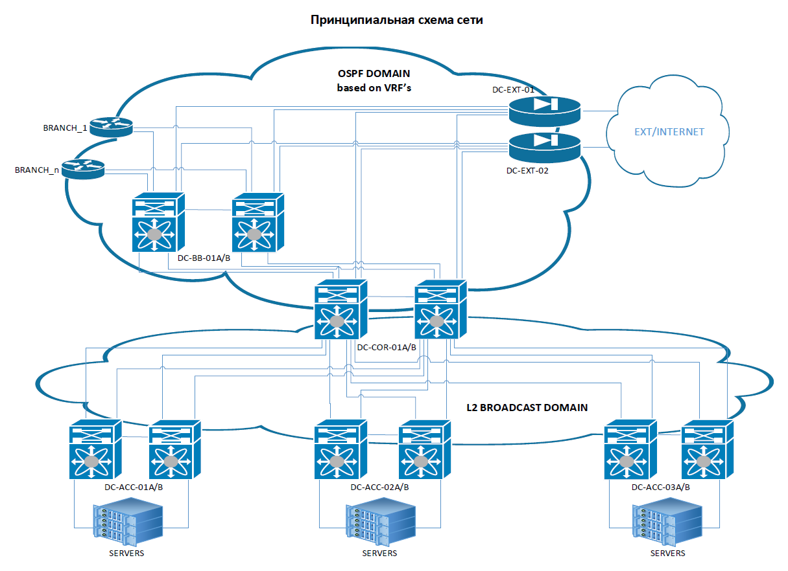
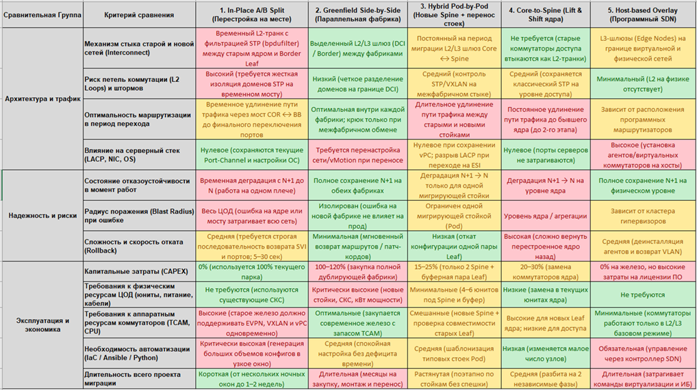

# Проектная работа
## Тема: 
## Бесшовная миграция инфраструктуры действующего ЦОД с технологии vPС на технологию VXLAN

## Цели работы:
Разработка и экспериментальная верификация методики бесшовной миграции сетевой инфраструктуры действующего центра обработки данных с классической архитектуры vPC/HSRP на фабрику VXLAN EVPN на существующем оборудовании с сохранением строгой изоляции VRF и маршрутизацией всего межсегментного трафика исключительно через межсетевые экраны периметра без прерывания работы пользовательских сервисов.

### Для достижения поставленной цели в работе решаются следующие задачи:
* Провести сравнительный анализ существующих подходов и вариаций миграции действующих сетей ЦОД на архитектуру VXLAN EVPN по техническим, эксплуатационным и экономическим критериям.
* Спроектировать целевую архитектуру фабрики Spine–Leaf, обеспечивающую оптимальную маршрутизацию внутри каждого VRF и направление всего Inter-VRF трафика через пограничные узлы (Border Leaf) на межсетевые экраны (DC-EXT).
* Разработать пошаговый алгоритм бесшовной миграции инфраструктуры с использованием временного межсетевого моста и регламента быстрого аварийного отката (Rollback).
* Развернуть имитационную модель в среде Cisco Modeling Labs (CML) и провести экспериментальную проверку сходимости протоколов, потерь пакетов, отказоустойчивости и корректности прохождения трафика через зоны безопасности межсетевых экранов.

 ## Оглавление:
1. [Текущая архитектура сети на Day 0](#1-текущая-архитектура-сети-на-day-0)
2. [Сборка лабораторного стенда Day0. Принятые ограничения и допущения](#2-сборка-лабораторного-стенда-day0-принятые-ограничения-и-допущения)
3. [Аналитический обзор и выбор методологии бесшовной миграции инфраструктуры ЦОД на архитектуру VXLAN EVPN](#3-аналитический-обзор-и-выбор-методологии-бесшовной-миграции-инфраструктуры-цод-на-архитектуру-vxlan-evpn)
4. [Проектирование целевой архитектуры фабрики VXLAN EVPN](#4-проектирование-целевой-архитектуры-фабрики-vxlan-evpn)
5. [Методика бесшовной миграции, автоматизация и управление рисками](#5-методика-бесшовной-миграции-автоматизация-и-управление-рисками)
6. [Экспериментальная верификация и моделирование бесшовной миграции](#6-экспериментальная-верификация-и-моделирование-бесшовной-миграции)
7. [Заключение](#7-заключение)
8. [Приложение 1. Изначальные конфигурации сетевого оборудования в лабораторном стенде](#8-приложение-1-изначальные-конфигурации-сетевого-оборудования-в-лабораторном-стенде)
9. [Приложение 2. Поэтапные конфигурации CLI сетевого оборудования](#9-приложение-2-поэтапные-конфигурации-cli-сетевого-оборудования)
10. [Приложение 3. Вывод команд диагностики в процессе выполнения работы](#10-приложение-3-вывод-команд-диагностики-в-процессе-выполнения-работы)
11. [Презентация](#11-презентация)

## 1. Текущая архитектура сети на Day 0

    Текущая архитектура сети представляет собой классическую иерархическую корпоративную Legacy-архитектуру с разделением на уровни маршрутизации (L3) и коммутации (L2), а также полным резервированием всех критически важных узлов.
#### Основные уровни и элементы схемы:
**Внешний периметр и выход в Интернет (DC-EXT-01, DC-EXT-02)** – Ферма межсетевых экранов, состоящая из HA-пар, обеспечивающих подключение сети к внешнему сегменту сети и сети Интернет (EXT/INTERNET).

**Домен маршрутизации (OSPF DOMAIN based on VRF's)** - Уровень L3, на котором работает протокол динамической маршрутизации OSPF. Использование технологии VRF (Virtual Routing and Forwarding) позволяет логически изолировать трафик разных логических сегментов ЦОДа с терминированием на МСЭ, а также организовать корпоративный сегмент как для подключения удаленных площадок так и серверов корпоративного сегмента внутри единой физической инфраструктуры.

**Магистральный уровень (DC-BB-01A/B)** - Пара коммутаторов (Backbone/Distribution), агрегирующих трафик от филиалов и пограничных маршрутизаторов перед передачей его в ядро ЦОД (в рамках VRF CORP) либо в сторону Интернет-каналов через МСЭ.

**Филиальная сеть (BRANCH_1, BRANCH_n)** - Маршрутизаторы удаленных офисов и филиалов, которые подключаются к магистральным узлам ЦОД.

**Ядро сети (DC-COR-01A/B)** - Высокопроизводительные отказоустойчивые коммутаторы ядра (объединенные в кластер по технологии Cisco vPС) служат центральной точкой связности между уровнем маршрутизации (L3) и серверным сегментом (L2).

**Уровень доступа (DC-ACC-0xA/B)** - Парные коммутаторы доступа (типа Top-of-Rack, объединенные в кластер по технологии Cisco vPС), к которым напрямую подключаются Cервера (SERVERS). Каждый сервер имеет двойное подключение (к коммутаторам A и B) для защиты от сбоев с агрегацией по протоколу LACP.

## 2. Сборка лабораторного стенда Day0. Принятые ограничения и допущения
В качестве системы эмуляции лабораторного стенда была использована среда Cisco Modeling Labs (CML) версии 2.9.  

Ниже представлена собранная архитектура сети на Day0. 

В качестве устройств с ролями COR, BB, ACC был использован виртуальный образ Cisco NX-OS 9300v под управлением NX-OS версии 10.5.3.F

В качестве устройств с ролями HOST, BRANCH, EXT был использован виртуальный образ Cisco Catalyst 8000v под управлением IOS-XE версии 17.16.01a.

Все изначальные конфигурации приложены к проекту Приложении №1.

Принятые допущения и ограничения (не влияющие на результат):
* Вместо серверов в качестве конечных хостов (HOST) использовались виртуальные маршрутизаторы с протоколом агрегации LACP до вышестоящих узлов.
* Вместо межсетевых экранов (EXT) с разделением по зонам безопасности (Security Zones) использовались виртуальные маршрутизаторы с протоколом агрегации LACP до узлов COR и BB. 
* Маршрут по умолчанию отсутствует в сети, т.к. рассмотрение его распространения не является одной из задач работы.

## 3. Аналитический обзор и выбор методологии бесшовной миграции инфраструктуры ЦОД на архитектуру VXLAN EVPN

### Классификация и сравнительный анализ подходов к миграции действующего ЦОД

Переход от классической трехуровневой или двухуровневой сетевой архитектуры, построенной на базе протоколов агрегации каналов (vPC / MLAG) и резервирования шлюзов по умолчанию (HSRP / VRRP), к фабрике VXLAN EVPN является одной из наиболее сложных задач сетевой инженерии. Основная трудность заключается в необходимости обеспечения непрерывности бизнес-процессов (Zero-Downtime Migration) при одновременной смене парадигмы коммутации и маршрутизации: переходе от централизованной L3-маршрутизации на уровне ядра к распределенному шлюзу (Distributed Anycast Gateway) на уровне доступа.

В современной индустрии сетевых технологий выделяют пять фундаментальных подходов к проведению подобной миграции:

#### Поочередная миграция по плечам на существующем оборудовании (In-Place A/B Split Migration).
Метод основывается на использовании штатной избыточности отказоустойчивых подключений серверов (Dual-Homed LACP) и сетевых узлов без закупки дополнительного оборудования. Сетевая инфраструктура логически разделяется на два независимых контура (плечо А и плечо Б). Весь продуктивный трафик принудительно направляется через плечо А, в то время как плечо Б выводится из эксплуатации, перенастраивается в топологию Spine–Leaf (VXLAN EVPN) и связывается со старым ядром временным L2-мостом с фильтрацией протокола Spanning Tree (bpdufilter). После переключения шлюзов по умолчанию (с HSRP на Anycast Gateway) и миграции клиентских портов на плечо Б аналогичным образом перестраивается плечо А.

#### Параллельное построение новой фабрики (Greenfield Side-by-Side / Swing Migration).
Подход предполагает развертывание изолированной фабрики VXLAN EVPN с нуля на новом парке оборудования рядом с действующей сетью. Между старым ядром и пограничными узлами новой фабрики (Border Leaf) организуется межфабричный шлюз (DCI / Migration Border). Перенос нагрузки осуществляется путем физической перекоммутации кабелей серверов либо с помощью живой миграции виртуальных машин (vMotion) с сохранением IP-адресации через растянутые L2-сегменты.

#### Инкрементальная гибридная миграция (Hybrid Pod-by-Pod Migration).
Компромиссный метод, при котором новое оборудование закупается только для уровня ядра (Spine) и одной буферной стойки (Pod). Существующие коммутаторы доступа выводятся из классической сети по одной паре, перенастраиваются в роль Leaf и включаются в новую фабрику. На протяжении всего переходного периода старое ядро и новые Spine-коммутаторы взаимодействуют через межфабричный L2/L3-шлюз.

#### Поэтапная модернизация с заменой только уровня ядра (Core-to-Spine / Lift-and-Shift).
При данном подходе в фабрику VXLAN EVPN переводится исключительно уровень ядра и агрегации, тогда как коммутаторы доступа временно сохраняют конфигурацию классического L2 vPC и подключаются к новым Leaf-узлам в качестве обычных транковых портов. Перенос шлюзов маршрутизации на уровень доступа откладывается на второй этап модернизации.

#### Программно-определяемый оверлей поверх существующей сети (Host-based Overlay / SDN).
Отказ от аппаратной реализации VXLAN EVPN на физических коммутаторах в пользу программного туннелирования на уровне гипервизоров серверов (например, VMware NSX или Open vSwitch). Физическая сеть упрощается до базового IP-транспорта (Underlay), а вся логика виртуальных сетей (VRF), инкапсуляции и распределенной маршрутизации выполняется силами центральных процессоров (CPU) серверов.
Для объективного выбора оптимальной стратегии проведен многокритериальный сравнительный анализ указанных подходов по двенадцати техническим, эксплуатационным и экономическим параметрам (Таблица ниже). Для наглядности оценки в таблице применена цветовая индикация: Зеленый — благоприятный показатель (низкие риски/затраты), Оранжевый — умеренный (требует компромиссов), Красный — критический (высокие риски/затраты).

### Обоснование выбора подхода
Анализ матрицы демонстрирует наличие жесткого антагонизма между капитальными затратами (CAPEX) и операционными рисками (OPEX):

Подход Greenfield Side-by-Side обладает наилучшими показателями безопасности и минимальным радиусом поражения, однако он неприменим в условиях действующего корпоративного ЦОД из-за необходимости 100% дублирования парка оборудования, дефицита свободных стойко-мест (юнитов), резервов электропитания и высокой трудоемкости физической перекоммутации кабельной системы.

Подход Host-based Overlay (SDN) не решает задачу подключения не-виртуализированных физических серверов (Bare Metal) и систем хранения данных (СХД) без приобретения дорогостоящих аппаратных шлюзов (Hardware VTEP Gateway), а также влечет за собой высокие расходы на лицензирование ПО и нагрузку на вычислительные ресурсы серверов.
Подход Core-to-Spine (Lift & Shift) является половинчатым решением: сохранение уровня доступа в режиме классического L2 vPC не устраняет проблему неоптимальной маршрутизации и требует проведения повторного цикла модернизации в будущем.

Подход Hybrid Pod-by-Pod требует закупки новых коммутаторов ядра (Spine) и буферной стойки, а также обрекает сеть на длительную работу в гибридном режиме с двойным администрированием и повышенными задержками при обмене трафиком между мигрировавшими и старыми сегментами.

Таким образом, при наличии современного аппаратного парка коммутаторов уровня ядра и доступа (в частности, линейки Cisco Nexus 9000), поддерживающего аппаратную инкапсуляцию VXLAN, экономически и технически наиболее целесообразным является метод In-Place A/B Split Migration. Он позволяет получить полноценную фабрику VXLAN EVPN за минимальное время без закупки нового оборудования и без вмешательства в настройки серверного стека.

### Детальный анализ вариаций реализации метода In-Place A/B Split Migration
В инженерной практике метод In-Place A/B Split Migration имеет четыре основные модификации, различающиеся архитектурой межсетевого стыка (Interconnect) в переходный период и способом синхронизации шлюзов по умолчанию:

#### Поэтапная миграция с L2-мостом на пограничном уровне (Border-Anchored L2 Bridge).
Функции взаимодействия с внешними сетями (L3 Out) и роль временного L2-моста между старым контуром (DC-COR) и новой фабрикой концентрируются на выделенных пограничных коммутаторах (DC-BB / Border Leaf). Внешние стыки заранее переводятся на DC-BB, после чего между старым ядром плеча А и Border Leaf плеча Б поднимается временный L2-транк с включенной фильтрацией BPDU (spanning-tree bpdufilter enable). Это позволяет разделить во времени два критических события: переключение L3-шлюзов (с HSRP на Distributed Anycast Gateway) и последующее плавное переключение физических портов серверов с плеча А на плечо Б.

#### Миграция с L2-мостом непосредственно на уровне доступа (Access-Anchored L2 Bridge).
Применяется в двухуровневых топологиях (Core–Access), где отсутствует выделенный уровень Backbone. Поскольку коммутаторы Spine в архитектуре VXLAN EVPN не могут выступать конечными точками туннелей (VTEP), временный L2-мост организуется между старым коммутатором ядра и одним из первых переведенных коммутаторов доступа (Leaf), который временно берет на себя функции пограничного маршрутизатора.

#### Безмостовая миграция с атомарным переворотом сегментов (Bridgeless Atomic Cutover).
Вариация, полностью исключающая организацию каких-либо L2-связей между старой и новой сетями. В технологическое окно средства автоматизации синхронно (за доли секунды) отключают HSRP-шлюзы и все порты доступа конкретного VLAN на плече А, одновременно активируя Anycast Gateway и порты доступа на плече Б.

#### Гибридная L3-миграция с переключением подсетей или VRF (L3 Subnet / VRF Swing).
Старый и новый контуры связываются исключительно на сетевом уровне (L3) по протоколам динамической маршрутизации (OSPF / BGP). Миграция осуществляется путем переноса изолированных доменов маршрутизации (VRF) целиком либо за счет выделения серверам новых IP-подсетей при переключении на плечо Б.

Сравнительная оценка данных вариаций по семи ключевым критериям приведена в Таблице ниже.

На основании проведенного анализа для практической реализации в рамках данной работы выбрана Вариация 1 метода In-Place A/B Split Migration (Border-Anchored L2 Bridge) по следующим причинам:
* **Неизменность адресного пространства:** Наличие временного L2-моста между ядром и пограничными узлами гарантирует сохранение связности внутри растянутых L2-сегментов без необходимости изменения IP-адресов конечных хостов (в отличие от Вариации 4).
* **Поддержка серверной виртуализации:** В отличие от безмостового переворота (Вариация 3), выбранный алгоритм позволяет мигрировать транковые порты серверов поэтапно, исключая риск длительного простоя при массовом переключении сотен интерфейсов.
* **Защита уровня доступа от перегрузок:** Использование выделенных пограничных коммутаторов (будущих Border Leaf) для организации временного L2-моста и терминации внешних каналов избавляет коммутаторы доступа от транзитного межфабричного трафика (в отличие от Вариации 2).
* **Нейтрализация эксплуатационных рисков:** Присущие методу риски возникновения петель коммутации на временном мосту и деградации резервирования компенсируются строгой регламентацией этапов (Этапы 0–4), принудительной фильтрацией BPDU (spanning-tree bpdufilter enable), предварительной валидацией конфигураций и сохранением настроек резервного плеча в состоянии shutdown для обеспечения быстрого отката (Rollback).

## 4. Проектирование целевой архитектуры фабрики VXLAN EVPN

### Топология Spine–Leaf и распределение ролей оборудования
Целевая архитектура модернизируемого центра обработки данных (ЦОД) строится на базе неблокируемой двухуровневой фабрики Clos (Spine–Leaf). Переход выполняется путем программно-логического перепрофилирования действующего парка коммутаторов Cisco Nexus без изменения физической кабельной инфраструктуры (СКС) магистрального уровня.

Распределение функциональных ролей между узлами фабрики организовано следующим образом:
* **Уровень ядра маршрутизации (Spine Layer — DC-COR-01A, DC-COR-01B).** Бывшие коммутаторы классического ядра переводятся в режим высокоскоростного L3-транзита и выполняют роль BGP Route Reflector для плоскости управления EVPN. Прямые межъядерные соединения (Po61 и vPC Peer-Link) полностью выводятся из эксплуатации, так как в топологии Clos коммутаторы Spine должны быть изолированы друг от друга. Также со Spine снимаются все внешние каналы связи и клиентские шлюзы.
* **Уровень доступа (Leaf Layer — DC-ACC-01A/B, DC-ACC-02A/B, DC-ACC-03A/B).** Коммутаторы доступа становятся граничными узлами туннелирования (VTEP — VXLAN Tunnel Endpoint). Каждый Leaf-коммутатор терминирует L2-сегменты серверов, инкапсулирует кадры Ethernet в пакеты VXLAN и выполняет функцию распределенного шлюза (Distributed Anycast Gateway).
* **Пограничный уровень (Border Leaf Layer — DC-BB-01A, DC-BB-01B).** Коммутаторы уровня Backbone консолидируют все стыки с межсетевыми экранами периметра (DC-EXT-01/02) и региональными филиалами (BRANCH_1–4) по всем четырем изолированным VRF.

Все магистральные линки между уровнями Spine и Leaf переводятся в режим чистого L3 (Point-to-Point /31) с увеличенным размером максимального передаваемого блока (MTU 9216 байт), что исключает фрагментацию пакетов при добавлении 50-байтного заголовка VXLAN.

### Выбор протоколов маршрутизации Underlay и Overlay
Для функционирования фабрики VXLAN EVPN необходимо спроектировать две логически независимые плоскости:

* **Underlay-сеть:** обеспечивает IP-связность между Loopback-интерфейсами всех коммутаторов фабрики и балансировку трафика по равнозначным маршрутам (ECMP).
* **Overlay-сеть:** отвечает за распространение информации о MAC-адресах, IP-адресах конечных хостов и префиксах VRF с использованием семейства адресов MP-BGP L2VPN EVPN (RFC 7432).
 
В современных сетях применяются три основные модели построения Control Plane фабрики, сравнение которых приведено в таблице ниже.

### Обоснование выбора модели iBGP-only

Для целевой архитектуры выбрана Модель 3 (единый iBGP для Underlay и Overlay в рамках автономной системы):
* **Отказ от IGP-протоколов внутри фабрики:** Использование единого протокола BGP для передачи как транспортных /32 Loopback-адресов (семейство ipv4 unicast), так и клиентских маршрутов EVPN (семейство l2vpn evpn) унифицирует эксплуатацию и диагностику сети.
* **Упрощение политик EVPN:** В отличие от схемы eBGP, где каждой паре Leaf назначается собственный номер автономной системы и требуется принудительная перезапись атрибутов Route-Target на каждом узле, единая AS 65001 позволяет использовать автоматическую генерацию идентификаторов (rd auto, route-target auto). Коммутаторы Spine выступают в роли Route Reflector и передают маршруты между Leaf с сохранением исходного адреса VTEP в качестве Next-Hop.
* **Архитектурная готовность к EVPN Multi-Site:** Закрепление единой автономной системы (например AS 65001) за первым дата-центром (DC1) создает четкую административную границу для будущего подключения второго дата-центра (например AS 65002) по стандартному протоколу eBGP между пограничными узлами Border Gateway.

### Выбор механизма отказоустойчивости доступа (Multihoming) и обработки BUM-трафика

#### Сравнение vPC VXLAN и EVPN Multihoming (ESI)

Для подключения серверов по схеме Dual-Homing (агрегация каналов LACP к двум коммутаторам доступа одновременно) в стандарте EVPN предусмотрены два механизма: классический vPC VXLAN (Anycast VTEP) и стандартизированный EVPN Multihoming (Ethernet Segment Identifier — ESI, RFC 7432).

Для проекта выбран механизм vPC VXLAN (Anycast VTEP). Поскольку в действующей сети уже развернуты домены vPC и физически собраны межкоммутаторные линки Po63 (Eth1/63–64), сохранение vPC VXLAN позволяет выполнить миграцию без разрыва клиентских групп LACP и перенастройки сетевых адаптеров серверов. Для корректной маршрутизации трафика одиночно подключенных устройств (Orphan Ports) и внешних стыков на всех vPC-парах активируется анонс первичного IP-адреса VTEP (advertise pip в BGP EVPN) и виртуального MAC-адреса маршрутизатора (advertise virtual-rmac в интерфейсе nve1).

#### Выбор способа репликации BUM-трафика
Для доставки широковещательного, неизвестного одноадресного и многоадресного трафика (BUM — Broadcast, Unknown Unicast, Multicast) внутри VXLAN-сегментов выбран механизм Ingress Replication (Head-End Replication) на базе BGP EVPN (маршруты Type-3 IMET).

В отличие от Multicast Underlay (требующего развертывания протокола PIM Sparse Mode и выделения точек рандеву Anycast-RP на Spine), Ingress Replication полностью избавляет транспортную сеть от необходимости поддерживать состояние многоадресных деревьев. При умеренном количестве VTEP-узлов в фабрике головная репликация силами аппаратных ASIC коммутаторов Cisco Nexus обеспечивает минимальную задержку и максимальную простоту эксплуатации.

### Проектирование распределенного шлюза (Distributed Anycast Gateway) и сегментации
В целевой архитектуре устраняется узкое горлышко централизованной маршрутизации на ядре. На каждом коммутаторе Leaf и Border Leaf настраиваются идентичные виртуальные интерфейсы (SVI) для всех клиентских подсетей с единым IP-адресом шлюза (.1) и единым виртуальным MAC-адресом (0000.2222.3333) в режиме fabric forwarding mode anycast-gateway.

Критическим архитектурным требованием информационной безопасности является строгая изоляция четырех контуров (vrf_DC-FE, vrf_DC-BE, vrf_DC-DB, vrf_DC-CORP) с прохождением всего межсегментного трафика исключительно через межсетевые экраны периметра DC-EXT-01/02, на которых реализованы соответствующие зоны безопасности.

Для соблюдения этого правила в фабрике VXLAN EVPN закладываются следующие механизмы:
* **Оптимальная маршрутизация внутри контура (Intra-VRF Symmetric IRB):** Трафик между разными подсетями одного VRF (например, между VLAN 20 и VLAN 30 внутри vrf_DC-BE) маршрутизируется локально на входном Leaf через Distributed Anycast Gateway (MAC 0000.2222.3333) с использованием транзитного L3 VNI 50193 без выхода за пределы фабрики.
* **Полный запрет Route Leaking на Leaf и Border Leaf:** Каждый из четырех VRF имеет свой уникальный транзитный L3 VNI и уникальные автоматические атрибуты Route-Target (route-target both auto evpn). Импорт маршрутов между разными VRF на коммутаторах DC-ACC и DC-BB строго отсутствует.
* **Маршрутизация Inter-VRF через межсетевые экраны (DC-EXT):** Внутри каждого VRF пограничные узлы DC-BB-01A/B получают от межсетевых экранов DC-EXT-01/02 (по протоколу OSPF внутри соответствующего VRF-сабинтерфейса .192–.195) маршрут по умолчанию 0.0.0.0/0 (или суммарные маршруты других зон безопасности) и анонсируют его внутрь фабрики EVPN как маршрут Type-5 (IP Prefix). Таким образом, при обращении сервера из зоны vrf_DC-FE (10.1.10.11) к базе данных в зоне vrf_DC-DB (10.1.40.11):
  * Пакет попадает на локальный Anycast Gateway входного Leaf в контуре vrf_DC-FE.
  * Не найдя префикса 10.1.40.0/24 в таблице маршрутизации vrf_DC-FE, Leaf направляет пакет по маршруту по умолчанию в туннель L3 VNI на Border Leaf (DC-BB).
  * Border Leaf декапсулирует пакет и передает его на межсетевые экраны DC-EXT.
  * Межсетевой экран DC-EXT выполняет инспекцию сессии согласно политикам безопасности между зонами FE и DB, после чего возвращает разрешенный пакет (в рамках vrf_DC-DB) на Border Leaf, который доставляет его по туннелю L3 VNI до целевого Leaf.

Для сохранения строгой изоляции контуров безопасности в фабрике реализуется модель Multi-Tenancy на базе четырех VRF:
* **vrf_DC-FE** (контур фронтенд-сервисов);
* **vrf_DC-BE** (контур бэкенд-приложений и обработки данных);
* **vrf_DC-DB** (изолированный контур систем управления базами данных);
* **vrf_DC-CORP** (корпоративный контур и взаимодействие с филиалами).

Ниже представлена матрица сегментации VRF, VLAN и VNI целевой фабрики.

|Домен маршрутизации (VRF)|Транзитный L3 VNI|Транзитный VLAN (IRB)|Клиентский VLAN|Назначение сегмента|Клиентский L2 VNI|Anycast Gateway IP (MAC 0000.2222.3333)|
|:-:|:-:|:-:|:-:|:-:|:-:|:-:|
|vrf_DC-FE|50192|VLAN 1192|VLAN 10|Сегмент Front-End (DC-FE)|10010|10.1.10.1/24|
|vrf_DC-BE|50193|VLAN 1193|VLAN 20|Сегмент Back-End (DC-BE)|10020|10.1.20.1/24|
|vrf_DC-BE|50193|VLAN 1193|VLAN 30|Сегмент данных (DC-DATA)|10030|10.1.30.1/24|
|vrf_DC-DB|50194|VLAN 1194|VLAN 40|Сегмент баз данных (DC-DB)|10040|10.1.40.1/24|
|vrf_DC-CORP|50195|VLAN 1195|VLAN 50|Корпоративный сегмент (DC-CORP)|10050|10.1.50.1/24|

### Спроектированный план IP-адресации (DC1 — 10.1.0.0/16)

Для стандартизации управления и обеспечения масштабируемости (резервирование блока 10.2.0.0/16 под второй ЦОД DC2) разработан структурированный адресный план из пространства 10.1.0.0/16:

**Идентификаторы маршрутизаторов (Loopback0, пул 10.1.255.0/24):**

используются для установки соседства iBGP EVPN Overlay с Route Reflector.

*Диапазон .1–.10 зарезервирован за Spine (10.1.255.1/32 — Spine-1, 10.1.255.2/32 — Spine-2).
*Диапазон .11–.250 выделен под Leaf (10.1.255.11/32 — 10.1.255.16/32).
*Диапазон .251–.254 закреплен за Border Leaf (10.1.255.251/32 — BL-1, 10.1.255.252/32 — BL-2).

**Адреса туннельных конечных точек VTEP (Loopback1, пул 10.1.254.0/24):**
* Первичные адреса (Primary IP): .11–.16 для Leaf и .251–.252 для Border Leaf.
* Общие виртуальные адреса (Secondary vPC VTEP IP): .241 (пара ACC-01), .242 (пара ACC-02), .243 (пара ACC-03) и .250 (пара Border Leaf BB-01).

**Транспортные P2P-подсети Underlay (/31):**
* 10.1.241.0/24 — связность от Spine-1 к Leaf-1..6 (.0/31 — .10/31).
* 10.1.242.0/24 — связность от Spine-2 к Leaf-1..6 (.0/31 — .10/31).
* 10.1.251.0/24 — связность от обоих Spine к Border Leaf (.0/31 и .2/31 от Spine-1; .64/31 и .66/31 от Spine-2).

**Внешний периметр (DC-BB ↔ DC-EXT):**

для каждого из четырех VRF выделены подсети /31 из пулов 10.1.192.0/24 – 10.1.195.0/24 (диапазоны .10/31 – .17/31) поверх существующих магистральных портов Eth1/11–12 с взаимной редистрибуцией маршрутов между OSPF (внешний периметр и филиалы BRANCH_1–4) и MP-BGP EVPN.

## 5. Методика бесшовной миграции, автоматизация и управление рисками

### Архитектура переходного периода и защита от аномалий трафика
Ключевой задачей при реализации выбранной вариации Border-Anchored L2 Bridge является обеспечение непрерывной связности (L2 и L3) между сегментами, уже переведенными в фабрику VXLAN EVPN, и узлами, все еще функционирующими в классической сети vPC/HSRP.

Для решения этой задачи на время миграции формируется переходная топология, защищенная от трех типичных сетевых аномалий:

#### Изоляция доменов Spanning Tree (защита от петель L2).
Между старым ядром (DC-COR-01A/B) и пограничными узлами (DC-BB-01A/B) организуется временный агрегированный L2-транк (Port-Channel 50), разрешающий пропуск клиентских сегментов (VLAN 10, 20, 30, 40, 50). Поскольку классическая сеть использует протокол Rapid PVST+, а новая фабрика VXLAN EVPN блокирует распространение BPDU через оверлей, прямое соединение двух доменов без фильтрации приведет к непредсказуемому пересчету корневого коммутатора (Root Bridge) и блокировке портов. Для предотвращения этого на интерфейсах временного моста принудительно активируется функция spanning-tree bpdufilter enable и ограничитель широковещательного трафика (storm-control broadcast level 1.00).

#### Непрерывность межсетевого экранирования (DC-EXT) на всех этапах.
На Этапе 0 на линки DC-BB ↔ DC-EXT добавляются все четыре зоны безопасности (.192–.195) с трансляцией маршрута по умолчанию от DC-EXT в каждый VRF. Благодаря этому в момент переключения шлюзов (Этап 2) любой Inter-VRF трафик (как от уже мигрировавших хостов на плече B, так и от старых хостов через мост Po50) сразу уходит в соответствующий сабинтерфейс DC-EXT, не нарушая инспекцию сессий на межсетевых экранах.Контролируемый транзитный крюк трафика на этапе переноса портов.

В интервале между переключением шлюзов и переключением физических портов серверов пакеты от еще не мигрировавших хостов (подключенных к DC-ACC-xxA) проходят через старое ядро DC-COR-01A, попадают по временному мосту Po50 на новый Border Leaf DC-BB-01B, где терминируются на Anycast Gateway и направляются в VXLAN или во внешний периметр (DC-EXT). Данный избыточный транзитный маршрут является временным и полностью исчезает сразу после переключения клиентских портов на плечо B».

### Пошаговый алгоритм бесшовной миграции (Этапы 0–4)
Процесс перевода инфраструктуры ЦОД на архитектуру VXLAN EVPN разбит на пять последовательных технологических этапов. Переход к каждому следующему этапу разрешается только после успешного прохождения контрольных проверок (чек-поинтов) предыдущего.

#### Этап 0. Подготовка инфраструктуры и консолидация внешнего периметра

**Цель:** 
Устранить локальные неоптимальности текущей конфигурации, завести все четыре домена маршрутизации (VRF) на будущие Border Leaf (DC-BB-01A/B) и развернуть временный L2-мост.

**Выполняемые действия:**
*	На коммутаторах доступа (DC-ACC) отключается агрессивный таймер lacp rate fast (для предотвращения ложных срабатываний при перестройке Control Plane) и корректируются параметры STP на портах Peer-Link.
*	На стыках DC-BB-01A/B ↔ DC-EXT-01/02 (интерфейсы Eth1/11–12 и Gi1–2) создаются недостающие сабинтерфейсы .192 (vrf_DC-FE), .193 (vrf_DC-BE) и .194 (vrf_DC-DB) с выделенными подсетями /31 и запускается соседство OSPF Area 0 с поддержкой BFD. Внешние маршрутизаторы начинают видеть префиксы ЦОД одновременно через старое ядро и через DC-BB.
* Между парами DC-COR и DC-BB собирается временный vPC-транк Port-Channel 50 с изоляцией bpdufilter.
  
**Влияние на трафик:** 
Нулевое (0 потерянных пакетов).

## 6. Экспериментальная верификация и моделирование бесшовной миграции
## 7. Заключение
## 8. Приложение 1. Изначальные конфигурации сетевого оборудования в лабораторном стенде
## 9. Приложение 2. Поэтапные конфигурации CLI сетевого оборудования
## 10. Приложение 3. Вывод команд диагностики в процессе выполнения работы
## 10. Презентация

