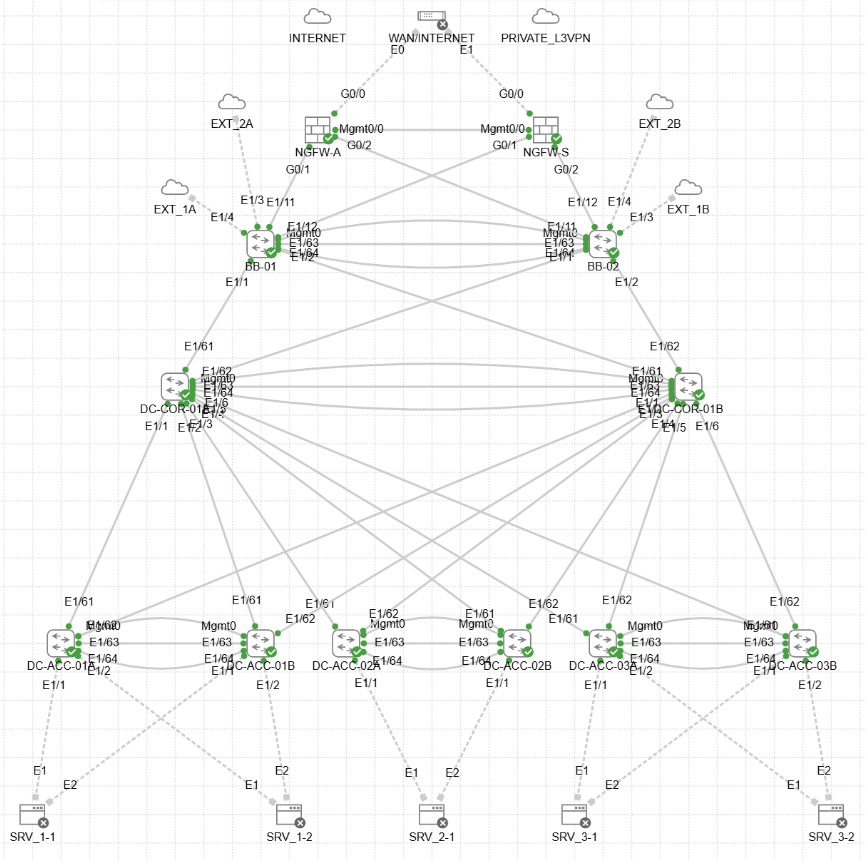

# Проектная работа
Тема: Бесшовная миграция инфраструктуры действующего ЦОД с технологии vPС на технологию VXLAN

## Цели работы:
- разработать методологию миграции с vPC на VXLAN без простоев в режиме действующего 24х7 предприятия.

## Цели от бизнеса и смежных IT-подразделений к департаменту сетевой инфраструктуры:
- обеспечить перспективы роста IT-инфраструктуры в целом для группы компаний.
- организовать GR-резервирование ЦОД группы копаний с возможностью восстановления on-fly (реальное время восстановления не более 1 часа обеспечивают прикладные команды).
- обеспечить возможность миграции VM's с одного ЦОД в другой в режиме реального времени и без необходимости изменения параметров.
  
## Описание методологии и подходов:

...

# ...

## Ткущая схема сети

