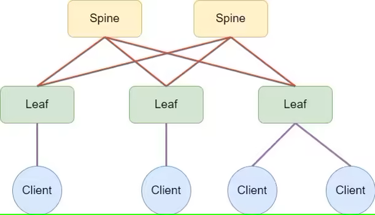

### Цель:
- Cобрать схему CLOS и распределить адресное пространство   

### Описание/Пошаговая инструкция выполнения домашнего задания:
- Собрать топологию CLOS, как на схеме:   

- Распределите адресное пространство для Underlay сети
- Зафиксировать в документации план работ, адресное пространство, схему сети, настройки (если перенесли на оборудование)   

### Выполнение: 

### Схема

### Целевое распределение адресного пространства

- 10.0.0.0/8 - LLC Private address space   

- DC1 - 10.1.0.0/16
- DC2 - 10.2.0.0/16   

- 10.x.255.0/24 - Lo0 RID (/32) (.1-.10 - S, .11-.250 - L, .251-.254 - BL)
- 10.x.254.0/24 - Lo1 VTEP_ID (/32) (.1-.10 - S, .11-.250 - L, .251-.254 - BL)   

- 10.х.241.0/24 - P2P INTRASITE Underlay Transport from Spine1 to Leafs (/31) 
- 10.х.242.0/24 - P2P INTRASITE Underlay Transport from Spine2 to Leafs (/31)   

- 10.x.251.0/24 - P2P INTRASITE Underlay Transport from Spines to Boarder Leafs (/31) (.0-.63 - to BL1, .64-.127 - to BL2)   

### Вывод команд диагностики

### S1-1
S1-1# sh ip int brief 

IP Interface Status for VRF "default"(1)
Interface            IP Address      Interface Status
Lo0                  10.1.255.1      protocol-up/link-up/admin-up       
Lo1                  10.1.254.1      protocol-up/link-up/admin-up       
Eth1/1               10.1.241.0      protocol-up/link-up/admin-up       
Eth1/2               10.1.241.2      protocol-up/link-up/admin-up       
S1-1# ping 10.1.241.1
PING 10.1.241.1 (10.1.241.1): 56 data bytes
64 bytes from 10.1.241.1: icmp_seq=0 ttl=254 time=7.677 ms
64 bytes from 10.1.241.1: icmp_seq=1 ttl=254 time=4.139 ms
64 bytes from 10.1.241.1: icmp_seq=2 ttl=254 time=4.153 ms
64 bytes from 10.1.241.1: icmp_seq=3 ttl=254 time=4.929 ms
64 bytes from 10.1.241.1: icmp_seq=4 ttl=254 time=4.822 ms

--- 10.1.241.1 ping statistics ---
5 packets transmitted, 5 packets received, 0.00% packet loss
round-trip min/avg/max = 4.139/5.143/7.677 ms
S1-1# ping 10.1.241.3
PING 10.1.241.3 (10.1.241.3): 56 data bytes
64 bytes from 10.1.241.3: icmp_seq=0 ttl=254 time=6.869 ms
64 bytes from 10.1.241.3: icmp_seq=1 ttl=254 time=4.694 ms
64 bytes from 10.1.241.3: icmp_seq=2 ttl=254 time=5.122 ms
64 bytes from 10.1.241.3: icmp_seq=3 ttl=254 time=5.044 ms
64 bytes from 10.1.241.3: icmp_seq=4 ttl=254 time=6.436 ms

--- 10.1.241.3 ping statistics ---
5 packets transmitted, 5 packets received, 0.00% packet loss
round-trip min/avg/max = 4.694/5.633/6.869 ms
S1-1# sh cdp ne
Capability Codes: R - Router, T - Trans-Bridge, B - Source-Route-Bridge
                  S - Switch, H - Host, I - IGMP, r - Repeater,
                  V - VoIP-Phone, D - Remotely-Managed-Device,
                  s - Supports-STP-Dispute

Device-ID          Local Intrfce  Hldtme Capability  Platform      Port ID
L1-1(9YB5F0EY5AY)   Eth1/1         151    R S s     N9K-C9300v       Eth1/1     
   
L1-2(999J8AJU9LV)   Eth1/2         133    R S s     N9K-C9300v       Eth1/1     
   

Total entries displayed: 2

### S1-2
S1-2# sh ip int brief 

IP Interface Status for VRF "default"(1)
Interface            IP Address      Interface Status
Lo0                  10.1.255.2      protocol-up/link-up/admin-up       
Lo1                  10.1.254.2      protocol-up/link-up/admin-up       
Eth1/1               10.1.242.0      protocol-up/link-up/admin-up       
Eth1/2               10.1.242.2      protocol-up/link-up/admin-up       
S1-2# ping 10.1.242.1
PING 10.1.242.1 (10.1.242.1): 56 data bytes
64 bytes from 10.1.242.1: icmp_seq=0 ttl=254 time=6.506 ms
64 bytes from 10.1.242.1: icmp_seq=1 ttl=254 time=4.907 ms
64 bytes from 10.1.242.1: icmp_seq=2 ttl=254 time=4.542 ms
64 bytes from 10.1.242.1: icmp_seq=3 ttl=254 time=5.563 ms
64 bytes from 10.1.242.1: icmp_seq=4 ttl=254 time=5.849 ms

--- 10.1.242.1 ping statistics ---
5 packets transmitted, 5 packets received, 0.00% packet loss
round-trip min/avg/max = 4.542/5.473/6.506 ms
S1-2# ping 10.1.242.3
PING 10.1.242.3 (10.1.242.3): 56 data bytes
64 bytes from 10.1.242.3: icmp_seq=0 ttl=254 time=5.361 ms
64 bytes from 10.1.242.3: icmp_seq=1 ttl=254 time=4.589 ms
64 bytes from 10.1.242.3: icmp_seq=2 ttl=254 time=3.461 ms
64 bytes from 10.1.242.3: icmp_seq=3 ttl=254 time=3.268 ms
64 bytes from 10.1.242.3: icmp_seq=4 ttl=254 time=5.624 ms

--- 10.1.242.3 ping statistics ---
5 packets transmitted, 5 packets received, 0.00% packet loss
round-trip min/avg/max = 3.268/4.46/5.624 ms
S1-2# sh cdp ne
Capability Codes: R - Router, T - Trans-Bridge, B - Source-Route-Bridge
                  S - Switch, H - Host, I - IGMP, r - Repeater,
                  V - VoIP-Phone, D - Remotely-Managed-Device,
                  s - Supports-STP-Dispute

Device-ID          Local Intrfce  Hldtme Capability  Platform      Port ID
L1-1(9YB5F0EY5AY)   Eth1/1         150    R S s     N9K-C9300v       Eth1/2     
   
L1-2(999J8AJU9LV)   Eth1/2         172    R S s     N9K-C9300v       Eth1/2     
   

Total entries displayed: 2

