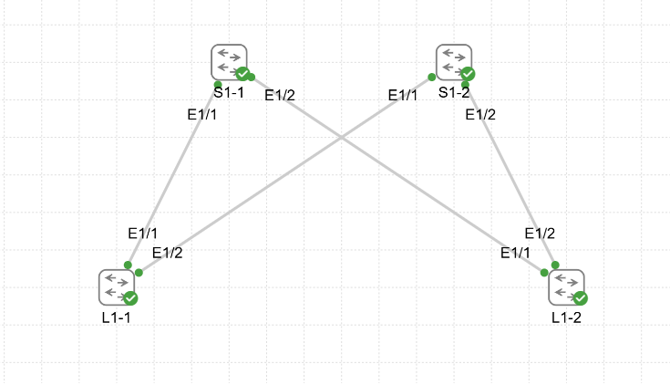

# Домашнее задание
Underlay. OSPF

## Цель:
- настроить OSPF для Underlay сети.

## Описание/Пошаговая инструкция выполнения домашнего задания:
В этой самостоятельной работе мы ожидаем, что вы самостоятельно:
- Настроите OSPF в Underlay сети, для IP связанности между всеми сетевыми устройствами.
- Зафиксируете в документации - план работы, адресное пространство, схему сети, конфигурацию устройств
- Убедитесь в наличии IP связанности между устройствами в OSFP домене

# Выполнение: 

## Схема


## Целевое распределение адресного пространства

- 10.0.0.0/8 - LLC Private address space  <br>

- DC1 - 10.1.0.0/16
- DC2 - 10.2.0.0/16  <br>

- 10.x.255.0/24 - Lo0 RID (/32) (.1-.10 - S, .11-.250 - L, .251-.254 - BL)
- 10.x.254.0/24 - Lo1 VTEP_ID (/32) (.1-.10 - S, .11-.250 - L, .251-.254 - BL)  <br>

- 10.х.241.0/24 - P2P INTRASITE Underlay Transport from Spine1 to Leafs (/31) 
- 10.х.242.0/24 - P2P INTRASITE Underlay Transport from Spine2 to Leafs (/31)  <br>

- 10.x.251.0/24 - P2P INTRASITE Underlay Transport from Spines to Boarder Leafs (/31) (.0-.63 - to BL1, .64-.127 - to BL2)  <br>

## Вывод команд диагностики

### S1-1
```
S1-1# sh run ospf 

!Command: show running-config ospf
!Running configuration last done at: Thu Oct 15 18:40:17 2026
!Time: Thu Oct 15 18:59:08 2026

version 10.5(3) Bios:version  
feature ospf

router ospf UNDERLAY
  router-id 10.1.255.1
  log-adjacency-changes detail
  passive-interface default

interface loopback0
  ip router ospf UNDERLAY area 0.0.0.0

interface loopback1
  ip router ospf UNDERLAY area 0.0.0.0

interface Ethernet1/1
  no ip ospf passive-interface
  ip router ospf UNDERLAY area 0.0.0.0

interface Ethernet1/2
  no ip ospf passive-interface
  ip router ospf UNDERLAY area 0.0.0.0

S1-1# sh ip ospf ne
 OSPF Process ID UNDERLAY VRF default
 Total number of neighbors: 2
 Neighbor ID     Pri State            Up Time  Address         Interface
 10.1.255.11       1 FULL/DR          00:14:59 10.1.241.1      Eth1/1 
 10.1.255.12       1 FULL/DR          00:14:52 10.1.241.3      Eth1/2 
S1-1# sh ip ospf da
        OSPF Router with ID (10.1.255.1) (Process ID UNDERLAY VRF default)

                Router Link States (Area 0.0.0.0)

Link ID         ADV Router      Age        Seq#       Checksum Link Count
10.1.255.1      10.1.255.1      899        0x80000007 0x584b   4   
10.1.255.2      10.1.255.2      883        0x80000007 0x0d8e   4   
10.1.255.11     10.1.255.11     888        0x80000007 0x9ddd   4   
10.1.255.12     10.1.255.12     882        0x80000007 0xb6b8   4   

                Network Link States (Area 0.0.0.0)

Link ID         ADV Router      Age        Seq#       Checksum 
10.1.241.1      10.1.255.11     907        0x80000002 0x1c08
10.1.241.3      10.1.255.12     900        0x80000002 0x0c14
10.1.242.1      10.1.255.11     888        0x80000002 0x1f03
10.1.242.3      10.1.255.12     882        0x80000002 0x0f0f
```

### S1-2
```
S1-2# sh run ospf 

!Command: show running-config ospf
!Running configuration last done at: Thu Oct 15 18:39:54 2026
!Time: Thu Oct 15 18:59:55 2026

version 10.5(3) Bios:version  
feature ospf

router ospf UNDERLAY
  router-id 10.1.255.2
  log-adjacency-changes detail
  passive-interface default

interface loopback0
  ip router ospf UNDERLAY area 0.0.0.0

interface loopback1
  ip router ospf UNDERLAY area 0.0.0.0

interface Ethernet1/1
  no ip ospf passive-interface
  ip router ospf UNDERLAY area 0.0.0.0

interface Ethernet1/2
  no ip ospf passive-interface
  ip router ospf UNDERLAY area 0.0.0.0

S1-2# sh ip ospf ne
 OSPF Process ID UNDERLAY VRF default
 Total number of neighbors: 2
 Neighbor ID     Pri State            Up Time  Address         Interface
 10.1.255.11       1 FULL/DR          00:15:18 10.1.242.1      Eth1/1 
 10.1.255.12       1 FULL/DR          00:15:13 10.1.242.3      Eth1/2 
S1-2# sh ip ospf da
        OSPF Router with ID (10.1.255.2) (Process ID UNDERLAY VRF default)

                Router Link States (Area 0.0.0.0)

Link ID         ADV Router      Age        Seq#       Checksum Link Count
10.1.255.1      10.1.255.1      937        0x80000007 0x584b   4   
10.1.255.2      10.1.255.2      919        0x80000007 0x0d8e   4   
10.1.255.11     10.1.255.11     927        0x80000007 0x9ddd   4   
10.1.255.12     10.1.255.12     920        0x80000007 0xb6b8   4   

                Network Link States (Area 0.0.0.0)

Link ID         ADV Router      Age        Seq#       Checksum 
10.1.241.1      10.1.255.11     944        0x80000002 0x1c08
10.1.241.3      10.1.255.12     938        0x80000002 0x0c14
10.1.242.1      10.1.255.11     925        0x80000002 0x1f03
10.1.242.3      10.1.255.12     920        0x80000002 0x0f0f
```

### L1-1
```
L1-1# sh run ospf

!Command: show running-config ospf
!Running configuration last done at: Thu Oct 15 18:39:35 2026
!Time: Thu Oct 15 19:00:37 2026

version 10.5(3) Bios:version  
feature ospf

router ospf UNDERLAY
  router-id 10.1.255.11
  log-adjacency-changes detail
  passive-interface default

interface loopback0
  ip router ospf UNDERLAY area 0.0.0.0

interface loopback1
  ip router ospf UNDERLAY area 0.0.0.0

interface Ethernet1/1
  no ip ospf passive-interface
  ip router ospf UNDERLAY area 0.0.0.0

interface Ethernet1/2
  no ip ospf passive-interface
  ip router ospf UNDERLAY area 0.0.0.0

L1-1# sh ip ro
IP Route Table for VRF "default"
'*' denotes best ucast next-hop
'**' denotes best mcast next-hop
'[x/y]' denotes [preference/metric]
'%<string>' in via output denotes VRF <string>

10.1.241.0/31, ubest/mbest: 1/0, attached
    *via 10.1.241.1, Eth1/1, [0/0], 01:30:31, direct
10.1.241.1/32, ubest/mbest: 1/0, attached
    *via 10.1.241.1, Eth1/1, [0/0], 01:30:31, local
10.1.241.2/31, ubest/mbest: 1/0
    *via 10.1.241.0, Eth1/1, [110/80], 00:10:57, ospf-UNDERLAY, intra
10.1.242.0/31, ubest/mbest: 1/0, attached
    *via 10.1.242.1, Eth1/2, [0/0], 01:30:27, direct
10.1.242.1/32, ubest/mbest: 1/0, attached
    *via 10.1.242.1, Eth1/2, [0/0], 01:30:27, local
10.1.242.2/31, ubest/mbest: 1/0
    *via 10.1.242.0, Eth1/2, [110/80], 00:10:39, ospf-UNDERLAY, intra
10.1.254.1/32, ubest/mbest: 1/0
    *via 10.1.241.0, Eth1/1, [110/41], 00:10:57, ospf-UNDERLAY, intra
10.1.254.2/32, ubest/mbest: 1/0
    *via 10.1.242.0, Eth1/2, [110/41], 00:10:39, ospf-UNDERLAY, intra
10.1.254.11/32, ubest/mbest: 2/0, attached
    *via 10.1.254.11, Lo1, [0/0], 01:32:30, local
    *via 10.1.254.11, Lo1, [0/0], 01:32:30, direct
10.1.254.12/32, ubest/mbest: 2/0
    *via 10.1.241.0, Eth1/1, [110/81], 00:10:51, ospf-UNDERLAY, intra
    *via 10.1.242.0, Eth1/2, [110/81], 00:10:33, ospf-UNDERLAY, intra
10.1.255.1/32, ubest/mbest: 1/0
    *via 10.1.241.0, Eth1/1, [110/41], 00:10:57, ospf-UNDERLAY, intra
10.1.255.2/32, ubest/mbest: 1/0
    *via 10.1.242.0, Eth1/2, [110/41], 00:10:39, ospf-UNDERLAY, intra
10.1.255.11/32, ubest/mbest: 2/0, attached
    *via 10.1.255.11, Lo0, [0/0], 01:32:43, local
    *via 10.1.255.11, Lo0, [0/0], 01:32:43, direct
10.1.255.12/32, ubest/mbest: 2/0
    *via 10.1.241.0, Eth1/1, [110/81], 00:10:51, ospf-UNDERLAY, intra
    *via 10.1.242.0, Eth1/2, [110/81], 00:10:33, ospf-UNDERLAY, intra

L1-1# sh ip ospf da
        OSPF Router with ID (10.1.255.11) (Process ID UNDERLAY VRF default)

                Router Link States (Area 0.0.0.0)

Link ID         ADV Router      Age        Seq#       Checksum Link Count
10.1.255.1      10.1.255.1      660        0x80000007 0x584b   4   
10.1.255.2      10.1.255.2      642        0x80000007 0x0d8e   4   
10.1.255.11     10.1.255.11     647        0x80000007 0x9ddd   4   
10.1.255.12     10.1.255.12     644        0x80000007 0xb6b8   4   

                Network Link States (Area 0.0.0.0)

Link ID         ADV Router      Age        Seq#       Checksum 
10.1.241.1      10.1.255.11     666        0x80000002 0x1c08
10.1.241.3      10.1.255.12     661        0x80000002 0x0c14
10.1.242.1      10.1.255.11     647        0x80000002 0x1f03
10.1.242.3      10.1.255.12     644        0x80000002 0x0f0f

L1-1# sh ip ospf ne
 OSPF Process ID UNDERLAY VRF default
 Total number of neighbors: 2
 Neighbor ID     Pri State            Up Time  Address         Interface
 10.1.255.1        1 FULL/BDR         00:11:11 10.1.241.0      Eth1/1 
 10.1.255.2        1 FULL/BDR         00:10:52 10.1.242.0      Eth1/2 

L1-1# ping 10.1.255.12 source 10.1.255.11
PING 10.1.255.12 (10.1.255.12) from 10.1.255.11: 56 data bytes
64 bytes from 10.1.255.12: icmp_seq=0 ttl=253 time=15.46 ms
64 bytes from 10.1.255.12: icmp_seq=1 ttl=253 time=11.224 ms
64 bytes from 10.1.255.12: icmp_seq=2 ttl=253 time=10.433 ms
64 bytes from 10.1.255.12: icmp_seq=3 ttl=253 time=8.586 ms
64 bytes from 10.1.255.12: icmp_seq=4 ttl=253 time=9.57 ms

--- 10.1.255.12 ping statistics ---
5 packets transmitted, 5 packets received, 0.00% packet loss
round-trip min/avg/max = 8.586/11.054/15.46 ms
L1-1# 
```

### L1-2
```
L1-2# sh run ospf 

!Command: show running-config ospf
!Running configuration last done at: Thu Oct 15 18:39:21 2026
!Time: Thu Oct 15 19:01:04 2026

version 10.5(3) Bios:version  
feature ospf

router ospf UNDERLAY
  router-id 10.1.255.12
  log-adjacency-changes detail
  passive-interface default

interface loopback0
  ip router ospf UNDERLAY area 0.0.0.0

interface loopback1
  ip router ospf UNDERLAY area 0.0.0.0

interface Ethernet1/1
  no ip ospf passive-interface
  ip router ospf UNDERLAY area 0.0.0.0

interface Ethernet1/2
  no ip ospf passive-interface
  ip router ospf UNDERLAY area 0.0.0.0

L1-2# sh ip ro
IP Route Table for VRF "default"
'*' denotes best ucast next-hop
'**' denotes best mcast next-hop
'[x/y]' denotes [preference/metric]
'%<string>' in via output denotes VRF <string>

10.1.241.0/31, ubest/mbest: 1/0
    *via 10.1.241.2, Eth1/1, [110/80], 00:12:55, ospf-UNDERLAY, intra
10.1.241.2/31, ubest/mbest: 1/0, attached
    *via 10.1.241.3, Eth1/1, [0/0], 01:14:57, direct
10.1.241.3/32, ubest/mbest: 1/0, attached
    *via 10.1.241.3, Eth1/1, [0/0], 01:14:57, local
10.1.242.0/31, ubest/mbest: 1/0
    *via 10.1.242.2, Eth1/2, [110/80], 00:12:37, ospf-UNDERLAY, intra
10.1.242.2/31, ubest/mbest: 1/0, attached
    *via 10.1.242.3, Eth1/2, [0/0], 01:14:51, direct
10.1.242.3/32, ubest/mbest: 1/0, attached
    *via 10.1.242.3, Eth1/2, [0/0], 01:14:51, local
10.1.254.1/32, ubest/mbest: 1/0
    *via 10.1.241.2, Eth1/1, [110/41], 00:12:55, ospf-UNDERLAY, intra
10.1.254.2/32, ubest/mbest: 1/0
    *via 10.1.242.2, Eth1/2, [110/41], 00:12:37, ospf-UNDERLAY, intra
10.1.254.11/32, ubest/mbest: 2/0
    *via 10.1.241.2, Eth1/1, [110/81], 00:12:55, ospf-UNDERLAY, intra
    *via 10.1.242.2, Eth1/2, [110/81], 00:12:37, ospf-UNDERLAY, intra
10.1.254.12/32, ubest/mbest: 2/0, attached
    *via 10.1.254.12, Lo1, [0/0], 01:17:29, local
    *via 10.1.254.12, Lo1, [0/0], 01:17:29, direct
10.1.255.1/32, ubest/mbest: 1/0
    *via 10.1.241.2, Eth1/1, [110/41], 00:12:55, ospf-UNDERLAY, intra
10.1.255.2/32, ubest/mbest: 1/0
    *via 10.1.242.2, Eth1/2, [110/41], 00:12:37, ospf-UNDERLAY, intra
10.1.255.11/32, ubest/mbest: 2/0
    *via 10.1.241.2, Eth1/1, [110/81], 00:12:55, ospf-UNDERLAY, intra
    *via 10.1.242.2, Eth1/2, [110/81], 00:12:37, ospf-UNDERLAY, intra
10.1.255.12/32, ubest/mbest: 2/0, attached
    *via 10.1.255.12, Lo0, [0/0], 01:17:40, local
    *via 10.1.255.12, Lo0, [0/0], 01:17:40, direct

L1-2# sh ip ospf da
        OSPF Router with ID (10.1.255.12) (Process ID UNDERLAY VRF default)

                Router Link States (Area 0.0.0.0)

Link ID         ADV Router      Age        Seq#       Checksum Link Count
10.1.255.1      10.1.255.1      793        0x80000007 0x584b   4   
10.1.255.2      10.1.255.2      775        0x80000007 0x0d8e   4   
10.1.255.11     10.1.255.11     782        0x80000007 0x9ddd   4   
10.1.255.12     10.1.255.12     775        0x80000007 0xb6b8   4   

                Network Link States (Area 0.0.0.0)

Link ID         ADV Router      Age        Seq#       Checksum 
10.1.241.1      10.1.255.11     801        0x80000002 0x1c08
10.1.241.3      10.1.255.12     792        0x80000002 0x0c14
10.1.242.1      10.1.255.11     782        0x80000002 0x1f03
10.1.242.3      10.1.255.12     775        0x80000002 0x0f0f

L1-2#  sh ip ospf ne
 OSPF Process ID UNDERLAY VRF default
 Total number of neighbors: 2
 Neighbor ID     Pri State            Up Time  Address         Interface
 10.1.255.1        1 FULL/BDR         00:13:27 10.1.241.2      Eth1/1 
 10.1.255.2        1 FULL/BDR         00:13:10 10.1.242.2      Eth1/2 
L1-2# ping 10.1.254.11 source 10.1.254.12
PING 10.1.254.11 (10.1.254.11) from 10.1.254.12: 56 data bytes
64 bytes from 10.1.254.11: icmp_seq=0 ttl=253 time=12.663 ms
64 bytes from 10.1.254.11: icmp_seq=1 ttl=253 time=11.265 ms
64 bytes from 10.1.254.11: icmp_seq=2 ttl=253 time=10.424 ms
64 bytes from 10.1.254.11: icmp_seq=3 ttl=253 time=14.148 ms
64 bytes from 10.1.254.11: icmp_seq=4 ttl=253 time=11.583 ms

--- 10.1.254.11 ping statistics ---
5 packets transmitted, 5 packets received, 0.00% packet loss
round-trip min/avg/max = 10.424/12.016/14.148 ms
L1-2# 
```

