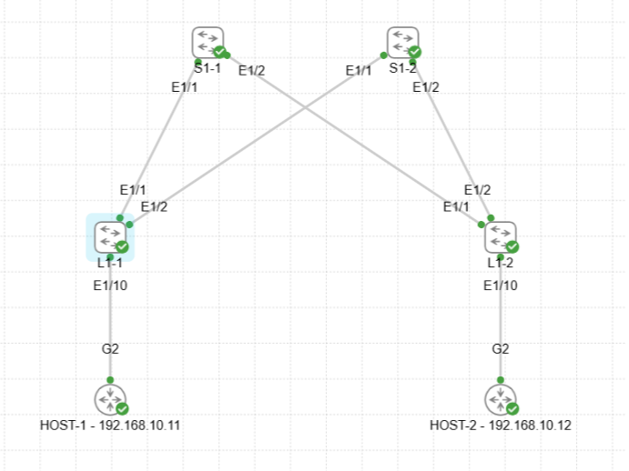

# Домашнее задание
VxLAN. L2 VNI

## Цель:
- настроить Overlay на основе VxLAN EVPN для L2 связанности между клиентами.

## Описание/Пошаговая инструкция выполнения домашнего задания:
В этой самостоятельной работе мы ожидаем, что вы самостоятельно:
- Настроить BGP peering между Leaf и Spine в AF l2vpn evpn
- Настроить связанность между клиентами в первой зоне и убедиться в её наличии
- Зафиксируете в документации - план работы, адресное пространство, схему сети, конфигурацию устройств
- 
# Выполнение: 

## Схема


## Целевое распределение адресного пространства


- 10.0.0.0/8 - LLC Private address space  <br>

- DC1 - 10.1.0.0/16
	- 	 Vl 10 - 10.1.10.0/24 - DC-APP vrf_DC-PROD	
	-    Vl 20 - 10.1.20.0/24 - DC-DB vrf_DC-PROD
	-    Vl 3001 - NO IP - L3VPN_VRF_PROD
- DC2 - 10.2.0.0/16  (reserved) <br>

- 10.x.255.0/24 - Lo0 RID (/32) (.1-.10 - S, .11-.250 - L, .251-.254 - BL)
- 10.x.254.0/24 - Lo1 VTEP_ID (/32) (.1-.10 - S, .11-.250 - L, .251-.254 - BL)  <br>

- 10.х.241.0/24 - P2P INTRASITE Underlay Transport from Spine1 to Leafs (/31) 
- 10.х.242.0/24 - P2P INTRASITE Underlay Transport from Spine2 to Leafs (/31)  <br>

- 10.x.251.0/24 - P2P INTRASITE Underlay Transport from Spines to Boarder Leafs (/31) (.0-.63 - to BL1, .64-.127 - to BL2)  <br>

- 192.168.0.0/16 - EXTERNAL SEGMENT (reserved) <br>

## Задействованные хосты и адреса (у SVI-интерфейсов указана подсеть, на самих SVI используется адрес .1)

### S1-1
```
Eth1/1        eth    10G     S1-1_to_L1-1 10.1.241.0/31
Eth1/2        eth    10G     S1-1_to_L1-2 10.1.241.2/31
Eth1/3        eth    10G     S1-1_to_L1-3 10.1.241.4/31
Eth1/63       eth    10G     S1-1_to_BL1-1 10.1.241.250/31
Eth1/64       eth    10G     S1-1_to_BL1-2 10.1.241.252/31
Lo0                      RID 10.1.255.1/32
Lo1                      VTEP_ID 10.1.254.1/32
```
### S1-2
```
Eth1/1        eth    10G     S1-2_to_L1-1 10.1.242.0/31
Eth1/2        eth    10G     S1-2_to_L1-2 10.1.242.2/31
Eth1/3        eth    10G     S1-2_to_L1-3 10.1.242.4/31
Eth1/63       eth    10G     S1-2_to_BL1-1 10.1.242.250/31
Eth1/64       eth    10G     S1-2_to_BL1-2 10.1.242.252/31
Lo0                      RID 10.1.255.2/32
Lo1                      VTEP_ID 10.1.254.2/32
```
### L1-1
```
Eth1/1        eth    10G     host-1 10.1.10.11
Eth1/2        eth    10G     host-2 10.1.20.12
Eth1/61       eth    10G     L1-1_to_S1-1 10.1.241.1/31
Eth1/62       eth    10G     L1-1_to_S1-2 10.1.242.1/31
Lo0                      RID 10.1.255.11/32
Lo1                      VTEP_ID 10.1.254.11/32
Vlan10                   DC-APP 10.1.10.0/24
Vlan20                   DC-DB 10.1.20.0/24
```
### L1-2
```
Eth1/1        eth    10G     host-3 10.1.10.13
Eth1/61       eth    10G     L1-2_to_S1-1 10.1.241.3/31
Eth1/62       eth    10G     L1-2_to_S1-2 10.1.242.3/31
Lo0                      RID 10.1.255.12/32
Lo1                      VTEP_ID 10.1.254.12/32
Vlan10                   DC-APP 10.1.10.0/24
Vlan20                   DC-DB 10.1.20.0/24
```
### L1-3
```
Eth1/1        eth    10G     host-4 10.1.20.14
Eth1/61       eth    10G     L1-3_to_S1-1 10.1.241.5/31
Eth1/62       eth    10G     L1-3_to_S1-2 10.1.242.5/31
Lo0                      RID 10.1.255.13/32
Lo1                      VTEP_ID 10.1.254.13/32
Vlan10                   DC-APP 10.1.10.0/24
Vlan20                   DC-DB 10.1.20.0/24
```

### Используемые алиасы команд
```
cli alias name sble show bgp l2vpn evpn 
cli alias name sbles show bgp l2vpn evpn summary
cli alias name sblert5 show bgp l2vpn evpn route-type 5
cli alias name snp show nve peers
cli alias name snv show nve vni
cli alias name sirv show ip route vrf 
cli alias name sr show running-config
```
### Используемые команды вывода и диагностики
```
sr vrf vrf_DC-PROD
sr interface vlan 10, vlan 20, vlan 3001
sr bgp
sr interface nve1
sr nv overlay

snv
snp
sirv vrf_DC-PROD

sble
sbles
sblert5
sble <ADDR>
```

## Вывод команд диагностики

### host-1
```
host-1#ping 10.1.10.13
Type escape sequence to abort.
Sending 5, 100-byte ICMP Echos to 10.1.10.13, timeout is 2 seconds:
!!!!!
Success rate is 100 percent (5/5), round-trip min/avg/max = 10/13/17 ms
host-1#ping 10.1.20.12
Type escape sequence to abort.
Sending 5, 100-byte ICMP Echos to 10.1.20.12, timeout is 2 seconds:
!!!!!
Success rate is 100 percent (5/5), round-trip min/avg/max = 4/5/9 ms
host-1#ping 10.1.20.14
Type escape sequence to abort.
Sending 5, 100-byte ICMP Echos to 10.1.20.14, timeout is 2 seconds:
!!!!!
Success rate is 100 percent (5/5), round-trip min/avg/max = 10/16/39 ms
```

### L1-1
```
L1-1# 
L1-1# sr vrf vrf_DC-PROD

!Command: show running-config vrf vrf_DC-PROD
!Running configuration last done at: Thu Oct 22 10:31:11 2026
!Time: Thu Oct 22 11:29:31 2026

version 10.5(3) Bios:version  

interface Vlan10
  vrf member vrf_DC-PROD

interface Vlan20
  vrf member vrf_DC-PROD

interface Vlan3001
  vrf member vrf_DC-PROD
vrf context vrf_DC-PROD
  vni 103001
  rd 10.1.254.11:65001
  address-family ipv4 unicast
    route-target import 65001:103001
    route-target import 65001:103001 evpn
    route-target export 65001:103001
    route-target export 65001:103001 evpn
router bgp 65001
  vrf vrf_DC-PROD
    address-family ipv4 unicast
      advertise l2vpn evpn
      redistribute direct route-map rm_DC-PROD_direct_redistr


L1-1# sr interface vlan 10, vlan 20, vlan 3001

!Command: show running-config interface Vlan10, Vlan20, Vlan3001
!Running configuration last done at: Thu Oct 22 10:31:11 2026
!Time: Thu Oct 22 11:29:35 2026

version 10.5(3) Bios:version  

interface Vlan10
  description DC-APP 10.1.10.0/24
  no shutdown
  vrf member vrf_DC-PROD
  ip address 10.1.10.1/24
  fabric forwarding mode anycast-gateway

interface Vlan20
  description DC-DB 10.1.20.0/24
  no shutdown
  vrf member vrf_DC-PROD
  ip address 10.1.20.1/24
  fabric forwarding mode anycast-gateway

interface Vlan3001
  description L3VPN_VRF_PROD
  no shutdown
  vrf member vrf_DC-PROD
  ip forward

L1-1# sr bgp

!Command: show running-config bgp
!Running configuration last done at: Thu Oct 22 10:31:11 2026
!Time: Thu Oct 22 11:29:39 2026

version 10.5(3) Bios:version  
feature bgp

router bgp 65001
  router-id 10.1.255.11
  reconnect-interval 12
  log-neighbor-changes
  address-family ipv4 unicast
    network 10.1.254.11/32
    network 10.1.255.11/32
    maximum-paths 10
    maximum-paths ibgp 10
  address-family l2vpn evpn
  template peer peer_LEAF_EVPN
    remote-as 65001
    update-source loopback0
    address-family l2vpn evpn
      send-community
      send-community extended
  template peer peer_LEAF_UNDERLAY
    bfd
    remote-as 65001
    timers 3 9
    address-family ipv4 unicast
  neighbor 10.1.241.0
    inherit peer peer_LEAF_UNDERLAY
    description to_Spine1_Underlay
  neighbor 10.1.242.0
    inherit peer peer_LEAF_UNDERLAY
    description to_Spine2_Underlay
  neighbor 10.1.255.1
    inherit peer peer_LEAF_EVPN
    description to_Spine1_EVPN
  neighbor 10.1.255.2
    inherit peer peer_LEAF_EVPN
    description to_Spine2_EVPN
  vrf vrf_DC-PROD
    address-family ipv4 unicast
      advertise l2vpn evpn
      redistribute direct route-map rm_DC-PROD_direct_redistr
evpn
  vni 10010 l2
    rd 10.1.254.11:10010
    route-target import 65001:10010
    route-target export 65001:10010
  vni 10020 l2
    rd 10.1.254.11:10020
    route-target import 65001:10020
    route-target export 65001:10020
vrf context vrf_DC-PROD
  rd 10.1.254.11:65001
  address-family ipv4 unicast
    route-target import 65001:103001
    route-target import 65001:103001 evpn
    route-target export 65001:103001
    route-target export 65001:103001 evpn

L1-1# 
L1-1# sr interface nve1

!Command: show running-config interface nve1
!Running configuration last done at: Thu Oct 22 10:31:11 2026
!Time: Thu Oct 22 11:29:58 2026

version 10.5(3) Bios:version  

interface nve1
  no shutdown
  host-reachability protocol bgp
  source-interface loopback1
  source-interface hold-down-time 1
  member vni 10010
    ingress-replication protocol bgp
  member vni 10020
    ingress-replication protocol bgp
  member vni 103001 associate-vrf

L1-1#  sr nv overlay

!Command: show running-config nv overlay
!Running configuration last done at: Thu Oct 22 10:31:11 2026
!Time: Thu Oct 22 11:30:06 2026

version 10.5(3) Bios:version  
feature nv overlay

vlan 10,20,3001

interface nve1
  no shutdown
  host-reachability protocol bgp
  source-interface loopback1
  source-interface hold-down-time 1
  member vni 10010
    ingress-replication protocol bgp
  member vni 10020
    ingress-replication protocol bgp
  member vni 103001 associate-vrf

L1-1# 
L1-1# snv
Codes: CP - Control Plane        DP - Data Plane          
       UC - Unconfigured         SA - Suppress ARP        
       S-ND - Suppress ND        
       SU - Suppress Unknown Unicast 
       Xconn - Crossconnect      
       MS-IR - Multisite Ingress Replication 
       HYB - Hybrid IRB mode
    
Interface VNI      Multicast-group   State Mode Type [BD/VRF]      Flags
--------- -------- ----------------- ----- ---- ------------------ -----
nve1      10010    UnicastBGP        Up    CP   L2 [10]                 
nve1      10020    UnicastBGP        Up    CP   L2 [20]                 
nve1      103001   n/a               Up    CP   L3 [vrf_DC-PROD]        

L1-1# snp
Interface Peer-IP                                 State LearnType Uptime   Route
r-Mac       
--------- --------------------------------------  ----- --------- -------- -----
------------
nve1      10.1.254.12                             Up    CP        02:15:12 5239.
2f8c.1b08   
nve1      10.1.254.13                             Up    CP        02:15:11 52ff.
fe16.1b08   

L1-1# sirv vrf_DC-PROD
IP Route Table for VRF "vrf_DC-PROD"
'*' denotes best ucast next-hop
'**' denotes best mcast next-hop
'[x/y]' denotes [preference/metric]
'%<string>' in via output denotes VRF <string>

10.1.10.0/24, ubest/mbest: 1/0, attached
    *via 10.1.10.1, Vlan10, [0/0], 02:18:22, direct
10.1.10.1/32, ubest/mbest: 1/0, attached
    *via 10.1.10.1, Vlan10, [0/0], 02:18:22, local
10.1.10.11/32, ubest/mbest: 1/0, attached
    *via 10.1.10.11, Vlan10, [190/0], 01:16:44, hmm
10.1.10.13/32, ubest/mbest: 1/0
    *via 10.1.254.12%default, [200/0], 02:15:30, bgp-65001, internal, tag 65001,
 segid: 103001 tunnelid: 0xa01fe0c encap: VXLAN
 
10.1.20.0/24, ubest/mbest: 1/0, attached
    *via 10.1.20.1, Vlan20, [0/0], 02:18:22, direct
10.1.20.1/32, ubest/mbest: 1/0, attached
    *via 10.1.20.1, Vlan20, [0/0], 02:18:22, local
10.1.20.12/32, ubest/mbest: 1/0, attached
    *via 10.1.20.12, Vlan20, [190/0], 00:16:43, hmm
10.1.20.14/32, ubest/mbest: 1/0
    *via 10.1.254.13%default, [200/0], 00:39:43, bgp-65001, internal, tag 65001,
 segid: 103001 tunnelid: 0xa01fe0d encap: VXLAN
 

L1-1# sble
BGP routing table information for VRF default, address family L2VPN EVPN
BGP table version is 74, Local Router ID is 10.1.255.11
Status: s-suppressed, x-deleted, S-stale, d-dampened, h-history, *-valid, >-best
Path type: i-internal, e-external, c-confed, l-local, a-aggregate, r-redist, I-i
njected
Origin codes: i - IGP, e - EGP, ? - incomplete, | - multipath, & - backup, 2 - b
est2

   Network            Next Hop            Metric     LocPrf     Weight Path
Route Distinguisher: 10.1.254.11:10010    (L2VNI 10010)
*>l[2]:[0]:[0]:[48]:[5254.008a.b993]:[0]:[0.0.0.0]/216
                      10.1.254.11                       100      32768 i
*>i[2]:[0]:[0]:[48]:[5254.00d3.1350]:[0]:[0.0.0.0]/216
                      10.1.254.12                       100          0 i
*>l[2]:[0]:[0]:[48]:[5254.008a.b993]:[32]:[10.1.10.11]/272
                      10.1.254.11                       100      32768 i
*>i[2]:[0]:[0]:[48]:[5254.00d3.1350]:[32]:[10.1.10.13]/272
                      10.1.254.12                       100          0 i
*>l[3]:[0]:[32]:[10.1.254.11]/88
                      10.1.254.11                       100      32768 i
*>i[3]:[0]:[32]:[10.1.254.12]/88
                      10.1.254.12                       100          0 i
*>i[3]:[0]:[32]:[10.1.254.13]/88
                      10.1.254.13                       100          0 i

Route Distinguisher: 10.1.254.11:10020    (L2VNI 10020)
*>i[2]:[0]:[0]:[48]:[5254.0015.ad54]:[0]:[0.0.0.0]/216
                      10.1.254.13                       100          0 i
*>l[2]:[0]:[0]:[48]:[5254.00c0.5a23]:[0]:[0.0.0.0]/216
                      10.1.254.11                       100      32768 i
*>i[2]:[0]:[0]:[48]:[5254.0015.ad54]:[32]:[10.1.20.14]/272
                      10.1.254.13                       100          0 i
*>l[2]:[0]:[0]:[48]:[5254.00c0.5a23]:[32]:[10.1.20.12]/272
                      10.1.254.11                       100      32768 i
*>l[3]:[0]:[32]:[10.1.254.11]/88
                      10.1.254.11                       100      32768 i
*>i[3]:[0]:[32]:[10.1.254.12]/88
                      10.1.254.12                       100          0 i
*>i[3]:[0]:[32]:[10.1.254.13]/88
                      10.1.254.13                       100          0 i

Route Distinguisher: 10.1.254.12:10010
*>i[2]:[0]:[0]:[48]:[5254.00d3.1350]:[0]:[0.0.0.0]/216
                      10.1.254.12                       100          0 i
* i                   10.1.254.12                       100          0 i
*>i[2]:[0]:[0]:[48]:[5254.00d3.1350]:[32]:[10.1.10.13]/272
                      10.1.254.12                       100          0 i
* i                   10.1.254.12                       100          0 i
*>i[3]:[0]:[32]:[10.1.254.12]/88
                      10.1.254.12                       100          0 i
* i                   10.1.254.12                       100          0 i

Route Distinguisher: 10.1.254.12:10020
*>i[3]:[0]:[32]:[10.1.254.12]/88
                      10.1.254.12                       100          0 i
* i                   10.1.254.12                       100          0 i

Route Distinguisher: 10.1.254.12:65001
*>i[5]:[0]:[0]:[24]:[10.1.10.0]/224
                      10.1.254.12              0        100          0 ?
* i                   10.1.254.12              0        100          0 ?
*>i[5]:[0]:[0]:[24]:[10.1.20.0]/224
                      10.1.254.12              0        100          0 ?
* i                   10.1.254.12              0        100          0 ?

Route Distinguisher: 10.1.254.13:10010
*>i[3]:[0]:[32]:[10.1.254.13]/88
                      10.1.254.13                       100          0 i
* i                   10.1.254.13                       100          0 i

Route Distinguisher: 10.1.254.13:10020
*>i[2]:[0]:[0]:[48]:[5254.0015.ad54]:[0]:[0.0.0.0]/216
                      10.1.254.13                       100          0 i
* i                   10.1.254.13                       100          0 i
* i[2]:[0]:[0]:[48]:[5254.0015.ad54]:[32]:[10.1.20.14]/272
                      10.1.254.13                       100          0 i
*>i                   10.1.254.13                       100          0 i
*>i[3]:[0]:[32]:[10.1.254.13]/88
                      10.1.254.13                       100          0 i
* i                   10.1.254.13                       100          0 i

Route Distinguisher: 10.1.254.13:65001
*>i[5]:[0]:[0]:[24]:[10.1.10.0]/224
                      10.1.254.13              0        100          0 ?
* i                   10.1.254.13              0        100          0 ?
*>i[5]:[0]:[0]:[24]:[10.1.20.0]/224
                      10.1.254.13              0        100          0 ?
* i                   10.1.254.13              0        100          0 ?

Route Distinguisher: 10.1.254.11:65001    (L3VNI 103001)
*>i[2]:[0]:[0]:[48]:[5254.0015.ad54]:[32]:[10.1.20.14]/272
                      10.1.254.13                       100          0 i
*>i[2]:[0]:[0]:[48]:[5254.00d3.1350]:[32]:[10.1.10.13]/272
                      10.1.254.12                       100          0 i
* i[5]:[0]:[0]:[24]:[10.1.10.0]/224
                      10.1.254.13              0        100          0 ?
* i                   10.1.254.12              0        100          0 ?
*>l                   10.1.254.11              0        100      32768 ?
* i[5]:[0]:[0]:[24]:[10.1.20.0]/224
                      10.1.254.13              0        100          0 ?
* i                   10.1.254.12              0        100          0 ?
*>l                   10.1.254.11              0        100      32768 ?

L1-1#  sbles
BGP summary information for VRF default, address family L2VPN EVPN
BGP router identifier 10.1.255.11, local AS number 65001
BGP table version is 74, L2VPN EVPN config peers 2, capable peers 2
30 network entries and 46 paths using 11128 bytes of memory
BGP attribute entries [39/14352], BGP AS path entries [0/0]
BGP community entries [0/0], BGP clusterlist entries [4/16]

Neighbor        V    AS    MsgRcvd    MsgSent   TblVer  InQ OutQ Up/Down  State/
PfxRcd
10.1.255.1      4 65001        154        145       74    0    0 02:15:49 12    
    
10.1.255.2      4 65001        154        145       74    0    0 02:15:48 12    
    

Neighbor        T    AS Type-1     Type-2     Type-3     Type-4     Type-5     T
ype-6     Type-7     Type-8     Type-12   
10.1.255.1      I 65001 0          4          4          0          4          0
          0          0          0         
10.1.255.2      I 65001 0          4          4          0          4          0
          0          0          0         
L1-1# 
L1-1# sblert5
BGP routing table information for VRF default, address family L2VPN EVPN
Route Distinguisher: 10.1.254.12:65001
BGP routing table entry for [5]:[0]:[0]:[24]:[10.1.10.0]/224, version 30
Paths: (2 available, best #1)
Flags: (0x000002) (high32 00000000) on xmit-list, is not in l2rib/evpn, is not i
n HW

  Advertised path-id 1
  Path type: internal, path is valid, is best path, no labeled nexthop
             Imported to 2 destination(s)
             Imported paths list: vrf_DC-PROD L3-103001
  Gateway IP: 0.0.0.0
  AS-Path: NONE, path sourced internal to AS
    10.1.254.12 (metric 0) from 10.1.255.1 (10.1.255.1)
      Origin incomplete, MED 0, localpref 100, weight 0
      Received label 103001
      Extcommunity: RT:65001:103001 ENCAP:8 Router MAC:5239.2f8c.1b08
      Originator: 10.1.255.12 Cluster list: 10.1.255.1 

  Path type: internal, path is valid, not best reason: Neighbor Address, no labe
led nexthop
  Gateway IP: 0.0.0.0
  AS-Path: NONE, path sourced internal to AS
    10.1.254.12 (metric 0) from 10.1.255.2 (10.1.255.2)
      Origin incomplete, MED 0, localpref 100, weight 0
      Received label 103001
      Extcommunity: RT:65001:103001 ENCAP:8 Router MAC:5239.2f8c.1b08
      Originator: 10.1.255.12 Cluster list: 10.1.255.2 

  Path-id 1 not advertised to any peer
BGP routing table entry for [5]:[0]:[0]:[24]:[10.1.20.0]/224, version 31
Paths: (2 available, best #1)
Flags: (0x000002) (high32 00000000) on xmit-list, is not in l2rib/evpn, is not i
n HW

  Advertised path-id 1
  Path type: internal, path is valid, is best path, no labeled nexthop
             Imported to 2 destination(s)
             Imported paths list: vrf_DC-PROD L3-103001
  Gateway IP: 0.0.0.0
  AS-Path: NONE, path sourced internal to AS
    10.1.254.12 (metric 0) from 10.1.255.1 (10.1.255.1)
      Origin incomplete, MED 0, localpref 100, weight 0
      Received label 103001
      Extcommunity: RT:65001:103001 ENCAP:8 Router MAC:5239.2f8c.1b08
      Originator: 10.1.255.12 Cluster list: 10.1.255.1 

  Path type: internal, path is valid, not best reason: Neighbor Address, no labe
led nexthop
  Gateway IP: 0.0.0.0
  AS-Path: NONE, path sourced internal to AS
    10.1.254.12 (metric 0) from 10.1.255.2 (10.1.255.2)
      Origin incomplete, MED 0, localpref 100, weight 0
      Received label 103001
      Extcommunity: RT:65001:103001 ENCAP:8 Router MAC:5239.2f8c.1b08
      Originator: 10.1.255.12 Cluster list: 10.1.255.2 

  Path-id 1 not advertised to any peer

Route Distinguisher: 10.1.254.13:65001
BGP routing table entry for [5]:[0]:[0]:[24]:[10.1.10.0]/224, version 46
Paths: (2 available, best #1)
Flags: (0x000002) (high32 00000000) on xmit-list, is not in l2rib/evpn, is not i
n HW

  Advertised path-id 1
  Path type: internal, path is valid, is best path, no labeled nexthop
             Imported to 2 destination(s)
             Imported paths list: vrf_DC-PROD L3-103001
  Gateway IP: 0.0.0.0
  AS-Path: NONE, path sourced internal to AS
    10.1.254.13 (metric 0) from 10.1.255.1 (10.1.255.1)
      Origin incomplete, MED 0, localpref 100, weight 0
      Received label 103001
      Extcommunity: RT:65001:103001 ENCAP:8 Router MAC:52ff.fe16.1b08
      Originator: 10.1.255.13 Cluster list: 10.1.255.1 

  Path type: internal, path is valid, not best reason: Neighbor Address, no labe
led nexthop
  Gateway IP: 0.0.0.0
  AS-Path: NONE, path sourced internal to AS
    10.1.254.13 (metric 0) from 10.1.255.2 (10.1.255.2)
      Origin incomplete, MED 0, localpref 100, weight 0
      Received label 103001
      Extcommunity: RT:65001:103001 ENCAP:8 Router MAC:52ff.fe16.1b08
      Originator: 10.1.255.13 Cluster list: 10.1.255.2 

  Path-id 1 not advertised to any peer
BGP routing table entry for [5]:[0]:[0]:[24]:[10.1.20.0]/224, version 47
Paths: (2 available, best #1)
Flags: (0x000002) (high32 00000000) on xmit-list, is not in l2rib/evpn, is not i
n HW

  Advertised path-id 1
  Path type: internal, path is valid, is best path, no labeled nexthop
             Imported to 2 destination(s)
             Imported paths list: vrf_DC-PROD L3-103001
  Gateway IP: 0.0.0.0
  AS-Path: NONE, path sourced internal to AS
    10.1.254.13 (metric 0) from 10.1.255.1 (10.1.255.1)
      Origin incomplete, MED 0, localpref 100, weight 0
      Received label 103001
      Extcommunity: RT:65001:103001 ENCAP:8 Router MAC:52ff.fe16.1b08
      Originator: 10.1.255.13 Cluster list: 10.1.255.1 

  Path type: internal, path is valid, not best reason: Neighbor Address, no labe
led nexthop
  Gateway IP: 0.0.0.0
  AS-Path: NONE, path sourced internal to AS
    10.1.254.13 (metric 0) from 10.1.255.2 (10.1.255.2)
      Origin incomplete, MED 0, localpref 100, weight 0
      Received label 103001
      Extcommunity: RT:65001:103001 ENCAP:8 Router MAC:52ff.fe16.1b08
      Originator: 10.1.255.13 Cluster list: 10.1.255.2 

  Path-id 1 not advertised to any peer

Route Distinguisher: 10.1.254.11:65001    (L3VNI 103001)
BGP routing table entry for [5]:[0]:[0]:[24]:[10.1.10.0]/224, version 49
Paths: (3 available, best #3)
Flags: (0x000002) (high32 00000000) on xmit-list, is not in l2rib/evpn

  Path type: internal, path is valid, not best reason: Router Id, no labeled nex
thop
             Imported from 10.1.254.13:65001:[5]:[0]:[0]:[24]:[10.1.10.0]/224 
  Gateway IP: 0.0.0.0
  AS-Path: NONE, path sourced internal to AS
    10.1.254.13 (metric 0) from 10.1.255.1 (10.1.255.1)
      Origin incomplete, MED 0, localpref 100, weight 0
      Received label 103001
      Extcommunity: RT:65001:103001 ENCAP:8 Router MAC:52ff.fe16.1b08
      Originator: 10.1.255.13 Cluster list: 10.1.255.1 

  Path type: internal, path is valid, not best reason: Weight, no labeled nextho
p
             Imported from 10.1.254.12:65001:[5]:[0]:[0]:[24]:[10.1.10.0]/224 
  Gateway IP: 0.0.0.0
  AS-Path: NONE, path sourced internal to AS
    10.1.254.12 (metric 0) from 10.1.255.1 (10.1.255.1)
      Origin incomplete, MED 0, localpref 100, weight 0
      Received label 103001
      Extcommunity: RT:65001:103001 ENCAP:8 Router MAC:5239.2f8c.1b08
      Originator: 10.1.255.12 Cluster list: 10.1.255.1 

  Advertised path-id 1
  Path type: local, path is valid, is best path, no labeled nexthop
  Gateway IP: 0.0.0.0
  AS-Path: NONE, path locally originated
    10.1.254.11 (metric 0) from 0.0.0.0 (10.1.255.11)
      Origin incomplete, MED 0, localpref 100, weight 32768
      Received label 103001
      Extcommunity: RT:65001:103001 ENCAP:8 Router MAC:52ea.c915.1b08

  Path-id 1 advertised to peers:
    10.1.255.1         10.1.255.2     
BGP routing table entry for [5]:[0]:[0]:[24]:[10.1.20.0]/224, version 50
Paths: (3 available, best #3)
Flags: (0x000002) (high32 00000000) on xmit-list, is not in l2rib/evpn

  Path type: internal, path is valid, not best reason: Router Id, no labeled nex
thop
             Imported from 10.1.254.13:65001:[5]:[0]:[0]:[24]:[10.1.20.0]/224 
  Gateway IP: 0.0.0.0
  AS-Path: NONE, path sourced internal to AS
    10.1.254.13 (metric 0) from 10.1.255.1 (10.1.255.1)
      Origin incomplete, MED 0, localpref 100, weight 0
      Received label 103001
      Extcommunity: RT:65001:103001 ENCAP:8 Router MAC:52ff.fe16.1b08
      Originator: 10.1.255.13 Cluster list: 10.1.255.1 

  Path type: internal, path is valid, not best reason: Weight, no labeled nextho
p
             Imported from 10.1.254.12:65001:[5]:[0]:[0]:[24]:[10.1.20.0]/224 
  Gateway IP: 0.0.0.0
  AS-Path: NONE, path sourced internal to AS
    10.1.254.12 (metric 0) from 10.1.255.1 (10.1.255.1)
      Origin incomplete, MED 0, localpref 100, weight 0
      Received label 103001
      Extcommunity: RT:65001:103001 ENCAP:8 Router MAC:5239.2f8c.1b08
      Originator: 10.1.255.12 Cluster list: 10.1.255.1 

  Advertised path-id 1
  Path type: local, path is valid, is best path, no labeled nexthop
  Gateway IP: 0.0.0.0
  AS-Path: NONE, path locally originated
    10.1.254.11 (metric 0) from 0.0.0.0 (10.1.255.11)
      Origin incomplete, MED 0, localpref 100, weight 32768
      Received label 103001
      Extcommunity: RT:65001:103001 ENCAP:8 Router MAC:52ea.c915.1b08

  Path-id 1 advertised to peers:
    10.1.255.1         10.1.255.2     

L1-1#       sble 10.1.20.14
BGP routing table information for VRF default, address family L2VPN EVPN
Route Distinguisher: 10.1.254.11:10020    (L2VNI 10020)
BGP routing table entry for [2]:[0]:[0]:[48]:[5254.0015.ad54]:[32]:[10.1.20.14]/
272, version 62
Paths: (1 available, best #1)
Flags: (0x000212) (high32 00000000) on xmit-list, is in l2rib/evpn, is not in HW

  Advertised path-id 1
  Path type: internal, path is valid, is best path, no labeled nexthop, in rib
             Imported from 10.1.254.13:10020:[2]:[0]:[0]:[48]:[5254.0015.ad54]:[
32]:[10.1.20.14]/272 
  AS-Path: NONE, path sourced internal to AS
    10.1.254.13 (metric 0) from 10.1.255.1 (10.1.255.1)
      Origin IGP, MED not set, localpref 100, weight 0
      Received label 10020 103001
      Extcommunity: RT:65001:10020 RT:65001:103001 ENCAP:8 Router MAC:52ff.fe16.
1b08
      Originator: 10.1.255.13 Cluster list: 10.1.255.1 

  Path-id 1 not advertised to any peer

Route Distinguisher: 10.1.254.13:10020
BGP routing table entry for [2]:[0]:[0]:[48]:[5254.0015.ad54]:[32]:[10.1.20.14]/
272, version 64
Paths: (2 available, best #2)
Flags: (0x000202) (high32 00000000) on xmit-list, is not in l2rib/evpn, is not i
n HW

  Path type: internal, path is valid, not best reason: Neighbor Address, no labe
led nexthop
  AS-Path: NONE, path sourced internal to AS
    10.1.254.13 (metric 0) from 10.1.255.2 (10.1.255.2)
      Origin IGP, MED not set, localpref 100, weight 0
      Received label 10020 103001
      Extcommunity: RT:65001:10020 RT:65001:103001 ENCAP:8 Router MAC:52ff.fe16.
1b08
      Originator: 10.1.255.13 Cluster list: 10.1.255.2 

  Advertised path-id 1
  Path type: internal, path is valid, is best path, no labeled nexthop
             Imported to 3 destination(s)
             Imported paths list: vrf_DC-PROD L3-103001 L2-10020
  AS-Path: NONE, path sourced internal to AS
    10.1.254.13 (metric 0) from 10.1.255.1 (10.1.255.1)
      Origin IGP, MED not set, localpref 100, weight 0
      Received label 10020 103001
      Extcommunity: RT:65001:10020 RT:65001:103001 ENCAP:8 Router MAC:52ff.fe16.
1b08
      Originator: 10.1.255.13 Cluster list: 10.1.255.1 

  Path-id 1 not advertised to any peer

Route Distinguisher: 10.1.254.11:65001    (L3VNI 103001)
BGP routing table entry for [2]:[0]:[0]:[48]:[5254.0015.ad54]:[32]:[10.1.20.14]/
272, version 63
Paths: (1 available, best #1)
Flags: (0x000202) (high32 00000000) on xmit-list, is not in l2rib/evpn, is not i
n HW

  Advertised path-id 1
  Path type: internal, path is valid, is best path, no labeled nexthop
             Imported from 10.1.254.13:10020:[2]:[0]:[0]:[48]:[5254.0015.ad54]:[
32]:[10.1.20.14]/272 
  AS-Path: NONE, path sourced internal to AS
    10.1.254.13 (metric 0) from 10.1.255.1 (10.1.255.1)
      Origin IGP, MED not set, localpref 100, weight 0
      Received label 10020 103001
      Extcommunity: RT:65001:10020 RT:65001:103001 ENCAP:8 Router MAC:52ff.fe16.
1b08
      Originator: 10.1.255.13 Cluster list: 10.1.255.1 

  Path-id 1 not advertised to any peer

L1-1# 
```

### L1-2
```
L1-2# 
L1-2# sr vrf vrf_DC-PROD

!Command: show running-config vrf vrf_DC-PROD
!Running configuration last done at: Thu Oct 22 10:51:37 2026
!Time: Thu Oct 22 11:35:24 2026

version 10.5(3) Bios:version  

interface Vlan10
  vrf member vrf_DC-PROD

interface Vlan20
  vrf member vrf_DC-PROD

interface Vlan3001
  vrf member vrf_DC-PROD
vrf context vrf_DC-PROD
  vni 103001
  rd 10.1.254.12:65001
  address-family ipv4 unicast
    route-target import 65001:103001
    route-target import 65001:103001 evpn
    route-target export 65001:103001
    route-target export 65001:103001 evpn
router bgp 65001
  vrf vrf_DC-PROD
    address-family ipv4 unicast
      advertise l2vpn evpn
      redistribute direct route-map rm_DC-PROD_direct_redistr


L1-2# 
L1-2# sr interface vlan 10, vlan 20, vlan 3001

!Command: show running-config interface Vlan10, Vlan20, Vlan3001
!Running configuration last done at: Thu Oct 22 10:51:37 2026
!Time: Thu Oct 22 11:35:30 2026

version 10.5(3) Bios:version  

interface Vlan10
  description DC-APP 10.1.10.0/24
  no shutdown
  vrf member vrf_DC-PROD
  ip address 10.1.10.1/24
  fabric forwarding mode anycast-gateway

interface Vlan20
  description DC-DB 10.1.20.0/24
  no shutdown
  vrf member vrf_DC-PROD
  ip address 10.1.20.1/24
  fabric forwarding mode anycast-gateway

interface Vlan3001
  description L3VPN_VRF_PROD
  no shutdown
  vrf member vrf_DC-PROD
  ip forward

L1-2# 
L1-2# sr bgp

!Command: show running-config bgp
!Running configuration last done at: Thu Oct 22 10:51:37 2026
!Time: Thu Oct 22 11:35:35 2026

version 10.5(3) Bios:version  
feature bgp

router bgp 65001
  router-id 10.1.255.12
  reconnect-interval 12
  log-neighbor-changes
  address-family ipv4 unicast
    network 10.1.254.12/32
    network 10.1.255.12/32
    maximum-paths 10
    maximum-paths ibgp 10
  address-family l2vpn evpn
  template peer peer_LEAF_EVPN
    remote-as 65001
    update-source loopback0
    address-family l2vpn evpn
      send-community
      send-community extended
  template peer peer_LEAF_UNDERLAY
    bfd
    remote-as 65001
    timers 3 9
    address-family ipv4 unicast
  neighbor 10.1.241.2
    inherit peer peer_LEAF_UNDERLAY
    description to_Spine1_Underlay
  neighbor 10.1.242.2
    inherit peer peer_LEAF_UNDERLAY
    description to_Spine2_Underlay
  neighbor 10.1.255.1
    inherit peer peer_LEAF_EVPN
    description to_Spine1_EVPN
  neighbor 10.1.255.2
    inherit peer peer_LEAF_EVPN
    description to_Spine2_EVPN
  vrf vrf_DC-PROD
    address-family ipv4 unicast
      advertise l2vpn evpn
      redistribute direct route-map rm_DC-PROD_direct_redistr
evpn
  vni 10010 l2
    rd 10.1.254.12:10010
    route-target import 65001:10010
    route-target export 65001:10010
  vni 10020 l2
    rd 10.1.254.12:10020
    route-target import 65001:10020
    route-target export 65001:10020
vrf context vrf_DC-PROD
  rd 10.1.254.12:65001
  address-family ipv4 unicast
    route-target import 65001:103001
    route-target import 65001:103001 evpn
    route-target export 65001:103001
    route-target export 65001:103001 evpn


L1-2# 
L1-2# sr interface nve1

!Command: show running-config interface nve1
!Running configuration last done at: Thu Oct 22 10:51:37 2026
!Time: Thu Oct 22 11:35:40 2026

version 10.5(3) Bios:version  

interface nve1
  no shutdown
  host-reachability protocol bgp
  source-interface loopback1
  source-interface hold-down-time 1
  member vni 10010
    ingress-replication protocol bgp
  member vni 10020
    ingress-replication protocol bgp
  member vni 103001 associate-vrf

L1-2# 
L1-2#  sr nv overlay

!Command: show running-config nv overlay
!Running configuration last done at: Thu Oct 22 10:51:37 2026
!Time: Thu Oct 22 11:35:45 2026

version 10.5(3) Bios:version  
feature nv overlay

vlan 10,20,3001

interface nve1
  no shutdown
  host-reachability protocol bgp
  source-interface loopback1
  source-interface hold-down-time 1
  member vni 10010
    ingress-replication protocol bgp
  member vni 10020
    ingress-replication protocol bgp
  member vni 103001 associate-vrf

L1-2# 
L1-2#  snv
Codes: CP - Control Plane        DP - Data Plane          
       UC - Unconfigured         SA - Suppress ARP        
       S-ND - Suppress ND        
       SU - Suppress Unknown Unicast 
       Xconn - Crossconnect      
       MS-IR - Multisite Ingress Replication 
       HYB - Hybrid IRB mode
    
Interface VNI      Multicast-group   State Mode Type [BD/VRF]      Flags
--------- -------- ----------------- ----- ---- ------------------ -----
nve1      10010    UnicastBGP        Up    CP   L2 [10]                 
nve1      10020    UnicastBGP        Up    CP   L2 [20]                 
nve1      103001   n/a               Up    CP   L3 [vrf_DC-PROD]        

L1-2# 
L1-2#  snp
Interface Peer-IP                                 State LearnType Uptime   Route
r-Mac       
--------- --------------------------------------  ----- --------- -------- -----
------------
nve1      10.1.254.11                             Up    CP        02:20:51 52ea.
c915.1b08   
nve1      10.1.254.13                             Up    CP        02:20:50 52ff.
fe16.1b08   

L1-2# 
L1-2#  sirv vrf_DC-PROD
IP Route Table for VRF "vrf_DC-PROD"
'*' denotes best ucast next-hop
'**' denotes best mcast next-hop
'[x/y]' denotes [preference/metric]
'%<string>' in via output denotes VRF <string>

10.1.10.0/24, ubest/mbest: 1/0, attached
    *via 10.1.10.1, Vlan10, [0/0], 02:23:22, direct
10.1.10.1/32, ubest/mbest: 1/0, attached
    *via 10.1.10.1, Vlan10, [0/0], 02:23:22, local
10.1.10.11/32, ubest/mbest: 1/0
    *via 10.1.254.11%default, [200/0], 02:20:57, bgp-65001, internal, tag 65001,
 segid: 103001 tunnelid: 0xa01fe0b encap: VXLAN
 
10.1.10.13/32, ubest/mbest: 1/0, attached
    *via 10.1.10.13, Vlan10, [190/0], 01:21:42, hmm
10.1.20.0/24, ubest/mbest: 1/0, attached
    *via 10.1.20.1, Vlan20, [0/0], 02:23:21, direct
10.1.20.1/32, ubest/mbest: 1/0, attached
    *via 10.1.20.1, Vlan20, [0/0], 02:23:21, local
10.1.20.12/32, ubest/mbest: 1/0
    *via 10.1.254.11%default, [200/0], 02:20:57, bgp-65001, internal, tag 65001,
 segid: 103001 tunnelid: 0xa01fe0b encap: VXLAN
 
10.1.20.14/32, ubest/mbest: 1/0
    *via 10.1.254.13%default, [200/0], 00:45:10, bgp-65001, internal, tag 65001,
 segid: 103001 tunnelid: 0xa01fe0d encap: VXLAN
 

L1-2# 
L1-2# sble
BGP routing table information for VRF default, address family L2VPN EVPN
BGP table version is 93, Local Router ID is 10.1.255.12
Status: s-suppressed, x-deleted, S-stale, d-dampened, h-history, *-valid, >-best
Path type: i-internal, e-external, c-confed, l-local, a-aggregate, r-redist, I-i
njected
Origin codes: i - IGP, e - EGP, ? - incomplete, | - multipath, & - backup, 2 - b
est2

   Network            Next Hop            Metric     LocPrf     Weight Path
Route Distinguisher: 10.1.254.11:10010
*>i[2]:[0]:[0]:[48]:[5254.008a.b993]:[0]:[0.0.0.0]/216
                      10.1.254.11                       100          0 i
* i                   10.1.254.11                       100          0 i
*>i[2]:[0]:[0]:[48]:[5254.008a.b993]:[32]:[10.1.10.11]/272
                      10.1.254.11                       100          0 i
* i                   10.1.254.11                       100          0 i
*>i[3]:[0]:[32]:[10.1.254.11]/88
                      10.1.254.11                       100          0 i
* i                   10.1.254.11                       100          0 i

Route Distinguisher: 10.1.254.11:10020
*>i[2]:[0]:[0]:[48]:[5254.00c0.5a23]:[0]:[0.0.0.0]/216
                      10.1.254.11                       100          0 i
* i                   10.1.254.11                       100          0 i
*>i[2]:[0]:[0]:[48]:[5254.00c0.5a23]:[32]:[10.1.20.12]/272
                      10.1.254.11                       100          0 i
* i                   10.1.254.11                       100          0 i
*>i[3]:[0]:[32]:[10.1.254.11]/88
                      10.1.254.11                       100          0 i
* i                   10.1.254.11                       100          0 i

Route Distinguisher: 10.1.254.11:65001
*>i[5]:[0]:[0]:[24]:[10.1.10.0]/224
                      10.1.254.11              0        100          0 ?
* i                   10.1.254.11              0        100          0 ?
*>i[5]:[0]:[0]:[24]:[10.1.20.0]/224
                      10.1.254.11              0        100          0 ?
* i                   10.1.254.11              0        100          0 ?

Route Distinguisher: 10.1.254.12:10010    (L2VNI 10010)
*>i[2]:[0]:[0]:[48]:[5254.008a.b993]:[0]:[0.0.0.0]/216
                      10.1.254.11                       100          0 i
*>l[2]:[0]:[0]:[48]:[5254.00d3.1350]:[0]:[0.0.0.0]/216
                      10.1.254.12                       100      32768 i
*>i[2]:[0]:[0]:[48]:[5254.008a.b993]:[32]:[10.1.10.11]/272
                      10.1.254.11                       100          0 i
*>l[2]:[0]:[0]:[48]:[5254.00d3.1350]:[32]:[10.1.10.13]/272
                      10.1.254.12                       100      32768 i
*>i[3]:[0]:[32]:[10.1.254.11]/88
                      10.1.254.11                       100          0 i
*>l[3]:[0]:[32]:[10.1.254.12]/88
                      10.1.254.12                       100      32768 i
*>i[3]:[0]:[32]:[10.1.254.13]/88
                      10.1.254.13                       100          0 i

Route Distinguisher: 10.1.254.12:10020    (L2VNI 10020)
*>i[2]:[0]:[0]:[48]:[5254.0015.ad54]:[0]:[0.0.0.0]/216
                      10.1.254.13                       100          0 i
*>i[2]:[0]:[0]:[48]:[5254.00c0.5a23]:[0]:[0.0.0.0]/216
                      10.1.254.11                       100          0 i
*>i[2]:[0]:[0]:[48]:[5254.0015.ad54]:[32]:[10.1.20.14]/272
                      10.1.254.13                       100          0 i
*>i[2]:[0]:[0]:[48]:[5254.00c0.5a23]:[32]:[10.1.20.12]/272
                      10.1.254.11                       100          0 i
*>i[3]:[0]:[32]:[10.1.254.11]/88
                      10.1.254.11                       100          0 i
*>l[3]:[0]:[32]:[10.1.254.12]/88
                      10.1.254.12                       100      32768 i
*>i[3]:[0]:[32]:[10.1.254.13]/88
                      10.1.254.13                       100          0 i

Route Distinguisher: 10.1.254.13:10010
*>i[3]:[0]:[32]:[10.1.254.13]/88
                      10.1.254.13                       100          0 i
* i                   10.1.254.13                       100          0 i

Route Distinguisher: 10.1.254.13:10020
* i[2]:[0]:[0]:[48]:[5254.0015.ad54]:[0]:[0.0.0.0]/216
                      10.1.254.13                       100          0 i
*>i                   10.1.254.13                       100          0 i
* i[2]:[0]:[0]:[48]:[5254.0015.ad54]:[32]:[10.1.20.14]/272
                      10.1.254.13                       100          0 i
*>i                   10.1.254.13                       100          0 i
* i[3]:[0]:[32]:[10.1.254.13]/88
                      10.1.254.13                       100          0 i
*>i                   10.1.254.13                       100          0 i

Route Distinguisher: 10.1.254.13:65001
*>i[5]:[0]:[0]:[24]:[10.1.10.0]/224
                      10.1.254.13              0        100          0 ?
* i                   10.1.254.13              0        100          0 ?
*>i[5]:[0]:[0]:[24]:[10.1.20.0]/224
                      10.1.254.13              0        100          0 ?
* i                   10.1.254.13              0        100          0 ?

Route Distinguisher: 10.1.254.12:65001    (L3VNI 103001)
*>i[2]:[0]:[0]:[48]:[5254.0015.ad54]:[32]:[10.1.20.14]/272
                      10.1.254.13                       100          0 i
*>i[2]:[0]:[0]:[48]:[5254.008a.b993]:[32]:[10.1.10.11]/272
                      10.1.254.11                       100          0 i
*>i[2]:[0]:[0]:[48]:[5254.00c0.5a23]:[32]:[10.1.20.12]/272
                      10.1.254.11                       100          0 i
* i[5]:[0]:[0]:[24]:[10.1.10.0]/224
                      10.1.254.13              0        100          0 ?
* i                   10.1.254.11              0        100          0 ?
*>l                   10.1.254.12              0        100      32768 ?
* i[5]:[0]:[0]:[24]:[10.1.20.0]/224
                      10.1.254.13              0        100          0 ?
* i                   10.1.254.11              0        100          0 ?
*>l                   10.1.254.12              0        100      32768 ?

L1-2# 
L1-2# sbles
BGP summary information for VRF default, address family L2VPN EVPN
BGP router identifier 10.1.255.12, local AS number 65001
BGP table version is 93, L2VPN EVPN config peers 2, capable peers 2
33 network entries and 51 paths using 12116 bytes of memory
BGP attribute entries [44/16192], BGP AS path entries [0/0]
BGP community entries [0/0], BGP clusterlist entries [4/16]

Neighbor        V    AS    MsgRcvd    MsgSent   TblVer  InQ OutQ Up/Down  State/
PfxRcd
10.1.255.1      4 65001        164        150       93    0    0 02:21:16 14    
    
10.1.255.2      4 65001        164        148       93    0    0 02:21:17 14    
    

Neighbor        T    AS Type-1     Type-2     Type-3     Type-4     Type-5     T
ype-6     Type-7     Type-8     Type-12   
10.1.255.1      I 65001 0          6          4          0          4          0
          0          0          0         
10.1.255.2      I 65001 0          6          4          0          4          0
          0          0          0         
L1-2# 
L1-2#  sblert5
BGP routing table information for VRF default, address family L2VPN EVPN
Route Distinguisher: 10.1.254.11:65001
BGP routing table entry for [5]:[0]:[0]:[24]:[10.1.10.0]/224, version 34
Paths: (2 available, best #1)
Flags: (0x000002) (high32 00000000) on xmit-list, is not in l2rib/evpn, is not i
n HW

  Advertised path-id 1
  Path type: internal, path is valid, is best path, no labeled nexthop
             Imported to 2 destination(s)
             Imported paths list: vrf_DC-PROD L3-103001
  Gateway IP: 0.0.0.0
  AS-Path: NONE, path sourced internal to AS
    10.1.254.11 (metric 0) from 10.1.255.1 (10.1.255.1)
      Origin incomplete, MED 0, localpref 100, weight 0
      Received label 103001
      Extcommunity: RT:65001:103001 ENCAP:8 Router MAC:52ea.c915.1b08
      Originator: 10.1.255.11 Cluster list: 10.1.255.1 

  Path type: internal, path is valid, not best reason: Neighbor Address, no labe
led nexthop
  Gateway IP: 0.0.0.0
  AS-Path: NONE, path sourced internal to AS
    10.1.254.11 (metric 0) from 10.1.255.2 (10.1.255.2)
      Origin incomplete, MED 0, localpref 100, weight 0
      Received label 103001
      Extcommunity: RT:65001:103001 ENCAP:8 Router MAC:52ea.c915.1b08
      Originator: 10.1.255.11 Cluster list: 10.1.255.2 

  Path-id 1 not advertised to any peer
BGP routing table entry for [5]:[0]:[0]:[24]:[10.1.20.0]/224, version 35
Paths: (2 available, best #1)
Flags: (0x000002) (high32 00000000) on xmit-list, is not in l2rib/evpn, is not i
n HW

  Advertised path-id 1
  Path type: internal, path is valid, is best path, no labeled nexthop
             Imported to 2 destination(s)
             Imported paths list: vrf_DC-PROD L3-103001
  Gateway IP: 0.0.0.0
  AS-Path: NONE, path sourced internal to AS
    10.1.254.11 (metric 0) from 10.1.255.1 (10.1.255.1)
      Origin incomplete, MED 0, localpref 100, weight 0
      Received label 103001
      Extcommunity: RT:65001:103001 ENCAP:8 Router MAC:52ea.c915.1b08
      Originator: 10.1.255.11 Cluster list: 10.1.255.1 

  Path type: internal, path is valid, not best reason: Neighbor Address, no labe
led nexthop
  Gateway IP: 0.0.0.0
  AS-Path: NONE, path sourced internal to AS
    10.1.254.11 (metric 0) from 10.1.255.2 (10.1.255.2)
      Origin incomplete, MED 0, localpref 100, weight 0
      Received label 103001
      Extcommunity: RT:65001:103001 ENCAP:8 Router MAC:52ea.c915.1b08
      Originator: 10.1.255.11 Cluster list: 10.1.255.2 

  Path-id 1 not advertised to any peer

Route Distinguisher: 10.1.254.13:65001
BGP routing table entry for [5]:[0]:[0]:[24]:[10.1.10.0]/224, version 53
Paths: (2 available, best #1)
Flags: (0x000002) (high32 00000000) on xmit-list, is not in l2rib/evpn, is not i
n HW

  Advertised path-id 1
  Path type: internal, path is valid, is best path, no labeled nexthop
             Imported to 2 destination(s)
             Imported paths list: vrf_DC-PROD L3-103001
  Gateway IP: 0.0.0.0
  AS-Path: NONE, path sourced internal to AS
    10.1.254.13 (metric 0) from 10.1.255.1 (10.1.255.1)
      Origin incomplete, MED 0, localpref 100, weight 0
      Received label 103001
      Extcommunity: RT:65001:103001 ENCAP:8 Router MAC:52ff.fe16.1b08
      Originator: 10.1.255.13 Cluster list: 10.1.255.1 

  Path type: internal, path is valid, not best reason: Neighbor Address, no labe
led nexthop
  Gateway IP: 0.0.0.0
  AS-Path: NONE, path sourced internal to AS
    10.1.254.13 (metric 0) from 10.1.255.2 (10.1.255.2)
      Origin incomplete, MED 0, localpref 100, weight 0
      Received label 103001
      Extcommunity: RT:65001:103001 ENCAP:8 Router MAC:52ff.fe16.1b08
      Originator: 10.1.255.13 Cluster list: 10.1.255.2 

  Path-id 1 not advertised to any peer
BGP routing table entry for [5]:[0]:[0]:[24]:[10.1.20.0]/224, version 54
Paths: (2 available, best #1)
Flags: (0x000002) (high32 00000000) on xmit-list, is not in l2rib/evpn, is not i
n HW

  Advertised path-id 1
  Path type: internal, path is valid, is best path, no labeled nexthop
             Imported to 2 destination(s)
             Imported paths list: vrf_DC-PROD L3-103001
  Gateway IP: 0.0.0.0
  AS-Path: NONE, path sourced internal to AS
    10.1.254.13 (metric 0) from 10.1.255.1 (10.1.255.1)
      Origin incomplete, MED 0, localpref 100, weight 0
      Received label 103001
      Extcommunity: RT:65001:103001 ENCAP:8 Router MAC:52ff.fe16.1b08
      Originator: 10.1.255.13 Cluster list: 10.1.255.1 

  Path type: internal, path is valid, not best reason: Neighbor Address, no labe
led nexthop
  Gateway IP: 0.0.0.0
  AS-Path: NONE, path sourced internal to AS
    10.1.254.13 (metric 0) from 10.1.255.2 (10.1.255.2)
      Origin incomplete, MED 0, localpref 100, weight 0
      Received label 103001
      Extcommunity: RT:65001:103001 ENCAP:8 Router MAC:52ff.fe16.1b08
      Originator: 10.1.255.13 Cluster list: 10.1.255.2 

  Path-id 1 not advertised to any peer

Route Distinguisher: 10.1.254.12:65001    (L3VNI 103001)
BGP routing table entry for [5]:[0]:[0]:[24]:[10.1.10.0]/224, version 56
Paths: (3 available, best #3)
Flags: (0x000002) (high32 00000000) on xmit-list, is not in l2rib/evpn

  Path type: internal, path is valid, not best reason: Router Id, no labeled nex
thop
             Imported from 10.1.254.13:65001:[5]:[0]:[0]:[24]:[10.1.10.0]/224 
  Gateway IP: 0.0.0.0
  AS-Path: NONE, path sourced internal to AS
    10.1.254.13 (metric 0) from 10.1.255.1 (10.1.255.1)
      Origin incomplete, MED 0, localpref 100, weight 0
      Received label 103001
      Extcommunity: RT:65001:103001 ENCAP:8 Router MAC:52ff.fe16.1b08
      Originator: 10.1.255.13 Cluster list: 10.1.255.1 

  Path type: internal, path is valid, not best reason: Weight, no labeled nextho
p
             Imported from 10.1.254.11:65001:[5]:[0]:[0]:[24]:[10.1.10.0]/224 
  Gateway IP: 0.0.0.0
  AS-Path: NONE, path sourced internal to AS
    10.1.254.11 (metric 0) from 10.1.255.1 (10.1.255.1)
      Origin incomplete, MED 0, localpref 100, weight 0
      Received label 103001
      Extcommunity: RT:65001:103001 ENCAP:8 Router MAC:52ea.c915.1b08
      Originator: 10.1.255.11 Cluster list: 10.1.255.1 

  Advertised path-id 1
  Path type: local, path is valid, is best path, no labeled nexthop
  Gateway IP: 0.0.0.0
  AS-Path: NONE, path locally originated
    10.1.254.12 (metric 0) from 0.0.0.0 (10.1.255.12)
      Origin incomplete, MED 0, localpref 100, weight 32768
      Received label 103001
      Extcommunity: RT:65001:103001 ENCAP:8 Router MAC:5239.2f8c.1b08

  Path-id 1 advertised to peers:
    10.1.255.1         10.1.255.2     
BGP routing table entry for [5]:[0]:[0]:[24]:[10.1.20.0]/224, version 57
Paths: (3 available, best #3)
Flags: (0x000002) (high32 00000000) on xmit-list, is not in l2rib/evpn

  Path type: internal, path is valid, not best reason: Router Id, no labeled nex
thop
             Imported from 10.1.254.13:65001:[5]:[0]:[0]:[24]:[10.1.20.0]/224 
  Gateway IP: 0.0.0.0
  AS-Path: NONE, path sourced internal to AS
    10.1.254.13 (metric 0) from 10.1.255.1 (10.1.255.1)
      Origin incomplete, MED 0, localpref 100, weight 0
      Received label 103001
      Extcommunity: RT:65001:103001 ENCAP:8 Router MAC:52ff.fe16.1b08
      Originator: 10.1.255.13 Cluster list: 10.1.255.1 

  Path type: internal, path is valid, not best reason: Weight, no labeled nextho
p
             Imported from 10.1.254.11:65001:[5]:[0]:[0]:[24]:[10.1.20.0]/224 
  Gateway IP: 0.0.0.0
  AS-Path: NONE, path sourced internal to AS
    10.1.254.11 (metric 0) from 10.1.255.1 (10.1.255.1)
      Origin incomplete, MED 0, localpref 100, weight 0
      Received label 103001
      Extcommunity: RT:65001:103001 ENCAP:8 Router MAC:52ea.c915.1b08
      Originator: 10.1.255.11 Cluster list: 10.1.255.1 

  Advertised path-id 1
  Path type: local, path is valid, is best path, no labeled nexthop
  Gateway IP: 0.0.0.0
  AS-Path: NONE, path locally originated
    10.1.254.12 (metric 0) from 0.0.0.0 (10.1.255.12)
      Origin incomplete, MED 0, localpref 100, weight 32768
      Received label 103001
      Extcommunity: RT:65001:103001 ENCAP:8 Router MAC:5239.2f8c.1b08

  Path-id 1 advertised to peers:
    10.1.255.1         10.1.255.2     

L1-2# 
L1-2# sble 10.1.20.12
BGP routing table information for VRF default, address family L2VPN EVPN
Route Distinguisher: 10.1.254.11:10020
BGP routing table entry for [2]:[0]:[0]:[48]:[5254.00c0.5a23]:[32]:[10.1.20.12]/
272, version 33
Paths: (2 available, best #1)
Flags: (0x000202) (high32 00000000) on xmit-list, is not in l2rib/evpn, is not i
n HW

  Advertised path-id 1
  Path type: internal, path is valid, is best path, no labeled nexthop
             Imported to 3 destination(s)
             Imported paths list: vrf_DC-PROD L3-103001 L2-10020
  AS-Path: NONE, path sourced internal to AS
    10.1.254.11 (metric 0) from 10.1.255.1 (10.1.255.1)
      Origin IGP, MED not set, localpref 100, weight 0
      Received label 10020 103001
      Extcommunity: RT:65001:10020 RT:65001:103001 ENCAP:8 Router MAC:52ea.c915.
1b08
      Originator: 10.1.255.11 Cluster list: 10.1.255.1 

  Path type: internal, path is valid, not best reason: Neighbor Address, no labe
led nexthop
  AS-Path: NONE, path sourced internal to AS
    10.1.254.11 (metric 0) from 10.1.255.2 (10.1.255.2)
      Origin IGP, MED not set, localpref 100, weight 0
      Received label 10020 103001
      Extcommunity: RT:65001:10020 RT:65001:103001 ENCAP:8 Router MAC:52ea.c915.
1b08
      Originator: 10.1.255.11 Cluster list: 10.1.255.2 

  Path-id 1 not advertised to any peer

Route Distinguisher: 10.1.254.12:10020    (L2VNI 10020)
BGP routing table entry for [2]:[0]:[0]:[48]:[5254.00c0.5a23]:[32]:[10.1.20.12]/
272, version 42
Paths: (1 available, best #1)
Flags: (0x000212) (high32 00000000) on xmit-list, is in l2rib/evpn, is not in HW

  Advertised path-id 1
  Path type: internal, path is valid, is best path, no labeled nexthop, in rib
             Imported from 10.1.254.11:10020:[2]:[0]:[0]:[48]:[5254.00c0.5a23]:[
32]:[10.1.20.12]/272 
  AS-Path: NONE, path sourced internal to AS
    10.1.254.11 (metric 0) from 10.1.255.1 (10.1.255.1)
      Origin IGP, MED not set, localpref 100, weight 0
      Received label 10020 103001
      Extcommunity: RT:65001:10020 RT:65001:103001 ENCAP:8 Router MAC:52ea.c915.
1b08
      Originator: 10.1.255.11 Cluster list: 10.1.255.1 

  Path-id 1 not advertised to any peer

Route Distinguisher: 10.1.254.12:65001    (L3VNI 103001)
BGP routing table entry for [2]:[0]:[0]:[48]:[5254.00c0.5a23]:[32]:[10.1.20.12]/
272, version 43
Paths: (1 available, best #1)
Flags: (0x000202) (high32 00000000) on xmit-list, is not in l2rib/evpn, is not i
n HW

  Advertised path-id 1
  Path type: internal, path is valid, is best path, no labeled nexthop
             Imported from 10.1.254.11:10020:[2]:[0]:[0]:[48]:[5254.00c0.5a23]:[
32]:[10.1.20.12]/272 
  AS-Path: NONE, path sourced internal to AS
    10.1.254.11 (metric 0) from 10.1.255.1 (10.1.255.1)
      Origin IGP, MED not set, localpref 100, weight 0
      Received label 10020 103001
      Extcommunity: RT:65001:10020 RT:65001:103001 ENCAP:8 Router MAC:52ea.c915.
1b08
      Originator: 10.1.255.11 Cluster list: 10.1.255.1 

  Path-id 1 not advertised to any peer
```

### L1-3
```
L1-3# 
L1-3# sr vrf vrf_DC-PROD

!Command: show running-config vrf vrf_DC-PROD
!Running configuration last done at: Thu Oct 22 10:51:32 2026
!Time: Thu Oct 22 11:33:15 2026

version 10.5(3) Bios:version  

interface Vlan10
  vrf member vrf_DC-PROD

interface Vlan20
  vrf member vrf_DC-PROD

interface Vlan3001
  vrf member vrf_DC-PROD
vrf context vrf_DC-PROD
  vni 103001
  rd 10.1.254.13:65001
  address-family ipv4 unicast
    route-target import 65001:103001
    route-target import 65001:103001 evpn
    route-target export 65001:103001
    route-target export 65001:103001 evpn
router bgp 65001
  vrf vrf_DC-PROD
    address-family ipv4 unicast
      advertise l2vpn evpn
      redistribute direct route-map rm_DC-PROD_direct_redistr


L1-3# sr interface vlan 10, vlan 20, vlan 3001

!Command: show running-config interface Vlan10, Vlan20, Vlan3001
!Running configuration last done at: Thu Oct 22 10:51:32 2026
!Time: Thu Oct 22 11:33:19 2026

version 10.5(3) Bios:version  

interface Vlan10
  description DC-APP 10.1.10.0/24
  no shutdown
  vrf member vrf_DC-PROD
  ip address 10.1.10.1/24
  fabric forwarding mode anycast-gateway

interface Vlan20
  description DC-DB 10.1.20.0/24
  no shutdown
  vrf member vrf_DC-PROD
  ip address 10.1.20.1/24
  fabric forwarding mode anycast-gateway

interface Vlan3001
  description L3VPN_VRF_PROD
  no shutdown
  vrf member vrf_DC-PROD
  ip forward

L1-3# sr bgp

!Command: show running-config bgp
!Running configuration last done at: Thu Oct 22 10:51:32 2026
!Time: Thu Oct 22 11:33:23 2026

version 10.5(3) Bios:version  
feature bgp

router bgp 65001
  router-id 10.1.255.13
  reconnect-interval 12
  log-neighbor-changes
  address-family ipv4 unicast
    network 10.1.254.13/32
    network 10.1.255.13/32
    maximum-paths 10
    maximum-paths ibgp 10
  address-family l2vpn evpn
  template peer peer_LEAF_EVPN
    remote-as 65001
    update-source loopback0
    address-family l2vpn evpn
      send-community
      send-community extended
  template peer peer_LEAF_UNDERLAY
    bfd
    remote-as 65001
    timers 3 9
    address-family ipv4 unicast
  neighbor 10.1.241.4
    inherit peer peer_LEAF_UNDERLAY
    description to_Spine1_Underlay
  neighbor 10.1.242.4
    inherit peer peer_LEAF_UNDERLAY
    description to_Spine2_Underlay
  neighbor 10.1.255.1
    inherit peer peer_LEAF_EVPN
    description to_Spine1_EVPN
  neighbor 10.1.255.2
    inherit peer peer_LEAF_EVPN
    description to_Spine2_EVPN
  vrf vrf_DC-PROD
    address-family ipv4 unicast
      advertise l2vpn evpn
      redistribute direct route-map rm_DC-PROD_direct_redistr
evpn
  vni 10010 l2
    rd 10.1.254.13:10010
    route-target import 65001:10010
    route-target export 65001:10010
  vni 10020 l2
    rd 10.1.254.13:10020
    route-target import 65001:10020
    route-target export 65001:10020
vrf context vrf_DC-PROD
  rd 10.1.254.13:65001
  address-family ipv4 unicast
    route-target import 65001:103001
    route-target import 65001:103001 evpn
    route-target export 65001:103001
    route-target export 65001:103001 evpn


L1-3# sr interface nve1

!Command: show running-config interface nve1
!Running configuration last done at: Thu Oct 22 10:51:32 2026
!Time: Thu Oct 22 11:33:29 2026

version 10.5(3) Bios:version  

interface nve1
  no shutdown
  host-reachability protocol bgp
  source-interface loopback1
  source-interface hold-down-time 1
  member vni 10010
    ingress-replication protocol bgp
  member vni 10020
    ingress-replication protocol bgp
  member vni 103001 associate-vrf

L1-3#  sr nv overlay

!Command: show running-config nv overlay
!Running configuration last done at: Thu Oct 22 10:51:32 2026
!Time: Thu Oct 22 11:33:33 2026

version 10.5(3) Bios:version  
feature nv overlay

vlan 10,20,3001

interface nve1
  no shutdown
  host-reachability protocol bgp
  source-interface loopback1
  source-interface hold-down-time 1
  member vni 10010
    ingress-replication protocol bgp
  member vni 10020
    ingress-replication protocol bgp
  member vni 103001 associate-vrf

L1-3#  snv
Codes: CP - Control Plane        DP - Data Plane          
       UC - Unconfigured         SA - Suppress ARP        
       S-ND - Suppress ND        
       SU - Suppress Unknown Unicast 
       Xconn - Crossconnect      
       MS-IR - Multisite Ingress Replication 
       HYB - Hybrid IRB mode
    
Interface VNI      Multicast-group   State Mode Type [BD/VRF]      Flags
--------- -------- ----------------- ----- ---- ------------------ -----
nve1      10010    UnicastBGP        Up    CP   L2 [10]                 
nve1      10020    UnicastBGP        Up    CP   L2 [20]                 
nve1      103001   n/a               Up    CP   L3 [vrf_DC-PROD]        

L1-3# 
L1-3# snp
Interface Peer-IP                                 State LearnType Uptime   Route
r-Mac       
--------- --------------------------------------  ----- --------- -------- -----
------------
nve1      10.1.254.11                             Up    CP        02:18:38 52ea.
c915.1b08   
nve1      10.1.254.12                             Up    CP        02:18:38 5239.
2f8c.1b08   

L1-3# 
L1-3# sirv vrf_DC-PROD
IP Route Table for VRF "vrf_DC-PROD"
'*' denotes best ucast next-hop
'**' denotes best mcast next-hop
'[x/y]' denotes [preference/metric]
'%<string>' in via output denotes VRF <string>

10.1.10.0/24, ubest/mbest: 1/0, attached
    *via 10.1.10.1, Vlan10, [0/0], 02:20:53, direct
10.1.10.1/32, ubest/mbest: 1/0, attached
    *via 10.1.10.1, Vlan10, [0/0], 02:20:53, local
10.1.10.11/32, ubest/mbest: 1/0
    *via 10.1.254.11%default, [200/0], 02:18:46, bgp-65001, internal, tag 65001,
 segid: 103001 tunnelid: 0xa01fe0b encap: VXLAN
 
10.1.10.13/32, ubest/mbest: 1/0
    *via 10.1.254.12%default, [200/0], 02:18:46, bgp-65001, internal, tag 65001,
 segid: 103001 tunnelid: 0xa01fe0c encap: VXLAN
 
10.1.20.0/24, ubest/mbest: 1/0, attached
    *via 10.1.20.1, Vlan20, [0/0], 02:20:53, direct
10.1.20.1/32, ubest/mbest: 1/0, attached
    *via 10.1.20.1, Vlan20, [0/0], 02:20:53, local
10.1.20.12/32, ubest/mbest: 1/0
    *via 10.1.254.11%default, [200/0], 02:18:46, bgp-65001, internal, tag 65001,
 segid: 103001 tunnelid: 0xa01fe0b encap: VXLAN
 
10.1.20.14/32, ubest/mbest: 1/0, attached
    *via 10.1.20.14, Vlan20, [190/0], 00:19:19, hmm

L1-3#  sble
BGP routing table information for VRF default, address family L2VPN EVPN
BGP table version is 101, Local Router ID is 10.1.255.13
Status: s-suppressed, x-deleted, S-stale, d-dampened, h-history, *-valid, >-best
Path type: i-internal, e-external, c-confed, l-local, a-aggregate, r-redist, I-i
njected
Origin codes: i - IGP, e - EGP, ? - incomplete, | - multipath, & - backup, 2 - b
est2

   Network            Next Hop            Metric     LocPrf     Weight Path
Route Distinguisher: 10.1.254.11:10010
*>i[2]:[0]:[0]:[48]:[5254.008a.b993]:[0]:[0.0.0.0]/216
                      10.1.254.11                       100          0 i
* i                   10.1.254.11                       100          0 i
*>i[2]:[0]:[0]:[48]:[5254.008a.b993]:[32]:[10.1.10.11]/272
                      10.1.254.11                       100          0 i
* i                   10.1.254.11                       100          0 i
*>i[3]:[0]:[32]:[10.1.254.11]/88
                      10.1.254.11                       100          0 i
* i                   10.1.254.11                       100          0 i

Route Distinguisher: 10.1.254.11:10020
*>i[2]:[0]:[0]:[48]:[5254.00c0.5a23]:[0]:[0.0.0.0]/216
                      10.1.254.11                       100          0 i
* i                   10.1.254.11                       100          0 i
*>i[2]:[0]:[0]:[48]:[5254.00c0.5a23]:[32]:[10.1.20.12]/272
                      10.1.254.11                       100          0 i
* i                   10.1.254.11                       100          0 i
*>i[3]:[0]:[32]:[10.1.254.11]/88
                      10.1.254.11                       100          0 i
* i                   10.1.254.11                       100          0 i

Route Distinguisher: 10.1.254.11:65001
*>i[5]:[0]:[0]:[24]:[10.1.10.0]/224
                      10.1.254.11              0        100          0 ?
* i                   10.1.254.11              0        100          0 ?
*>i[5]:[0]:[0]:[24]:[10.1.20.0]/224
                      10.1.254.11              0        100          0 ?
* i                   10.1.254.11              0        100          0 ?

Route Distinguisher: 10.1.254.12:10010
*>i[2]:[0]:[0]:[48]:[5254.00d3.1350]:[0]:[0.0.0.0]/216
                      10.1.254.12                       100          0 i
* i                   10.1.254.12                       100          0 i
*>i[2]:[0]:[0]:[48]:[5254.00d3.1350]:[32]:[10.1.10.13]/272
                      10.1.254.12                       100          0 i
* i                   10.1.254.12                       100          0 i
*>i[3]:[0]:[32]:[10.1.254.12]/88
                      10.1.254.12                       100          0 i
* i                   10.1.254.12                       100          0 i

Route Distinguisher: 10.1.254.12:10020
*>i[3]:[0]:[32]:[10.1.254.12]/88
                      10.1.254.12                       100          0 i
* i                   10.1.254.12                       100          0 i

Route Distinguisher: 10.1.254.12:65001
*>i[5]:[0]:[0]:[24]:[10.1.10.0]/224
                      10.1.254.12              0        100          0 ?
* i                   10.1.254.12              0        100          0 ?
*>i[5]:[0]:[0]:[24]:[10.1.20.0]/224
                      10.1.254.12              0        100          0 ?
* i                   10.1.254.12              0        100          0 ?

Route Distinguisher: 10.1.254.13:10010    (L2VNI 10010)
*>i[2]:[0]:[0]:[48]:[5254.008a.b993]:[0]:[0.0.0.0]/216
                      10.1.254.11                       100          0 i
*>i[2]:[0]:[0]:[48]:[5254.00d3.1350]:[0]:[0.0.0.0]/216
                      10.1.254.12                       100          0 i
*>i[2]:[0]:[0]:[48]:[5254.008a.b993]:[32]:[10.1.10.11]/272
                      10.1.254.11                       100          0 i
*>i[2]:[0]:[0]:[48]:[5254.00d3.1350]:[32]:[10.1.10.13]/272
                      10.1.254.12                       100          0 i
*>i[3]:[0]:[32]:[10.1.254.11]/88
                      10.1.254.11                       100          0 i
*>i[3]:[0]:[32]:[10.1.254.12]/88
                      10.1.254.12                       100          0 i
*>l[3]:[0]:[32]:[10.1.254.13]/88
                      10.1.254.13                       100      32768 i

Route Distinguisher: 10.1.254.13:10020    (L2VNI 10020)
*>l[2]:[0]:[0]:[48]:[5254.0015.ad54]:[0]:[0.0.0.0]/216
                      10.1.254.13                       100      32768 i
*>i[2]:[0]:[0]:[48]:[5254.00c0.5a23]:[0]:[0.0.0.0]/216
                      10.1.254.11                       100          0 i
*>l[2]:[0]:[0]:[48]:[5254.0015.ad54]:[32]:[10.1.20.14]/272
                      10.1.254.13                       100      32768 i
*>i[2]:[0]:[0]:[48]:[5254.00c0.5a23]:[32]:[10.1.20.12]/272
                      10.1.254.11                       100          0 i
*>i[3]:[0]:[32]:[10.1.254.11]/88
                      10.1.254.11                       100          0 i
*>i[3]:[0]:[32]:[10.1.254.12]/88
                      10.1.254.12                       100          0 i
*>l[3]:[0]:[32]:[10.1.254.13]/88
                      10.1.254.13                       100      32768 i

Route Distinguisher: 10.1.254.13:65001    (L3VNI 103001)
*>i[2]:[0]:[0]:[48]:[5254.008a.b993]:[32]:[10.1.10.11]/272
                      10.1.254.11                       100          0 i
*>i[2]:[0]:[0]:[48]:[5254.00c0.5a23]:[32]:[10.1.20.12]/272
                      10.1.254.11                       100          0 i
*>i[2]:[0]:[0]:[48]:[5254.00d3.1350]:[32]:[10.1.10.13]/272
                      10.1.254.12                       100          0 i
* i[5]:[0]:[0]:[24]:[10.1.10.0]/224
                      10.1.254.12              0        100          0 ?
* i                   10.1.254.11              0        100          0 ?
*>l                   10.1.254.13              0        100      32768 ?
* i[5]:[0]:[0]:[24]:[10.1.20.0]/224
                      10.1.254.12              0        100          0 ?
* i                   10.1.254.11              0        100          0 ?
*>l                   10.1.254.13              0        100      32768 ?

L1-3#         sbles
BGP summary information for VRF default, address family L2VPN EVPN
BGP router identifier 10.1.255.13, local AS number 65001
BGP table version is 101, L2VPN EVPN config peers 2, capable peers 2
33 network entries and 51 paths using 12116 bytes of memory
BGP attribute entries [44/16192], BGP AS path entries [0/0]
BGP community entries [0/0], BGP clusterlist entries [4/16]

Neighbor        V    AS    MsgRcvd    MsgSent   TblVer  InQ OutQ Up/Down  State/
PfxRcd
10.1.255.1      4 65001        178        147      101    0    0 02:18:56 14    
    
10.1.255.2      4 65001        178        147      101    0    0 02:18:56 14    
    

Neighbor        T    AS Type-1     Type-2     Type-3     Type-4     Type-5     T
ype-6     Type-7     Type-8     Type-12   
10.1.255.1      I 65001 0          6          4          0          4          0
          0          0          0         
10.1.255.2      I 65001 0          6          4          0          4          0
          0          0          0         

L1-3# 
L1-3# sblert5
BGP routing table information for VRF default, address family L2VPN EVPN
Route Distinguisher: 10.1.254.11:65001
BGP routing table entry for [5]:[0]:[0]:[24]:[10.1.10.0]/224, version 43
Paths: (2 available, best #1)
Flags: (0x000002) (high32 00000000) on xmit-list, is not in l2rib/evpn, is not i
n HW

  Advertised path-id 1
  Path type: internal, path is valid, is best path, no labeled nexthop
             Imported to 2 destination(s)
             Imported paths list: vrf_DC-PROD L3-103001
  Gateway IP: 0.0.0.0
  AS-Path: NONE, path sourced internal to AS
    10.1.254.11 (metric 0) from 10.1.255.1 (10.1.255.1)
      Origin incomplete, MED 0, localpref 100, weight 0
      Received label 103001
      Extcommunity: RT:65001:103001 ENCAP:8 Router MAC:52ea.c915.1b08
      Originator: 10.1.255.11 Cluster list: 10.1.255.1 

  Path type: internal, path is valid, not best reason: Neighbor Address, no labe
led nexthop
  Gateway IP: 0.0.0.0
  AS-Path: NONE, path sourced internal to AS
    10.1.254.11 (metric 0) from 10.1.255.2 (10.1.255.2)
      Origin incomplete, MED 0, localpref 100, weight 0
      Received label 103001
      Extcommunity: RT:65001:103001 ENCAP:8 Router MAC:52ea.c915.1b08
      Originator: 10.1.255.11 Cluster list: 10.1.255.2 

  Path-id 1 not advertised to any peer
BGP routing table entry for [5]:[0]:[0]:[24]:[10.1.20.0]/224, version 44
Paths: (2 available, best #1)
Flags: (0x000002) (high32 00000000) on xmit-list, is not in l2rib/evpn, is not i
n HW

  Advertised path-id 1
  Path type: internal, path is valid, is best path, no labeled nexthop
             Imported to 2 destination(s)
             Imported paths list: vrf_DC-PROD L3-103001
  Gateway IP: 0.0.0.0
  AS-Path: NONE, path sourced internal to AS
    10.1.254.11 (metric 0) from 10.1.255.1 (10.1.255.1)
      Origin incomplete, MED 0, localpref 100, weight 0
      Received label 103001
      Extcommunity: RT:65001:103001 ENCAP:8 Router MAC:52ea.c915.1b08
      Originator: 10.1.255.11 Cluster list: 10.1.255.1 

  Path type: internal, path is valid, not best reason: Neighbor Address, no labe
led nexthop
  Gateway IP: 0.0.0.0
  AS-Path: NONE, path sourced internal to AS
    10.1.254.11 (metric 0) from 10.1.255.2 (10.1.255.2)
      Origin incomplete, MED 0, localpref 100, weight 0
      Received label 103001
      Extcommunity: RT:65001:103001 ENCAP:8 Router MAC:52ea.c915.1b08
      Originator: 10.1.255.11 Cluster list: 10.1.255.2 

  Path-id 1 not advertised to any peer

Route Distinguisher: 10.1.254.12:65001
BGP routing table entry for [5]:[0]:[0]:[24]:[10.1.10.0]/224, version 64
Paths: (2 available, best #1)
Flags: (0x000002) (high32 00000000) on xmit-list, is not in l2rib/evpn, is not i
n HW

  Advertised path-id 1
  Path type: internal, path is valid, is best path, no labeled nexthop
             Imported to 2 destination(s)
             Imported paths list: vrf_DC-PROD L3-103001
  Gateway IP: 0.0.0.0
  AS-Path: NONE, path sourced internal to AS
    10.1.254.12 (metric 0) from 10.1.255.1 (10.1.255.1)
      Origin incomplete, MED 0, localpref 100, weight 0
      Received label 103001
      Extcommunity: RT:65001:103001 ENCAP:8 Router MAC:5239.2f8c.1b08
      Originator: 10.1.255.12 Cluster list: 10.1.255.1 

  Path type: internal, path is valid, not best reason: Neighbor Address, no labe
led nexthop
  Gateway IP: 0.0.0.0
  AS-Path: NONE, path sourced internal to AS
    10.1.254.12 (metric 0) from 10.1.255.2 (10.1.255.2)
      Origin incomplete, MED 0, localpref 100, weight 0
      Received label 103001
      Extcommunity: RT:65001:103001 ENCAP:8 Router MAC:5239.2f8c.1b08
      Originator: 10.1.255.12 Cluster list: 10.1.255.2 

  Path-id 1 not advertised to any peer
BGP routing table entry for [5]:[0]:[0]:[24]:[10.1.20.0]/224, version 65
Paths: (2 available, best #1)
Flags: (0x000002) (high32 00000000) on xmit-list, is not in l2rib/evpn, is not i
n HW

  Advertised path-id 1
  Path type: internal, path is valid, is best path, no labeled nexthop
             Imported to 2 destination(s)
             Imported paths list: vrf_DC-PROD L3-103001
  Gateway IP: 0.0.0.0
  AS-Path: NONE, path sourced internal to AS
    10.1.254.12 (metric 0) from 10.1.255.1 (10.1.255.1)
      Origin incomplete, MED 0, localpref 100, weight 0
      Received label 103001
      Extcommunity: RT:65001:103001 ENCAP:8 Router MAC:5239.2f8c.1b08
      Originator: 10.1.255.12 Cluster list: 10.1.255.1 

  Path type: internal, path is valid, not best reason: Neighbor Address, no labe
led nexthop
  Gateway IP: 0.0.0.0
  AS-Path: NONE, path sourced internal to AS
    10.1.254.12 (metric 0) from 10.1.255.2 (10.1.255.2)
      Origin incomplete, MED 0, localpref 100, weight 0
      Received label 103001
      Extcommunity: RT:65001:103001 ENCAP:8 Router MAC:5239.2f8c.1b08
      Originator: 10.1.255.12 Cluster list: 10.1.255.2 

  Path-id 1 not advertised to any peer

Route Distinguisher: 10.1.254.13:65001    (L3VNI 103001)
BGP routing table entry for [5]:[0]:[0]:[24]:[10.1.10.0]/224, version 66
Paths: (3 available, best #3)
Flags: (0x000002) (high32 00000000) on xmit-list, is not in l2rib/evpn

  Path type: internal, path is valid, not best reason: Router Id, no labeled nex
thop
             Imported from 10.1.254.12:65001:[5]:[0]:[0]:[24]:[10.1.10.0]/224 
  Gateway IP: 0.0.0.0
  AS-Path: NONE, path sourced internal to AS
    10.1.254.12 (metric 0) from 10.1.255.1 (10.1.255.1)
      Origin incomplete, MED 0, localpref 100, weight 0
      Received label 103001
      Extcommunity: RT:65001:103001 ENCAP:8 Router MAC:5239.2f8c.1b08
      Originator: 10.1.255.12 Cluster list: 10.1.255.1 

  Path type: internal, path is valid, not best reason: Weight, no labeled nextho
p
             Imported from 10.1.254.11:65001:[5]:[0]:[0]:[24]:[10.1.10.0]/224 
  Gateway IP: 0.0.0.0
  AS-Path: NONE, path sourced internal to AS
    10.1.254.11 (metric 0) from 10.1.255.1 (10.1.255.1)
      Origin incomplete, MED 0, localpref 100, weight 0
      Received label 103001
      Extcommunity: RT:65001:103001 ENCAP:8 Router MAC:52ea.c915.1b08
      Originator: 10.1.255.11 Cluster list: 10.1.255.1 

  Advertised path-id 1
  Path type: local, path is valid, is best path, no labeled nexthop
  Gateway IP: 0.0.0.0
  AS-Path: NONE, path locally originated
    10.1.254.13 (metric 0) from 0.0.0.0 (10.1.255.13)
      Origin incomplete, MED 0, localpref 100, weight 32768
      Received label 103001
      Extcommunity: RT:65001:103001 ENCAP:8 Router MAC:52ff.fe16.1b08

  Path-id 1 advertised to peers:
    10.1.255.1         10.1.255.2     
BGP routing table entry for [5]:[0]:[0]:[24]:[10.1.20.0]/224, version 67
Paths: (3 available, best #3)
Flags: (0x000002) (high32 00000000) on xmit-list, is not in l2rib/evpn

  Path type: internal, path is valid, not best reason: Router Id, no labeled nex
thop
             Imported from 10.1.254.12:65001:[5]:[0]:[0]:[24]:[10.1.20.0]/224 
  Gateway IP: 0.0.0.0
  AS-Path: NONE, path sourced internal to AS
    10.1.254.12 (metric 0) from 10.1.255.1 (10.1.255.1)
      Origin incomplete, MED 0, localpref 100, weight 0
      Received label 103001
      Extcommunity: RT:65001:103001 ENCAP:8 Router MAC:5239.2f8c.1b08
      Originator: 10.1.255.12 Cluster list: 10.1.255.1 

  Path type: internal, path is valid, not best reason: Weight, no labeled nextho
p
             Imported from 10.1.254.11:65001:[5]:[0]:[0]:[24]:[10.1.20.0]/224 
  Gateway IP: 0.0.0.0
  AS-Path: NONE, path sourced internal to AS
    10.1.254.11 (metric 0) from 10.1.255.1 (10.1.255.1)
      Origin incomplete, MED 0, localpref 100, weight 0
      Received label 103001
      Extcommunity: RT:65001:103001 ENCAP:8 Router MAC:52ea.c915.1b08
      Originator: 10.1.255.11 Cluster list: 10.1.255.1 

  Advertised path-id 1
  Path type: local, path is valid, is best path, no labeled nexthop
  Gateway IP: 0.0.0.0
  AS-Path: NONE, path locally originated
    10.1.254.13 (metric 0) from 0.0.0.0 (10.1.255.13)
      Origin incomplete, MED 0, localpref 100, weight 32768
      Received label 103001
      Extcommunity: RT:65001:103001 ENCAP:8 Router MAC:52ff.fe16.1b08

  Path-id 1 advertised to peers:
    10.1.255.1         10.1.255.2     

L1-3#        
L1-3# sble 10.1.10.11
BGP routing table information for VRF default, address family L2VPN EVPN
Route Distinguisher: 10.1.254.11:10010
BGP routing table entry for [2]:[0]:[0]:[48]:[5254.008a.b993]:[32]:[10.1.10.11]/
272, version 39
Paths: (2 available, best #1)
Flags: (0x000202) (high32 00000000) on xmit-list, is not in l2rib/evpn, is not i
n HW

  Advertised path-id 1
  Path type: internal, path is valid, is best path, no labeled nexthop
             Imported to 3 destination(s)
             Imported paths list: vrf_DC-PROD L3-103001 L2-10010
  AS-Path: NONE, path sourced internal to AS
    10.1.254.11 (metric 0) from 10.1.255.1 (10.1.255.1)
      Origin IGP, MED not set, localpref 100, weight 0
      Received label 10010 103001
      Extcommunity: RT:65001:10010 RT:65001:103001 ENCAP:8 Router MAC:52ea.c915.
1b08
      Originator: 10.1.255.11 Cluster list: 10.1.255.1 

  Path type: internal, path is valid, not best reason: Neighbor Address, no labe
led nexthop
  AS-Path: NONE, path sourced internal to AS
    10.1.254.11 (metric 0) from 10.1.255.2 (10.1.255.2)
      Origin IGP, MED not set, localpref 100, weight 0
      Received label 10010 103001
      Extcommunity: RT:65001:10010 RT:65001:103001 ENCAP:8 Router MAC:52ea.c915.
1b08
      Originator: 10.1.255.11 Cluster list: 10.1.255.2 

  Path-id 1 not advertised to any peer

Route Distinguisher: 10.1.254.13:10010    (L2VNI 10010)
BGP routing table entry for [2]:[0]:[0]:[48]:[5254.008a.b993]:[32]:[10.1.10.11]/
272, version 51
Paths: (1 available, best #1)
Flags: (0x000212) (high32 00000000) on xmit-list, is in l2rib/evpn, is not in HW

  Advertised path-id 1
  Path type: internal, path is valid, is best path, no labeled nexthop, in rib
             Imported from 10.1.254.11:10010:[2]:[0]:[0]:[48]:[5254.008a.b993]:[
32]:[10.1.10.11]/272 
  AS-Path: NONE, path sourced internal to AS
    10.1.254.11 (metric 0) from 10.1.255.1 (10.1.255.1)
      Origin IGP, MED not set, localpref 100, weight 0
      Received label 10010 103001
      Extcommunity: RT:65001:10010 RT:65001:103001 ENCAP:8 Router MAC:52ea.c915.
1b08
      Originator: 10.1.255.11 Cluster list: 10.1.255.1 

  Path-id 1 not advertised to any peer

Route Distinguisher: 10.1.254.13:65001    (L3VNI 103001)
BGP routing table entry for [2]:[0]:[0]:[48]:[5254.008a.b993]:[32]:[10.1.10.11]/
272, version 52
Paths: (1 available, best #1)
Flags: (0x000202) (high32 00000000) on xmit-list, is not in l2rib/evpn, is not i
n HW

  Advertised path-id 1
  Path type: internal, path is valid, is best path, no labeled nexthop
             Imported from 10.1.254.11:10010:[2]:[0]:[0]:[48]:[5254.008a.b993]:[
32]:[10.1.10.11]/272 
  AS-Path: NONE, path sourced internal to AS
    10.1.254.11 (metric 0) from 10.1.255.1 (10.1.255.1)
      Origin IGP, MED not set, localpref 100, weight 0
      Received label 10010 103001
      Extcommunity: RT:65001:10010 RT:65001:103001 ENCAP:8 Router MAC:52ea.c915.
1b08
      Originator: 10.1.255.11 Cluster list: 10.1.255.1 

  Path-id 1 not advertised to any peer

L1-3#      
```
