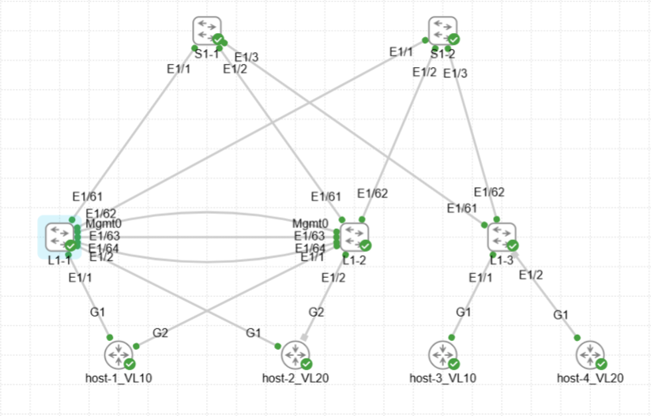

# Домашнее задание
VXLAN. Multihoming


## Цель:
- настроить отказоустойчивое подключение клиентов с использованием EVPN Multihoming.

## Описание/Пошаговая инструкция выполнения домашнего задания:
В этой самостоятельной работе мы ожидаем, что вы самостоятельно:
- Подключите клиентов 2-я линками к различным Leaf.
- Настроите агрегированный канал со стороны клиента.
- Настроите multihoming для работы в Overlay сети. Если используете Cisco NXOS - vPC, если иной вендор - то ESI LAG (либо MC-LAG с поддержкой VXLAN).
- Зафиксируете в документации - план работы, адресное пространство, схему сети, конфигурацию устройств.
- Опционально - протестировать отказоустойчивость - убедиться, что связнность не теряется при отключении одного из линков.
- 
# Выполнение: 

## Схема


## Целевое распределение адресного пространства

10.0.0.0/8 - LLC Private address space  <br>
192.168.0.0/16 - EXTERNAL SEGMENT (reserved) <br>

- DC1 - 10.1.0.0/16
	- 	 Vl 10 - 10.1.10.0/24 - DC-APP vrf_DC-PROD	
	-    Vl 20 - 10.1.20.0/24 - DC-DB vrf_DC-PROD
	-    Vl 3001 - NO IP - L3VPN_VRF_PROD <br>
    
- DC2 - 10.2.0.0/16  (reserved) <br>

- 10.x.255.0/24 - Lo0 RID (/32) (.1-.10 - S, .11-.250 - L, .251-.254 - BL)
- 10.x.254.0/24 - Lo1 VTEP_ID (/32) (.1-.10 - S, .11-.250 - L, .251-.254 - BL)  <br>

- 10.х.241.0/24 - P2P INTRASITE Underlay Transport from Spine1 to Leafs (/31) 
- 10.х.242.0/24 - P2P INTRASITE Underlay Transport from Spine2 to Leafs (/31)  <br>

- 10.x.251.0/24 - P2P INTRASITE Underlay Transport from Spines to Boarder Leafs (/31) (.0-.63 - to BL1, .64-.127 - to BL2)  <br>

## Задействованные хосты и адреса (у SVI-интерфейсов указана подсеть, на самих SVI используется адрес .1)

### S1-1
```
Eth1/1        eth    10G     S1-1_to_L1-1 10.1.241.0/31
Eth1/2        eth    10G     S1-1_to_L1-2 10.1.241.2/31
Eth1/3        eth    10G     S1-1_to_L1-3 10.1.241.4/31
Eth1/63       eth    10G     S1-1_to_BL1-1 10.1.241.250/31
Eth1/64       eth    10G     S1-1_to_BL1-2 10.1.241.252/31
Lo0                      RID 10.1.255.1/32
Lo1                      VTEP_ID 10.1.254.1/32
```
### S1-2
```
Eth1/1        eth    10G     S1-2_to_L1-1 10.1.242.0/31
Eth1/2        eth    10G     S1-2_to_L1-2 10.1.242.2/31
Eth1/3        eth    10G     S1-2_to_L1-3 10.1.242.4/31
Eth1/63       eth    10G     S1-2_to_BL1-1 10.1.242.250/31
Eth1/64       eth    10G     S1-2_to_BL1-2 10.1.242.252/31
Lo0                      RID 10.1.255.2/32
Lo1                      VTEP_ID 10.1.254.2/32
```
### L1-1
```
Eth1/1        eth    10G     host-1 10.1.10.11
Eth1/2        eth    10G     host-2 10.1.20.12
Eth1/61       eth    10G     L1-1_to_S1-1 10.1.241.1/31
Eth1/62       eth    10G     L1-1_to_S1-2 10.1.242.1/31
Lo0                      RID 10.1.255.11/32
Lo1                      VTEP_ID 10.1.254.11/32
Vlan10                   DC-APP 10.1.10.0/24
Vlan20                   DC-DB 10.1.20.0/24
```
### L1-2
```
Eth1/1        eth    10G     host-3 10.1.10.13
Eth1/61       eth    10G     L1-2_to_S1-1 10.1.241.3/31
Eth1/62       eth    10G     L1-2_to_S1-2 10.1.242.3/31
Lo0                      RID 10.1.255.12/32
Lo1                      VTEP_ID 10.1.254.12/32
Vlan10                   DC-APP 10.1.10.0/24
Vlan20                   DC-DB 10.1.20.0/24
```
### L1-3
```
Eth1/1        eth    10G     host-4 10.1.20.14
Eth1/61       eth    10G     L1-3_to_S1-1 10.1.241.5/31
Eth1/62       eth    10G     L1-3_to_S1-2 10.1.242.5/31
Lo0                      RID 10.1.255.13/32
Lo1                      VTEP_ID 10.1.254.13/32
Vlan10                   DC-APP 10.1.10.0/24
Vlan20                   DC-DB 10.1.20.0/24
```

### Используемые алиасы команд
```
cli alias name sble show bgp l2vpn evpn 
cli alias name sbles show bgp l2vpn evpn summary
cli alias name sblert5 show bgp l2vpn evpn route-type 5
cli alias name snp show nve peers
cli alias name snv show nve vni
cli alias name sirv show ip route vrf 
cli alias name sr show running-config
```
### Используемые команды вывода и диагностики
```
sr vrf vrf_DC-PROD
sr interface vlan 10, vlan 20, vlan 3001
sr bgp
sr interface nve1
sr nv overlay

snv
snp
sirv vrf_DC-PROD

sble
sbles
sblert5
sble <ADDR>
```

## Вывод команд диагностики

### host-1
```
