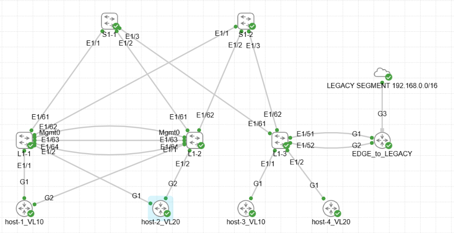

# Домашнее задание
VxLAN. Routing.

## Цель:
- реализовать передачу суммарных префиксов через EVPN route-type 5.

## Описание/Пошаговая инструкция выполнения домашнего задания:
В этой самостоятельной работе мы ожидаем, что вы самостоятельно:
- Разместите двух "клиентов" в разных VRF в рамках одной фабрики.
- Настроите маршрутизацию между клиентами через внешнее устройство (граничный роутер\фаерволл\etc)
- Зафиксируете в документации - план работы, адресное пространство, схему сети, настройки сетевого оборудования

# Выполнение: 

## Схема


## Целевое распределение адресного пространства

10.0.0.0/8 - LLC Private address space  <br>
192.168.0.0/16 - EXTERNAL LEGACY SEGMENT <br>

- DC1 - 10.1.0.0/16
	- 	 Vl 10 - 10.1.10.0/24 - DC-PROD vrf_DC-PROD	
	-    Vl 20 - 10.1.20.0/24 - DC-CORP vrf_DC-CORP
	-    Vl 300x - NO IP - L3VPN_VRF_"NAME" <br>
    
- DC2 - 10.2.0.0/16  (reserved) <br>

- 10.x.255.0/24 - Lo0 RID (/32) (.1-.10 - S, .11-.250 - L, .251-.254 - BL)
- 10.x.254.0/24 - Lo1 VTEP_ID (/32) 
 	- .1-.10 - S (reserved)
 	- .11-.240 - L 
 	- .241-249 - L Multihoming ID (Secondary Lo1 IP) 
 	- .251-.254 - BL (reserved)
 	- .250 - BL Multihoming ID (Secondary Lo1 IP) (reserved) <br>

- 10.х.241.0/24 - P2P INTRASITE Underlay Transport from Spine1 to Leafs (/31) 
- 10.х.242.0/24 - P2P INTRASITE Underlay Transport from Spine2 to Leafs (/31) <br>

- 10.x.251.0/24 - P2P INTRASITE Underlay Transport from Spines to Boarder Leafs (/31) (.0-.63 - to BL1, .64-.127 - to BL2) (reserved) <br>

- 10.x.252.0/24 - P2P INTRASINE Underlay Transport Other <br>

## Задействованные хосты и адреса (у SVI-интерфейсов указана подсеть, на самих SVI используется адрес .1)

### S1-1
```
Eth1/1        eth    10G     S1-1_to_L1-1 10.1.241.0/31
Eth1/2        eth    10G     S1-1_to_L1-2 10.1.241.2/31
Eth1/3        eth    10G     S1-1_to_L1-3 10.1.241.4/31
Eth1/63       eth    10G     S1-1_to_BL1-1 10.1.241.250/31
Eth1/64       eth    10G     S1-1_to_BL1-2 10.1.241.252/31
Lo0                      RID 10.1.255.1/32
Lo1                      VTEP_ID 10.1.254.1/32
```
### S1-2
```
Eth1/1        eth    10G     S1-2_to_L1-1 10.1.242.0/31
Eth1/2        eth    10G     S1-2_to_L1-2 10.1.242.2/31
Eth1/3        eth    10G     S1-2_to_L1-3 10.1.242.4/31
Eth1/63       eth    10G     S1-2_to_BL1-1 10.1.242.250/31
Eth1/64       eth    10G     S1-2_to_BL1-2 10.1.242.252/31
Lo0                      RID 10.1.255.2/32
Lo1                      VTEP_ID 10.1.254.2/32
```
### L1-1
```
Eth1/1        eth    10G     host-1 10.1.10.11
Eth1/2        eth    10G     host-2 10.1.20.12
Eth1/61       eth    10G     L1-1_to_S1-1 10.1.241.1/31
Eth1/62       eth    10G     L1-1_to_S1-2 10.1.242.1/31
Po1                      host-1 10.1.10.11
Po2                      host-2 10.1.20.12
Lo0                      RID 10.1.255.11/32
Lo1                      VTEP_ID 10.1.254.11/32
Vlan10                   DC-PROD 10.1.10.0/24
Vlan20                   DC-CORP 10.1.20.0/24
```
### L1-2
```
Eth1/1        eth    10G     host-1 10.1.10.11
Eth1/2        eth    10G     host-2 10.1.20.12
Eth1/61       eth    10G     L1-2_to_S1-1 10.1.241.3/31
Eth1/62       eth    10G     L1-2_to_S1-2 10.1.242.3/31
Po1                      host-1 10.1.10.11
Po2                      host-2 10.1.20.12
Lo0                      RID 10.1.255.12/32
Lo1                      VTEP_ID 10.1.254.12/32
Vlan10                   DC-PROD 10.1.10.0/24
Vlan20                   DC-CORP 10.1.20.0/24
```
### L1-3
```
Eth1/1        eth    10G     host-3 10.1.10.13
Eth1/2        eth    10G     host-4 10.1.20.14
Eth1/51       eth    10G     to_LEGACY 10.1.252.0/31 vrf PROD
Eth1/52       eth    10G     to_LEGACY 10.1.252.2/31 vrf CORP
Eth1/61       eth    10G     L1-3_to_S1-1 10.1.241.5/31
Eth1/62       eth    10G     L1-3_to_S1-2 10.1.242.5/31
Lo0                      RID 10.1.255.13/32
Lo1                      VTEP_ID 10.1.254.13/32
Vlan10                   DC-PROD 10.1.10.0/24
Vlan20                   DC-CORP 10.1.20.0/24
```

### EDGE
```
Gi1                            up             up       to_VXLAN/EVPN_Fabric 10.1.252.1/31 vrf PROD
Gi2                            up             up       to_VXLAN/EVPN_Fabric 10.1.252.3/31 vrf CORP
Gi3                            up             up       to_LEGACY 192.168.0.0/16
Gi3.1                          up             up       LEGACY 192.168.10.0/24
Gi3.2                          up             up       LEGACY 192.168.20.0/24
Gi3.3                          up             up       LEGACY 192.168.30.0/24
Gi3.4                          up             up       LEGACY 192.168.40.0/24
Lo0                            up             up       RID
Lo1                            up             up       for VXLAN Fabric ID
```


### Используемые алиасы команд
```
cli alias name sble show bgp l2vpn evpn 
cli alias name sbles show bgp l2vpn evpn summary
cli alias name sblert5 show bgp l2vpn evpn route-type 5
cli alias name snp show nve peers
cli alias name snv show nve vni
cli alias name sirv show ip route vrf 
cli alias name sr show running-config
```
### Используемые команды вывода и диагностики
```
! for Leafs:
sr vrf vrf_DC-PROD
sr vrf vrf_DC-CORP

sr interface vlan 10, vlan 20, vlan 3001, vlan 3002
sr interface lo 0, lo 1
sr interface  po 1, po 2, po 63
sr bgp
sr interface nve1
sr nv overlay

sh vpc 
snv
snp
sirv vrf_DC-PROD
sirv vrf_DC-CORP

sble
sbles
```

## Вывод команд диагностики

### host-1
```
host-1#
host-1#ping 10.1.10.13
Type escape sequence to abort.
Sending 5, 100-byte ICMP Echos to 10.1.10.13, timeout is 2 seconds:
!!!!!
Success rate is 100 percent (5/5), round-trip min/avg/max = 7/8/10 ms
host-1#ping 10.1.20.12
Type escape sequence to abort.
Sending 5, 100-byte ICMP Echos to 10.1.20.12, timeout is 2 seconds:
!!!!!
Success rate is 100 percent (5/5), round-trip min/avg/max = 4/4/5 ms
host-1#ping 10.1.20.14
Type escape sequence to abort.
Sending 5, 100-byte ICMP Echos to 10.1.20.14, timeout is 2 seconds:
!!!!!
Success rate is 100 percent (5/5), round-trip min/avg/max = 10/10/12 ms
```

### EDGE
```
EDGE#sh run | sec bgp
router bgp 65100
 bgp router-id 192.168.254.1
 bgp log-neighbor-changes
 neighbor 10.1.252.0 remote-as 65001
 neighbor 10.1.252.0 description to_L1-3
 neighbor 10.1.252.2 remote-as 65001
 neighbor 10.1.252.2 description to_L1-3
 !
 address-family ipv4
  aggregate-address 192.168.0.0 255.255.0.0
  redistribute connected
  neighbor 10.1.252.0 activate
  neighbor 10.1.252.0 as-override
  neighbor 10.1.252.2 activate
  neighbor 10.1.252.2 as-override
  maximum-paths eibgp 4
 exit-address-family
 
EDGE#sh ip bgp 
BGP table version is 22, local router ID is 192.168.254.1
Status codes: s suppressed, d damped, h history, * valid, > best, i - internal, 
              r RIB-failure, S Stale, m multipath, b backup-path, f RT-Filter, 
              x best-external, a additional-path, c RIB-compressed, 
              t secondary path, L long-lived-stale,
Origin codes: i - IGP, e - EGP, ? - incomplete
RPKI validation codes: V valid, I invalid, N Not found

     Network          Next Hop            Metric LocPrf Weight Path
 *>   10.1.10.0/24     10.1.252.0               0             0 65001 ?
 *>   10.1.10.11/32    10.1.252.0                             0 65001 i
 *>   10.1.20.0/24     10.1.252.2               0             0 65001 ?
 *>   10.1.20.12/32    10.1.252.2                             0 65001 i
 *    10.1.252.0/31    10.1.252.0               0             0 65001 ?
 *>                    0.0.0.0                  0         32768 ?
 *    10.1.252.2/31    10.1.252.2               0             0 65001 ?
 *>                    0.0.0.0                  0         32768 ?
 *>   192.168.0.0/16   0.0.0.0                            32768 i
 *>   192.168.10.0     0.0.0.0                  0         32768 ?
 *>   192.168.20.0     0.0.0.0                  0         32768 ?
 *>   192.168.30.0     0.0.0.0                  0         32768 ?
 *>   192.168.40.0     0.0.0.0                  0         32768 ?
     Network          Next Hop            Metric LocPrf Weight Path
 *>   192.168.254.1/32 0.0.0.0                  0         32768 ?
 *>   192.168.255.1/32 0.0.0.0                  0         32768 ?
```

### L1-1
```
L1-1# 
L1-1# sr vrf vrf_DC-PROD

!Command: show running-config vrf vrf_DC-PROD
!Running configuration last done at: Sun Oct 25 22:26:03 2026
!Time: Sun Oct 25 22:34:09 2026

version 10.5(3) Bios:version  

interface Vlan10
  vrf member vrf_DC-PROD

interface Vlan3001
  vrf member vrf_DC-PROD
vrf context vrf_DC-PROD
  vni 103001
  rd 10.1.254.11:65001
  address-family ipv4 unicast
    route-target import 65001:103001
    route-target import 65001:103001 evpn
    route-target export 65001:103001
    route-target export 65001:103001 evpn
router bgp 65001
  vrf vrf_DC-PROD
    address-family ipv4 unicast
      advertise l2vpn evpn
      redistribute direct route-map rm_DC-PROD_direct_redistr


L1-1# 
L1-1# sr vrf vrf_DC-PROD

!Command: show running-config vrf vrf_DC-PROD
!Running configuration last done at: Sun Oct 25 22:26:03 2026
!Time: Sun Oct 25 22:34:14 2026

version 10.5(3) Bios:version  

interface Vlan10
  vrf member vrf_DC-PROD

interface Vlan3001
  vrf member vrf_DC-PROD
vrf context vrf_DC-PROD
  vni 103001
  rd 10.1.254.11:65001
  address-family ipv4 unicast
    route-target import 65001:103001
    route-target import 65001:103001 evpn
    route-target export 65001:103001
    route-target export 65001:103001 evpn
router bgp 65001
  vrf vrf_DC-PROD
    address-family ipv4 unicast
      advertise l2vpn evpn
      redistribute direct route-map rm_DC-PROD_direct_redistr

L1-1# sr interface vlan 10, vlan 20, vlan 3001, vlan 3002

!Command: show running-config interface Vlan10, Vlan20, Vlan3001, Vlan3002
!Running configuration last done at: Sun Oct 25 22:26:03 2026
!Time: Sun Oct 25 22:34:52 2026

version 10.5(3) Bios:version  

interface Vlan10
  description DC-PROD 10.1.10.0/24
  no shutdown
  vrf member vrf_DC-PROD
  no ip redirects
  ip address 10.1.10.1/24
  no ipv6 redirects
  fabric forwarding mode anycast-gateway

interface Vlan20
  description DC-CORP 10.1.20.0/24
  no shutdown
  vrf member vrf_DC-CORP
  no ip redirects
  ip address 10.1.20.1/24
  no ipv6 redirects
  fabric forwarding mode anycast-gateway

interface Vlan3001
  description L3VPN_VRF_PROD
  no shutdown
  mac-address 0000.0001.0001 
  vrf member vrf_DC-PROD
  no ip redirects
  ip forward
  no ipv6 redirects

interface Vlan3002
  description L3VPN_VRF_CORP
  no shutdown
  mac-address 0000.0001.0002 
  vrf member vrf_DC-CORP
  no ip redirects
  ip forward
  no ipv6 redirects

L1-1#  sr interface lo 0, lo 1

!Command: show running-config interface loopback0, loopback1
!Running configuration last done at: Sun Oct 25 22:26:03 2026
!Time: Sun Oct 25 22:34:57 2026

version 10.5(3) Bios:version  

interface loopback0
  description RID 10.1.255.11/32
  ip address 10.1.255.11/32

interface loopback1
  description VTEP_ID 10.1.254.11/32
  ip address 10.1.254.11/32
  ip address 10.1.254.241/32 secondary

L1-1# 
L1-1#  sr interface  po 1, po 2, po 63

!Command: show running-config interface port-channel1-2, port-channel63
!Running configuration last done at: Sun Oct 25 22:26:03 2026
!Time: Sun Oct 25 22:35:01 2026

version 10.5(3) Bios:version  

interface port-channel1
  description host-1 10.1.10.11
  switchport access vlan 10
  spanning-tree port type edge
  vpc 1

interface port-channel2
  description host-2 10.1.20.12
  switchport access vlan 20
  spanning-tree port type edge
  vpc 2

interface port-channel63
  description VPC PEER-LINK
  switchport mode trunk
  switchport trunk native vlan 999
  spanning-tree port type network
  vpc peer-link

L1-1# 
L1-1# sr bgp

!Command: show running-config bgp
!Running configuration last done at: Sun Oct 25 22:26:03 2026
!Time: Sun Oct 25 22:35:20 2026

version 10.5(3) Bios:version  
feature bgp

router bgp 65001
  router-id 10.1.255.11
  reconnect-interval 12
  log-neighbor-changes
  address-family ipv4 unicast
    network 10.1.254.11/32
    network 10.1.254.241/32
    network 10.1.255.11/32
    maximum-paths 10
    maximum-paths ibgp 10
  address-family l2vpn evpn
    maximum-paths 10
    maximum-paths ibgp 10
  template peer peer_LEAF_EVPN
    remote-as 65001
    update-source loopback0
    address-family l2vpn evpn
      send-community
      send-community extended
  template peer peer_LEAF_UNDERLAY
    bfd
    remote-as 65001
    timers 3 9
    address-family ipv4 unicast
  neighbor 10.1.241.0
    inherit peer peer_LEAF_UNDERLAY
    description to_Spine1_Underlay
  neighbor 10.1.242.0
    inherit peer peer_LEAF_UNDERLAY
    description to_Spine2_Underlay
  neighbor 10.1.255.1
    inherit peer peer_LEAF_EVPN
    description to_Spine1_EVPN
  neighbor 10.1.255.2
    inherit peer peer_LEAF_EVPN
    description to_Spine2_EVPN
  vrf vrf_DC-CORP
    address-family ipv4 unicast
      advertise l2vpn evpn
      redistribute direct route-map rm_DC-CORP_direct_redistr
  vrf vrf_DC-PROD
    address-family ipv4 unicast
      advertise l2vpn evpn
      redistribute direct route-map rm_DC-PROD_direct_redistr
evpn
  vni 10010 l2
    rd 10.1.254.11:10010
    route-target import 65001:10010
    route-target export 65001:10010
  vni 10020 l2
    rd 10.1.254.11:10020
    route-target import 65001:10020
    route-target export 65001:10020
vrf context vrf_DC-CORP
  rd 10.1.254.11:65002
  address-family ipv4 unicast
    route-target import 65002:103002
    route-target import 65002:103002 evpn
    route-target export 65002:103002
    route-target export 65002:103002 evpn
vrf context vrf_DC-PROD
  rd 10.1.254.11:65001
  address-family ipv4 unicast
    route-target import 65001:103001
    route-target import 65001:103001 evpn
    route-target export 65001:103001
    route-target export 65001:103001 evpn


L1-1# sr interface nve1

!Command: show running-config interface nve1
!Running configuration last done at: Sun Oct 25 22:26:03 2026
!Time: Sun Oct 25 22:35:25 2026

version 10.5(3) Bios:version  

interface nve1
  no shutdown
  host-reachability protocol bgp
  source-interface loopback1
  source-interface hold-down-time 1
  member vni 10010
    suppress-arp
    ingress-replication protocol bgp
  member vni 10020
    suppress-arp
    ingress-replication protocol bgp
  member vni 103001 associate-vrf
  member vni 103002 associate-vrf

L1-1# 
L1-1#  sr nv overlay

!Command: show running-config nv overlay
!Running configuration last done at: Sun Oct 25 22:26:03 2026
!Time: Sun Oct 25 22:35:29 2026

version 10.5(3) Bios:version  
feature nv overlay

vlan 10,20,999,3001-3002

interface nve1
  no shutdown
  host-reachability protocol bgp
  source-interface loopback1
  source-interface hold-down-time 1
  member vni 10010
    suppress-arp
    ingress-replication protocol bgp
  member vni 10020
    suppress-arp
    ingress-replication protocol bgp
  member vni 103001 associate-vrf
  member vni 103002 associate-vrf


L1-1# sh vpc 
Legend:
                (*) - local vPC is down, forwarding via vPC peer-link

vPC domain id                     : 1   
Peer status                       : peer adjacency formed ok      
vPC keep-alive status             : peer is alive                 
Configuration consistency status  : success 
Per-vlan consistency status       : success                       
Type-2 consistency status         : success 
vPC role                          : primary                       
Number of vPCs configured         : 2   
Peer Gateway                      : Enabled
Dual-active excluded VLANs        : -
Graceful Consistency Check        : Enabled
Auto-recovery status              : Enabled, timer is off.(timeout = 240s)
Delay-restore status              : Timer is off.(timeout = 1s)
Delay-restore SVI status          : Timer is off.(timeout = 10s)
Delay-restore Orphan-port status  : Timer is off.(timeout = 0s)
Operational Layer3 Peer-router    : Enabled
Virtual-peerlink mode             : Disabled

vPC Peer-link status
---------------------------------------------------------------------
id    Port   Status Active vlans    
--    ----   ------ -------------------------------------------------
1     Po63   up     1,10,20,999,3001-3002                                       
         

vPC status
----------------------------------------------------------------------------
Id    Port          Status Consistency Reason                Active vlans
--    ------------  ------ ----------- ------                ---------------
1     Po1           up     success     success               10                 
         
                                                                                
         
2     Po2           up     success     success               20                 
         
                                                                                
         

Please check "show vpc consistency-parameters vpc <vpc-num>" for the 
consistency reason of down vpc and for type-2 consistency reasons for 
any vpc.

L1-1# snv
Codes: CP - Control Plane        DP - Data Plane          
       UC - Unconfigured         SA - Suppress ARP        
       S-ND - Suppress ND        
       SU - Suppress Unknown Unicast 
       Xconn - Crossconnect      
       MS-IR - Multisite Ingress Replication 
       HYB - Hybrid IRB mode
    
Interface VNI      Multicast-group   State Mode Type [BD/VRF]      Flags
--------- -------- ----------------- ----- ---- ------------------ -----
nve1      10010    UnicastBGP        Up    CP   L2 [10]            SA   
nve1      10020    UnicastBGP        Up    CP   L2 [20]            SA   
nve1      103001   n/a               Up    CP   L3 [vrf_DC-PROD]        
nve1      103002   n/a               Up    CP   L3 [vrf_DC-CORP]        

L1-1# 
L1-1#  snp
Interface Peer-IP                                 State LearnType Uptime   Route
r-Mac       
--------- --------------------------------------  ----- --------- -------- -----
------------
nve1      10.1.254.13                             Up    CP        00:15:52 52ff.
fe16.1b08   

L1-1# 
L1-1#  sirv vrf_DC-PROD
IP Route Table for VRF "vrf_DC-PROD"
'*' denotes best ucast next-hop
'**' denotes best mcast next-hop
'[x/y]' denotes [preference/metric]
'%<string>' in via output denotes VRF <string>

10.1.10.0/24, ubest/mbest: 1/0, attached
    *via 10.1.10.1, Vlan10, [0/0], 00:15:43, direct
10.1.10.1/32, ubest/mbest: 1/0, attached
    *via 10.1.10.1, Vlan10, [0/0], 00:15:43, local
10.1.10.11/32, ubest/mbest: 1/0, attached
    *via 10.1.10.11, Vlan10, [190/0], 00:09:26, hmm
10.1.10.13/32, ubest/mbest: 1/0
    *via 10.1.254.13%default, [200/0], 00:09:03, bgp-65001, internal, tag 65001,
 segid: 103001 tunnelid: 0xa01fe0d encap: VXLAN
 
10.1.20.0/24, ubest/mbest: 1/0
    *via 10.1.254.13%default, [200/0], 00:15:45, bgp-65001, internal, tag 65100,
 segid: 103001 tunnelid: 0xa01fe0d encap: VXLAN
 
10.1.20.12/32, ubest/mbest: 1/0
    *via 10.1.254.13%default, [200/0], 00:10:09, bgp-65001, internal, tag 65100,
 segid: 103001 tunnelid: 0xa01fe0d encap: VXLAN
 
10.1.252.0/31, ubest/mbest: 1/0
    *via 10.1.254.13%default, [200/0], 00:15:56, bgp-65001, internal, tag 65001,
 segid: 103001 tunnelid: 0xa01fe0d encap: VXLAN
 
10.1.252.2/31, ubest/mbest: 1/0
    *via 10.1.254.13%default, [200/0], 00:15:45, bgp-65001, internal, tag 65100,
 segid: 103001 tunnelid: 0xa01fe0d encap: VXLAN
 
192.168.0.0/16, ubest/mbest: 1/0
    *via 10.1.254.13%default, [200/0], 00:15:45, bgp-65001, internal, tag 65100,
 segid: 103001 tunnelid: 0xa01fe0d encap: VXLAN
 
192.168.10.0/24, ubest/mbest: 1/0
    *via 10.1.254.13%default, [200/0], 00:15:45, bgp-65001, internal, tag 65100,
 segid: 103001 tunnelid: 0xa01fe0d encap: VXLAN
 
192.168.20.0/24, ubest/mbest: 1/0
    *via 10.1.254.13%default, [200/0], 00:15:45, bgp-65001, internal, tag 65100,
 segid: 103001 tunnelid: 0xa01fe0d encap: VXLAN
 
192.168.30.0/24, ubest/mbest: 1/0
    *via 10.1.254.13%default, [200/0], 00:15:45, bgp-65001, internal, tag 65100,
 segid: 103001 tunnelid: 0xa01fe0d encap: VXLAN
 
192.168.40.0/24, ubest/mbest: 1/0
    *via 10.1.254.13%default, [200/0], 00:15:45, bgp-65001, internal, tag 65100,
 segid: 103001 tunnelid: 0xa01fe0d encap: VXLAN
 
192.168.254.1/32, ubest/mbest: 1/0
    *via 10.1.254.13%default, [200/0], 00:15:45, bgp-65001, internal, tag 65100,
 segid: 103001 tunnelid: 0xa01fe0d encap: VXLAN
 
192.168.255.1/32, ubest/mbest: 1/0
    *via 10.1.254.13%default, [200/0], 00:15:45, bgp-65001, internal, tag 65100,
 segid: 103001 tunnelid: 0xa01fe0d encap: VXLAN
 

L1-1# sirv vrf_DC-CORP
IP Route Table for VRF "vrf_DC-CORP"
'*' denotes best ucast next-hop
'**' denotes best mcast next-hop
'[x/y]' denotes [preference/metric]
'%<string>' in via output denotes VRF <string>

10.1.10.0/24, ubest/mbest: 1/0
    *via 10.1.254.13%default, [200/0], 00:15:50, bgp-65001, internal, tag 65100,
 segid: 103002 tunnelid: 0xa01fe0d encap: VXLAN
 
10.1.10.11/32, ubest/mbest: 1/0
    *via 10.1.254.13%default, [200/0], 00:10:44, bgp-65001, internal, tag 65100,
 segid: 103002 tunnelid: 0xa01fe0d encap: VXLAN
 
10.1.20.0/24, ubest/mbest: 1/0, attached
    *via 10.1.20.1, Vlan20, [0/0], 00:15:48, direct
10.1.20.1/32, ubest/mbest: 1/0, attached
    *via 10.1.20.1, Vlan20, [0/0], 00:15:48, local
10.1.20.12/32, ubest/mbest: 1/0, attached
    *via 10.1.20.12, Vlan20, [190/0], 00:09:31, hmm
10.1.20.14/32, ubest/mbest: 1/0
    *via 10.1.254.13%default, [200/0], 00:08:58, bgp-65001, internal, tag 65001,
 segid: 103002 tunnelid: 0xa01fe0d encap: VXLAN
 
10.1.252.0/31, ubest/mbest: 1/0
    *via 10.1.254.13%default, [200/0], 00:15:50, bgp-65001, internal, tag 65100,
 segid: 103002 tunnelid: 0xa01fe0d encap: VXLAN
 
10.1.252.2/31, ubest/mbest: 1/0
    *via 10.1.254.13%default, [200/0], 00:16:01, bgp-65001, internal, tag 65001,
 segid: 103002 tunnelid: 0xa01fe0d encap: VXLAN
 
192.168.0.0/16, ubest/mbest: 1/0
    *via 10.1.254.13%default, [200/0], 00:15:50, bgp-65001, internal, tag 65100,
 segid: 103002 tunnelid: 0xa01fe0d encap: VXLAN
 
192.168.10.0/24, ubest/mbest: 1/0
    *via 10.1.254.13%default, [200/0], 00:15:50, bgp-65001, internal, tag 65100,
 segid: 103002 tunnelid: 0xa01fe0d encap: VXLAN
 
192.168.20.0/24, ubest/mbest: 1/0
    *via 10.1.254.13%default, [200/0], 00:15:50, bgp-65001, internal, tag 65100,
 segid: 103002 tunnelid: 0xa01fe0d encap: VXLAN
 
192.168.30.0/24, ubest/mbest: 1/0
    *via 10.1.254.13%default, [200/0], 00:15:50, bgp-65001, internal, tag 65100,
 segid: 103002 tunnelid: 0xa01fe0d encap: VXLAN
 
192.168.40.0/24, ubest/mbest: 1/0
    *via 10.1.254.13%default, [200/0], 00:15:50, bgp-65001, internal, tag 65100,
 segid: 103002 tunnelid: 0xa01fe0d encap: VXLAN
 
192.168.254.1/32, ubest/mbest: 1/0
    *via 10.1.254.13%default, [200/0], 00:15:50, bgp-65001, internal, tag 65100,
 segid: 103002 tunnelid: 0xa01fe0d encap: VXLAN
 
192.168.255.1/32, ubest/mbest: 1/0
    *via 10.1.254.13%default, [200/0], 00:15:50, bgp-65001, internal, tag 65100,
 segid: 103002 tunnelid: 0xa01fe0d encap: VXLAN
 

L1-1#  

L1-1# sble
BGP routing table information for VRF default, address family L2VPN EVPN
BGP table version is 113, Local Router ID is 10.1.255.11
Status: s-suppressed, x-deleted, S-stale, d-dampened, h-history, *-valid, >-best
Path type: i-internal, e-external, c-confed, l-local, a-aggregate, r-redist, I-i
njected
Origin codes: i - IGP, e - EGP, ? - incomplete, | - multipath, & - backup, 2 - b
est2

   Network            Next Hop            Metric     LocPrf     Weight Path
Route Distinguisher: 10.1.254.11:10010    (L2VNI 10010)
*>l[2]:[0]:[0]:[48]:[001e.14b9.6bc0]:[0]:[0.0.0.0]/216
                      10.1.254.241                      100      32768 i
*>i[2]:[0]:[0]:[48]:[5254.00d3.1350]:[0]:[0.0.0.0]/216
                      10.1.254.13                       100          0 i
*>l[2]:[0]:[0]:[48]:[001e.14b9.6bc0]:[32]:[10.1.10.11]/272
                      10.1.254.241                      100      32768 i
*>i[2]:[0]:[0]:[48]:[5254.00d3.1350]:[32]:[10.1.10.13]/272
                      10.1.254.13                       100          0 i
*>i[3]:[0]:[32]:[10.1.254.13]/88
                      10.1.254.13                       100          0 i
*>l[3]:[0]:[32]:[10.1.254.241]/88
                      10.1.254.241                      100      32768 i

Route Distinguisher: 10.1.254.11:10020    (L2VNI 10020)
*>l[2]:[0]:[0]:[48]:[001e.e579.efc0]:[0]:[0.0.0.0]/216
                      10.1.254.241                      100      32768 i
*>i[2]:[0]:[0]:[48]:[5254.0015.ad54]:[0]:[0.0.0.0]/216
                      10.1.254.13                       100          0 i
*>l[2]:[0]:[0]:[48]:[001e.e579.efc0]:[32]:[10.1.20.12]/272
                      10.1.254.241                      100      32768 i
*>i[2]:[0]:[0]:[48]:[5254.0015.ad54]:[32]:[10.1.20.14]/272
                      10.1.254.13                       100          0 i
*>i[3]:[0]:[32]:[10.1.254.13]/88
                      10.1.254.13                       100          0 i
*>l[3]:[0]:[32]:[10.1.254.241]/88
                      10.1.254.241                      100      32768 i

Route Distinguisher: 10.1.254.13:10010
* i[2]:[0]:[0]:[48]:[5254.00d3.1350]:[0]:[0.0.0.0]/216
                      10.1.254.13                       100          0 i
*>i                   10.1.254.13                       100          0 i
*>i[2]:[0]:[0]:[48]:[5254.00d3.1350]:[32]:[10.1.10.13]/272
                      10.1.254.13                       100          0 i
* i                   10.1.254.13                       100          0 i
*>i[3]:[0]:[32]:[10.1.254.13]/88
                      10.1.254.13                       100          0 i
* i                   10.1.254.13                       100          0 i

Route Distinguisher: 10.1.254.13:10020
*>i[2]:[0]:[0]:[48]:[5254.0015.ad54]:[0]:[0.0.0.0]/216
                      10.1.254.13                       100          0 i
* i                   10.1.254.13                       100          0 i
*>i[2]:[0]:[0]:[48]:[5254.0015.ad54]:[32]:[10.1.20.14]/272
                      10.1.254.13                       100          0 i
* i                   10.1.254.13                       100          0 i
*>i[3]:[0]:[32]:[10.1.254.13]/88
                      10.1.254.13                       100          0 i
* i                   10.1.254.13                       100          0 i

Route Distinguisher: 10.1.254.13:65001
* i[5]:[0]:[0]:[16]:[192.168.0.0]/224
                      10.1.254.13              0        100          0 65100 i
*>i                   10.1.254.13              0        100          0 65100 i
*>i[5]:[0]:[0]:[24]:[10.1.10.0]/224
                      10.1.254.13              0        100          0 ?
* i                   10.1.254.13              0        100          0 ?
* i[5]:[0]:[0]:[24]:[10.1.20.0]/224
                      10.1.254.13                       100          0 65100 651
00 ?
*>i                   10.1.254.13                       100          0 65100 651
00 ?
* i[5]:[0]:[0]:[24]:[192.168.10.0]/224
                      10.1.254.13              0        100          0 65100 ?
*>i                   10.1.254.13              0        100          0 65100 ?
* i[5]:[0]:[0]:[24]:[192.168.20.0]/224
                      10.1.254.13              0        100          0 65100 ?
*>i                   10.1.254.13              0        100          0 65100 ?
* i[5]:[0]:[0]:[24]:[192.168.30.0]/224
                      10.1.254.13              0        100          0 65100 ?
*>i                   10.1.254.13              0        100          0 65100 ?
* i[5]:[0]:[0]:[24]:[192.168.40.0]/224
                      10.1.254.13              0        100          0 65100 ?
*>i                   10.1.254.13              0        100          0 65100 ?
*>i[5]:[0]:[0]:[31]:[10.1.252.0]/224
                      10.1.254.13              0        100          0 ?
* i                   10.1.254.13              0        100          0 ?
* i[5]:[0]:[0]:[31]:[10.1.252.2]/224
                      10.1.254.13              0        100          0 65100 ?
*>i                   10.1.254.13              0        100          0 65100 ?
* i[5]:[0]:[0]:[32]:[10.1.20.12]/224
                      10.1.254.13                       100          0 65100 651
00 i
*>i                   10.1.254.13                       100          0 65100 651
00 i
* i[5]:[0]:[0]:[32]:[192.168.254.1]/224
                      10.1.254.13              0        100          0 65100 ?
*>i                   10.1.254.13              0        100          0 65100 ?
* i[5]:[0]:[0]:[32]:[192.168.255.1]/224
                      10.1.254.13              0        100          0 65100 ?
*>i                   10.1.254.13              0        100          0 65100 ?

Route Distinguisher: 10.1.254.13:65002
* i[5]:[0]:[0]:[16]:[192.168.0.0]/224
                      10.1.254.13              0        100          0 65100 i
*>i                   10.1.254.13              0        100          0 65100 i
* i[5]:[0]:[0]:[24]:[10.1.10.0]/224
                      10.1.254.13                       100          0 65100 651
00 ?
*>i                   10.1.254.13                       100          0 65100 651
00 ?
* i[5]:[0]:[0]:[24]:[10.1.20.0]/224
                      10.1.254.13              0        100          0 ?
*>i                   10.1.254.13              0        100          0 ?
* i[5]:[0]:[0]:[24]:[192.168.10.0]/224
                      10.1.254.13              0        100          0 65100 ?
*>i                   10.1.254.13              0        100          0 65100 ?
* i[5]:[0]:[0]:[24]:[192.168.20.0]/224
                      10.1.254.13              0        100          0 65100 ?
*>i                   10.1.254.13              0        100          0 65100 ?
* i[5]:[0]:[0]:[24]:[192.168.30.0]/224
                      10.1.254.13              0        100          0 65100 ?
*>i                   10.1.254.13              0        100          0 65100 ?
* i[5]:[0]:[0]:[24]:[192.168.40.0]/224
                      10.1.254.13              0        100          0 65100 ?
*>i                   10.1.254.13              0        100          0 65100 ?
* i[5]:[0]:[0]:[31]:[10.1.252.0]/224
                      10.1.254.13              0        100          0 65100 ?
*>i                   10.1.254.13              0        100          0 65100 ?
* i[5]:[0]:[0]:[31]:[10.1.252.2]/224
                      10.1.254.13              0        100          0 ?
*>i                   10.1.254.13              0        100          0 ?
* i[5]:[0]:[0]:[32]:[10.1.10.11]/224
                      10.1.254.13                       100          0 65100 651
00 i
*>i                   10.1.254.13                       100          0 65100 651
00 i
* i[5]:[0]:[0]:[32]:[192.168.254.1]/224
                      10.1.254.13              0        100          0 65100 ?
*>i                   10.1.254.13              0        100          0 65100 ?
* i[5]:[0]:[0]:[32]:[192.168.255.1]/224
                      10.1.254.13              0        100          0 65100 ?
*>i                   10.1.254.13              0        100          0 65100 ?

Route Distinguisher: 10.1.254.11:65001    (L3VNI 103001)
*>i[2]:[0]:[0]:[48]:[5254.00d3.1350]:[32]:[10.1.10.13]/272
                      10.1.254.13                       100          0 i
*>i[5]:[0]:[0]:[16]:[192.168.0.0]/224
                      10.1.254.13              0        100          0 65100 i
*>l[5]:[0]:[0]:[24]:[10.1.10.0]/224
                      10.1.254.241             0        100      32768 ?
* i                   10.1.254.13              0        100          0 ?
*>i[5]:[0]:[0]:[24]:[10.1.20.0]/224
                      10.1.254.13                       100          0 65100 651
00 ?
*>i[5]:[0]:[0]:[24]:[192.168.10.0]/224
                      10.1.254.13              0        100          0 65100 ?
*>i[5]:[0]:[0]:[24]:[192.168.20.0]/224
                      10.1.254.13              0        100          0 65100 ?
*>i[5]:[0]:[0]:[24]:[192.168.30.0]/224
                      10.1.254.13              0        100          0 65100 ?
*>i[5]:[0]:[0]:[24]:[192.168.40.0]/224
                      10.1.254.13              0        100          0 65100 ?
*>i[5]:[0]:[0]:[31]:[10.1.252.0]/224
                      10.1.254.13              0        100          0 ?
*>i[5]:[0]:[0]:[31]:[10.1.252.2]/224
                      10.1.254.13              0        100          0 65100 ?
*>i[5]:[0]:[0]:[32]:[10.1.20.12]/224
                      10.1.254.13                       100          0 65100 651
00 i
*>i[5]:[0]:[0]:[32]:[192.168.254.1]/224
                      10.1.254.13              0        100          0 65100 ?
*>i[5]:[0]:[0]:[32]:[192.168.255.1]/224
                      10.1.254.13              0        100          0 65100 ?

Route Distinguisher: 10.1.254.11:65002    (L3VNI 103002)
*>i[2]:[0]:[0]:[48]:[5254.0015.ad54]:[32]:[10.1.20.14]/272
                      10.1.254.13                       100          0 i
*>i[5]:[0]:[0]:[16]:[192.168.0.0]/224
                      10.1.254.13              0        100          0 65100 i
*>i[5]:[0]:[0]:[24]:[10.1.10.0]/224
                      10.1.254.13                       100          0 65100 651
00 ?
*>l[5]:[0]:[0]:[24]:[10.1.20.0]/224
                      10.1.254.241             0        100      32768 ?
* i                   10.1.254.13              0        100          0 ?
*>i[5]:[0]:[0]:[24]:[192.168.10.0]/224
                      10.1.254.13              0        100          0 65100 ?
*>i[5]:[0]:[0]:[24]:[192.168.20.0]/224
                      10.1.254.13              0        100          0 65100 ?
*>i[5]:[0]:[0]:[24]:[192.168.30.0]/224
                      10.1.254.13              0        100          0 65100 ?
*>i[5]:[0]:[0]:[24]:[192.168.40.0]/224
                      10.1.254.13              0        100          0 65100 ?
*>i[5]:[0]:[0]:[31]:[10.1.252.0]/224
                      10.1.254.13              0        100          0 65100 ?
*>i[5]:[0]:[0]:[31]:[10.1.252.2]/224
                      10.1.254.13              0        100          0 ?
*>i[5]:[0]:[0]:[32]:[10.1.10.11]/224
                      10.1.254.13                       100          0 65100 651
00 i
*>i[5]:[0]:[0]:[32]:[192.168.254.1]/224
                      10.1.254.13              0        100          0 65100 ?
*>i[5]:[0]:[0]:[32]:[192.168.255.1]/224
                      10.1.254.13              0        100          0 65100 ?

L1-1#  

L1-1# sbles
BGP summary information for VRF default, address family L2VPN EVPN
BGP router identifier 10.1.255.11, local AS number 65001
BGP table version is 113, L2VPN EVPN config peers 2, capable peers 2
68 network entries and 100 paths using 24752 bytes of memory
BGP attribute entries [58/21344], BGP AS path entries [2/16]
BGP community entries [0/0], BGP clusterlist entries [4/16]

Neighbor        V    AS    MsgRcvd    MsgSent   TblVer  InQ OutQ Up/Down  State/
PfxRcd
10.1.255.1      4 65001         53         23      113    0    0 00:16:59 30    
    
10.1.255.2      4 65001         53         23      113    0    0 00:17:10 30    
    

Neighbor        T    AS Type-1     Type-2     Type-3     Type-4     Type-5     T
ype-6     Type-7     Type-8     Type-12   
10.1.255.1      I 65001 0          4          2          0          24         0
          0          0          0         
10.1.255.2      I 65001 0          4          2          0          24         0
          0          0          0         
L1-1# 
```

### L1-2
```
L1-2# 
L1-2# sr vrf vrf_DC-PROD

!Command: show running-config vrf vrf_DC-PROD
!Running configuration last done at: Sun Oct 25 22:26:12 2026
!Time: Sun Oct 25 22:38:15 2026

version 10.5(3) Bios:version  

interface Vlan10
  vrf member vrf_DC-PROD

interface Vlan3001
  vrf member vrf_DC-PROD
vrf context vrf_DC-PROD
  vni 103001
  rd 10.1.254.12:65001
  address-family ipv4 unicast
    route-target import 65001:103001
    route-target import 65001:103001 evpn
    route-target export 65001:103001
    route-target export 65001:103001 evpn
router bgp 65001
  vrf vrf_DC-PROD
    address-family ipv4 unicast
      advertise l2vpn evpn
      redistribute direct route-map rm_DC-PROD_direct_redistr


L1-2# sr vrf vrf_DC-PROD

!Command: show running-config vrf vrf_DC-PROD
!Running configuration last done at: Sun Oct 25 22:26:12 2026
!Time: Sun Oct 25 22:38:20 2026

version 10.5(3) Bios:version  

interface Vlan10
  vrf member vrf_DC-PROD

interface Vlan3001
  vrf member vrf_DC-PROD
vrf context vrf_DC-PROD
  vni 103001
  rd 10.1.254.12:65001
  address-family ipv4 unicast
    route-target import 65001:103001
    route-target import 65001:103001 evpn
    route-target export 65001:103001
    route-target export 65001:103001 evpn
router bgp 65001
  vrf vrf_DC-PROD
    address-family ipv4 unicast
      advertise l2vpn evpn
      redistribute direct route-map rm_DC-PROD_direct_redistr


L1-2# 
L1-2# sr interface vlan 10, vlan 20, vlan 3001, vlan 3002

!Command: show running-config interface Vlan10, Vlan20, Vlan3001, Vlan3002
!Running configuration last done at: Sun Oct 25 22:26:12 2026
!Time: Sun Oct 25 22:38:23 2026

version 10.5(3) Bios:version  

interface Vlan10
  description DC-PROD 10.1.10.0/24
  no shutdown
  vrf member vrf_DC-PROD
  no ip redirects
  ip address 10.1.10.1/24
  no ipv6 redirects
  fabric forwarding mode anycast-gateway

interface Vlan20
  description DC-CORP 10.1.20.0/24
  no shutdown
  vrf member vrf_DC-CORP
  no ip redirects
  ip address 10.1.20.1/24
  no ipv6 redirects
  fabric forwarding mode anycast-gateway

interface Vlan3001
  description L3VPN_VRF_PROD
  no shutdown
  mac-address 0000.0001.0001 
  vrf member vrf_DC-PROD
  no ip redirects
  ip forward
  no ipv6 redirects

interface Vlan3002
  description L3VPN_VRF_CORP
  no shutdown
  mac-address 0000.0001.0002 
  vrf member vrf_DC-CORP
  no ip redirects
  ip forward
  no ipv6 redirects

L1-2#  sr interface lo 0, lo 1

!Command: show running-config interface loopback0, loopback1
!Running configuration last done at: Sun Oct 25 22:26:12 2026
!Time: Sun Oct 25 22:38:27 2026

version 10.5(3) Bios:version  

interface loopback0
  description RID 10.1.255.12/32
  ip address 10.1.255.12/32

interface loopback1
  description VTEP_ID 10.1.254.12/32
  ip address 10.1.254.12/32
  ip address 10.1.254.241/32 secondary

L1-2# 
L1-2#  sr interface  po 1, po 2, po 63

!Command: show running-config interface port-channel1-2, port-channel63
!Running configuration last done at: Sun Oct 25 22:26:12 2026
!Time: Sun Oct 25 22:38:32 2026

version 10.5(3) Bios:version  

interface port-channel1
  description host-1 10.1.10.11
  switchport access vlan 10
  spanning-tree port type edge
  vpc 1

interface port-channel2
  description host-2 10.1.20.12
  switchport access vlan 20
  spanning-tree port type edge
  vpc 2

interface port-channel63
  description VPC PEER-LINK
  switchport mode trunk
  switchport trunk native vlan 999
  spanning-tree port type network
  vpc peer-link

L1-2#  
L1-2# sr bgp

!Command: show running-config bgp
!Running configuration last done at: Sun Oct 25 22:26:12 2026
!Time: Sun Oct 25 22:38:37 2026

version 10.5(3) Bios:version  
feature bgp

router bgp 65001
  router-id 10.1.255.12
  reconnect-interval 12
  log-neighbor-changes
  address-family ipv4 unicast
    network 10.1.254.12/32
    network 10.1.254.241/32
    network 10.1.255.12/32
    maximum-paths 10
    maximum-paths ibgp 10
  address-family l2vpn evpn
    maximum-paths 10
    maximum-paths ibgp 10
  template peer peer_LEAF_EVPN
    remote-as 65001
    update-source loopback0
    address-family l2vpn evpn
      send-community
      send-community extended
  template peer peer_LEAF_UNDERLAY
    bfd
    remote-as 65001
    timers 3 9
    address-family ipv4 unicast
  neighbor 10.1.241.2
    inherit peer peer_LEAF_UNDERLAY
    description to_Spine1_Underlay
  neighbor 10.1.242.2
    inherit peer peer_LEAF_UNDERLAY
    description to_Spine2_Underlay
  neighbor 10.1.255.1
    inherit peer peer_LEAF_EVPN
    description to_Spine1_EVPN
  neighbor 10.1.255.2
    inherit peer peer_LEAF_EVPN
    description to_Spine2_EVPN
  vrf vrf_DC-CORP
    address-family ipv4 unicast
      advertise l2vpn evpn
      redistribute direct route-map rm_DC-CORP_direct_redistr
  vrf vrf_DC-PROD
    address-family ipv4 unicast
      advertise l2vpn evpn
      redistribute direct route-map rm_DC-PROD_direct_redistr
evpn
  vni 10010 l2
    rd 10.1.254.12:10010
    route-target import 65001:10010
    route-target export 65001:10010
  vni 10020 l2
    rd 10.1.254.12:10020
    route-target import 65001:10020
    route-target export 65001:10020
vrf context vrf_DC-CORP
  rd 10.1.254.12:65002
  address-family ipv4 unicast
    route-target import 65002:103002
    route-target import 65002:103002 evpn
    route-target export 65002:103002
    route-target export 65002:103002 evpn
vrf context vrf_DC-PROD
  rd 10.1.254.12:65001
  address-family ipv4 unicast
    route-target import 65001:103001
    route-target import 65001:103001 evpn
    route-target export 65001:103001
    route-target export 65001:103001 evpn


L1-2#  sr interface nve1

!Command: show running-config interface nve1
!Running configuration last done at: Sun Oct 25 22:26:12 2026
!Time: Sun Oct 25 22:38:42 2026

version 10.5(3) Bios:version  

interface nve1
  no shutdown
  host-reachability protocol bgp
  source-interface loopback1
  source-interface hold-down-time 1
  member vni 10010
    suppress-arp
    ingress-replication protocol bgp
  member vni 10020
    suppress-arp
    ingress-replication protocol bgp
  member vni 103001 associate-vrf
  member vni 103002 associate-vrf

L1-2# 
L1-2#   sr nv overlay

!Command: show running-config nv overlay
!Running configuration last done at: Sun Oct 25 22:26:12 2026
!Time: Sun Oct 25 22:38:45 2026

version 10.5(3) Bios:version  
feature nv overlay

vlan 10,20,999,3001-3002

interface nve1
  no shutdown
  host-reachability protocol bgp
  source-interface loopback1
  source-interface hold-down-time 1
  member vni 10010
    suppress-arp
    ingress-replication protocol bgp
  member vni 10020
    suppress-arp
    ingress-replication protocol bgp
  member vni 103001 associate-vrf
  member vni 103002 associate-vrf

L1-2#  sh vpc 
Legend:
                (*) - local vPC is down, forwarding via vPC peer-link

vPC domain id                     : 1   
Peer status                       : peer adjacency formed ok      
vPC keep-alive status             : peer is alive                 
Configuration consistency status  : success 
Per-vlan consistency status       : success                       
Type-2 consistency status         : success 
vPC role                          : secondary                     
Number of vPCs configured         : 2   
Peer Gateway                      : Enabled
Dual-active excluded VLANs        : -
Graceful Consistency Check        : Enabled
Auto-recovery status              : Enabled, timer is off.(timeout = 240s)
Delay-restore status              : Timer is off.(timeout = 1s)
Delay-restore SVI status          : Timer is off.(timeout = 10s)
Delay-restore Orphan-port status  : Timer is off.(timeout = 0s)
Operational Layer3 Peer-router    : Enabled
Virtual-peerlink mode             : Disabled

vPC Peer-link status
---------------------------------------------------------------------
id    Port   Status Active vlans    
--    ----   ------ -------------------------------------------------
1     Po63   up     1,10,20,999,3001-3002                                       
         

vPC status
----------------------------------------------------------------------------
Id    Port          Status Consistency Reason                Active vlans
--    ------------  ------ ----------- ------                ---------------
1     Po1           up     success     success               10                 
         
                                                                                
         
2     Po2           up     success     success               20                 
         
                                                                                
         

Please check "show vpc consistency-parameters vpc <vpc-num>" for the 
consistency reason of down vpc and for type-2 consistency reasons for 
any vpc.

L1-2# snv
Codes: CP - Control Plane        DP - Data Plane          
       UC - Unconfigured         SA - Suppress ARP        
       S-ND - Suppress ND        
       SU - Suppress Unknown Unicast 
       Xconn - Crossconnect      
       MS-IR - Multisite Ingress Replication 
       HYB - Hybrid IRB mode
    
Interface VNI      Multicast-group   State Mode Type [BD/VRF]      Flags
--------- -------- ----------------- ----- ---- ------------------ -----
nve1      10010    UnicastBGP        Up    CP   L2 [10]            SA   
nve1      10020    UnicastBGP        Up    CP   L2 [20]            SA   
nve1      103001   n/a               Up    CP   L3 [vrf_DC-PROD]        
nve1      103002   n/a               Up    CP   L3 [vrf_DC-CORP]        

L1-2#  snp
Interface Peer-IP                                 State LearnType Uptime   Route
r-Mac       
--------- --------------------------------------  ----- --------- -------- -----
------------
nve1      10.1.254.13                             Up    CP        00:18:16 52ff.
fe16.1b08   

L1-2# 
L1-2#  sirv vrf_DC-PROD
IP Route Table for VRF "vrf_DC-PROD"
'*' denotes best ucast next-hop
'**' denotes best mcast next-hop
'[x/y]' denotes [preference/metric]
'%<string>' in via output denotes VRF <string>

10.1.10.0/24, ubest/mbest: 1/0, attached
    *via 10.1.10.1, Vlan10, [0/0], 00:18:42, direct
10.1.10.1/32, ubest/mbest: 1/0, attached
    *via 10.1.10.1, Vlan10, [0/0], 00:18:42, local
10.1.10.11/32, ubest/mbest: 1/0, attached
    *via 10.1.10.11, Vlan10, [190/0], 00:12:25, hmm
10.1.10.13/32, ubest/mbest: 1/0
    *via 10.1.254.13%default, [200/0], 00:12:03, bgp-65001, internal, tag 65001,
 segid: 103001 tunnelid: 0xa01fe0d encap: VXLAN
 
10.1.20.0/24, ubest/mbest: 1/0
    *via 10.1.254.13%default, [200/0], 00:18:20, bgp-65001, internal, tag 65100,
 segid: 103001 tunnelid: 0xa01fe0d encap: VXLAN
 
10.1.20.12/32, ubest/mbest: 1/0
    *via 10.1.254.13%default, [200/0], 00:13:08, bgp-65001, internal, tag 65100,
 segid: 103001 tunnelid: 0xa01fe0d encap: VXLAN
 
10.1.252.0/31, ubest/mbest: 1/0
    *via 10.1.254.13%default, [200/0], 00:18:20, bgp-65001, internal, tag 65001,
 segid: 103001 tunnelid: 0xa01fe0d encap: VXLAN
 
10.1.252.2/31, ubest/mbest: 1/0
    *via 10.1.254.13%default, [200/0], 00:18:20, bgp-65001, internal, tag 65100,
 segid: 103001 tunnelid: 0xa01fe0d encap: VXLAN
 
192.168.0.0/16, ubest/mbest: 1/0
    *via 10.1.254.13%default, [200/0], 00:18:20, bgp-65001, internal, tag 65100,
 segid: 103001 tunnelid: 0xa01fe0d encap: VXLAN
 
192.168.10.0/24, ubest/mbest: 1/0
    *via 10.1.254.13%default, [200/0], 00:18:20, bgp-65001, internal, tag 65100,
 segid: 103001 tunnelid: 0xa01fe0d encap: VXLAN
 
192.168.20.0/24, ubest/mbest: 1/0
    *via 10.1.254.13%default, [200/0], 00:18:20, bgp-65001, internal, tag 65100,
 segid: 103001 tunnelid: 0xa01fe0d encap: VXLAN
 
192.168.30.0/24, ubest/mbest: 1/0
    *via 10.1.254.13%default, [200/0], 00:18:20, bgp-65001, internal, tag 65100,
 segid: 103001 tunnelid: 0xa01fe0d encap: VXLAN
 
192.168.40.0/24, ubest/mbest: 1/0
    *via 10.1.254.13%default, [200/0], 00:18:20, bgp-65001, internal, tag 65100,
 segid: 103001 tunnelid: 0xa01fe0d encap: VXLAN
 
192.168.254.1/32, ubest/mbest: 1/0
    *via 10.1.254.13%default, [200/0], 00:18:20, bgp-65001, internal, tag 65100,
 segid: 103001 tunnelid: 0xa01fe0d encap: VXLAN
 
192.168.255.1/32, ubest/mbest: 1/0
    *via 10.1.254.13%default, [200/0], 00:18:20, bgp-65001, internal, tag 65100,
 segid: 103001 tunnelid: 0xa01fe0d encap: VXLAN
 

L1-2#  sirv vrf_DC-CORP
IP Route Table for VRF "vrf_DC-CORP"
'*' denotes best ucast next-hop
'**' denotes best mcast next-hop
'[x/y]' denotes [preference/metric]
'%<string>' in via output denotes VRF <string>

10.1.10.0/24, ubest/mbest: 1/0
    *via 10.1.254.13%default, [200/0], 00:18:24, bgp-65001, internal, tag 65100,
 segid: 103002 tunnelid: 0xa01fe0d encap: VXLAN
 
10.1.10.11/32, ubest/mbest: 1/0
    *via 10.1.254.13%default, [200/0], 00:13:42, bgp-65001, internal, tag 65100,
 segid: 103002 tunnelid: 0xa01fe0d encap: VXLAN
 
10.1.20.0/24, ubest/mbest: 1/0, attached
    *via 10.1.20.1, Vlan20, [0/0], 00:18:46, direct
10.1.20.1/32, ubest/mbest: 1/0, attached
    *via 10.1.20.1, Vlan20, [0/0], 00:18:46, local
10.1.20.12/32, ubest/mbest: 1/0, attached
    *via 10.1.20.12, Vlan20, [190/0], 00:12:29, hmm
10.1.20.14/32, ubest/mbest: 1/0
    *via 10.1.254.13%default, [200/0], 00:11:56, bgp-65001, internal, tag 65001,
 segid: 103002 tunnelid: 0xa01fe0d encap: VXLAN
 
10.1.252.0/31, ubest/mbest: 1/0
    *via 10.1.254.13%default, [200/0], 00:18:24, bgp-65001, internal, tag 65100,
 segid: 103002 tunnelid: 0xa01fe0d encap: VXLAN
 
10.1.252.2/31, ubest/mbest: 1/0
    *via 10.1.254.13%default, [200/0], 00:18:24, bgp-65001, internal, tag 65001,
 segid: 103002 tunnelid: 0xa01fe0d encap: VXLAN
 
192.168.0.0/16, ubest/mbest: 1/0
    *via 10.1.254.13%default, [200/0], 00:18:24, bgp-65001, internal, tag 65100,
 segid: 103002 tunnelid: 0xa01fe0d encap: VXLAN
 
192.168.10.0/24, ubest/mbest: 1/0
    *via 10.1.254.13%default, [200/0], 00:18:24, bgp-65001, internal, tag 65100,
 segid: 103002 tunnelid: 0xa01fe0d encap: VXLAN
 
192.168.20.0/24, ubest/mbest: 1/0
    *via 10.1.254.13%default, [200/0], 00:18:24, bgp-65001, internal, tag 65100,
 segid: 103002 tunnelid: 0xa01fe0d encap: VXLAN
 
192.168.30.0/24, ubest/mbest: 1/0
    *via 10.1.254.13%default, [200/0], 00:18:24, bgp-65001, internal, tag 65100,
 segid: 103002 tunnelid: 0xa01fe0d encap: VXLAN
 
192.168.40.0/24, ubest/mbest: 1/0
    *via 10.1.254.13%default, [200/0], 00:18:24, bgp-65001, internal, tag 65100,
 segid: 103002 tunnelid: 0xa01fe0d encap: VXLAN
 
192.168.254.1/32, ubest/mbest: 1/0
    *via 10.1.254.13%default, [200/0], 00:18:24, bgp-65001, internal, tag 65100,
 segid: 103002 tunnelid: 0xa01fe0d encap: VXLAN
 
192.168.255.1/32, ubest/mbest: 1/0
    *via 10.1.254.13%default, [200/0], 00:18:24, bgp-65001, internal, tag 65100,
 segid: 103002 tunnelid: 0xa01fe0d encap: VXLAN
 

L1-2#  

L1-2# sble
BGP routing table information for VRF default, address family L2VPN EVPN
BGP table version is 84, Local Router ID is 10.1.255.12
Status: s-suppressed, x-deleted, S-stale, d-dampened, h-history, *-valid, >-best
Path type: i-internal, e-external, c-confed, l-local, a-aggregate, r-redist, I-i
njected
Origin codes: i - IGP, e - EGP, ? - incomplete, | - multipath, & - backup, 2 - b
est2

   Network            Next Hop            Metric     LocPrf     Weight Path
Route Distinguisher: 10.1.254.12:10010    (L2VNI 10010)
*>l[2]:[0]:[0]:[48]:[001e.14b9.6bc0]:[0]:[0.0.0.0]/216
                      10.1.254.241                      100      32768 i
*>i[2]:[0]:[0]:[48]:[5254.00d3.1350]:[0]:[0.0.0.0]/216
                      10.1.254.13                       100          0 i
*>l[2]:[0]:[0]:[48]:[001e.14b9.6bc0]:[32]:[10.1.10.11]/272
                      10.1.254.241                      100      32768 i
*>i[2]:[0]:[0]:[48]:[5254.00d3.1350]:[32]:[10.1.10.13]/272
                      10.1.254.13                       100          0 i
*>i[3]:[0]:[32]:[10.1.254.13]/88
                      10.1.254.13                       100          0 i
*>l[3]:[0]:[32]:[10.1.254.241]/88
                      10.1.254.241                      100      32768 i

Route Distinguisher: 10.1.254.12:10020    (L2VNI 10020)
*>l[2]:[0]:[0]:[48]:[001e.e579.efc0]:[0]:[0.0.0.0]/216
                      10.1.254.241                      100      32768 i
*>i[2]:[0]:[0]:[48]:[5254.0015.ad54]:[0]:[0.0.0.0]/216
                      10.1.254.13                       100          0 i
*>l[2]:[0]:[0]:[48]:[001e.e579.efc0]:[32]:[10.1.20.12]/272
                      10.1.254.241                      100      32768 i
*>i[2]:[0]:[0]:[48]:[5254.0015.ad54]:[32]:[10.1.20.14]/272
                      10.1.254.13                       100          0 i
*>i[3]:[0]:[32]:[10.1.254.13]/88
                      10.1.254.13                       100          0 i
*>l[3]:[0]:[32]:[10.1.254.241]/88
                      10.1.254.241                      100      32768 i

Route Distinguisher: 10.1.254.13:10010
*>i[2]:[0]:[0]:[48]:[5254.00d3.1350]:[0]:[0.0.0.0]/216
                      10.1.254.13                       100          0 i
* i                   10.1.254.13                       100          0 i
*>i[2]:[0]:[0]:[48]:[5254.00d3.1350]:[32]:[10.1.10.13]/272
                      10.1.254.13                       100          0 i
* i                   10.1.254.13                       100          0 i
*>i[3]:[0]:[32]:[10.1.254.13]/88
                      10.1.254.13                       100          0 i
* i                   10.1.254.13                       100          0 i

Route Distinguisher: 10.1.254.13:10020
* i[2]:[0]:[0]:[48]:[5254.0015.ad54]:[0]:[0.0.0.0]/216
                      10.1.254.13                       100          0 i
*>i                   10.1.254.13                       100          0 i
*>i[2]:[0]:[0]:[48]:[5254.0015.ad54]:[32]:[10.1.20.14]/272
                      10.1.254.13                       100          0 i
* i                   10.1.254.13                       100          0 i
*>i[3]:[0]:[32]:[10.1.254.13]/88
                      10.1.254.13                       100          0 i
* i                   10.1.254.13                       100          0 i

Route Distinguisher: 10.1.254.13:65001
*>i[5]:[0]:[0]:[16]:[192.168.0.0]/224
                      10.1.254.13              0        100          0 65100 i
* i                   10.1.254.13              0        100          0 65100 i
*>i[5]:[0]:[0]:[24]:[10.1.10.0]/224
                      10.1.254.13              0        100          0 ?
* i                   10.1.254.13              0        100          0 ?
*>i[5]:[0]:[0]:[24]:[10.1.20.0]/224
                      10.1.254.13                       100          0 65100 651
00 ?
* i                   10.1.254.13                       100          0 65100 651
00 ?
*>i[5]:[0]:[0]:[24]:[192.168.10.0]/224
                      10.1.254.13              0        100          0 65100 ?
* i                   10.1.254.13              0        100          0 65100 ?
*>i[5]:[0]:[0]:[24]:[192.168.20.0]/224
                      10.1.254.13              0        100          0 65100 ?
* i                   10.1.254.13              0        100          0 65100 ?
*>i[5]:[0]:[0]:[24]:[192.168.30.0]/224
                      10.1.254.13              0        100          0 65100 ?
* i                   10.1.254.13              0        100          0 65100 ?
*>i[5]:[0]:[0]:[24]:[192.168.40.0]/224
                      10.1.254.13              0        100          0 65100 ?
* i                   10.1.254.13              0        100          0 65100 ?
*>i[5]:[0]:[0]:[31]:[10.1.252.0]/224
                      10.1.254.13              0        100          0 ?
* i                   10.1.254.13              0        100          0 ?
*>i[5]:[0]:[0]:[31]:[10.1.252.2]/224
                      10.1.254.13              0        100          0 65100 ?
* i                   10.1.254.13              0        100          0 65100 ?
*>i[5]:[0]:[0]:[32]:[10.1.20.12]/224
                      10.1.254.13                       100          0 65100 651
00 i
* i                   10.1.254.13                       100          0 65100 651
00 i
*>i[5]:[0]:[0]:[32]:[192.168.254.1]/224
                      10.1.254.13              0        100          0 65100 ?
* i                   10.1.254.13              0        100          0 65100 ?
*>i[5]:[0]:[0]:[32]:[192.168.255.1]/224
                      10.1.254.13              0        100          0 65100 ?
* i                   10.1.254.13              0        100          0 65100 ?

Route Distinguisher: 10.1.254.13:65002
*>i[5]:[0]:[0]:[16]:[192.168.0.0]/224
                      10.1.254.13              0        100          0 65100 i
* i                   10.1.254.13              0        100          0 65100 i
*>i[5]:[0]:[0]:[24]:[10.1.10.0]/224
                      10.1.254.13                       100          0 65100 651
00 ?
* i                   10.1.254.13                       100          0 65100 651
00 ?
*>i[5]:[0]:[0]:[24]:[10.1.20.0]/224
                      10.1.254.13              0        100          0 ?
* i                   10.1.254.13              0        100          0 ?
*>i[5]:[0]:[0]:[24]:[192.168.10.0]/224
                      10.1.254.13              0        100          0 65100 ?
* i                   10.1.254.13              0        100          0 65100 ?
*>i[5]:[0]:[0]:[24]:[192.168.20.0]/224
                      10.1.254.13              0        100          0 65100 ?
* i                   10.1.254.13              0        100          0 65100 ?
*>i[5]:[0]:[0]:[24]:[192.168.30.0]/224
                      10.1.254.13              0        100          0 65100 ?
* i                   10.1.254.13              0        100          0 65100 ?
*>i[5]:[0]:[0]:[24]:[192.168.40.0]/224
                      10.1.254.13              0        100          0 65100 ?
* i                   10.1.254.13              0        100          0 65100 ?
*>i[5]:[0]:[0]:[31]:[10.1.252.0]/224
                      10.1.254.13              0        100          0 65100 ?
* i                   10.1.254.13              0        100          0 65100 ?
*>i[5]:[0]:[0]:[31]:[10.1.252.2]/224
                      10.1.254.13              0        100          0 ?
* i                   10.1.254.13              0        100          0 ?
* i[5]:[0]:[0]:[32]:[10.1.10.11]/224
                      10.1.254.13                       100          0 65100 651
00 i
*>i                   10.1.254.13                       100          0 65100 651
00 i
*>i[5]:[0]:[0]:[32]:[192.168.254.1]/224
                      10.1.254.13              0        100          0 65100 ?
* i                   10.1.254.13              0        100          0 65100 ?
*>i[5]:[0]:[0]:[32]:[192.168.255.1]/224
                      10.1.254.13              0        100          0 65100 ?
* i                   10.1.254.13              0        100          0 65100 ?

Route Distinguisher: 10.1.254.12:65001    (L3VNI 103001)
*>i[2]:[0]:[0]:[48]:[5254.00d3.1350]:[32]:[10.1.10.13]/272
                      10.1.254.13                       100          0 i
*>i[5]:[0]:[0]:[16]:[192.168.0.0]/224
                      10.1.254.13              0        100          0 65100 i
*>l[5]:[0]:[0]:[24]:[10.1.10.0]/224
                      10.1.254.241             0        100      32768 ?
* i                   10.1.254.13              0        100          0 ?
*>i[5]:[0]:[0]:[24]:[10.1.20.0]/224
                      10.1.254.13                       100          0 65100 651
00 ?
*>i[5]:[0]:[0]:[24]:[192.168.10.0]/224
                      10.1.254.13              0        100          0 65100 ?
*>i[5]:[0]:[0]:[24]:[192.168.20.0]/224
                      10.1.254.13              0        100          0 65100 ?
*>i[5]:[0]:[0]:[24]:[192.168.30.0]/224
                      10.1.254.13              0        100          0 65100 ?
*>i[5]:[0]:[0]:[24]:[192.168.40.0]/224
                      10.1.254.13              0        100          0 65100 ?
*>i[5]:[0]:[0]:[31]:[10.1.252.0]/224
                      10.1.254.13              0        100          0 ?
*>i[5]:[0]:[0]:[31]:[10.1.252.2]/224
                      10.1.254.13              0        100          0 65100 ?
*>i[5]:[0]:[0]:[32]:[10.1.20.12]/224
                      10.1.254.13                       100          0 65100 651
00 i
*>i[5]:[0]:[0]:[32]:[192.168.254.1]/224
                      10.1.254.13              0        100          0 65100 ?
*>i[5]:[0]:[0]:[32]:[192.168.255.1]/224
                      10.1.254.13              0        100          0 65100 ?

Route Distinguisher: 10.1.254.12:65002    (L3VNI 103002)
*>i[2]:[0]:[0]:[48]:[5254.0015.ad54]:[32]:[10.1.20.14]/272
                      10.1.254.13                       100          0 i
*>i[5]:[0]:[0]:[16]:[192.168.0.0]/224
                      10.1.254.13              0        100          0 65100 i
*>i[5]:[0]:[0]:[24]:[10.1.10.0]/224
                      10.1.254.13                       100          0 65100 651
00 ?
*>l[5]:[0]:[0]:[24]:[10.1.20.0]/224
                      10.1.254.241             0        100      32768 ?
* i                   10.1.254.13              0        100          0 ?
*>i[5]:[0]:[0]:[24]:[192.168.10.0]/224
                      10.1.254.13              0        100          0 65100 ?
*>i[5]:[0]:[0]:[24]:[192.168.20.0]/224
                      10.1.254.13              0        100          0 65100 ?
*>i[5]:[0]:[0]:[24]:[192.168.30.0]/224
                      10.1.254.13              0        100          0 65100 ?
*>i[5]:[0]:[0]:[24]:[192.168.40.0]/224
                      10.1.254.13              0        100          0 65100 ?
*>i[5]:[0]:[0]:[31]:[10.1.252.0]/224
                      10.1.254.13              0        100          0 65100 ?
*>i[5]:[0]:[0]:[31]:[10.1.252.2]/224
                      10.1.254.13              0        100          0 ?
*>i[5]:[0]:[0]:[32]:[10.1.10.11]/224
                      10.1.254.13                       100          0 65100 651
00 i
*>i[5]:[0]:[0]:[32]:[192.168.254.1]/224
                      10.1.254.13              0        100          0 65100 ?
*>i[5]:[0]:[0]:[32]:[192.168.255.1]/224
                      10.1.254.13              0        100          0 65100 ?

L1-2#  
```

### L1-3
```
L1-3# sr vrf vrf_DC-PROD

!Command: show running-config vrf vrf_DC-PROD
!Running configuration last done at: Sun Oct 25 22:26:24 2026
!Time: Sun Oct 25 22:40:35 2026

version 10.5(3) Bios:version  

interface Vlan10
  vrf member vrf_DC-PROD

interface Vlan3001
  vrf member vrf_DC-PROD

interface Ethernet1/51
  vrf member vrf_DC-PROD
vrf context vrf_DC-PROD
  vni 103001
  rd 10.1.254.13:65001
  address-family ipv4 unicast
    route-target import 65001:103001
    route-target import 65001:103001 evpn
    route-target export 65001:103001
    route-target export 65001:103001 evpn
router bgp 65001
  vrf vrf_DC-PROD
    address-family ipv4 unicast
      advertise l2vpn evpn
      redistribute direct route-map rm_DC-PROD_direct_redistr
    neighbor 10.1.252.1
      remote-as 65100
      description EXT_SEGMENT vrf PROD
      address-family ipv4 unicast


L1-3#         
L1-3# sr vrf vrf_DC-CORP

!Command: show running-config vrf vrf_DC-CORP
!Running configuration last done at: Sun Oct 25 22:26:24 2026
!Time: Sun Oct 25 22:40:42 2026

version 10.5(3) Bios:version  

interface Vlan20
  vrf member vrf_DC-CORP

interface Vlan3002
  vrf member vrf_DC-CORP

interface Ethernet1/52
  vrf member vrf_DC-CORP
vrf context vrf_DC-CORP
  vni 103002
  rd 10.1.254.13:65002
  address-family ipv4 unicast
    route-target import 65002:103002
    route-target import 65002:103002 evpn
    route-target export 65002:103002
    route-target export 65002:103002 evpn
router bgp 65001
  vrf vrf_DC-CORP
    address-family ipv4 unicast
      advertise l2vpn evpn
      redistribute direct route-map rm_DC-CORP_direct_redistr
    neighbor 10.1.252.3
      remote-as 65100
      description EXT_SEGMENT vrf CORP
      address-family ipv4 unicast


L1-3#                
L1-3# sr interface vlan 10, vlan 20, vlan 3001, vlan 3002

!Command: show running-config interface Vlan10, Vlan20, Vlan3001, Vlan3002
!Running configuration last done at: Sun Oct 25 22:26:24 2026
!Time: Sun Oct 25 22:40:48 2026

version 10.5(3) Bios:version  

interface Vlan10
  description DC-PROD 10.1.10.0/24
  no shutdown
  vrf member vrf_DC-PROD
  ip address 10.1.10.1/24
  fabric forwarding mode anycast-gateway

interface Vlan20
  description DC-CORP 10.1.20.0/24
  no shutdown
  vrf member vrf_DC-CORP
  no ip redirects
  ip address 10.1.20.1/24
  no ipv6 redirects
  fabric forwarding mode anycast-gateway

interface Vlan3001
  description L3VPN_VRF_PROD
  no shutdown
  vrf member vrf_DC-PROD
  ip forward

interface Vlan3002
  description L3VPN_VRF_CORP
  no shutdown
  vrf member vrf_DC-CORP
  no ip redirects
  ip forward
  no ipv6 redirects

L1-3# 
L1-3# 
L1-3# sr interface lo 0, lo 1

!Command: show running-config interface loopback0, loopback1
!Running configuration last done at: Sun Oct 25 22:26:24 2026
!Time: Sun Oct 25 22:40:53 2026

version 10.5(3) Bios:version  

interface loopback0
  description RID 10.1.255.13/32
  ip address 10.1.255.13/32

interface loopback1
  description VTEP_ID 10.1.254.13/32
  ip address 10.1.254.13/32

L1-3# 
L1-3# sr bgp

!Command: show running-config bgp
!Running configuration last done at: Sun Oct 25 22:26:24 2026
!Time: Sun Oct 25 22:41:33 2026

version 10.5(3) Bios:version  
feature bgp

router bgp 65001
  router-id 10.1.255.13
  reconnect-interval 12
  log-neighbor-changes
  address-family ipv4 unicast
    network 10.1.254.13/32
    network 10.1.255.13/32
    maximum-paths 10
    maximum-paths ibgp 10
  address-family l2vpn evpn
    maximum-paths 10
    maximum-paths ibgp 10
  template peer peer_LEAF_EVPN
    remote-as 65001
    update-source loopback0
    address-family l2vpn evpn
      send-community
      send-community extended
  template peer peer_LEAF_UNDERLAY
    bfd
    remote-as 65001
    timers 3 9
    address-family ipv4 unicast
  neighbor 10.1.241.4
    inherit peer peer_LEAF_UNDERLAY
    description to_Spine1_Underlay
  neighbor 10.1.242.4
    inherit peer peer_LEAF_UNDERLAY
    description to_Spine2_Underlay
  neighbor 10.1.255.1
    inherit peer peer_LEAF_EVPN
    description to_Spine1_EVPN
  neighbor 10.1.255.2
    inherit peer peer_LEAF_EVPN
    description to_Spine2_EVPN
  vrf vrf_DC-CORP
    address-family ipv4 unicast
      advertise l2vpn evpn
      redistribute direct route-map rm_DC-CORP_direct_redistr
    neighbor 10.1.252.3
      remote-as 65100
      description EXT_SEGMENT vrf CORP
      address-family ipv4 unicast
  vrf vrf_DC-PROD
    address-family ipv4 unicast
      advertise l2vpn evpn
      redistribute direct route-map rm_DC-PROD_direct_redistr
    neighbor 10.1.252.1
      remote-as 65100
      description EXT_SEGMENT vrf PROD
      address-family ipv4 unicast
evpn
  vni 10010 l2
    rd 10.1.254.13:10010
    route-target import 65001:10010
    route-target export 65001:10010
  vni 10020 l2
    rd 10.1.254.13:10020
    route-target import 65001:10020
    route-target export 65001:10020
vrf context vrf_DC-CORP
  rd 10.1.254.13:65002
  address-family ipv4 unicast
    route-target import 65002:103002
    route-target import 65002:103002 evpn
    route-target export 65002:103002
    route-target export 65002:103002 evpn
vrf context vrf_DC-PROD
  rd 10.1.254.13:65001
  address-family ipv4 unicast
    route-target import 65001:103001
    route-target import 65001:103001 evpn
    route-target export 65001:103001
    route-target export 65001:103001 evpn


L1-3# 
L1-3# sr interface nve1

!Command: show running-config interface nve1
!Running configuration last done at: Sun Oct 25 22:26:24 2026
!Time: Sun Oct 25 22:41:41 2026

version 10.5(3) Bios:version  

interface nve1
  no shutdown
  host-reachability protocol bgp
  source-interface loopback1
  source-interface hold-down-time 1
  member vni 10010
    suppress-arp
    ingress-replication protocol bgp
  member vni 10020
    suppress-arp
    ingress-replication protocol bgp
  member vni 103001 associate-vrf
  member vni 103002 associate-vrf

L1-3# 
L1-3#  
L1-3# sr nv overlay

!Command: show running-config nv overlay
!Running configuration last done at: Sun Oct 25 22:26:24 2026
!Time: Sun Oct 25 22:41:45 2026

version 10.5(3) Bios:version  
feature nv overlay

vlan 10,20,3001-3002

interface nve1
  no shutdown
  host-reachability protocol bgp
  source-interface loopback1
  source-interface hold-down-time 1
  member vni 10010
    suppress-arp
    ingress-replication protocol bgp
  member vni 10020
    suppress-arp
    ingress-replication protocol bgp
  member vni 103001 associate-vrf
  member vni 103002 associate-vrf

L1-3# snv
Codes: CP - Control Plane        DP - Data Plane          
       UC - Unconfigured         SA - Suppress ARP        
       S-ND - Suppress ND        
       SU - Suppress Unknown Unicast 
       Xconn - Crossconnect      
       MS-IR - Multisite Ingress Replication 
       HYB - Hybrid IRB mode
    
Interface VNI      Multicast-group   State Mode Type [BD/VRF]      Flags
--------- -------- ----------------- ----- ---- ------------------ -----
nve1      10010    UnicastBGP        Up    CP   L2 [10]            SA   
nve1      10020    UnicastBGP        Up    CP   L2 [20]            SA   
nve1      103001   n/a               Up    CP   L3 [vrf_DC-PROD]        
nve1      103002   n/a               Up    CP   L3 [vrf_DC-CORP]        

L1-3#  snp
Interface Peer-IP                                 State LearnType Uptime   Route
r-Mac       
--------- --------------------------------------  ----- --------- -------- -----
------------
nve1      10.1.254.241                            Up    CP        00:21:59 52ea.
c915.1b08   

L1-3# 
L1-3#  sirv vrf_DC-PROD
IP Route Table for VRF "vrf_DC-PROD"
'*' denotes best ucast next-hop
'**' denotes best mcast next-hop
'[x/y]' denotes [preference/metric]
'%<string>' in via output denotes VRF <string>

10.1.10.0/24, ubest/mbest: 1/0, attached
    *via 10.1.10.1, Vlan10, [0/0], 00:24:21, direct
10.1.10.1/32, ubest/mbest: 1/0, attached
    *via 10.1.10.1, Vlan10, [0/0], 00:24:21, local
10.1.10.11/32, ubest/mbest: 1/0
    *via 10.1.254.241%default, [200/0], 00:16:52, bgp-65001, internal, tag 65001
, segid: 103001 tunnelid: 0xa01fef1 encap: VXLAN
 
10.1.10.13/32, ubest/mbest: 1/0, attached
    *via 10.1.10.13, Vlan10, [190/0], 00:15:17, hmm
10.1.20.0/24, ubest/mbest: 1/0
    *via 10.1.252.1, [20/0], 00:22:01, bgp-65001, external, tag 65100
10.1.20.12/32, ubest/mbest: 1/0
    *via 10.1.252.1, [20/0], 00:16:23, bgp-65001, external, tag 65100
10.1.252.0/31, ubest/mbest: 1/0, attached
    *via 10.1.252.0, Eth1/51, [0/0], 00:22:32, direct
10.1.252.0/32, ubest/mbest: 1/0, attached
    *via 10.1.252.0, Eth1/51, [0/0], 00:22:32, local
10.1.252.2/31, ubest/mbest: 1/0
    *via 10.1.252.1, [20/0], 00:22:10, bgp-65001, external, tag 65100
192.168.0.0/16, ubest/mbest: 1/0
    *via 10.1.252.1, [20/0], 00:22:10, bgp-65001, external, tag 65100
192.168.10.0/24, ubest/mbest: 1/0
    *via 10.1.252.1, [20/0], 00:22:10, bgp-65001, external, tag 65100
192.168.20.0/24, ubest/mbest: 1/0
    *via 10.1.252.1, [20/0], 00:22:10, bgp-65001, external, tag 65100
192.168.30.0/24, ubest/mbest: 1/0
    *via 10.1.252.1, [20/0], 00:22:10, bgp-65001, external, tag 65100
192.168.40.0/24, ubest/mbest: 1/0
    *via 10.1.252.1, [20/0], 00:22:10, bgp-65001, external, tag 65100
192.168.254.1/32, ubest/mbest: 1/0
    *via 10.1.252.1, [20/0], 00:22:10, bgp-65001, external, tag 65100
192.168.255.1/32, ubest/mbest: 1/0
    *via 10.1.252.1, [20/0], 00:22:10, bgp-65001, external, tag 65100

L1-3#  sirv vrf_DC-CORP
IP Route Table for VRF "vrf_DC-CORP"
'*' denotes best ucast next-hop
'**' denotes best mcast next-hop
'[x/y]' denotes [preference/metric]
'%<string>' in via output denotes VRF <string>

10.1.10.0/24, ubest/mbest: 1/0
    *via 10.1.252.3, [20/0], 00:22:05, bgp-65001, external, tag 65100
10.1.10.11/32, ubest/mbest: 1/0
    *via 10.1.252.3, [20/0], 00:16:56, bgp-65001, external, tag 65100
10.1.20.0/24, ubest/mbest: 1/0, attached
    *via 10.1.20.1, Vlan20, [0/0], 00:24:24, direct
10.1.20.1/32, ubest/mbest: 1/0, attached
    *via 10.1.20.1, Vlan20, [0/0], 00:24:24, local
10.1.20.12/32, ubest/mbest: 1/0
    *via 10.1.254.241%default, [200/0], 00:16:50, bgp-65001, internal, tag 65001
, segid: 103002 tunnelid: 0xa01fef1 encap: VXLAN
 
10.1.20.14/32, ubest/mbest: 1/0, attached
    *via 10.1.20.14, Vlan20, [190/0], 00:15:11, hmm
10.1.252.0/31, ubest/mbest: 1/0
    *via 10.1.252.3, [20/0], 00:22:14, bgp-65001, external, tag 65100
10.1.252.2/31, ubest/mbest: 1/0, attached
    *via 10.1.252.2, Eth1/52, [0/0], 00:22:36, direct
10.1.252.2/32, ubest/mbest: 1/0, attached
    *via 10.1.252.2, Eth1/52, [0/0], 00:22:36, local
192.168.0.0/16, ubest/mbest: 1/0
    *via 10.1.252.3, [20/0], 00:22:14, bgp-65001, external, tag 65100
192.168.10.0/24, ubest/mbest: 1/0
    *via 10.1.252.3, [20/0], 00:22:14, bgp-65001, external, tag 65100
192.168.20.0/24, ubest/mbest: 1/0
    *via 10.1.252.3, [20/0], 00:22:14, bgp-65001, external, tag 65100
192.168.30.0/24, ubest/mbest: 1/0
    *via 10.1.252.3, [20/0], 00:22:14, bgp-65001, external, tag 65100
192.168.40.0/24, ubest/mbest: 1/0
    *via 10.1.252.3, [20/0], 00:22:14, bgp-65001, external, tag 65100
192.168.254.1/32, ubest/mbest: 1/0
    *via 10.1.252.3, [20/0], 00:22:14, bgp-65001, external, tag 65100
192.168.255.1/32, ubest/mbest: 1/0
    *via 10.1.252.3, [20/0], 00:22:14, bgp-65001, external, tag 65100

L1-3#  
L1-3# sble
BGP routing table information for VRF default, address family L2VPN EVPN
BGP table version is 120, Local Router ID is 10.1.255.13
Status: s-suppressed, x-deleted, S-stale, d-dampened, h-history, *-valid, >-best
Path type: i-internal, e-external, c-confed, l-local, a-aggregate, r-redist, I-i
njected
Origin codes: i - IGP, e - EGP, ? - incomplete, | - multipath, & - backup, 2 - b
est2

   Network            Next Hop            Metric     LocPrf     Weight Path
Route Distinguisher: 10.1.254.11:10010
* i[2]:[0]:[0]:[48]:[001e.14b9.6bc0]:[0]:[0.0.0.0]/216
                      10.1.254.241                      100          0 i
*>i                   10.1.254.241                      100          0 i
* i[2]:[0]:[0]:[48]:[001e.14b9.6bc0]:[32]:[10.1.10.11]/272
                      10.1.254.241                      100          0 i
*>i                   10.1.254.241                      100          0 i
* i[3]:[0]:[32]:[10.1.254.241]/88
                      10.1.254.241                      100          0 i
*>i                   10.1.254.241                      100          0 i

Route Distinguisher: 10.1.254.11:10020
* i[2]:[0]:[0]:[48]:[001e.e579.efc0]:[0]:[0.0.0.0]/216
                      10.1.254.241                      100          0 i
*>i                   10.1.254.241                      100          0 i
* i[2]:[0]:[0]:[48]:[001e.e579.efc0]:[32]:[10.1.20.12]/272
                      10.1.254.241                      100          0 i
*>i                   10.1.254.241                      100          0 i
* i[3]:[0]:[32]:[10.1.254.241]/88
                      10.1.254.241                      100          0 i
*>i                   10.1.254.241                      100          0 i

Route Distinguisher: 10.1.254.11:65001
* i[5]:[0]:[0]:[24]:[10.1.10.0]/224
                      10.1.254.241             0        100          0 ?
*>i                   10.1.254.241             0        100          0 ?

Route Distinguisher: 10.1.254.11:65002
* i[5]:[0]:[0]:[24]:[10.1.20.0]/224
                      10.1.254.241             0        100          0 ?
*>i                   10.1.254.241             0        100          0 ?

Route Distinguisher: 10.1.254.12:10010
* i[2]:[0]:[0]:[48]:[001e.14b9.6bc0]:[0]:[0.0.0.0]/216
                      10.1.254.241                      100          0 i
*>i                   10.1.254.241                      100          0 i
*>i[2]:[0]:[0]:[48]:[001e.14b9.6bc0]:[32]:[10.1.10.11]/272
                      10.1.254.241                      100          0 i
* i                   10.1.254.241                      100          0 i
* i[3]:[0]:[32]:[10.1.254.241]/88
                      10.1.254.241                      100          0 i
*>i                   10.1.254.241                      100          0 i

Route Distinguisher: 10.1.254.12:10020
*>i[2]:[0]:[0]:[48]:[001e.e579.efc0]:[0]:[0.0.0.0]/216
                      10.1.254.241                      100          0 i
* i                   10.1.254.241                      100          0 i
*>i[2]:[0]:[0]:[48]:[001e.e579.efc0]:[32]:[10.1.20.12]/272
                      10.1.254.241                      100          0 i
* i                   10.1.254.241                      100          0 i
* i[3]:[0]:[32]:[10.1.254.241]/88
                      10.1.254.241                      100          0 i
*>i                   10.1.254.241                      100          0 i

Route Distinguisher: 10.1.254.12:65001
* i[5]:[0]:[0]:[24]:[10.1.10.0]/224
                      10.1.254.241             0        100          0 ?
*>i                   10.1.254.241             0        100          0 ?

Route Distinguisher: 10.1.254.12:65002
* i[5]:[0]:[0]:[24]:[10.1.20.0]/224
                      10.1.254.241             0        100          0 ?
*>i                   10.1.254.241             0        100          0 ?

Route Distinguisher: 10.1.254.13:10010    (L2VNI 10010)
* i[2]:[0]:[0]:[48]:[001e.14b9.6bc0]:[0]:[0.0.0.0]/216
                      10.1.254.241                      100          0 i
*>i                   10.1.254.241                      100          0 i
*>l[2]:[0]:[0]:[48]:[5254.00d3.1350]:[0]:[0.0.0.0]/216
                      10.1.254.13                       100      32768 i
*>i[2]:[0]:[0]:[48]:[001e.14b9.6bc0]:[32]:[10.1.10.11]/272
                      10.1.254.241                      100          0 i
* i                   10.1.254.241                      100          0 i
*>l[2]:[0]:[0]:[48]:[5254.00d3.1350]:[32]:[10.1.10.13]/272
                      10.1.254.13                       100      32768 i
*>l[3]:[0]:[32]:[10.1.254.13]/88
                      10.1.254.13                       100      32768 i
* i[3]:[0]:[32]:[10.1.254.241]/88
                      10.1.254.241                      100          0 i
*>i                   10.1.254.241                      100          0 i

Route Distinguisher: 10.1.254.13:10020    (L2VNI 10020)
*>i[2]:[0]:[0]:[48]:[001e.e579.efc0]:[0]:[0.0.0.0]/216
                      10.1.254.241                      100          0 i
* i                   10.1.254.241                      100          0 i
*>l[2]:[0]:[0]:[48]:[5254.0015.ad54]:[0]:[0.0.0.0]/216
                      10.1.254.13                       100      32768 i
*>i[2]:[0]:[0]:[48]:[001e.e579.efc0]:[32]:[10.1.20.12]/272
                      10.1.254.241                      100          0 i
* i                   10.1.254.241                      100          0 i
*>l[2]:[0]:[0]:[48]:[5254.0015.ad54]:[32]:[10.1.20.14]/272
                      10.1.254.13                       100      32768 i
*>l[3]:[0]:[32]:[10.1.254.13]/88
                      10.1.254.13                       100      32768 i
* i[3]:[0]:[32]:[10.1.254.241]/88
                      10.1.254.241                      100          0 i
*>i                   10.1.254.241                      100          0 i

Route Distinguisher: 10.1.254.13:65001    (L3VNI 103001)
*>i[2]:[0]:[0]:[48]:[001e.14b9.6bc0]:[32]:[10.1.10.11]/272
                      10.1.254.241                      100          0 i
* i                   10.1.254.241                      100          0 i
*>l[5]:[0]:[0]:[16]:[192.168.0.0]/224
                      10.1.254.13              0                     0 65100 i
* i[5]:[0]:[0]:[24]:[10.1.10.0]/224
                      10.1.254.241             0        100          0 ?
* i                   10.1.254.241             0        100          0 ?
*>l                   10.1.254.13              0        100      32768 ?
*>l[5]:[0]:[0]:[24]:[10.1.20.0]/224
                      10.1.254.13                                    0 65100 651
00 ?
*>l[5]:[0]:[0]:[24]:[192.168.10.0]/224
                      10.1.254.13              0                     0 65100 ?
*>l[5]:[0]:[0]:[24]:[192.168.20.0]/224
                      10.1.254.13              0                     0 65100 ?
*>l[5]:[0]:[0]:[24]:[192.168.30.0]/224
                      10.1.254.13              0                     0 65100 ?
*>l[5]:[0]:[0]:[24]:[192.168.40.0]/224
                      10.1.254.13              0                     0 65100 ?
*>l[5]:[0]:[0]:[31]:[10.1.252.0]/224
                      10.1.254.13              0        100      32768 ?
*>l[5]:[0]:[0]:[31]:[10.1.252.2]/224
                      10.1.254.13              0                     0 65100 ?
*>l[5]:[0]:[0]:[32]:[10.1.20.12]/224
                      10.1.254.13                                    0 65100 651
00 i
*>l[5]:[0]:[0]:[32]:[192.168.254.1]/224
                      10.1.254.13              0                     0 65100 ?
*>l[5]:[0]:[0]:[32]:[192.168.255.1]/224
                      10.1.254.13              0                     0 65100 ?

Route Distinguisher: 10.1.254.13:65002    (L3VNI 103002)
*>i[2]:[0]:[0]:[48]:[001e.e579.efc0]:[32]:[10.1.20.12]/272
                      10.1.254.241                      100          0 i
* i                   10.1.254.241                      100          0 i
*>l[5]:[0]:[0]:[16]:[192.168.0.0]/224
                      10.1.254.13              0                     0 65100 i
*>l[5]:[0]:[0]:[24]:[10.1.10.0]/224
                      10.1.254.13                                    0 65100 651
00 ?
* i[5]:[0]:[0]:[24]:[10.1.20.0]/224
                      10.1.254.241             0        100          0 ?
* i                   10.1.254.241             0        100          0 ?
*>l                   10.1.254.13              0        100      32768 ?
*>l[5]:[0]:[0]:[24]:[192.168.10.0]/224
                      10.1.254.13              0                     0 65100 ?
*>l[5]:[0]:[0]:[24]:[192.168.20.0]/224
                      10.1.254.13              0                     0 65100 ?
*>l[5]:[0]:[0]:[24]:[192.168.30.0]/224
                      10.1.254.13              0                     0 65100 ?
*>l[5]:[0]:[0]:[24]:[192.168.40.0]/224
                      10.1.254.13              0                     0 65100 ?
*>l[5]:[0]:[0]:[31]:[10.1.252.0]/224
                      10.1.254.13              0                     0 65100 ?
*>l[5]:[0]:[0]:[31]:[10.1.252.2]/224
                      10.1.254.13              0        100      32768 ?
*>l[5]:[0]:[0]:[32]:[10.1.10.11]/224
                      10.1.254.13                                    0 65100 651
00 i
*>l[5]:[0]:[0]:[32]:[192.168.254.1]/224
                      10.1.254.13              0                     0 65100 ?
*>l[5]:[0]:[0]:[32]:[192.168.255.1]/224
                      10.1.254.13              0                     0 65100 ?


L1-3# sbles
BGP summary information for VRF default, address family L2VPN EVPN
BGP router identifier 10.1.255.13, local AS number 65001
BGP table version is 120, L2VPN EVPN config peers 2, capable peers 2
54 network entries and 82 paths using 20488 bytes of memory
BGP attribute entries [68/25024], BGP AS path entries [2/16]
BGP community entries [0/0], BGP clusterlist entries [4/16]

Neighbor        V    AS    MsgRcvd    MsgSent   TblVer  InQ OutQ Up/Down  State/
PfxRcd
10.1.255.1      4 65001         49         26      120    0    0 00:22:41 16    
    
10.1.255.2      4 65001         49         26      120    0    0 00:22:41 16    
    

Neighbor        T    AS Type-1     Type-2     Type-3     Type-4     Type-5     T
ype-6     Type-7     Type-8     Type-12   
10.1.255.1      I 65001 0          8          4          0          4          0
          0          0          0         
10.1.255.2      I 65001 0          8          4          0          4          0
          0          0          0         
L1-3#  
```
